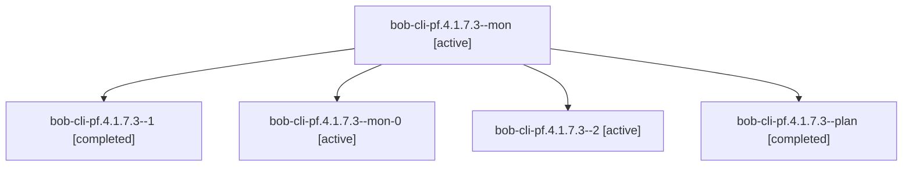

# Session: bob-cli-pf.4.1.7.3

[Agent Hoods](../README.md) / [bbugyi200](../users/bbugyi200/README.md) / [apollo](../users/bbugyi200/machines/apollo/README.md) / [bob-cli-pf](../users/bbugyi200/machines/apollo/hoods/bob-cli-pf/README.md) / bob-cli-pf.4.1.7.3

Owner: `bbugyi200.apollo` · Hood: `bob-cli-pf` · Members: 5 · Bead: [bob-cli-pf.4.1.7.3](https://github.com/bobs-org/bob-cli--beads/blob/main/pages/bob-cli-pf/bob-cli-pf.4.1.7.3.md)

## Lineage

The diagram is an optional enhancement; the ordered table below contains the same lineage in accessible text.

| Role | Agent | State | Model / provider | Timing | Commits | Prompt | Chat |
|---|---|---|---|---|---:|---|---|
| mon | bob-cli-pf.4.1.7.3--mon | active | gpt-6-astra / codex | 2026-11-23T10:38:12.858116+00:00 | 0 | — | — |
| 1 | bob-cli-pf.4.1.7.3--1 | completed | gpt-6-luna / codex | 2026-11-23T09:30:56.792284+00:00 → 2026-11-23T09:37:01.649159+00:00 | 0 | [Prompt](../agents/bbugyi200.apollo.bob-cli-pf.4.1.7.3--1/prompt.md) | [Chat](../agents/bbugyi200.apollo.bob-cli-pf.4.1.7.3--1/chat.md) |
| mon-0 | bob-cli-pf.4.1.7.3--mon-0 | active | gpt-6-luna / codex | 2026-11-23T09:34:50.439297+00:00 | 0 | — | — |
| 2 | bob-cli-pf.4.1.7.3--2 | active | gpt-6-luna / codex | 20261123044019 | 0 | [Prompt](../agents/bbugyi200.apollo.bob-cli-pf.4.1.7.3--2/prompt.md) | — |
| plan | bob-cli-pf.4.1.7.3--plan | completed | gpt-6-astra / codex | 2026-11-23T10:26:54.421750+00:00 → 2026-11-23T10:40:19.566131+00:00 | 0 | [Prompt](../agents/bbugyi200.apollo.bob-cli-pf.4.1.7.3--plan/prompt.md) | [Chat](../agents/bbugyi200.apollo.bob-cli-pf.4.1.7.3--plan/chat.md) |

## Neighbors

| Agent | Relation | State |
|---|---|---|
| [bob-cli-pf.4](bbugyi200.apollo.bob-cli-pf.4.md) (session · 3) | ancestor | active 1, completed 2 |
| [bob-cli-pf.4.1.7.1](../agents/bbugyi200.apollo.bob-cli-pf.4.1.7.1/README.md) | bob-cli-pf.4.1.7 hood | completed |
| [bob-cli-pf.4.1.7.2](../agents/bbugyi200.apollo.bob-cli-pf.4.1.7.2/README.md) | bob-cli-pf.4.1.7 hood | completed |
| [bob-cli-pf.4.1.7.4](../agents/bbugyi200.apollo.bob-cli-pf.4.1.7.4/README.md) | bob-cli-pf.4.1.7 hood | waiting |
| [bob-cli-pf.4.1.7.land](../agents/bbugyi200.apollo.bob-cli-pf.4.1.7.land/README.md) | bob-cli-pf.4.1.7 hood | waiting |
| [bob-cli-pf.4.1.1](../agents/bbugyi200.apollo.bob-cli-pf.4.1.1/README.md) | bob-cli-pf.4.1 hood | completed |
| [bob-cli-pf.4.1.2](../agents/bbugyi200.apollo.bob-cli-pf.4.1.2/README.md) | bob-cli-pf.4.1 hood | completed |
| [bob-cli-pf.4.1.3](bbugyi200.apollo.bob-cli-pf.4.1.3.md) (session · 5) | bob-cli-pf.4.1 hood | completed 3, failed 2 |
| [bob-cli-pf.4.1.4](../agents/bbugyi200.apollo.bob-cli-pf.4.1.4/README.md) | bob-cli-pf.4.1 hood | completed |
| [bob-cli-pf.4.1.5](../agents/bbugyi200.apollo.bob-cli-pf.4.1.5/README.md) | bob-cli-pf.4.1 hood | completed |
| [bob-cli-pf.4.1.6](bbugyi200.apollo.bob-cli-pf.4.1.6.md) (session · 3) | bob-cli-pf.4.1 hood | completed 2, failed 1 |
| [bob-cli-pf.4.1.land](bbugyi200.apollo.bob-cli-pf.4.1.land.md) (session · 3) | bob-cli-pf.4.1 hood | active 1, completed 2 |
| [bob-cli-pf.1](bbugyi200.apollo.bob-cli-pf.1.md) (session · 3) | bob-cli-pf hood | active 1, completed 2 |
| [bob-cli-pf.1.1.1](bbugyi200.apollo.bob-cli-pf.1.1.1.md) (session · 13) | bob-cli-pf hood | completed 7, failed 6 |
| [bob-cli-pf.1.1.2](../agents/bbugyi200.apollo.bob-cli-pf.1.1.2/README.md) | bob-cli-pf hood | completed |
| [bob-cli-pf.1.1.3](../agents/bbugyi200.apollo.bob-cli-pf.1.1.3/README.md) | bob-cli-pf hood | completed |
| [bob-cli-pf.1.1.4](bbugyi200.apollo.bob-cli-pf.1.1.4.md) (session · 7) | bob-cli-pf hood | completed 4, failed 3 |
| [bob-cli-pf.1.1.5](../agents/bbugyi200.apollo.bob-cli-pf.1.1.5/README.md) | bob-cli-pf hood | completed |
| [bob-cli-pf.1.1.land](bbugyi200.apollo.bob-cli-pf.1.1.land.md) (session · 3) | bob-cli-pf hood | completed 3 |
| [bob-cli-pf.2](bbugyi200.apollo.bob-cli-pf.2.md) (session · 3) | bob-cli-pf hood | active 1, completed 2 |
| [bob-cli-pf.2.1.1](bbugyi200.apollo.bob-cli-pf.2.1.1.md) (session · 3) | bob-cli-pf hood | completed 3 |
| [bob-cli-pf.2.1.2](bbugyi200.apollo.bob-cli-pf.2.1.2.md) (session · 5) | bob-cli-pf hood | completed 4, failed 1 |
| [bob-cli-pf.2.1.3](../agents/bbugyi200.apollo.bob-cli-pf.2.1.3/README.md) | bob-cli-pf hood | completed |
| [bob-cli-pf.2.1.land](bbugyi200.apollo.bob-cli-pf.2.1.land.md) (session · 3) | bob-cli-pf hood | completed 3 |
| [bob-cli-pf.3](../agents/bbugyi200.apollo.bob-cli-pf.3/README.md) | bob-cli-pf hood | completed |
| [bob-cli-pf.5](../agents/bbugyi200.apollo.bob-cli-pf.5/README.md) | bob-cli-pf hood | waiting |
| [bob-cli-pf.6](../agents/bbugyi200.apollo.bob-cli-pf.6/README.md) | bob-cli-pf hood | waiting |
| [bob-cli-pf.land](../agents/bbugyi200.apollo.bob-cli-pf.land/README.md) | bob-cli-pf hood | waiting |
