# Session: bob-cli-pf.4.1.7.3

[Agent Hoods](../README.md) / [bbugyi200](../users/bbugyi200/README.md) / [apollo](../users/bbugyi200/machines/apollo/README.md) / [bob-cli-pf](../users/bbugyi200/machines/apollo/hoods/bob-cli-pf/README.md) / bob-cli-pf.4.1.7.3

Owner: `bbugyi200.apollo` · Hood: `bob-cli-pf` · Members: 12 · Bead: [bob-cli-pf.4.1.7.3](https://github.com/bobs-org/bob-cli--beads/blob/main/pages/bob-cli-pf/bob-cli-pf.4.1.7.3.md)

## Lineage

```mermaid
flowchart TD
  n0["bob-cli-pf.4.1.7.3--mon-3 [failed]"]
  n1["bob-cli-pf.4.1.7.3--5 [completed]"]
  n0 --> n1
  n2["bob-cli-pf.4.1.7.3--4 [completed]"]
  n0 --> n2
  n3["bob-cli-pf.4.1.7.3--2 [completed]"]
  n0 --> n3
  n4["bob-cli-pf.4.1.7.3--1 [completed]"]
  n0 --> n4
  n5["bob-cli-pf.4.1.7.3--3 [completed]"]
  n0 --> n5
  n6["bob-cli-pf.4.1.7.3--mon-1 [failed]"]
  n0 --> n6
  n7["bob-cli-pf.4.1.7.3--mon-2 [failed]"]
  n0 --> n7
  n8["bob-cli-pf.4.1.7.3--mon [failed]"]
  n0 --> n8
  n9["bob-cli-pf.4.1.7.3--mon-0 [failed]"]
  n0 --> n9
  n10["bob-cli-pf.4.1.7.3--mon-4 [active]"]
  n0 --> n10
  n11["bob-cli-pf.4.1.7.3--plan [completed]"]
  n0 --> n11
```



The diagram is an optional enhancement; the ordered table below contains the same lineage in accessible text.

| Role | Agent | State | Model / provider | Timing | Commits | Prompt | Chat |
|---|---|---|---|---|---:|---|---|
| <a id="member-mon-3"></a>mon-3 | bob-cli-pf.4.1.7.3--mon-3 | failed | gpt-6-astra / codex | 2026-11-23T12:08:47.303599+00:00 → 2026-11-23T12:32:27.531090+00:00 | 0 | — | [Chat](../agents/bbugyi200.apollo.bob-cli-pf.4.1.7.3--mon-3/chat.md) |
| <a id="member-5"></a>5 | bob-cli-pf.4.1.7.3--5 | completed | gpt-6-astra / codex | 2026-11-23T12:32:27.168870+00:00 → 2026-11-23T12:40:19.389358+00:00 | 0 | [Prompt](../agents/bbugyi200.apollo.bob-cli-pf.4.1.7.3--5/prompt.md) | [Chat](../agents/bbugyi200.apollo.bob-cli-pf.4.1.7.3--5/chat.md) |
| <a id="member-4"></a>4 | bob-cli-pf.4.1.7.3--4 | completed | gpt-6-astra / codex | 2026-11-23T11:53:22.746085+00:00 → 2026-11-23T12:12:55.464636+00:00 | [1](../agents/bbugyi200.apollo.bob-cli-pf.4.1.7.3--4/README.md#commits) | [Prompt](../agents/bbugyi200.apollo.bob-cli-pf.4.1.7.3--4/prompt.md) | [Chat](../agents/bbugyi200.apollo.bob-cli-pf.4.1.7.3--4/chat.md) |
| <a id="member-2"></a>2 | bob-cli-pf.4.1.7.3--2 | completed | gpt-6-astra / codex | 2026-11-23T11:01:09.339852+00:00 → 2026-11-23T11:22:14.856997+00:00 | 0 | [Prompt](../agents/bbugyi200.apollo.bob-cli-pf.4.1.7.3--2/prompt.md) | [Chat](../agents/bbugyi200.apollo.bob-cli-pf.4.1.7.3--2/chat.md) |
| <a id="member-1"></a>1 | bob-cli-pf.4.1.7.3--1 | completed | gpt-6-astra / codex | 2026-11-23T10:48:37.143312+00:00 → 2026-11-23T10:55:51.575873+00:00 | 0 | [Prompt](../agents/bbugyi200.apollo.bob-cli-pf.4.1.7.3--1/prompt.md) | [Chat](../agents/bbugyi200.apollo.bob-cli-pf.4.1.7.3--1/chat.md) |
| <a id="member-3"></a>3 | bob-cli-pf.4.1.7.3--3 | completed | gpt-6-astra / codex | 2026-11-23T11:31:13.421284+00:00 → 2026-11-23T11:44:32.446542+00:00 | 0 | [Prompt](../agents/bbugyi200.apollo.bob-cli-pf.4.1.7.3--3/prompt.md) | [Chat](../agents/bbugyi200.apollo.bob-cli-pf.4.1.7.3--3/chat.md) |
| <a id="member-mon-1"></a>mon-1 | bob-cli-pf.4.1.7.3--mon-1 | failed | gpt-6-astra / codex | 2026-11-23T11:20:02.469753+00:00 → 2026-11-23T11:31:13.840390+00:00 | 0 | — | [Chat](../agents/bbugyi200.apollo.bob-cli-pf.4.1.7.3--mon-1/chat.md) |
| <a id="member-mon-2"></a>mon-2 | bob-cli-pf.4.1.7.3--mon-2 | failed | gpt-6-astra / codex | 2026-11-23T11:42:28.005354+00:00 → 2026-11-23T11:53:23.229752+00:00 | 0 | — | [Chat](../agents/bbugyi200.apollo.bob-cli-pf.4.1.7.3--mon-2/chat.md) |
| <a id="member-mon"></a>mon | bob-cli-pf.4.1.7.3--mon | failed | gpt-6-astra / codex | 2026-11-23T10:38:12.858116+00:00 → 2026-11-23T10:48:37.319341+00:00 | 0 | — | [Chat](../agents/bbugyi200.apollo.bob-cli-pf.4.1.7.3--mon/chat.md) |
| <a id="member-mon-0"></a>mon-0 | bob-cli-pf.4.1.7.3--mon-0 | failed | gpt-6-astra / codex | 2026-11-23T10:53:47.534694+00:00 → 2026-11-23T11:01:09.835672+00:00 | 0 | — | [Chat](../agents/bbugyi200.apollo.bob-cli-pf.4.1.7.3--mon-0/chat.md) |
| <a id="member-mon-4"></a>mon-4 | bob-cli-pf.4.1.7.3--mon-4 | active | gpt-6-astra / codex | 2026-11-23T12:38:10.026759+00:00 | 0 | — | — |
| <a id="member-plan"></a>plan | bob-cli-pf.4.1.7.3--plan | completed | gpt-6-astra / codex | 2026-11-23T10:26:54.421750+00:00 → 2026-11-23T10:40:19.566131+00:00 | 0 | [Prompt](../agents/bbugyi200.apollo.bob-cli-pf.4.1.7.3--plan/prompt.md) | [Chat](../agents/bbugyi200.apollo.bob-cli-pf.4.1.7.3--plan/chat.md) |

## Commits

| Role | Repo | Commit | Subject | Committed |
|---|---|---|---|---|
| 4 | bob-cli | [`de66b39`](https://github.com/bobs-org/bob-cli/commit/de66b399e4d9a9837989687ec172217b32d4238f) | fix(props): resolve canonical record ownership through its album folder | 2026-11-23 07:10:01 EST |

## Variables

| Role | Variable | Value |
|---|---|---|
| 2 | `artifacts` | \[{bead: bob-cli-pf.4.1.7.3, kind: image, label: Property editor loading shell visual diagnostic, path: /home/bryan/.sase/artifacts/agents/gh\_bobs-org\_\_bob-cli/20261123060023/property-editor-first-wri… |

#### artifacts

**Role:** `2`

```yaml
- bead: bob-cli-pf.4.1.7.3
  kind: image
  label: Property editor loading shell visual diagnostic
  path: /home/bryan/.sase/artifacts/agents/gh_bobs-org__bob-cli/20261123060023/property-editor-first-write-native-8fa6304b1bde.png
  ref: file:explicit:7e12d43d0c85a1341586ae16
  source_path: /home/bryan/.local/state/sase/workspaces/bobs-org/bob-cli/bob-cli_10/.git/property-editor-first-write-native.png
- bead: bob-cli-pf.4.1.7.3
  kind: image
  label: Property editor saved shell visual diagnostic
  path: /home/bryan/.sase/artifacts/agents/gh_bobs-org__bob-cli/20261123060023/property-editor-first-write-settled-dd36247baf5d.png
  ref: file:explicit:8f50ead937709232d964a1c2
  source_path: /home/bryan/.local/state/sase/workspaces/bobs-org/bob-cli/bob-cli_10/.git/property-editor-first-write-settled.png
```

Values are truncated for display; see each member's agent meta.json for the full values.

## Neighbors

| Agent | Relation | State |
|---|---|---|
| [bob-cli-pf.4](bbugyi200.apollo.bob-cli-pf.4.md) (session · 3) | ancestor | active 1, completed 2 |
| [bob-cli-pf.4.1.7.1](../agents/bbugyi200.apollo.bob-cli-pf.4.1.7.1/README.md) | bob-cli-pf.4.1.7 hood | completed |
| [bob-cli-pf.4.1.7.2](../agents/bbugyi200.apollo.bob-cli-pf.4.1.7.2/README.md) | bob-cli-pf.4.1.7 hood | completed |
| [bob-cli-pf.4.1.7.4](../agents/bbugyi200.apollo.bob-cli-pf.4.1.7.4/README.md) | bob-cli-pf.4.1.7 hood | waiting |
| [bob-cli-pf.4.1.7.land](../agents/bbugyi200.apollo.bob-cli-pf.4.1.7.land/README.md) | bob-cli-pf.4.1.7 hood | waiting |
| [bob-cli-pf.4.1.1](../agents/bbugyi200.apollo.bob-cli-pf.4.1.1/README.md) | bob-cli-pf.4.1 hood | completed |
| [bob-cli-pf.4.1.2](../agents/bbugyi200.apollo.bob-cli-pf.4.1.2/README.md) | bob-cli-pf.4.1 hood | completed |
| [bob-cli-pf.4.1.3](bbugyi200.apollo.bob-cli-pf.4.1.3.md) (session · 5) | bob-cli-pf.4.1 hood | completed 3, failed 2 |
| [bob-cli-pf.4.1.4](../agents/bbugyi200.apollo.bob-cli-pf.4.1.4/README.md) | bob-cli-pf.4.1 hood | completed |
| [bob-cli-pf.4.1.5](../agents/bbugyi200.apollo.bob-cli-pf.4.1.5/README.md) | bob-cli-pf.4.1 hood | completed |
| [bob-cli-pf.4.1.6](bbugyi200.apollo.bob-cli-pf.4.1.6.md) (session · 3) | bob-cli-pf.4.1 hood | completed 2, failed 1 |
| [bob-cli-pf.4.1.land](bbugyi200.apollo.bob-cli-pf.4.1.land.md) (session · 3) | bob-cli-pf.4.1 hood | active 1, completed 2 |
| [bob-cli-pf.1](bbugyi200.apollo.bob-cli-pf.1.md) (session · 3) | bob-cli-pf hood | active 1, completed 2 |
| [bob-cli-pf.1.1.1](bbugyi200.apollo.bob-cli-pf.1.1.1.md) (session · 13) | bob-cli-pf hood | completed 7, failed 6 |
| [bob-cli-pf.1.1.2](../agents/bbugyi200.apollo.bob-cli-pf.1.1.2/README.md) | bob-cli-pf hood | completed |
| [bob-cli-pf.1.1.3](../agents/bbugyi200.apollo.bob-cli-pf.1.1.3/README.md) | bob-cli-pf hood | completed |
| [bob-cli-pf.1.1.4](bbugyi200.apollo.bob-cli-pf.1.1.4.md) (session · 7) | bob-cli-pf hood | completed 4, failed 3 |
| [bob-cli-pf.1.1.5](../agents/bbugyi200.apollo.bob-cli-pf.1.1.5/README.md) | bob-cli-pf hood | completed |
| [bob-cli-pf.1.1.land](bbugyi200.apollo.bob-cli-pf.1.1.land.md) (session · 3) | bob-cli-pf hood | completed 3 |
| [bob-cli-pf.2](bbugyi200.apollo.bob-cli-pf.2.md) (session · 3) | bob-cli-pf hood | active 1, completed 2 |
| [bob-cli-pf.2.1.1](bbugyi200.apollo.bob-cli-pf.2.1.1.md) (session · 3) | bob-cli-pf hood | completed 3 |
| [bob-cli-pf.2.1.2](bbugyi200.apollo.bob-cli-pf.2.1.2.md) (session · 5) | bob-cli-pf hood | completed 4, failed 1 |
| [bob-cli-pf.2.1.3](../agents/bbugyi200.apollo.bob-cli-pf.2.1.3/README.md) | bob-cli-pf hood | completed |
| [bob-cli-pf.2.1.land](bbugyi200.apollo.bob-cli-pf.2.1.land.md) (session · 3) | bob-cli-pf hood | completed 3 |
| [bob-cli-pf.3](../agents/bbugyi200.apollo.bob-cli-pf.3/README.md) | bob-cli-pf hood | completed |
| [bob-cli-pf.5](../agents/bbugyi200.apollo.bob-cli-pf.5/README.md) | bob-cli-pf hood | waiting |
| [bob-cli-pf.6](../agents/bbugyi200.apollo.bob-cli-pf.6/README.md) | bob-cli-pf hood | waiting |
| [bob-cli-pf.land](../agents/bbugyi200.apollo.bob-cli-pf.land/README.md) | bob-cli-pf hood | waiting |
