# Session: bob-cli-pf.4.1.7.4

[Agent Hoods](../README.md) / [bbugyi200](../users/bbugyi200/README.md) / [apollo](../users/bbugyi200/machines/apollo/README.md) / [bob-cli-pf](../users/bbugyi200/machines/apollo/hoods/bob-cli-pf/README.md) / bob-cli-pf.4.1.7.4

Owner: `bbugyi200.apollo` · Hood: `bob-cli-pf` · Members: 21 · Bead: [bob-cli-pf.4.1.7.4](https://github.com/bobs-org/bob-cli--beads/blob/main/pages/bob-cli-pf/bob-cli-pf.4.1.7.4.md)

## Lineage

```mermaid
flowchart TD
  n0["bob-cli-pf.4.1.7.4--mon-2 [failed]"]
  n1["bob-cli-pf.4.1.7.4--5 [completed]"]
  n0 --> n1
  n2["bob-cli-pf.4.1.7.4--3 [completed]"]
  n0 --> n2
  n3["bob-cli-pf.4.1.7.4--plan [completed]"]
  n0 --> n3
  n4["bob-cli-pf.4.1.7.4--9 [completed]"]
  n0 --> n4
  n5["bob-cli-pf.4.1.7.4--mon [failed]"]
  n0 --> n5
  n6["bob-cli-pf.4.1.7.4--7 [completed]"]
  n0 --> n6
  n7["bob-cli-pf.4.1.7.4--a [active]"]
  n0 --> n7
  n8["bob-cli-pf.4.1.7.4--mon-7 [failed]"]
  n0 --> n8
  n9["bob-cli-pf.4.1.7.4--mon-5 [failed]"]
  n0 --> n9
  n10["bob-cli-pf.4.1.7.4--mon-1 [failed]"]
  n0 --> n10
  n11["bob-cli-pf.4.1.7.4--2 [completed]"]
  n0 --> n11
  n12["bob-cli-pf.4.1.7.4--8 [completed]"]
  n0 --> n12
  n13["bob-cli-pf.4.1.7.4--mon-6 [failed]"]
  n0 --> n13
  n14["bob-cli-pf.4.1.7.4--mon-0 [failed]"]
  n0 --> n14
  n15["bob-cli-pf.4.1.7.4--1 [completed]"]
  n0 --> n15
  n16["bob-cli-pf.4.1.7.4--6 [completed]"]
  n0 --> n16
  n17["bob-cli-pf.4.1.7.4--mon-8 [completed]"]
  n0 --> n17
  n18["bob-cli-pf.4.1.7.4--mon-4 [failed]"]
  n0 --> n18
  n19["bob-cli-pf.4.1.7.4--mon-3 [failed]"]
  n0 --> n19
  n20["bob-cli-pf.4.1.7.4--4 [completed]"]
  n0 --> n20
```

The diagram is an optional enhancement; the ordered table below contains the same lineage in accessible text.

| Role | Agent | State | Model / provider | Timing | Commits | Prompt | Chat |
|---|---|---|---|---|---:|---|---|
| mon-2 | bob-cli-pf.4.1.7.4--mon-2 | failed | grok-4.6 / grok | 2026-11-23T14:44:11.286359+00:00 → 2026-11-23T14:49:49.660162+00:00 | 0 | — | [Chat](../agents/bbugyi200.apollo.bob-cli-pf.4.1.7.4--mon-2/chat.md) |
| 5 | bob-cli-pf.4.1.7.4--5 | completed | grok-4.6 / grok | 2026-11-23T15:00:47.641687+00:00 → 2026-11-23T15:07:46.690914+00:00 | 0 | [Prompt](../agents/bbugyi200.apollo.bob-cli-pf.4.1.7.4--5/prompt.md) | [Chat](../agents/bbugyi200.apollo.bob-cli-pf.4.1.7.4--5/chat.md) |
| 3 | bob-cli-pf.4.1.7.4--3 | completed | grok-4.6 / grok | 2026-11-23T14:35:50.495230+00:00 → 2026-11-23T14:46:40.280710+00:00 | 0 | [Prompt](../agents/bbugyi200.apollo.bob-cli-pf.4.1.7.4--3/prompt.md) | [Chat](../agents/bbugyi200.apollo.bob-cli-pf.4.1.7.4--3/chat.md) |
| plan | bob-cli-pf.4.1.7.4--plan | completed | grok-4.6 / grok | 2026-11-23T13:21:38.032847+00:00 → 2026-11-23T14:02:03.699355+00:00 | 0 | [Prompt](../agents/bbugyi200.apollo.bob-cli-pf.4.1.7.4--plan/prompt.md) | [Chat](../agents/bbugyi200.apollo.bob-cli-pf.4.1.7.4--plan/chat.md) |
| 9 | bob-cli-pf.4.1.7.4--9 | completed | grok-4.6 / grok | 2026-11-23T15:48:15.379319+00:00 → 2026-11-23T15:57:30.816590+00:00 | 0 | [Prompt](../agents/bbugyi200.apollo.bob-cli-pf.4.1.7.4--9/prompt.md) | [Chat](../agents/bbugyi200.apollo.bob-cli-pf.4.1.7.4--9/chat.md) |
| mon | bob-cli-pf.4.1.7.4--mon | failed | grok-4.6 / grok | 2026-11-23T13:59:21.384788+00:00 → 2026-11-23T14:05:20.849893+00:00 | 0 | — | [Chat](../agents/bbugyi200.apollo.bob-cli-pf.4.1.7.4--mon/chat.md) |
| 7 | bob-cli-pf.4.1.7.4--7 | completed | grok-4.6 / grok | 2026-11-23T15:21:29.385624+00:00 → 2026-11-23T15:33:28.495329+00:00 | 0 | [Prompt](../agents/bbugyi200.apollo.bob-cli-pf.4.1.7.4--7/prompt.md) | [Chat](../agents/bbugyi200.apollo.bob-cli-pf.4.1.7.4--7/chat.md) |
| a | bob-cli-pf.4.1.7.4--a | active | grok-4.6 / grok | 2026-11-23T16:00:34.765889+00:00 | 0 | [Prompt](../agents/bbugyi200.apollo.bob-cli-pf.4.1.7.4--a/prompt.md) | — |
| mon-7 | bob-cli-pf.4.1.7.4--mon-7 | failed | grok-4.6 / grok | 2026-11-23T15:43:10.398794+00:00 → 2026-11-23T15:48:15.500007+00:00 | 0 | — | [Chat](../agents/bbugyi200.apollo.bob-cli-pf.4.1.7.4--mon-7/chat.md) |
| mon-5 | bob-cli-pf.4.1.7.4--mon-5 | failed | grok-4.6 / grok | 2026-11-23T15:15:43.059351+00:00 → 2026-11-23T15:21:29.806693+00:00 | 0 | — | [Chat](../agents/bbugyi200.apollo.bob-cli-pf.4.1.7.4--mon-5/chat.md) |
| mon-1 | bob-cli-pf.4.1.7.4--mon-1 | failed | grok-4.6 / grok | 2026-11-23T14:24:40.030832+00:00 → 2026-11-23T14:30:53.869761+00:00 | 0 | — | [Chat](../agents/bbugyi200.apollo.bob-cli-pf.4.1.7.4--mon-1/chat.md) |
| 2 | bob-cli-pf.4.1.7.4--2 | completed | grok-4.6 / grok | 2026-11-23T14:16:58.876630+00:00 → 2026-11-23T14:27:40.092028+00:00 | 0 | [Prompt](../agents/bbugyi200.apollo.bob-cli-pf.4.1.7.4--2/prompt.md) | [Chat](../agents/bbugyi200.apollo.bob-cli-pf.4.1.7.4--2/chat.md) |
| 8 | bob-cli-pf.4.1.7.4--8 | completed | grok-4.6 / grok | 2026-11-23T15:36:10.579138+00:00 → 2026-11-23T15:45:34.962479+00:00 | 0 | [Prompt](../agents/bbugyi200.apollo.bob-cli-pf.4.1.7.4--8/prompt.md) | [Chat](../agents/bbugyi200.apollo.bob-cli-pf.4.1.7.4--8/chat.md) |
| mon-6 | bob-cli-pf.4.1.7.4--mon-6 | failed | grok-4.6 / grok | 2026-11-23T15:30:54.782825+00:00 → 2026-11-23T15:36:11.064817+00:00 | 0 | — | [Chat](../agents/bbugyi200.apollo.bob-cli-pf.4.1.7.4--mon-6/chat.md) |
| mon-0 | bob-cli-pf.4.1.7.4--mon-0 | failed | grok-4.6 / grok | 2026-11-23T14:10:34.497594+00:00 → 2026-11-23T14:16:59.236268+00:00 | 0 | — | [Chat](../agents/bbugyi200.apollo.bob-cli-pf.4.1.7.4--mon-0/chat.md) |
| 1 | bob-cli-pf.4.1.7.4--1 | completed | grok-4.6 / grok | 2026-11-23T14:05:20.548692+00:00 → 2026-11-23T14:11:45.531384+00:00 | 0 | [Prompt](../agents/bbugyi200.apollo.bob-cli-pf.4.1.7.4--1/prompt.md) | [Chat](../agents/bbugyi200.apollo.bob-cli-pf.4.1.7.4--1/chat.md) |
| 6 | bob-cli-pf.4.1.7.4--6 | completed | grok-4.6 / grok | 2026-11-23T15:10:43.653874+00:00 → 2026-11-23T15:18:24.343987+00:00 | 0 | [Prompt](../agents/bbugyi200.apollo.bob-cli-pf.4.1.7.4--6/prompt.md) | [Chat](../agents/bbugyi200.apollo.bob-cli-pf.4.1.7.4--6/chat.md) |
| mon-8 | bob-cli-pf.4.1.7.4--mon-8 | completed | grok-4.6 / grok | 2026-11-23T15:55:03.669262+00:00 → 2026-11-23T16:00:35.255155+00:00 | 0 | — | [Chat](../agents/bbugyi200.apollo.bob-cli-pf.4.1.7.4--mon-8/chat.md) |
| mon-4 | bob-cli-pf.4.1.7.4--mon-4 | failed | grok-4.6 / grok | 2026-11-23T15:05:14.043163+00:00 → 2026-11-23T15:10:44.023404+00:00 | 0 | — | [Chat](../agents/bbugyi200.apollo.bob-cli-pf.4.1.7.4--mon-4/chat.md) |
| mon-3 | bob-cli-pf.4.1.7.4--mon-3 | failed | grok-4.6 / grok | 2026-11-23T14:55:28.583876+00:00 → 2026-11-23T15:00:47.994790+00:00 | 0 | — | [Chat](../agents/bbugyi200.apollo.bob-cli-pf.4.1.7.4--mon-3/chat.md) |
| 4 | bob-cli-pf.4.1.7.4--4 | completed | grok-4.6 / grok | 2026-11-23T14:49:49.365625+00:00 → 2026-11-23T14:58:01.911714+00:00 | 0 | [Prompt](../agents/bbugyi200.apollo.bob-cli-pf.4.1.7.4--4/prompt.md) | [Chat](../agents/bbugyi200.apollo.bob-cli-pf.4.1.7.4--4/chat.md) |

## Neighbors

| Agent | Relation | State |
|---|---|---|
| [bob-cli-pf.4](bbugyi200.apollo.bob-cli-pf.4.md) (session · 3) | ancestor | active 1, completed 2 |
| [bob-cli-pf.4.1.7.1](../agents/bbugyi200.apollo.bob-cli-pf.4.1.7.1/README.md) | bob-cli-pf.4.1.7 hood | completed |
| [bob-cli-pf.4.1.7.2](../agents/bbugyi200.apollo.bob-cli-pf.4.1.7.2/README.md) | bob-cli-pf.4.1.7 hood | completed |
| [bob-cli-pf.4.1.7.3](bbugyi200.apollo.bob-cli-pf.4.1.7.3.md) (session · 13) | bob-cli-pf.4.1.7 hood | completed 7, failed 6 |
| [bob-cli-pf.4.1.7.land](../agents/bbugyi200.apollo.bob-cli-pf.4.1.7.land/README.md) | bob-cli-pf.4.1.7 hood | waiting |
| [bob-cli-pf.4.1.1](../agents/bbugyi200.apollo.bob-cli-pf.4.1.1/README.md) | bob-cli-pf.4.1 hood | completed |
| [bob-cli-pf.4.1.2](../agents/bbugyi200.apollo.bob-cli-pf.4.1.2/README.md) | bob-cli-pf.4.1 hood | completed |
| [bob-cli-pf.4.1.3](bbugyi200.apollo.bob-cli-pf.4.1.3.md) (session · 5) | bob-cli-pf.4.1 hood | completed 3, failed 2 |
| [bob-cli-pf.4.1.4](../agents/bbugyi200.apollo.bob-cli-pf.4.1.4/README.md) | bob-cli-pf.4.1 hood | completed |
| [bob-cli-pf.4.1.5](../agents/bbugyi200.apollo.bob-cli-pf.4.1.5/README.md) | bob-cli-pf.4.1 hood | completed |
| [bob-cli-pf.4.1.6](bbugyi200.apollo.bob-cli-pf.4.1.6.md) (session · 3) | bob-cli-pf.4.1 hood | completed 2, failed 1 |
| [bob-cli-pf.4.1.land](bbugyi200.apollo.bob-cli-pf.4.1.land.md) (session · 3) | bob-cli-pf.4.1 hood | active 1, completed 2 |
| [bob-cli-pf.1](bbugyi200.apollo.bob-cli-pf.1.md) (session · 3) | bob-cli-pf hood | active 1, completed 2 |
| [bob-cli-pf.1.1.1](bbugyi200.apollo.bob-cli-pf.1.1.1.md) (session · 13) | bob-cli-pf hood | completed 7, failed 6 |
| [bob-cli-pf.1.1.2](../agents/bbugyi200.apollo.bob-cli-pf.1.1.2/README.md) | bob-cli-pf hood | completed |
| [bob-cli-pf.1.1.3](../agents/bbugyi200.apollo.bob-cli-pf.1.1.3/README.md) | bob-cli-pf hood | completed |
| [bob-cli-pf.1.1.4](bbugyi200.apollo.bob-cli-pf.1.1.4.md) (session · 7) | bob-cli-pf hood | completed 4, failed 3 |
| [bob-cli-pf.1.1.5](../agents/bbugyi200.apollo.bob-cli-pf.1.1.5/README.md) | bob-cli-pf hood | completed |
| [bob-cli-pf.1.1.land](bbugyi200.apollo.bob-cli-pf.1.1.land.md) (session · 3) | bob-cli-pf hood | completed 3 |
| [bob-cli-pf.2](bbugyi200.apollo.bob-cli-pf.2.md) (session · 3) | bob-cli-pf hood | active 1, completed 2 |
| [bob-cli-pf.2.1.1](bbugyi200.apollo.bob-cli-pf.2.1.1.md) (session · 3) | bob-cli-pf hood | completed 3 |
| [bob-cli-pf.2.1.2](bbugyi200.apollo.bob-cli-pf.2.1.2.md) (session · 5) | bob-cli-pf hood | completed 4, failed 1 |
| [bob-cli-pf.2.1.3](../agents/bbugyi200.apollo.bob-cli-pf.2.1.3/README.md) | bob-cli-pf hood | completed |
| [bob-cli-pf.2.1.land](bbugyi200.apollo.bob-cli-pf.2.1.land.md) (session · 3) | bob-cli-pf hood | completed 3 |
| [bob-cli-pf.3](../agents/bbugyi200.apollo.bob-cli-pf.3/README.md) | bob-cli-pf hood | completed |
| [bob-cli-pf.5](../agents/bbugyi200.apollo.bob-cli-pf.5/README.md) | bob-cli-pf hood | waiting |
| [bob-cli-pf.6](../agents/bbugyi200.apollo.bob-cli-pf.6/README.md) | bob-cli-pf hood | waiting |
| [bob-cli-pf.land](../agents/bbugyi200.apollo.bob-cli-pf.land/README.md) | bob-cli-pf hood | waiting |
