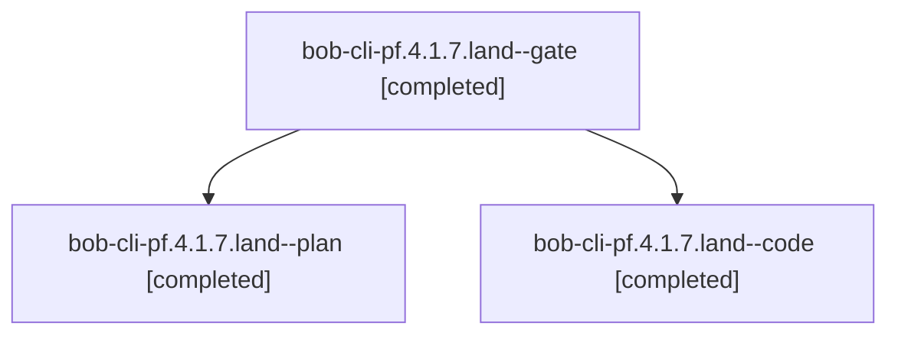

# Session: bob-cli-pf.4.1.7.land

[Agent Hoods](../README.md) / [bbugyi200](../users/bbugyi200/README.md) / [apollo](../users/bbugyi200/machines/apollo/README.md) / [bob-cli-pf](../users/bbugyi200/machines/apollo/hoods/bob-cli-pf/README.md) / bob-cli-pf.4.1.7.land

Owner: `bbugyi200.apollo` · Hood: `bob-cli-pf` · Members: 3 · Bead: [bob-cli-pf.4.1.7](https://github.com/bobs-org/bob-cli--beads/blob/main/pages/bob-cli-pf/bob-cli-pf.4.1.7.md)

## Lineage



The diagram is an optional enhancement; the ordered table below contains the same lineage in accessible text.

| Role | Agent | State | Model / provider | Timing | Commits | Prompt | Chat |
|---|---|---|---|---|---:|---|---|
| <a id="member-gate"></a>gate | bob-cli-pf.4.1.7.land--gate | completed | gpt-6-astra / codex | 2026-11-23T16:33:15.669788+00:00 → 2026-11-23T16:33:23.675686+00:00 | 0 | — | [Chat](../agents/bbugyi200.apollo.bob-cli-pf.4.1.7.land--gate/chat.md) |
| <a id="member-plan"></a>plan | bob-cli-pf.4.1.7.land--plan | completed | gpt-6-astra / codex | 2026-11-23T16:21:04.352456+00:00 → 2026-11-23T17:37:40.292843+00:00 | 0 | [Prompt](../agents/bbugyi200.apollo.bob-cli-pf.4.1.7.land--plan/prompt.md) | [Chat](../agents/bbugyi200.apollo.bob-cli-pf.4.1.7.land--plan/chat.md) |
| <a id="member-code"></a>code | bob-cli-pf.4.1.7.land--code | completed | grok-4.6 / grok | 2026-11-23T16:34:04.482593+00:00 → 2026-11-23T17:37:40.292843+00:00 | 0 | — | [Chat](../agents/bbugyi200.apollo.bob-cli-pf.4.1.7.land--code/chat.md) |

## Variables

| Role | Variable | Value |
|---|---|---|
| code | `artifacts` | \[{bead: bob-cli-pf.4.1.7, kind: file, label: Property editor YAML-Done raw athena report, path: /home/bryan/.sase/artifacts/agents/gh\_bobs-org\_\_bob-cli/20261123113333/property-editor-e2e-054eb4752efb… |

#### artifacts

**Role:** `code`

```yaml
- bead: bob-cli-pf.4.1.7
  kind: file
  label: Property editor YAML-Done raw athena report
  path: /home/bryan/.sase/artifacts/agents/gh_bobs-org__bob-cli/20261123113333/property-editor-e2e-054eb4752efb.json
  ref: file:explicit:100794501f510b52e4d301a2
  source_path: /tmp/pf417-e2e/property-editor-e2e.json
- bead: bob-cli-pf.4.1.7
  kind: file
  label: Property editor YAML-Done reviewed athena report
  path: /home/bryan/.sase/artifacts/agents/gh_bobs-org__bob-cli/20261123113333/property-editor-e2e-reviewed-968ccf7d013d.json
  ref: file:explicit:67292147c2af0fb1dbc34095
  source_path: /tmp/pf417-e2e/property-editor-e2e-reviewed.json
- bead: bob-cli-pf.4.1.7
  kind: image
  label: Property editor wide light screenshot
  path: /home/bryan/.sase/artifacts/agents/gh_bobs-org__bob-cli/20261123113333/property-editor-wide-light-0136fbed3ab9.png
  ref: file:explicit:fc123a59cb45c2d89a6be43e
  source_path: /tmp/pf417-e2e/property-editor-wide-light.png
- bead: bob-cli-pf.4.1.7
  kind: image
  label: Property editor wide dark screenshot
  path: /home/bryan/.sase/artifacts/agents/gh_bobs-org__bob-cli/20261123113333/property-editor-wide-dark-fbfee02eff43.png
  ref: file:explicit:bfad2cb954f520df8821b7b4
  source_path: /tmp/pf417-e2e/property-editor-wide-dark.png
- bead: bob-cli-pf.4.1.7
  kind: image
  label: Property editor narrow light screenshot
  path: /home/bryan/.sase/artifacts/agents/gh_bobs-org__bob-cli/20261123113333/property-editor-narrow-light-fb13a934f9ea.png
  ref: file:explicit:6613646d2f833b8c8fd3468b
  source_path: /tmp/pf417-e2e/property-editor-narrow-light.png
- bead: bob-cli-pf.4.1.7
  kind: image
  label: Property editor narrow dark screenshot
  path: /home/bryan/.sase/artifacts/agents/gh_bobs-org__bob-cli/20261123113333/property-editor-narrow-dark-9a58420c1316.png
  ref: file:explicit:3dd66eae5b7b4285c7d4a2db
  source_path: /tmp/pf417-e2e/property-editor-narrow-dark.png
```

Values are truncated for display; see each member's agent meta.json for the full values.

## Neighbors

| Agent | Relation | State |
|---|---|---|
| [bob-cli-pf.4](bbugyi200.apollo.bob-cli-pf.4.md) (session · 3) | ancestor | active 1, completed 2 |
| [bob-cli-pf.4.1.7.1](../agents/bbugyi200.apollo.bob-cli-pf.4.1.7.1/README.md) | bob-cli-pf.4.1.7 hood | completed |
| [bob-cli-pf.4.1.7.2](../agents/bbugyi200.apollo.bob-cli-pf.4.1.7.2/README.md) | bob-cli-pf.4.1.7 hood | completed |
| [bob-cli-pf.4.1.7.3](bbugyi200.apollo.bob-cli-pf.4.1.7.3.md) (session · 13) | bob-cli-pf.4.1.7 hood | completed 7, failed 6 |
| [bob-cli-pf.4.1.7.4](bbugyi200.apollo.bob-cli-pf.4.1.7.4.md) (session · 21) | bob-cli-pf.4.1.7 hood | completed 12, failed 9 |
| [bob-cli-pf.4.1.1](../agents/bbugyi200.apollo.bob-cli-pf.4.1.1/README.md) | bob-cli-pf.4.1 hood | completed |
| [bob-cli-pf.4.1.2](../agents/bbugyi200.apollo.bob-cli-pf.4.1.2/README.md) | bob-cli-pf.4.1 hood | completed |
| [bob-cli-pf.4.1.3](bbugyi200.apollo.bob-cli-pf.4.1.3.md) (session · 5) | bob-cli-pf.4.1 hood | completed 3, failed 2 |
| [bob-cli-pf.4.1.4](../agents/bbugyi200.apollo.bob-cli-pf.4.1.4/README.md) | bob-cli-pf.4.1 hood | completed |
| [bob-cli-pf.4.1.5](../agents/bbugyi200.apollo.bob-cli-pf.4.1.5/README.md) | bob-cli-pf.4.1 hood | completed |
| [bob-cli-pf.4.1.6](bbugyi200.apollo.bob-cli-pf.4.1.6.md) (session · 3) | bob-cli-pf.4.1 hood | completed 2, failed 1 |
| [bob-cli-pf.4.1.land](bbugyi200.apollo.bob-cli-pf.4.1.land.md) (session · 3) | bob-cli-pf.4.1 hood | active 1, completed 2 |
| [bob-cli-pf.1](bbugyi200.apollo.bob-cli-pf.1.md) (session · 3) | bob-cli-pf hood | active 1, completed 2 |
| [bob-cli-pf.1.1.1](bbugyi200.apollo.bob-cli-pf.1.1.1.md) (session · 13) | bob-cli-pf hood | completed 7, failed 6 |
| [bob-cli-pf.1.1.2](../agents/bbugyi200.apollo.bob-cli-pf.1.1.2/README.md) | bob-cli-pf hood | completed |
| [bob-cli-pf.1.1.3](../agents/bbugyi200.apollo.bob-cli-pf.1.1.3/README.md) | bob-cli-pf hood | completed |
| [bob-cli-pf.1.1.4](bbugyi200.apollo.bob-cli-pf.1.1.4.md) (session · 7) | bob-cli-pf hood | completed 4, failed 3 |
| [bob-cli-pf.1.1.5](../agents/bbugyi200.apollo.bob-cli-pf.1.1.5/README.md) | bob-cli-pf hood | completed |
| [bob-cli-pf.1.1.land](bbugyi200.apollo.bob-cli-pf.1.1.land.md) (session · 3) | bob-cli-pf hood | completed 3 |
| [bob-cli-pf.2](bbugyi200.apollo.bob-cli-pf.2.md) (session · 3) | bob-cli-pf hood | active 1, completed 2 |
| [bob-cli-pf.2.1.1](bbugyi200.apollo.bob-cli-pf.2.1.1.md) (session · 3) | bob-cli-pf hood | completed 3 |
| [bob-cli-pf.2.1.2](bbugyi200.apollo.bob-cli-pf.2.1.2.md) (session · 5) | bob-cli-pf hood | completed 4, failed 1 |
| [bob-cli-pf.2.1.3](../agents/bbugyi200.apollo.bob-cli-pf.2.1.3/README.md) | bob-cli-pf hood | completed |
| [bob-cli-pf.2.1.land](bbugyi200.apollo.bob-cli-pf.2.1.land.md) (session · 3) | bob-cli-pf hood | completed 3 |
| [bob-cli-pf.3](../agents/bbugyi200.apollo.bob-cli-pf.3/README.md) | bob-cli-pf hood | completed |
| [bob-cli-pf.5](bbugyi200.apollo.bob-cli-pf.5.md) (session · 3) | bob-cli-pf hood | active 1, completed 2 |
| [bob-cli-pf.5.1.1](bbugyi200.apollo.bob-cli-pf.5.1.1.md) (session · 3) | bob-cli-pf hood | completed 3 |
| [bob-cli-pf.5.1.2](../agents/bbugyi200.apollo.bob-cli-pf.5.1.2/README.md) | bob-cli-pf hood | completed |
| [bob-cli-pf.5.1.3](../agents/bbugyi200.apollo.bob-cli-pf.5.1.3/README.md) | bob-cli-pf hood | completed |
| [bob-cli-pf.5.1.4](../agents/bbugyi200.apollo.bob-cli-pf.5.1.4/README.md) | bob-cli-pf hood | completed |
| [bob-cli-pf.5.1.5](../agents/bbugyi200.apollo.bob-cli-pf.5.1.5/README.md) | bob-cli-pf hood | completed |
| [bob-cli-pf.5.1.6](../agents/bbugyi200.apollo.bob-cli-pf.5.1.6/README.md) | bob-cli-pf hood | completed |
| [bob-cli-pf.5.1.7](../agents/bbugyi200.apollo.bob-cli-pf.5.1.7/README.md) | bob-cli-pf hood | completed |
| [bob-cli-pf.5.1.land](../agents/bbugyi200.apollo.bob-cli-pf.5.1.land/README.md) | bob-cli-pf hood | completed |
| [bob-cli-pf.6](bbugyi200.apollo.bob-cli-pf.6.md) (session · 3) | bob-cli-pf hood | active 1, completed 2 |
| [bob-cli-pf.6.1.1](../agents/bbugyi200.apollo.bob-cli-pf.6.1.1/README.md) | bob-cli-pf hood | completed |
| [bob-cli-pf.6.1.2](../agents/bbugyi200.apollo.bob-cli-pf.6.1.2/README.md) | bob-cli-pf hood | completed |
| [bob-cli-pf.6.1.3](../agents/bbugyi200.apollo.bob-cli-pf.6.1.3/README.md) | bob-cli-pf hood | completed |
| [bob-cli-pf.6.1.4](bbugyi200.apollo.bob-cli-pf.6.1.4.md) (session · 50) | bob-cli-pf hood | active 1, completed 25, failed 24 |
| [bob-cli-pf.6.1.5](../agents/bbugyi200.apollo.bob-cli-pf.6.1.5/README.md) | bob-cli-pf hood | waiting |
| [bob-cli-pf.6.1.land](../agents/bbugyi200.apollo.bob-cli-pf.6.1.land/README.md) | bob-cli-pf hood | waiting |
| [bob-cli-pf.land](../agents/bbugyi200.apollo.bob-cli-pf.land/README.md) | bob-cli-pf hood | waiting |
