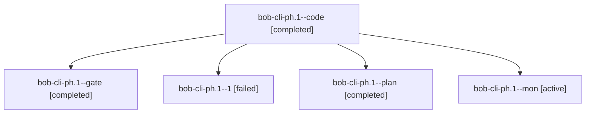

# Session: bob-cli-ph.1

[Agent Hoods](../README.md) / [bbugyi200](../users/bbugyi200/README.md) / [apollo](../users/bbugyi200/machines/apollo/README.md) / [bob-cli-ph](../users/bbugyi200/machines/apollo/hoods/bob-cli-ph/README.md) / bob-cli-ph.1

Owner: `bbugyi200.apollo` · Hood: `bob-cli-ph` · Members: 5 · Bead: [bob-cli-ph.1](https://github.com/bobs-org/bob-cli--beads/blob/main/pages/bob-cli-ph/bob-cli-ph.1.md)

## Lineage

The diagram is an optional enhancement; the ordered table below contains the same lineage in accessible text.

| Role | Agent | State | Model / provider | Timing | Commits | Prompt | Chat |
|---|---|---|---|---|---:|---|---|
| code | bob-cli-ph.1--code | completed | gpt-6-luna / codex | 2026-11-23T12:18:34.081436+00:00 → 2026-11-23T13:07:37.431328+00:00 | [1](../agents/bbugyi200.apollo.bob-cli-ph.1--code/README.md#commits) | — | [Chat](../agents/bbugyi200.apollo.bob-cli-ph.1--code/chat.md) |
| gate | bob-cli-ph.1--gate | completed | opus / claude | 2026-11-23T12:17:47.049569+00:00 → 2026-11-23T12:17:55.783760+00:00 | 0 | — | [Chat](../agents/bbugyi200.apollo.bob-cli-ph.1--gate/chat.md) |
| 1 | bob-cli-ph.1--1 | failed | gpt-6-astra / codex | 2026-11-23T08:38:15.099155+00:00 → 2026-11-23T08:47:39.085883+00:00 | 0 | [Prompt](../agents/bbugyi200.apollo.bob-cli-ph.1--1/prompt.md) | [Chat](../agents/bbugyi200.apollo.bob-cli-ph.1--1/chat.md) |
| plan | bob-cli-ph.1--plan | completed | opus / claude | 2026-11-23T12:07:09.026451+00:00 → 2026-11-23T13:07:37.431328+00:00 | 0 | [Prompt](../agents/bbugyi200.apollo.bob-cli-ph.1--plan/prompt.md) | [Chat](../agents/bbugyi200.apollo.bob-cli-ph.1--plan/chat.md) |
| mon | bob-cli-ph.1--mon | active | gpt-6-luna / codex | 2026-11-23T13:05:02.988973+00:00 | 0 | — | — |

## Commits

| Role | Repo | Commit | Subject | Committed |
|---|---|---|---|---|
| code | bob-cli | [`37b2080`](https://github.com/bobs-org/bob-cli/commit/37b2080e9efca170f542954f088ce4169d430cfa) | feat(drawers): add dual-read task drawer readers | 2026-11-23 08:06:21 EST |

## Neighbors

| Agent | Relation | State |
|---|---|---|
| [bob-cli-ph.10](../agents/bbugyi200.apollo.bob-cli-ph.10/README.md) | bob-cli-ph hood | waiting |
| [bob-cli-ph.11](../agents/bbugyi200.apollo.bob-cli-ph.11/README.md) | bob-cli-ph hood | waiting |
| [bob-cli-ph.2](../agents/bbugyi200.apollo.bob-cli-ph.2/README.md) | bob-cli-ph hood | waiting |
| [bob-cli-ph.3](../agents/bbugyi200.apollo.bob-cli-ph.3/README.md) | bob-cli-ph hood | waiting |
| [bob-cli-ph.4](../agents/bbugyi200.apollo.bob-cli-ph.4/README.md) | bob-cli-ph hood | waiting |
| [bob-cli-ph.5](../agents/bbugyi200.apollo.bob-cli-ph.5/README.md) | bob-cli-ph hood | waiting |
| [bob-cli-ph.6](../agents/bbugyi200.apollo.bob-cli-ph.6/README.md) | bob-cli-ph hood | waiting |
| [bob-cli-ph.7](../agents/bbugyi200.apollo.bob-cli-ph.7/README.md) | bob-cli-ph hood | waiting |
| [bob-cli-ph.8](../agents/bbugyi200.apollo.bob-cli-ph.8/README.md) | bob-cli-ph hood | waiting |
| [bob-cli-ph.9](../agents/bbugyi200.apollo.bob-cli-ph.9/README.md) | bob-cli-ph hood | waiting |
| [bob-cli-ph.land](../agents/bbugyi200.apollo.bob-cli-ph.land/README.md) | bob-cli-ph hood | waiting |
