# Session: bob-cli-ph.1

[Agent Hoods](../README.md) / [bbugyi200](../users/bbugyi200/README.md) / [apollo](../users/bbugyi200/machines/apollo/README.md) / [bob-cli-ph](../users/bbugyi200/machines/apollo/hoods/bob-cli-ph/README.md) / bob-cli-ph.1

Owner: `bbugyi200.apollo` · Hood: `bob-cli-ph` · Members: 31 · Bead: [bob-cli-ph.1](https://github.com/bobs-org/bob-cli--beads/blob/main/pages/bob-cli-ph/bob-cli-ph.1.md)

## Lineage

```mermaid
flowchart TD
  n0["bob-cli-ph.1--mon-c [completed]"]
  n1["bob-cli-ph.1--3 [completed]"]
  n0 --> n1
  n2["bob-cli-ph.1--code [completed]"]
  n0 --> n2
  n3["bob-cli-ph.1--9 [completed]"]
  n0 --> n3
  n4["bob-cli-ph.1--mon-5 [failed]"]
  n0 --> n4
  n5["bob-cli-ph.1--6 [completed]"]
  n0 --> n5
  n6["bob-cli-ph.1--mon-b [failed]"]
  n0 --> n6
  n7["bob-cli-ph.1--mon-7 [failed]"]
  n0 --> n7
  n8["bob-cli-ph.1--mon-4 [failed]"]
  n0 --> n8
  n9["bob-cli-ph.1--7 [completed]"]
  n0 --> n9
  n10["bob-cli-ph.1--mon-2 [failed]"]
  n0 --> n10
  n11["bob-cli-ph.1--mon-0 [failed]"]
  n0 --> n11
  n12["bob-cli-ph.1--8 [completed]"]
  n0 --> n12
  n13["bob-cli-ph.1--mon-a [failed]"]
  n0 --> n13
  n14["bob-cli-ph.1--5 [completed]"]
  n0 --> n14
  n15["bob-cli-ph.1--d [completed]"]
  n0 --> n15
  n16["bob-cli-ph.1--gate [completed]"]
  n0 --> n16
  n17["bob-cli-ph.1--mon-9 [failed]"]
  n0 --> n17
  n18["bob-cli-ph.1--c [completed]"]
  n0 --> n18
  n19["bob-cli-ph.1--e [completed]"]
  n0 --> n19
  n20["bob-cli-ph.1--mon-8 [completed]"]
  n0 --> n20
  n21["bob-cli-ph.1--mon-6 [failed]"]
  n0 --> n21
  n22["bob-cli-ph.1--mon-3 [failed]"]
  n0 --> n22
  n23["bob-cli-ph.1--2 [completed]"]
  n0 --> n23
  n24["bob-cli-ph.1--plan [completed]"]
  n0 --> n24
  n25["bob-cli-ph.1--mon [completed]"]
  n0 --> n25
  n26["bob-cli-ph.1--mon-1 [failed]"]
  n0 --> n26
  n27["bob-cli-ph.1--1 [completed]"]
  n0 --> n27
  n28["bob-cli-ph.1--a [completed]"]
  n0 --> n28
  n29["bob-cli-ph.1--4 [completed]"]
  n0 --> n29
  n30["bob-cli-ph.1--b [completed]"]
  n0 --> n30
```

The diagram is an optional enhancement; the ordered table below contains the same lineage in accessible text.

| Role | Agent | State | Model / provider | Timing | Commits | Prompt | Chat |
|---|---|---|---|---|---:|---|---|
| mon-c | bob-cli-ph.1--mon-c | completed | gpt-6-luna / codex | 2026-11-23T16:36:33.075835+00:00 → 2026-11-23T17:05:55.418407+00:00 | 0 | — | [Chat](../agents/bbugyi200.apollo.bob-cli-ph.1--mon-c/chat.md) |
| 3 | bob-cli-ph.1--3 | completed | gpt-6-luna / codex | 2026-11-23T13:53:58.799566+00:00 → 2026-11-23T14:02:17.569763+00:00 | 0 | [Prompt](../agents/bbugyi200.apollo.bob-cli-ph.1--3/prompt.md) | [Chat](../agents/bbugyi200.apollo.bob-cli-ph.1--3/chat.md) |
| code | bob-cli-ph.1--code | completed | gpt-6-luna / codex | 2026-11-23T12:18:34.081436+00:00 → 2026-11-23T13:07:37.431328+00:00 | [1](../agents/bbugyi200.apollo.bob-cli-ph.1--code/README.md#commits) | — | [Chat](../agents/bbugyi200.apollo.bob-cli-ph.1--code/chat.md) |
| 9 | bob-cli-ph.1--9 | completed | gpt-6-luna / codex | 2026-11-23T15:29:09.316390+00:00 → 2026-11-23T15:32:33.484208+00:00 | 0 | [Prompt](../agents/bbugyi200.apollo.bob-cli-ph.1--9/prompt.md) | [Chat](../agents/bbugyi200.apollo.bob-cli-ph.1--9/chat.md) |
| mon-5 | bob-cli-ph.1--mon-5 | failed | gpt-6-luna / codex | 2026-11-23T14:54:49.943297+00:00 → 2026-11-23T15:01:36.486312+00:00 | 0 | — | [Chat](../agents/bbugyi200.apollo.bob-cli-ph.1--mon-5/chat.md) |
| 6 | bob-cli-ph.1--6 | completed | gpt-6-luna / codex | 2026-11-23T14:50:38.581735+00:00 → 2026-11-23T14:56:10.445282+00:00 | 0 | [Prompt](../agents/bbugyi200.apollo.bob-cli-ph.1--6/prompt.md) | [Chat](../agents/bbugyi200.apollo.bob-cli-ph.1--6/chat.md) |
| mon-b | bob-cli-ph.1--mon-b | failed | gpt-6-luna / codex | 2026-11-23T16:10:48.694033+00:00 → 2026-11-23T16:31:45.798134+00:00 | 0 | — | [Chat](../agents/bbugyi200.apollo.bob-cli-ph.1--mon-b/chat.md) |
| mon-7 | bob-cli-ph.1--mon-7 | failed | gpt-6-luna / codex | 2026-11-23T15:17:15.611749+00:00 → 2026-11-23T15:29:09.550539+00:00 | 0 | — | [Chat](../agents/bbugyi200.apollo.bob-cli-ph.1--mon-7/chat.md) |
| mon-4 | bob-cli-ph.1--mon-4 | failed | gpt-6-luna / codex | 2026-11-23T14:47:42.337799+00:00 → 2026-11-23T14:50:39.018031+00:00 | 0 | — | [Chat](../agents/bbugyi200.apollo.bob-cli-ph.1--mon-4/chat.md) |
| 7 | bob-cli-ph.1--7 | completed | gpt-6-luna / codex | 2026-11-23T15:01:36.040028+00:00 → 2026-11-23T15:09:36.096727+00:00 | 0 | [Prompt](../agents/bbugyi200.apollo.bob-cli-ph.1--7/prompt.md) | [Chat](../agents/bbugyi200.apollo.bob-cli-ph.1--7/chat.md) |
| mon-2 | bob-cli-ph.1--mon-2 | failed | gpt-6-luna / codex | 2026-11-23T14:01:04.202567+00:00 → 2026-11-23T14:03:48.345619+00:00 | 0 | — | [Chat](../agents/bbugyi200.apollo.bob-cli-ph.1--mon-2/chat.md) |
| mon-0 | bob-cli-ph.1--mon-0 | failed | gpt-6-luna / codex | 2026-11-23T13:26:49.619865+00:00 → 2026-11-23T13:33:37.812989+00:00 | 0 | — | [Chat](../agents/bbugyi200.apollo.bob-cli-ph.1--mon-0/chat.md) |
| 8 | bob-cli-ph.1--8 | completed | gpt-6-luna / codex | 2026-11-23T15:14:57.120790+00:00 → 2026-11-23T15:18:43.178388+00:00 | 0 | [Prompt](../agents/bbugyi200.apollo.bob-cli-ph.1--8/prompt.md) | [Chat](../agents/bbugyi200.apollo.bob-cli-ph.1--8/chat.md) |
| mon-a | bob-cli-ph.1--mon-a | failed | gpt-6-luna / codex | 2026-11-23T15:56:36.817720+00:00 → 2026-11-23T16:08:51.451509+00:00 | 0 | — | [Chat](../agents/bbugyi200.apollo.bob-cli-ph.1--mon-a/chat.md) |
| 5 | bob-cli-ph.1--5 | completed | gpt-6-luna / codex | 2026-11-23T14:35:54.076545+00:00 → 2026-11-23T14:48:54.961753+00:00 | 0 | [Prompt](../agents/bbugyi200.apollo.bob-cli-ph.1--5/prompt.md) | [Chat](../agents/bbugyi200.apollo.bob-cli-ph.1--5/chat.md) |
| d | bob-cli-ph.1--d | completed | gpt-6-luna / codex | 2026-11-23T16:31:45.327029+00:00 → 2026-11-23T16:39:47.221716+00:00 | 0 | [Prompt](../agents/bbugyi200.apollo.bob-cli-ph.1--d/prompt.md) | [Chat](../agents/bbugyi200.apollo.bob-cli-ph.1--d/chat.md) |
| gate | bob-cli-ph.1--gate | completed | opus / claude | 2026-11-23T12:17:47.049569+00:00 → 2026-11-23T12:17:55.783760+00:00 | 0 | — | [Chat](../agents/bbugyi200.apollo.bob-cli-ph.1--gate/chat.md) |
| mon-9 | bob-cli-ph.1--mon-9 | failed | gpt-6-luna / codex | 2026-11-23T15:36:20.434691+00:00 → 2026-11-23T15:52:51.477786+00:00 | 0 | — | [Chat](../agents/bbugyi200.apollo.bob-cli-ph.1--mon-9/chat.md) |
| c | bob-cli-ph.1--c | completed | gpt-6-luna / codex | 2026-11-23T16:08:51.271046+00:00 → 2026-11-23T16:11:39.297397+00:00 | 0 | [Prompt](../agents/bbugyi200.apollo.bob-cli-ph.1--c/prompt.md) | [Chat](../agents/bbugyi200.apollo.bob-cli-ph.1--c/chat.md) |
| e | bob-cli-ph.1--e | completed | gpt-6-luna / codex | 2026-11-23T17:08:03.472263+00:00 → 2026-11-23T17:15:11.229956+00:00 | [1](../agents/bbugyi200.apollo.bob-cli-ph.1--e/README.md#commits) | [Prompt](../agents/bbugyi200.apollo.bob-cli-ph.1--e/prompt.md) | [Chat](../agents/bbugyi200.apollo.bob-cli-ph.1--e/chat.md) |
| mon-8 | bob-cli-ph.1--mon-8 | completed | gpt-6-luna / codex | 2026-11-23T15:31:42.700225+00:00 → 2026-11-23T15:34:03.054761+00:00 | 0 | — | [Chat](../agents/bbugyi200.apollo.bob-cli-ph.1--mon-8/chat.md) |
| mon-6 | bob-cli-ph.1--mon-6 | failed | gpt-6-luna / codex | 2026-11-23T15:08:34.671850+00:00 → 2026-11-23T15:14:57.531373+00:00 | 0 | — | [Chat](../agents/bbugyi200.apollo.bob-cli-ph.1--mon-6/chat.md) |
| mon-3 | bob-cli-ph.1--mon-3 | failed | gpt-6-luna / codex | 2026-11-23T14:21:04.589318+00:00 → 2026-11-23T14:28:59.456491+00:00 | 0 | — | [Chat](../agents/bbugyi200.apollo.bob-cli-ph.1--mon-3/chat.md) |
| 2 | bob-cli-ph.1--2 | completed | gpt-6-luna / codex | 2026-11-23T13:33:37.770078+00:00 → 2026-11-23T13:52:36.288139+00:00 | 0 | [Prompt](../agents/bbugyi200.apollo.bob-cli-ph.1--2/prompt.md) | [Chat](../agents/bbugyi200.apollo.bob-cli-ph.1--2/chat.md) |
| plan | bob-cli-ph.1--plan | completed | opus / claude | 2026-11-23T12:07:09.026451+00:00 → 2026-11-23T13:07:37.431328+00:00 | 0 | [Prompt](../agents/bbugyi200.apollo.bob-cli-ph.1--plan/prompt.md) | [Chat](../agents/bbugyi200.apollo.bob-cli-ph.1--plan/chat.md) |
| mon | bob-cli-ph.1--mon | completed | gpt-6-luna / codex | 2026-11-23T13:05:02.988973+00:00 → 2026-11-23T13:13:37.678300+00:00 | 0 | — | [Chat](../agents/bbugyi200.apollo.bob-cli-ph.1--mon/chat.md) |
| mon-1 | bob-cli-ph.1--mon-1 | failed | gpt-6-luna / codex | 2026-11-23T13:51:32.889434+00:00 → 2026-11-23T13:53:59.046341+00:00 | 0 | — | [Chat](../agents/bbugyi200.apollo.bob-cli-ph.1--mon-1/chat.md) |
| 1 | bob-cli-ph.1--1 | completed | gpt-6-luna / codex | 2026-11-23T13:21:40.333789+00:00 → 2026-11-23T13:27:46.540938+00:00 | 0 | [Prompt](../agents/bbugyi200.apollo.bob-cli-ph.1--1/prompt.md) | [Chat](../agents/bbugyi200.apollo.bob-cli-ph.1--1/chat.md) |
| a | bob-cli-ph.1--a | completed | gpt-6-luna / codex | 2026-11-23T15:34:03.003695+00:00 → 2026-11-23T15:37:32.211022+00:00 | 0 | [Prompt](../agents/bbugyi200.apollo.bob-cli-ph.1--a/prompt.md) | [Chat](../agents/bbugyi200.apollo.bob-cli-ph.1--a/chat.md) |
| 4 | bob-cli-ph.1--4 | completed | gpt-6-luna / codex | 2026-11-23T14:03:48.156595+00:00 → 2026-11-23T14:22:01.932724+00:00 | 0 | [Prompt](../agents/bbugyi200.apollo.bob-cli-ph.1--4/prompt.md) | [Chat](../agents/bbugyi200.apollo.bob-cli-ph.1--4/chat.md) |
| b | bob-cli-ph.1--b | completed | gpt-6-luna / codex | 2026-11-23T15:52:51.061743+00:00 → 2026-11-23T15:57:53.216739+00:00 | 0 | [Prompt](../agents/bbugyi200.apollo.bob-cli-ph.1--b/prompt.md) | [Chat](../agents/bbugyi200.apollo.bob-cli-ph.1--b/chat.md) |

## Commits

| Role | Repo | Commit | Subject | Committed |
|---|---|---|---|---|
| code | bob-cli | [`37b2080`](https://github.com/bobs-org/bob-cli/commit/37b2080e9efca170f542954f088ce4169d430cfa) | feat(drawers): add dual-read task drawer readers | 2026-11-23 08:06:21 EST |
| e | bob-cli | [`c25d92f`](https://github.com/bobs-org/bob-cli/commit/c25d92fdd4e2c4073ec1a24bda34251fae8eded9) | feat(capture): add task drawer contracts and docs | 2026-11-23 12:14:15 EST |

## Neighbors

| Agent | Relation | State |
|---|---|---|
| [bob-cli-ph.10](../agents/bbugyi200.apollo.bob-cli-ph.10/README.md) | bob-cli-ph hood | waiting |
| [bob-cli-ph.11](../agents/bbugyi200.apollo.bob-cli-ph.11/README.md) | bob-cli-ph hood | waiting |
| [bob-cli-ph.2](bbugyi200.apollo.bob-cli-ph.2.md) (session · 7) | bob-cli-ph hood | active 1, completed 5, failed 1 |
| [bob-cli-ph.3](bbugyi200.apollo.bob-cli-ph.3.md) (session · 2) | bob-cli-ph hood | active 1, completed 1 |
| [bob-cli-ph.3](../agents/bbugyi200.apollo.bob-cli-ph.3/README.md) | bob-cli-ph hood | completed |
| [bob-cli-ph.4](../agents/bbugyi200.apollo.bob-cli-ph.4/README.md) | bob-cli-ph hood | completed |
| [bob-cli-ph.5](bbugyi200.apollo.bob-cli-ph.5.md) (session · 3) | bob-cli-ph hood | completed 3 |
| [bob-cli-ph.6](bbugyi200.apollo.bob-cli-ph.6.md) (session · 3) | bob-cli-ph hood | active 1, completed 2 |
| [bob-cli-ph.6.1.1](../agents/bbugyi200.apollo.bob-cli-ph.6.1.1/README.md) | bob-cli-ph hood | completed |
| [bob-cli-ph.6.1.2](../agents/bbugyi200.apollo.bob-cli-ph.6.1.2/README.md) | bob-cli-ph hood | completed |
| [bob-cli-ph.6.1.3](../agents/bbugyi200.apollo.bob-cli-ph.6.1.3/README.md) | bob-cli-ph hood | completed |
| [bob-cli-ph.6.1.4](../agents/bbugyi200.apollo.bob-cli-ph.6.1.4/README.md) | bob-cli-ph hood | completed |
| [bob-cli-ph.6.1.5](bbugyi200.apollo.bob-cli-ph.6.1.5.md) (session · 3) | bob-cli-ph hood | completed 2, failed 1 |
| [bob-cli-ph.6.1.land](../agents/bbugyi200.apollo.bob-cli-ph.6.1.land/README.md) | bob-cli-ph hood | completed |
| [bob-cli-ph.7](bbugyi200.apollo.bob-cli-ph.7.md) (session · 3) | bob-cli-ph hood | active 1, completed 2 |
| [bob-cli-ph.7.1.1](../agents/bbugyi200.apollo.bob-cli-ph.7.1.1/README.md) | bob-cli-ph hood | completed |
| [bob-cli-ph.7.1.2](bbugyi200.apollo.bob-cli-ph.7.1.2.md) (session · 9) | bob-cli-ph hood | completed 6, failed 3 |
| [bob-cli-ph.7.1.3](../agents/bbugyi200.apollo.bob-cli-ph.7.1.3/README.md) | bob-cli-ph hood | completed |
| [bob-cli-ph.7.1.4](../agents/bbugyi200.apollo.bob-cli-ph.7.1.4/README.md) | bob-cli-ph hood | completed |
| [bob-cli-ph.7.1.land](bbugyi200.apollo.bob-cli-ph.7.1.land.md) (session · 17) | bob-cli-ph hood | active 1, completed 13, failed 3 |
| [bob-cli-ph.8](bbugyi200.apollo.bob-cli-ph.8.md) (session · 3) | bob-cli-ph hood | active 2, completed 1 |
| [bob-cli-ph.9](../agents/bbugyi200.apollo.bob-cli-ph.9/README.md) | bob-cli-ph hood | waiting |
| [bob-cli-ph.land](../agents/bbugyi200.apollo.bob-cli-ph.land/README.md) | bob-cli-ph hood | waiting |
