# Session: bob-cli-ph.10

[Agent Hoods](../README.md) / [bbugyi200](../users/bbugyi200/README.md) / [apollo](../users/bbugyi200/machines/apollo/README.md) / [bob-cli-ph](../users/bbugyi200/machines/apollo/hoods/bob-cli-ph/README.md) / bob-cli-ph.10

Owner: `bbugyi200.apollo` · Hood: `bob-cli-ph` · Members: 16 · Bead: [bob-cli-ph.10](https://github.com/bobs-org/bob-cli--beads/blob/main/pages/bob-cli-ph/bob-cli-ph.10.md)

## Lineage

```mermaid
flowchart TD
  n0["bob-cli-ph.10--1 [completed]"]
  n1["bob-cli-ph.10--mon-2 [failed]"]
  n0 --> n1
  n2["bob-cli-ph.10--4 [completed]"]
  n0 --> n2
  n3["bob-cli-ph.10--7 [completed]"]
  n0 --> n3
  n4["bob-cli-ph.10--3 [completed]"]
  n0 --> n4
  n5["bob-cli-ph.10--mon [failed]"]
  n0 --> n5
  n6["bob-cli-ph.10--5 [completed]"]
  n0 --> n6
  n7["bob-cli-ph.10--mon-0 [failed]"]
  n0 --> n7
  n8["bob-cli-ph.10--mon-5 [failed]"]
  n0 --> n8
  n9["bob-cli-ph.10--mon-6 [failed]"]
  n0 --> n9
  n10["bob-cli-ph.10--mon-4 [failed]"]
  n0 --> n10
  n11["bob-cli-ph.10--2 [completed]"]
  n0 --> n11
  n12["bob-cli-ph.10--plan [completed]"]
  n0 --> n12
  n13["bob-cli-ph.10--6 [completed]"]
  n0 --> n13
  n14["bob-cli-ph.10--mon-1 [failed]"]
  n0 --> n14
  n15["bob-cli-ph.10--mon-3 [failed]"]
  n0 --> n15
```

The diagram is an optional enhancement; the ordered table below contains the same lineage in accessible text.

| Role | Agent | State | Model / provider | Timing | Commits | Prompt | Chat |
|---|---|---|---|---|---:|---|---|
| 1 | bob-cli-ph.10--1 | completed | gpt-6-luna / codex | 2026-11-26T02:58:09.435985+00:00 → 2026-11-26T03:23:09.824642+00:00 | [1](../agents/bbugyi200.apollo.bob-cli-ph.10--1/README.md#commits) | [Prompt](../agents/bbugyi200.apollo.bob-cli-ph.10--1/prompt.md) | [Chat](../agents/bbugyi200.apollo.bob-cli-ph.10--1/chat.md) |
| mon-2 | bob-cli-ph.10--mon-2 | failed | gpt-6-luna / codex | 2026-11-26T03:50:22.422566+00:00 → 2026-11-26T04:04:33.253193+00:00 | 0 | — | [Chat](../agents/bbugyi200.apollo.bob-cli-ph.10--mon-2/chat.md) |
| 4 | bob-cli-ph.10--4 | completed | gpt-6-luna / codex | 2026-11-26T04:04:33.020800+00:00 → 2026-11-26T04:12:54.316788+00:00 | 0 | [Prompt](../agents/bbugyi200.apollo.bob-cli-ph.10--4/prompt.md) | [Chat](../agents/bbugyi200.apollo.bob-cli-ph.10--4/chat.md) |
| 7 | bob-cli-ph.10--7 | completed | gpt-6-luna / codex | 2026-11-26T05:48:57.359616+00:00 → 2026-11-26T05:52:54.795820+00:00 | 0 | [Prompt](../agents/bbugyi200.apollo.bob-cli-ph.10--7/prompt.md) | [Chat](../agents/bbugyi200.apollo.bob-cli-ph.10--7/chat.md) |
| 3 | bob-cli-ph.10--3 | completed | gpt-6-luna / codex | 2026-11-26T03:46:35.195197+00:00 → 2026-11-26T03:52:52.078718+00:00 | [1](../agents/bbugyi200.apollo.bob-cli-ph.10--3/README.md#commits) | [Prompt](../agents/bbugyi200.apollo.bob-cli-ph.10--3/prompt.md) | [Chat](../agents/bbugyi200.apollo.bob-cli-ph.10--3/chat.md) |
| mon | bob-cli-ph.10--mon | failed | gpt-6-luna / codex | 2026-11-26T02:50:06.174628+00:00 → 2026-11-26T02:58:09.803094+00:00 | 0 | — | [Chat](../agents/bbugyi200.apollo.bob-cli-ph.10--mon/chat.md) |
| 5 | bob-cli-ph.10--5 | completed | gpt-6-luna / codex | 2026-11-26T04:37:24.584784+00:00 → 2026-11-26T04:59:28.501306+00:00 | [1](../agents/bbugyi200.apollo.bob-cli-ph.10--5/README.md#commits) | [Prompt](../agents/bbugyi200.apollo.bob-cli-ph.10--5/prompt.md) | [Chat](../agents/bbugyi200.apollo.bob-cli-ph.10--5/chat.md) |
| mon-0 | bob-cli-ph.10--mon-0 | failed | gpt-6-luna / codex | 2026-11-26T03:16:24.217828+00:00 → 2026-11-26T03:28:26.696207+00:00 | 0 | — | [Chat](../agents/bbugyi200.apollo.bob-cli-ph.10--mon-0/chat.md) |
| mon-5 | bob-cli-ph.10--mon-5 | failed | gpt-6-luna / codex | 2026-11-26T04:52:52.831525+00:00 → 2026-11-26T05:21:13.053501+00:00 | 0 | — | [Chat](../agents/bbugyi200.apollo.bob-cli-ph.10--mon-5/chat.md) |
| mon-6 | bob-cli-ph.10--mon-6 | failed | gpt-6-luna / codex | 2026-11-26T05:24:04.089261+00:00 → 2026-11-26T05:48:57.494138+00:00 | 0 | — | [Chat](../agents/bbugyi200.apollo.bob-cli-ph.10--mon-6/chat.md) |
| mon-4 | bob-cli-ph.10--mon-4 | failed | gpt-6-luna / codex | 2026-11-26T04:10:15.926184+00:00 → 2026-11-26T04:37:24.762853+00:00 | 0 | — | [Chat](../agents/bbugyi200.apollo.bob-cli-ph.10--mon-4/chat.md) |
| 2 | bob-cli-ph.10--2 | completed | gpt-6-luna / codex | 2026-11-26T03:30:32.022884+00:00 → 2026-11-26T03:38:29.076946+00:00 | [1](../agents/bbugyi200.apollo.bob-cli-ph.10--2/README.md#commits) | [Prompt](../agents/bbugyi200.apollo.bob-cli-ph.10--2/prompt.md) | [Chat](../agents/bbugyi200.apollo.bob-cli-ph.10--2/chat.md) |
| plan | bob-cli-ph.10--plan | completed | gpt-6-luna / codex | 2026-11-26T01:53:03.644076+00:00 → 2026-11-26T02:54:28.913904+00:00 | [1](../agents/bbugyi200.apollo.bob-cli-ph.10--plan/README.md#commits) | [Prompt](../agents/bbugyi200.apollo.bob-cli-ph.10--plan/prompt.md) | [Chat](../agents/bbugyi200.apollo.bob-cli-ph.10--plan/chat.md) |
| 6 | bob-cli-ph.10--6 | completed | gpt-6-luna / codex | 2026-11-26T05:21:12.916030+00:00 → 2026-11-26T05:25:14.542115+00:00 | 0 | [Prompt](../agents/bbugyi200.apollo.bob-cli-ph.10--6/prompt.md) | [Chat](../agents/bbugyi200.apollo.bob-cli-ph.10--6/chat.md) |
| mon-1 | bob-cli-ph.10--mon-1 | failed | gpt-6-luna / codex | 2026-11-26T03:35:53.996216+00:00 → 2026-11-26T03:46:36.110816+00:00 | 0 | — | [Chat](../agents/bbugyi200.apollo.bob-cli-ph.10--mon-1/chat.md) |
| mon-3 | bob-cli-ph.10--mon-3 | failed | gpt-6-luna / codex | 2026-11-26T04:09:29.262450+00:00 → 2026-11-26T04:09:32.132536+00:00 | 0 | — | — |

## Commits

| Role | Repo | Commit | Subject | Committed |
|---|---|---|---|---|
| plan | bob-cli | [`9573ff8`](https://github.com/bobs-org/bob-cli/commit/9573ff869fbef177ff041e78bcf28ddac85a71be) | feat: retire all-caps task drawer recognition | 2026-11-25 21:51:35 EST |
| 1 | bob-cli | [`46aba67`](https://github.com/bobs-org/bob-cli/commit/46aba67724194df951bf2c23132f15861d2351ec) | fix(drawers): restore rename flow and complete bold-only cutover verification | 2026-11-25 22:21:33 EST |
| 2 | bob-cli | [`5d5509d`](https://github.com/bobs-org/bob-cli/commit/5d5509de4f27f4042eccf52b1c0f6171e43e88d9) | fix(capture): update drawer parser test fixtures | 2026-11-25 22:36:58 EST |
| 3 | bob-cli | [`d820323`](https://github.com/bobs-org/bob-cli/commit/d8203235ac54ac416160d34f5e4080499315bbfe) | fix(capture): borrow parsed drawer kind in record fixture | 2026-11-25 22:51:25 EST |
| 5 | bob-cli | [`c3a9bdd`](https://github.com/bobs-org/bob-cli/commit/c3a9bdd9088399cf4da683b6a0cfccb515fcb68e) | test(drawers): migrate task-requirements fixture vectors to bold headers | 2026-11-25 23:54:14 EST |
| — | bob-cli | [`1d6df8d`](https://github.com/bobs-org/bob-cli/commit/1d6df8d1dbf6087210f6546c3b798edfaaa29ef5) | docs(drawers): clarify preview marker compatibility after cutover | 2026-11-26 03:56:51 EST |

## Neighbors

| Agent | Relation | State |
|---|---|---|
| [bob-cli-ph.1](bbugyi200.apollo.bob-cli-ph.1.md) (session · 31) | bob-cli-ph hood | completed 20, failed 11 |
| [bob-cli-ph.11](../agents/bbugyi200.apollo.bob-cli-ph.11/README.md) | bob-cli-ph hood | completed |
| [bob-cli-ph.2](bbugyi200.apollo.bob-cli-ph.2.md) (session · 7) | bob-cli-ph hood | active 1, completed 5, failed 1 |
| [bob-cli-ph.3](bbugyi200.apollo.bob-cli-ph.3.md) (session · 2) | bob-cli-ph hood | active 1, completed 1 |
| [bob-cli-ph.3](../agents/bbugyi200.apollo.bob-cli-ph.3/README.md) | bob-cli-ph hood | completed |
| [bob-cli-ph.4](../agents/bbugyi200.apollo.bob-cli-ph.4/README.md) | bob-cli-ph hood | completed |
| [bob-cli-ph.5](bbugyi200.apollo.bob-cli-ph.5.md) (session · 3) | bob-cli-ph hood | completed 3 |
| [bob-cli-ph.6](bbugyi200.apollo.bob-cli-ph.6.md) (session · 3) | bob-cli-ph hood | active 1, completed 2 |
| [bob-cli-ph.6.1.1](../agents/bbugyi200.apollo.bob-cli-ph.6.1.1/README.md) | bob-cli-ph hood | completed |
| [bob-cli-ph.6.1.2](../agents/bbugyi200.apollo.bob-cli-ph.6.1.2/README.md) | bob-cli-ph hood | completed |
| [bob-cli-ph.6.1.3](../agents/bbugyi200.apollo.bob-cli-ph.6.1.3/README.md) | bob-cli-ph hood | completed |
| [bob-cli-ph.6.1.4](../agents/bbugyi200.apollo.bob-cli-ph.6.1.4/README.md) | bob-cli-ph hood | completed |
| [bob-cli-ph.6.1.5](bbugyi200.apollo.bob-cli-ph.6.1.5.md) (session · 3) | bob-cli-ph hood | completed 2, failed 1 |
| [bob-cli-ph.6.1.land](../agents/bbugyi200.apollo.bob-cli-ph.6.1.land/README.md) | bob-cli-ph hood | completed |
| [bob-cli-ph.7](bbugyi200.apollo.bob-cli-ph.7.md) (session · 3) | bob-cli-ph hood | active 1, completed 2 |
| [bob-cli-ph.7.1.1](../agents/bbugyi200.apollo.bob-cli-ph.7.1.1/README.md) | bob-cli-ph hood | completed |
| [bob-cli-ph.7.1.2](bbugyi200.apollo.bob-cli-ph.7.1.2.md) (session · 9) | bob-cli-ph hood | completed 6, failed 3 |
| [bob-cli-ph.7.1.3](../agents/bbugyi200.apollo.bob-cli-ph.7.1.3/README.md) | bob-cli-ph hood | completed |
| [bob-cli-ph.7.1.4](../agents/bbugyi200.apollo.bob-cli-ph.7.1.4/README.md) | bob-cli-ph hood | completed |
| [bob-cli-ph.7.1.land](bbugyi200.apollo.bob-cli-ph.7.1.land.md) (session · 17) | bob-cli-ph hood | completed 14, failed 3 |
| [bob-cli-ph.8](bbugyi200.apollo.bob-cli-ph.8.md) (session · 7) | bob-cli-ph hood | active 1, completed 6 |
| [bob-cli-ph.8.1.1](bbugyi200.apollo.bob-cli-ph.8.1.1.md) (session · 9) | bob-cli-ph hood | completed 7, failed 2 |
| [bob-cli-ph.8.1.2](bbugyi200.apollo.bob-cli-ph.8.1.2.md) (session · 7) | bob-cli-ph hood | completed 5, failed 2 |
| [bob-cli-ph.8.1.3](bbugyi200.apollo.bob-cli-ph.8.1.3.md) (session · 3) | bob-cli-ph hood | completed 2, failed 1 |
| [bob-cli-ph.8.1.4](bbugyi200.apollo.bob-cli-ph.8.1.4.md) (session · 3) | bob-cli-ph hood | completed 2, failed 1 |
| [bob-cli-ph.8.1.5](bbugyi200.apollo.bob-cli-ph.8.1.5.md) (session · 7) | bob-cli-ph hood | completed 5, failed 2 |
| [bob-cli-ph.8.1.6](bbugyi200.apollo.bob-cli-ph.8.1.6.md) (session · 3) | bob-cli-ph hood | completed 2, failed 1 |
| [bob-cli-ph.8.1.land](bbugyi200.apollo.bob-cli-ph.8.1.land.md) (session · 13) | bob-cli-ph hood | completed 10, failed 3 |
| [bob-cli-ph.9](bbugyi200.apollo.bob-cli-ph.9.md) (session · 3) | bob-cli-ph hood | completed 3 |
| [bob-cli-ph.land](bbugyi200.apollo.bob-cli-ph.land.md) (session · 3) | bob-cli-ph hood | active 2, completed 1 |
