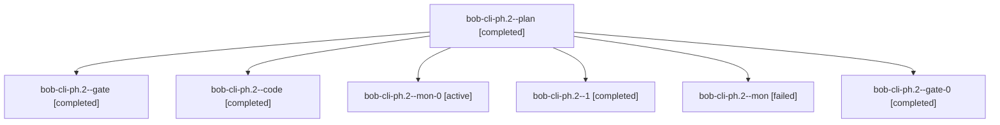

# Session: bob-cli-ph.2

[Agent Hoods](../README.md) / [bbugyi200](../users/bbugyi200/README.md) / [apollo](../users/bbugyi200/machines/apollo/README.md) / [bob-cli-ph](../users/bbugyi200/machines/apollo/hoods/bob-cli-ph/README.md) / bob-cli-ph.2

Owner: `bbugyi200.apollo` · Hood: `bob-cli-ph` · Members: 7 · Bead: [bob-cli-ph.2](https://github.com/bobs-org/bob-cli--beads/blob/main/pages/bob-cli-ph/bob-cli-ph.2.md)

## Lineage



The diagram is an optional enhancement; the ordered table below contains the same lineage in accessible text.

| Role | Agent | State | Model / provider | Timing | Commits | Prompt | Chat |
|---|---|---|---|---|---:|---|---|
| <a id="member-plan"></a>plan | bob-cli-ph.2--plan | completed | gpt-6-astra / codex | 2026-11-23T21:04:14.140984+00:00 → 2026-11-23T21:52:55.893378+00:00 | 0 | [Prompt](../agents/bbugyi200.apollo.bob-cli-ph.2--plan/prompt.md) | [Chat](../agents/bbugyi200.apollo.bob-cli-ph.2--plan/chat.md) |
| <a id="member-gate"></a>gate | bob-cli-ph.2--gate | completed | gpt-6-astra / codex | 2026-11-23T21:11:23.488306+00:00 → 2026-11-23T21:11:31.988519+00:00 | 0 | — | [Chat](../agents/bbugyi200.apollo.bob-cli-ph.2--gate/chat.md) |
| <a id="member-code"></a>code | bob-cli-ph.2--code | completed | grok-4.6 / grok | 2026-11-23T21:15:08.045717+00:00 → 2026-11-23T21:52:55.893378+00:00 | 0 | — | [Chat](../agents/bbugyi200.apollo.bob-cli-ph.2--code/chat.md) |
| <a id="member-mon-0"></a>mon-0 | bob-cli-ph.2--mon-0 | active | gpt-6-luna / codex | 2026-11-23T18:19:44.098936+00:00 | 0 | — | — |
| <a id="member-1"></a>1 | bob-cli-ph.2--1 | completed | grok-4.6 / grok | 2026-11-23T23:16:29.114134+00:00 → 2026-11-23T23:32:31.431572+00:00 | 0 | [Prompt](../agents/bbugyi200.apollo.bob-cli-ph.2--1/prompt.md) | [Chat](../agents/bbugyi200.apollo.bob-cli-ph.2--1/chat.md) |
| <a id="member-mon"></a>mon | bob-cli-ph.2--mon | failed | gpt-6-luna / codex | 2026-11-23T18:02:59.843500+00:00 → 2026-11-23T18:13:06.843160+00:00 | 0 | — | [Chat](../agents/bbugyi200.apollo.bob-cli-ph.2--mon/chat.md) |
| <a id="member-gate-0"></a>gate-0 | bob-cli-ph.2--gate-0 | completed | grok-4.6 / grok | 2026-11-23T23:15:19.124771+00:00 → 2026-11-23T23:15:42.648571+00:00 | 0 | — | [Chat](../agents/bbugyi200.apollo.bob-cli-ph.2--gate-0/chat.md) |

## Commits

| Role | Repo | Commit | Subject | Committed |
|---|---|---|---|---|
| — | bob-cli | [`b1fa8ad`](https://github.com/bobs-org/bob-cli/commit/b1fa8ad6de8c3818152296f7c9af7cb2ec21ed1e) | docs: document plugin task drawer reader parity | 2026-11-23 13:04:10 EST |

## Variables

| Role | Variable | Value |
|---|---|---|
| 1 | `artifacts` | \[{bead: bob-cli-ph.2, kind: file, label: bob-cli-ph.2 Obsidian startup smoke report, path: /home/bryan/.sase/artifacts/agents/gh\_bobs-org\_\_bob-cli/20261123181541/obsidian-smoke-b519bea49bb2.json, ref… |

#### artifacts

**Role:** `1`

```yaml
- bead: bob-cli-ph.2
  kind: file
  label: bob-cli-ph.2 Obsidian startup smoke report
  path: /home/bryan/.sase/artifacts/agents/gh_bobs-org__bob-cli/20261123181541/obsidian-smoke-b519bea49bb2.json
  ref: file:explicit:ea63e67c4a620dbad55354a6
  source_path: /tmp/ph2-deploy/obsidian-smoke.json
- bead: bob-cli-ph.2
  kind: file
  label: bob-cli-ph.2 plugin list after dual-read deploy
  path: /home/bryan/.sase/artifacts/agents/gh_bobs-org__bob-cli/20261123181541/list-after-94c04dc38aaa.json
  ref: file:explicit:9b7661cdd94a50ca73e00777
  source_path: /tmp/ph2-deploy/list-after.json
```

Values are truncated for display; see each member's agent meta.json for the full values.

## Neighbors

| Agent | Relation | State |
|---|---|---|
| [bob-cli-ph.1](bbugyi200.apollo.bob-cli-ph.1.md) (session · 31) | bob-cli-ph hood | completed 20, failed 11 |
| [bob-cli-ph.10](../agents/bbugyi200.apollo.bob-cli-ph.10/README.md) | bob-cli-ph hood | waiting |
| [bob-cli-ph.11](../agents/bbugyi200.apollo.bob-cli-ph.11/README.md) | bob-cli-ph hood | waiting |
| [bob-cli-ph.3](bbugyi200.apollo.bob-cli-ph.3.md) (session · 2) | bob-cli-ph hood | active 1, completed 1 |
| [bob-cli-ph.3](../agents/bbugyi200.apollo.bob-cli-ph.3/README.md) | bob-cli-ph hood | completed |
| [bob-cli-ph.4](../agents/bbugyi200.apollo.bob-cli-ph.4/README.md) | bob-cli-ph hood | completed |
| [bob-cli-ph.5](bbugyi200.apollo.bob-cli-ph.5.md) (session · 3) | bob-cli-ph hood | completed 3 |
| [bob-cli-ph.6](bbugyi200.apollo.bob-cli-ph.6.md) (session · 3) | bob-cli-ph hood | active 1, completed 2 |
| [bob-cli-ph.6.1.1](../agents/bbugyi200.apollo.bob-cli-ph.6.1.1/README.md) | bob-cli-ph hood | completed |
| [bob-cli-ph.6.1.2](../agents/bbugyi200.apollo.bob-cli-ph.6.1.2/README.md) | bob-cli-ph hood | completed |
| [bob-cli-ph.6.1.3](../agents/bbugyi200.apollo.bob-cli-ph.6.1.3/README.md) | bob-cli-ph hood | completed |
| [bob-cli-ph.6.1.4](../agents/bbugyi200.apollo.bob-cli-ph.6.1.4/README.md) | bob-cli-ph hood | waiting |
| [bob-cli-ph.6.1.5](../agents/bbugyi200.apollo.bob-cli-ph.6.1.5/README.md) | bob-cli-ph hood | waiting |
| [bob-cli-ph.6.1.land](../agents/bbugyi200.apollo.bob-cli-ph.6.1.land/README.md) | bob-cli-ph hood | waiting |
| [bob-cli-ph.7](bbugyi200.apollo.bob-cli-ph.7.md) (session · 3) | bob-cli-ph hood | active 1, completed 2 |
| [bob-cli-ph.7.1.1](../agents/bbugyi200.apollo.bob-cli-ph.7.1.1/README.md) | bob-cli-ph hood | completed |
| [bob-cli-ph.7.1.2](bbugyi200.apollo.bob-cli-ph.7.1.2.md) (session · 9) | bob-cli-ph hood | completed 6, failed 3 |
| [bob-cli-ph.7.1.3](../agents/bbugyi200.apollo.bob-cli-ph.7.1.3/README.md) | bob-cli-ph hood | completed |
| [bob-cli-ph.7.1.4](../agents/bbugyi200.apollo.bob-cli-ph.7.1.4/README.md) | bob-cli-ph hood | completed |
| [bob-cli-ph.7.1.land](bbugyi200.apollo.bob-cli-ph.7.1.land.md) (session · 6) | bob-cli-ph hood | active 1, completed 4, failed 1 |
| [bob-cli-ph.8](../agents/bbugyi200.apollo.bob-cli-ph.8/README.md) | bob-cli-ph hood | waiting |
| [bob-cli-ph.9](../agents/bbugyi200.apollo.bob-cli-ph.9/README.md) | bob-cli-ph hood | waiting |
| [bob-cli-ph.land](../agents/bbugyi200.apollo.bob-cli-ph.land/README.md) | bob-cli-ph hood | waiting |
