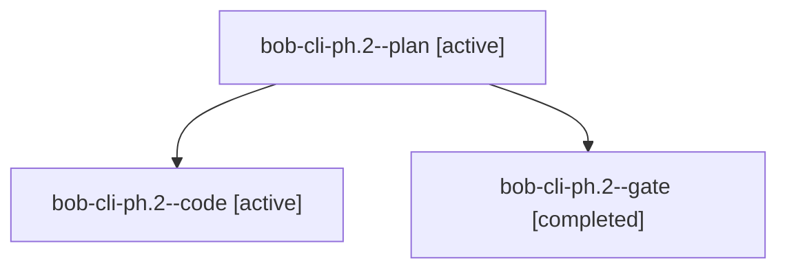

# Session: bob-cli-ph.2

[Agent Hoods](../README.md) / [bbugyi200](../users/bbugyi200/README.md) / [apollo](../users/bbugyi200/machines/apollo/README.md) / [bob-cli-ph](../users/bbugyi200/machines/apollo/hoods/bob-cli-ph/README.md) / bob-cli-ph.2

Owner: `bbugyi200.apollo` · Hood: `bob-cli-ph` · Members: 3 · Bead: [bob-cli-ph.2](https://github.com/bobs-org/bob-cli--beads/blob/main/pages/bob-cli-ph/bob-cli-ph.2.md)

## Lineage

The diagram is an optional enhancement; the ordered table below contains the same lineage in accessible text.

| Role | Agent | State | Model / provider | Timing | Commits | Prompt | Chat |
|---|---|---|---|---|---:|---|---|
| plan | bob-cli-ph.2--plan | active | gpt-6-astra / codex | 2026-11-23T17:15:29.894668+00:00 | 0 | [Prompt](../agents/bbugyi200.apollo.bob-cli-ph.2--plan/prompt.md) | [Chat](../agents/bbugyi200.apollo.bob-cli-ph.2--plan/chat.md) |
| code | bob-cli-ph.2--code | active | gpt-6-luna / codex | 2026-11-23T17:23:55.559468+00:00 | 0 | — | — |
| gate | bob-cli-ph.2--gate | completed | gpt-6-astra / codex | 2026-11-23T17:22:50.773698+00:00 → 2026-11-23T17:23:00.305055+00:00 | 0 | — | [Chat](../agents/bbugyi200.apollo.bob-cli-ph.2--gate/chat.md) |

## Neighbors

| Agent | Relation | State |
|---|---|---|
| [bob-cli-ph.1](bbugyi200.apollo.bob-cli-ph.1.md) (session · 31) | bob-cli-ph hood | completed 20, failed 11 |
| [bob-cli-ph.10](../agents/bbugyi200.apollo.bob-cli-ph.10/README.md) | bob-cli-ph hood | waiting |
| [bob-cli-ph.11](../agents/bbugyi200.apollo.bob-cli-ph.11/README.md) | bob-cli-ph hood | waiting |
| [bob-cli-ph.3](../agents/bbugyi200.apollo.bob-cli-ph.3/README.md) | bob-cli-ph hood | waiting |
| [bob-cli-ph.4](../agents/bbugyi200.apollo.bob-cli-ph.4/README.md) | bob-cli-ph hood | waiting |
| [bob-cli-ph.5](../agents/bbugyi200.apollo.bob-cli-ph.5/README.md) | bob-cli-ph hood | waiting |
| [bob-cli-ph.6](../agents/bbugyi200.apollo.bob-cli-ph.6/README.md) | bob-cli-ph hood | waiting |
| [bob-cli-ph.7](../agents/bbugyi200.apollo.bob-cli-ph.7/README.md) | bob-cli-ph hood | waiting |
| [bob-cli-ph.8](../agents/bbugyi200.apollo.bob-cli-ph.8/README.md) | bob-cli-ph hood | waiting |
| [bob-cli-ph.9](../agents/bbugyi200.apollo.bob-cli-ph.9/README.md) | bob-cli-ph hood | waiting |
| [bob-cli-ph.land](../agents/bbugyi200.apollo.bob-cli-ph.land/README.md) | bob-cli-ph hood | waiting |
