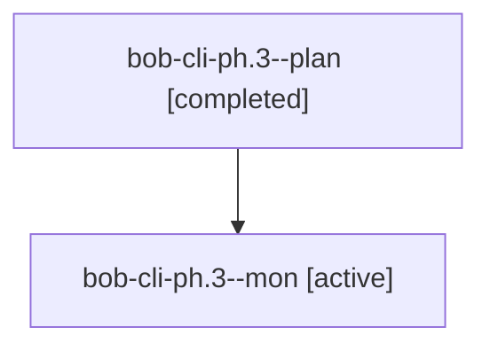

# Session: bob-cli-ph.3

[Agent Hoods](../README.md) / [bbugyi200](../users/bbugyi200/README.md) / [apollo](../users/bbugyi200/machines/apollo/README.md) / [bob-cli-ph](../users/bbugyi200/machines/apollo/hoods/bob-cli-ph/README.md) / bob-cli-ph.3

Owner: `bbugyi200.apollo` · Hood: `bob-cli-ph` · Members: 2 · Bead: [bob-cli-ph.3](https://github.com/bobs-org/bob-cli--beads/blob/main/pages/bob-cli-ph/bob-cli-ph.3.md)

## Lineage

The diagram is an optional enhancement; the ordered table below contains the same lineage in accessible text.

| Role | Agent | State | Model / provider | Timing | Commits | Prompt | Chat |
|---|---|---|---|---|---:|---|---|
| plan | bob-cli-ph.3--plan | completed | gpt-6-luna / codex | 2026-11-23T23:32:49.127244+00:00 → 2026-11-23T23:51:58.940653+00:00 | [1](../agents/bbugyi200.apollo.bob-cli-ph.3--plan/README.md#commits) | [Prompt](../agents/bbugyi200.apollo.bob-cli-ph.3--plan/prompt.md) | [Chat](../agents/bbugyi200.apollo.bob-cli-ph.3--plan/chat.md) |
| mon | bob-cli-ph.3--mon | active | gpt-6-luna / codex | 2026-11-23T23:50:04.339609+00:00 | 0 | — | — |

## Commits

| Role | Repo | Commit | Subject | Committed |
|---|---|---|---|---|
| plan | bob-cli | [`fd99ebb`](https://github.com/bobs-org/bob-cli/commit/fd99ebb85dcf0555cc48570397c419f4dd8f3167) | chore: add Bob host reader currency gate | 2026-11-23 18:51:04 EST |

## Neighbors

| Agent | Relation | State |
|---|---|---|
| [bob-cli-ph.1](bbugyi200.apollo.bob-cli-ph.1.md) (session · 31) | bob-cli-ph hood | completed 20, failed 11 |
| [bob-cli-ph.10](../agents/bbugyi200.apollo.bob-cli-ph.10/README.md) | bob-cli-ph hood | waiting |
| [bob-cli-ph.11](../agents/bbugyi200.apollo.bob-cli-ph.11/README.md) | bob-cli-ph hood | waiting |
| [bob-cli-ph.2](bbugyi200.apollo.bob-cli-ph.2.md) (session · 7) | bob-cli-ph hood | active 1, completed 5, failed 1 |
| [bob-cli-ph.4](../agents/bbugyi200.apollo.bob-cli-ph.4/README.md) | bob-cli-ph hood | active |
| [bob-cli-ph.5](../agents/bbugyi200.apollo.bob-cli-ph.5/README.md) | bob-cli-ph hood | waiting |
| [bob-cli-ph.6](../agents/bbugyi200.apollo.bob-cli-ph.6/README.md) | bob-cli-ph hood | waiting |
| [bob-cli-ph.7](../agents/bbugyi200.apollo.bob-cli-ph.7/README.md) | bob-cli-ph hood | waiting |
| [bob-cli-ph.8](../agents/bbugyi200.apollo.bob-cli-ph.8/README.md) | bob-cli-ph hood | waiting |
| [bob-cli-ph.9](../agents/bbugyi200.apollo.bob-cli-ph.9/README.md) | bob-cli-ph hood | waiting |
| [bob-cli-ph.land](../agents/bbugyi200.apollo.bob-cli-ph.land/README.md) | bob-cli-ph hood | waiting |
