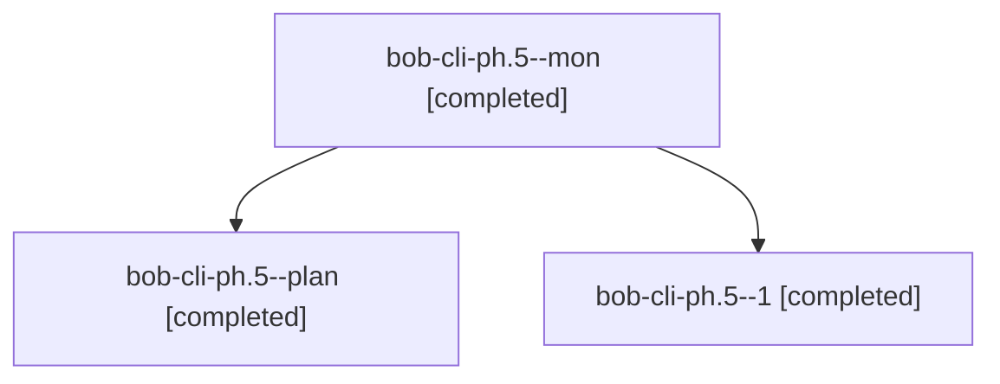

# Session: bob-cli-ph.5

[Agent Hoods](../README.md) / [bbugyi200](../users/bbugyi200/README.md) / [apollo](../users/bbugyi200/machines/apollo/README.md) / [bob-cli-ph](../users/bbugyi200/machines/apollo/hoods/bob-cli-ph/README.md) / bob-cli-ph.5

Owner: `bbugyi200.apollo` · Hood: `bob-cli-ph` · Members: 3 · Bead: [bob-cli-ph.5](https://github.com/bobs-org/bob-cli--beads/blob/main/pages/bob-cli-ph/bob-cli-ph.5.md)

## Lineage

The diagram is an optional enhancement; the ordered table below contains the same lineage in accessible text.

| Role | Agent | State | Model / provider | Timing | Commits | Prompt | Chat |
|---|---|---|---|---|---:|---|---|
| mon | bob-cli-ph.5--mon | completed | gpt-6-luna / codex | 2026-11-25T14:27:08.348957+00:00 → 2026-11-25T14:51:34.345382+00:00 | 0 | — | [Chat](../agents/bbugyi200.apollo.bob-cli-ph.5--mon/chat.md) |
| plan | bob-cli-ph.5--plan | completed | gpt-6-luna / codex | 2026-11-25T13:31:35.005304+00:00 → 2026-11-25T14:31:31.107287+00:00 | [1](../agents/bbugyi200.apollo.bob-cli-ph.5--plan/README.md#commits) | [Prompt](../agents/bbugyi200.apollo.bob-cli-ph.5--plan/prompt.md) | [Chat](../agents/bbugyi200.apollo.bob-cli-ph.5--plan/chat.md) |
| 1 | bob-cli-ph.5--1 | completed | gpt-6-luna / codex | 2026-11-25T14:51:33.983012+00:00 → 2026-11-25T14:53:35.286653+00:00 | 0 | [Prompt](../agents/bbugyi200.apollo.bob-cli-ph.5--1/prompt.md) | [Chat](../agents/bbugyi200.apollo.bob-cli-ph.5--1/chat.md) |

## Commits

| Role | Repo | Commit | Subject | Committed |
|---|---|---|---|---|
| plan | bob-cli | [`ae42b3e`](https://github.com/bobs-org/bob-cli/commit/ae42b3ed2a48ddc218021262c0fdd3fc791d99a1) | feat(task-drawers): preserve rename spelling and inventory legacy drawers | 2026-11-25 09:29:31 EST |

## Neighbors

| Agent | Relation | State |
|---|---|---|
| [bob-cli-ph.1](bbugyi200.apollo.bob-cli-ph.1.md) (session · 31) | bob-cli-ph hood | completed 20, failed 11 |
| [bob-cli-ph.10](../agents/bbugyi200.apollo.bob-cli-ph.10/README.md) | bob-cli-ph hood | waiting |
| [bob-cli-ph.11](../agents/bbugyi200.apollo.bob-cli-ph.11/README.md) | bob-cli-ph hood | waiting |
| [bob-cli-ph.2](bbugyi200.apollo.bob-cli-ph.2.md) (session · 7) | bob-cli-ph hood | active 1, completed 5, failed 1 |
| [bob-cli-ph.3](bbugyi200.apollo.bob-cli-ph.3.md) (session · 2) | bob-cli-ph hood | active 1, completed 1 |
| [bob-cli-ph.3](../agents/bbugyi200.apollo.bob-cli-ph.3/README.md) | bob-cli-ph hood | completed |
| [bob-cli-ph.4](../agents/bbugyi200.apollo.bob-cli-ph.4/README.md) | bob-cli-ph hood | completed |
| [bob-cli-ph.6](bbugyi200.apollo.bob-cli-ph.6.md) (session · 3) | bob-cli-ph hood | active 1, completed 2 |
| [bob-cli-ph.6.1.1](../agents/bbugyi200.apollo.bob-cli-ph.6.1.1/README.md) | bob-cli-ph hood | completed |
| [bob-cli-ph.6.1.2](../agents/bbugyi200.apollo.bob-cli-ph.6.1.2/README.md) | bob-cli-ph hood | waiting |
| [bob-cli-ph.6.1.3](../agents/bbugyi200.apollo.bob-cli-ph.6.1.3/README.md) | bob-cli-ph hood | waiting |
| [bob-cli-ph.6.1.4](../agents/bbugyi200.apollo.bob-cli-ph.6.1.4/README.md) | bob-cli-ph hood | waiting |
| [bob-cli-ph.6.1.5](../agents/bbugyi200.apollo.bob-cli-ph.6.1.5/README.md) | bob-cli-ph hood | waiting |
| [bob-cli-ph.6.1.land](../agents/bbugyi200.apollo.bob-cli-ph.6.1.land/README.md) | bob-cli-ph hood | waiting |
| [bob-cli-ph.7](bbugyi200.apollo.bob-cli-ph.7.md) (session · 3) | bob-cli-ph hood | active 1, completed 2 |
| [bob-cli-ph.7.1.1](../agents/bbugyi200.apollo.bob-cli-ph.7.1.1/README.md) | bob-cli-ph hood | completed |
| [bob-cli-ph.7.1.2](bbugyi200.apollo.bob-cli-ph.7.1.2.md) (session · 6) | bob-cli-ph hood | active 1, completed 4, failed 1 |
| [bob-cli-ph.7.1.3](../agents/bbugyi200.apollo.bob-cli-ph.7.1.3/README.md) | bob-cli-ph hood | waiting |
| [bob-cli-ph.7.1.4](../agents/bbugyi200.apollo.bob-cli-ph.7.1.4/README.md) | bob-cli-ph hood | waiting |
| [bob-cli-ph.7.1.land](../agents/bbugyi200.apollo.bob-cli-ph.7.1.land/README.md) | bob-cli-ph hood | waiting |
| [bob-cli-ph.8](../agents/bbugyi200.apollo.bob-cli-ph.8/README.md) | bob-cli-ph hood | waiting |
| [bob-cli-ph.9](../agents/bbugyi200.apollo.bob-cli-ph.9/README.md) | bob-cli-ph hood | waiting |
| [bob-cli-ph.land](../agents/bbugyi200.apollo.bob-cli-ph.land/README.md) | bob-cli-ph hood | waiting |
