# Session: bob-cli-ph.7.1.land

[Agent Hoods](../README.md) / [bbugyi200](../users/bbugyi200/README.md) / [apollo](../users/bbugyi200/machines/apollo/README.md) / [bob-cli-ph](../users/bbugyi200/machines/apollo/hoods/bob-cli-ph/README.md) / bob-cli-ph.7.1.land

Owner: `bbugyi200.apollo` · Hood: `bob-cli-ph` · Members: 14 · Bead: [bob-cli-ph.7.1](https://github.com/bobs-org/bob-cli--beads/blob/main/pages/bob-cli-ph/bob-cli-ph.7.1.md)

## Lineage

```mermaid
flowchart TD
  n0["bob-cli-ph.7.1.land--3 [completed]"]
  n1["bob-cli-ph.7.1.land--mon-0 [failed]"]
  n0 --> n1
  n2["bob-cli-ph.7.1.land--mon-3 [completed]"]
  n0 --> n2
  n3["bob-cli-ph.7.1.land--code [completed]"]
  n0 --> n3
  n4["bob-cli-ph.7.1.land--mon-1 [completed]"]
  n0 --> n4
  n5["bob-cli-ph.7.1.land--mon [failed]"]
  n0 --> n5
  n6["bob-cli-ph.7.1.land--2 [completed]"]
  n0 --> n6
  n7["bob-cli-ph.7.1.land--gate [completed]"]
  n0 --> n7
  n8["bob-cli-ph.7.1.land--plan [completed]"]
  n0 --> n8
  n9["bob-cli-ph.7.1.land--mon-4 [active]"]
  n0 --> n9
  n10["bob-cli-ph.7.1.land--1 [completed]"]
  n0 --> n10
  n11["bob-cli-ph.7.1.land--5 [completed]"]
  n0 --> n11
  n12["bob-cli-ph.7.1.land--4 [completed]"]
  n0 --> n12
  n13["bob-cli-ph.7.1.land--mon-2 [completed]"]
  n0 --> n13
```



The diagram is an optional enhancement; the ordered table below contains the same lineage in accessible text.

| Role | Agent | State | Model / provider | Timing | Commits | Prompt | Chat |
|---|---|---|---|---|---:|---|---|
| <a id="member-3"></a>3 | bob-cli-ph.7.1.land--3 | completed | gpt-6-luna / codex | 2026-11-25T22:12:57.481905+00:00 → 2026-11-25T22:35:28.446350+00:00 | 0 | [Prompt](../agents/bbugyi200.apollo.bob-cli-ph.7.1.land--3/prompt.md) | [Chat](../agents/bbugyi200.apollo.bob-cli-ph.7.1.land--3/chat.md) |
| <a id="member-mon-0"></a>mon-0 | bob-cli-ph.7.1.land--mon-0 | failed | gpt-6-luna / codex | 2026-11-25T19:07:39.987908+00:00 → 2026-11-25T19:14:19.653621+00:00 | 0 | — | [Chat](../agents/bbugyi200.apollo.bob-cli-ph.7.1.land--mon-0/chat.md) |
| <a id="member-mon-3"></a>mon-3 | bob-cli-ph.7.1.land--mon-3 | completed | gpt-6-luna / codex | 2026-11-25T22:51:59.448946+00:00 → 2026-11-25T23:04:01.287018+00:00 | 0 | — | [Chat](../agents/bbugyi200.apollo.bob-cli-ph.7.1.land--mon-3/chat.md) |
| <a id="member-code"></a>code | bob-cli-ph.7.1.land--code | completed | gpt-6-luna / codex | 2026-11-25T18:18:28.188551+00:00 → 2026-11-25T18:51:06.889333+00:00 | 0 | — | [Chat](../agents/bbugyi200.apollo.bob-cli-ph.7.1.land--code/chat.md) |
| <a id="member-mon-1"></a>mon-1 | bob-cli-ph.7.1.land--mon-1 | completed | gpt-6-luna / codex | 2026-11-25T20:15:44.778235+00:00 → 2026-11-25T22:12:51.487646+00:00 | 0 | — | [Chat](../agents/bbugyi200.apollo.bob-cli-ph.7.1.land--mon-1/chat.md) |
| <a id="member-mon"></a>mon | bob-cli-ph.7.1.land--mon | failed | gpt-6-luna / codex | 2026-11-25T18:48:19.179264+00:00 → 2026-11-25T18:52:42.685963+00:00 | 0 | — | [Chat](../agents/bbugyi200.apollo.bob-cli-ph.7.1.land--mon/chat.md) |
| <a id="member-2"></a>2 | bob-cli-ph.7.1.land--2 | completed | gpt-6-luna / codex | 2026-11-25T19:14:19.511818+00:00 → 2026-11-25T20:18:29.785153+00:00 | 0 | [Prompt](../agents/bbugyi200.apollo.bob-cli-ph.7.1.land--2/prompt.md) | [Chat](../agents/bbugyi200.apollo.bob-cli-ph.7.1.land--2/chat.md) |
| <a id="member-gate"></a>gate | bob-cli-ph.7.1.land--gate | completed | gpt-6-astra / codex | 2026-11-25T18:17:38.412891+00:00 → 2026-11-25T18:17:48.258626+00:00 | 0 | — | [Chat](../agents/bbugyi200.apollo.bob-cli-ph.7.1.land--gate/chat.md) |
| <a id="member-plan"></a>plan | bob-cli-ph.7.1.land--plan | completed | gpt-6-astra / codex | 2026-11-25T18:06:31.261069+00:00 → 2026-11-25T18:51:06.889333+00:00 | 0 | [Prompt](../agents/bbugyi200.apollo.bob-cli-ph.7.1.land--plan/prompt.md) | [Chat](../agents/bbugyi200.apollo.bob-cli-ph.7.1.land--plan/chat.md) |
| <a id="member-mon-4"></a>mon-4 | bob-cli-ph.7.1.land--mon-4 | active | gpt-6-luna / codex | 2026-11-25T23:24:17.439042+00:00 | 0 | — | — |
| <a id="member-1"></a>1 | bob-cli-ph.7.1.land--1 | completed | gpt-6-luna / codex | 2026-11-25T18:52:42.552717+00:00 → 2026-11-25T19:10:02.376594+00:00 | 0 | [Prompt](../agents/bbugyi200.apollo.bob-cli-ph.7.1.land--1/prompt.md) | [Chat](../agents/bbugyi200.apollo.bob-cli-ph.7.1.land--1/chat.md) |
| <a id="member-5"></a>5 | bob-cli-ph.7.1.land--5 | completed | gpt-6-luna / codex | 2026-11-25T23:04:00.870150+00:00 → 2026-11-25T23:26:19.049416+00:00 | 0 | [Prompt](../agents/bbugyi200.apollo.bob-cli-ph.7.1.land--5/prompt.md) | [Chat](../agents/bbugyi200.apollo.bob-cli-ph.7.1.land--5/chat.md) |
| <a id="member-4"></a>4 | bob-cli-ph.7.1.land--4 | completed | gpt-6-luna / codex | 2026-11-25T22:44:02.082754+00:00 → 2026-11-25T22:53:06.314036+00:00 | 0 | [Prompt](../agents/bbugyi200.apollo.bob-cli-ph.7.1.land--4/prompt.md) | [Chat](../agents/bbugyi200.apollo.bob-cli-ph.7.1.land--4/chat.md) |
| <a id="member-mon-2"></a>mon-2 | bob-cli-ph.7.1.land--mon-2 | completed | gpt-6-luna / codex | 2026-11-25T22:32:32.433315+00:00 → 2026-11-25T22:44:02.314558+00:00 | 0 | — | [Chat](../agents/bbugyi200.apollo.bob-cli-ph.7.1.land--mon-2/chat.md) |

## Variables

| Role | Variable | Value |
|---|---|---|
| 2 | `artifacts` | \[{kind: file, label: Task drawer visual acceptance report (4 of 4 pass), path: /home/bryan/.sase/artifacts/agents/gh\_bobs-org\_\_bob-cli/20261125141319/report-ab67912f2ba7.json, ref: file:explicit:7d13… |
| 5 | `artifacts` | \[{bead: bob-cli-ph.7.1, kind: file, label: Integrated drawer acceptance report · aecff7d2, path: /home/bryan/.sase/artifacts/agents/gh\_bobs-org\_\_bob-cli/20261125180311/report-f4e6e1ecfd42.json, ref:… |

#### artifacts

**Role:** `2`

```yaml
- kind: file
  label: Task drawer visual acceptance report (4 of 4 pass)
  path: /home/bryan/.sase/artifacts/agents/gh_bobs-org__bob-cli/20261125141319/report-ab67912f2ba7.json
  ref: file:explicit:7d1382945a7925b0c31918ec
  source_path: /tmp/bob-task-drawers-acceptance/report.json
- kind: image
  label: Task drawers — light Live Preview
  path: /home/bryan/.sase/artifacts/agents/gh_bobs-org__bob-cli/20261125141319/drawers-light-live-e3f034a712b2.png
  ref: file:explicit:e5eff65dbb95130799331a0d
  source_path: /tmp/bob-task-drawers-acceptance/drawers-light-live.png
- kind: image
  label: Task drawers — light reading view
  path: /home/bryan/.sase/artifacts/agents/gh_bobs-org__bob-cli/20261125141319/drawers-light-reading-70473ffb5024.png
  ref: file:explicit:dd053632f1ae33b646f71e15
  source_path: /tmp/bob-task-drawers-acceptance/drawers-light-reading.png
- kind: image
  label: Task drawers — dark Live Preview
  path: /home/bryan/.sase/artifacts/agents/gh_bobs-org__bob-cli/20261125141319/drawers-dark-live-5f16ee0c80d9.png
  ref: file:explicit:e66c8c4d308eb70022271092
  source_path: /tmp/bob-task-drawers-acceptance/drawers-dark-live.png
- kind: image
  label: Task drawers — dark reading view
  path: /home/bryan/.sase/artifacts/agents/gh_bobs-org__bob-cli/20261125141319/drawers-dark-reading-08d3ba06193a.png
  ref: file:explicit:feac1be20bb6aa1d6571c489
  source_path: /tmp/bob-task-drawers-acceptance/drawers-dark-reading.png
```

#### artifacts

**Role:** `5`

```yaml
- bead: bob-cli-ph.7.1
  kind: file
  label: Integrated drawer acceptance report · aecff7d2
  path: /home/bryan/.sase/artifacts/agents/gh_bobs-org__bob-cli/20261125180311/report-f4e6e1ecfd42.json
  ref: file:explicit:22401646d913918cad305ac5
  source_path: /tmp/bob-drawers-verify-final/report.json
```

Values are truncated for display; see each member's agent meta.json for the full values.

## Neighbors

| Agent | Relation | State |
|---|---|---|
| [bob-cli-ph.7](bbugyi200.apollo.bob-cli-ph.7.md) (session · 3) | ancestor | active 1, completed 2 |
| [bob-cli-ph.7.1.1](../agents/bbugyi200.apollo.bob-cli-ph.7.1.1/README.md) | bob-cli-ph.7.1 hood | completed |
| [bob-cli-ph.7.1.2](bbugyi200.apollo.bob-cli-ph.7.1.2.md) (session · 9) | bob-cli-ph.7.1 hood | completed 6, failed 3 |
| [bob-cli-ph.7.1.3](../agents/bbugyi200.apollo.bob-cli-ph.7.1.3/README.md) | bob-cli-ph.7.1 hood | completed |
| [bob-cli-ph.7.1.4](../agents/bbugyi200.apollo.bob-cli-ph.7.1.4/README.md) | bob-cli-ph.7.1 hood | completed |
| [bob-cli-ph.1](bbugyi200.apollo.bob-cli-ph.1.md) (session · 31) | bob-cli-ph hood | completed 20, failed 11 |
| [bob-cli-ph.10](../agents/bbugyi200.apollo.bob-cli-ph.10/README.md) | bob-cli-ph hood | waiting |
| [bob-cli-ph.11](../agents/bbugyi200.apollo.bob-cli-ph.11/README.md) | bob-cli-ph hood | waiting |
| [bob-cli-ph.2](bbugyi200.apollo.bob-cli-ph.2.md) (session · 7) | bob-cli-ph hood | active 1, completed 5, failed 1 |
| [bob-cli-ph.3](bbugyi200.apollo.bob-cli-ph.3.md) (session · 2) | bob-cli-ph hood | active 1, completed 1 |
| [bob-cli-ph.3](../agents/bbugyi200.apollo.bob-cli-ph.3/README.md) | bob-cli-ph hood | completed |
| [bob-cli-ph.4](../agents/bbugyi200.apollo.bob-cli-ph.4/README.md) | bob-cli-ph hood | completed |
| [bob-cli-ph.5](bbugyi200.apollo.bob-cli-ph.5.md) (session · 3) | bob-cli-ph hood | completed 3 |
| [bob-cli-ph.6](bbugyi200.apollo.bob-cli-ph.6.md) (session · 3) | bob-cli-ph hood | active 1, completed 2 |
| [bob-cli-ph.6.1.1](../agents/bbugyi200.apollo.bob-cli-ph.6.1.1/README.md) | bob-cli-ph hood | completed |
| [bob-cli-ph.6.1.2](../agents/bbugyi200.apollo.bob-cli-ph.6.1.2/README.md) | bob-cli-ph hood | completed |
| [bob-cli-ph.6.1.3](../agents/bbugyi200.apollo.bob-cli-ph.6.1.3/README.md) | bob-cli-ph hood | completed |
| [bob-cli-ph.6.1.4](../agents/bbugyi200.apollo.bob-cli-ph.6.1.4/README.md) | bob-cli-ph hood | completed |
| [bob-cli-ph.6.1.5](bbugyi200.apollo.bob-cli-ph.6.1.5.md) (session · 3) | bob-cli-ph hood | completed 2, failed 1 |
| [bob-cli-ph.6.1.land](../agents/bbugyi200.apollo.bob-cli-ph.6.1.land/README.md) | bob-cli-ph hood | completed |
| [bob-cli-ph.8](../agents/bbugyi200.apollo.bob-cli-ph.8/README.md) | bob-cli-ph hood | waiting |
| [bob-cli-ph.9](../agents/bbugyi200.apollo.bob-cli-ph.9/README.md) | bob-cli-ph hood | waiting |
| [bob-cli-ph.land](../agents/bbugyi200.apollo.bob-cli-ph.land/README.md) | bob-cli-ph hood | waiting |
