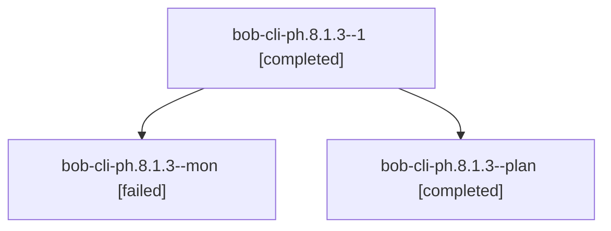

# Session: bob-cli-ph.8.1.3

[Agent Hoods](../README.md) / [bbugyi200](../users/bbugyi200/README.md) / [apollo](../users/bbugyi200/machines/apollo/README.md) / [bob-cli-ph](../users/bbugyi200/machines/apollo/hoods/bob-cli-ph/README.md) / bob-cli-ph.8.1.3

Owner: `bbugyi200.apollo` · Hood: `bob-cli-ph` · Members: 3 · Bead: [bob-cli-ph.8.1.3](https://github.com/bobs-org/bob-cli--beads/blob/main/pages/bob-cli-ph/bob-cli-ph.8.1.3.md)

## Lineage

The diagram is an optional enhancement; the ordered table below contains the same lineage in accessible text.

| Role | Agent | State | Model / provider | Timing | Commits | Prompt | Chat |
|---|---|---|---|---|---:|---|---|
| 1 | bob-cli-ph.8.1.3--1 | completed | gpt-6-luna / codex | 2026-11-26T04:33:38.519809+00:00 → 2026-11-26T04:40:28.817503+00:00 | 0 | [Prompt](../agents/bbugyi200.apollo.bob-cli-ph.8.1.3--1/prompt.md) | [Chat](../agents/bbugyi200.apollo.bob-cli-ph.8.1.3--1/chat.md) |
| mon | bob-cli-ph.8.1.3--mon | failed | gpt-6-luna / codex | 2026-11-26T04:22:11.716641+00:00 → 2026-11-26T04:33:38.709719+00:00 | 0 | — | [Chat](../agents/bbugyi200.apollo.bob-cli-ph.8.1.3--mon/chat.md) |
| plan | bob-cli-ph.8.1.3--plan | completed | gpt-6-luna / codex | 2026-11-26T03:54:33.108560+00:00 → 2026-11-26T04:26:45.980984+00:00 | 0 | [Prompt](../agents/bbugyi200.apollo.bob-cli-ph.8.1.3--plan/prompt.md) | [Chat](../agents/bbugyi200.apollo.bob-cli-ph.8.1.3--plan/chat.md) |

## Neighbors

| Agent | Relation | State |
|---|---|---|
| [bob-cli-ph.8](bbugyi200.apollo.bob-cli-ph.8.md) (session · 7) | ancestor | active 1, completed 6 |
| [bob-cli-ph.8.1.1](bbugyi200.apollo.bob-cli-ph.8.1.1.md) (session · 9) | bob-cli-ph.8.1 hood | completed 7, failed 2 |
| [bob-cli-ph.8.1.2](bbugyi200.apollo.bob-cli-ph.8.1.2.md) (session · 7) | bob-cli-ph.8.1 hood | completed 5, failed 2 |
| [bob-cli-ph.8.1.4](bbugyi200.apollo.bob-cli-ph.8.1.4.md) (session · 3) | bob-cli-ph.8.1 hood | completed 2, failed 1 |
| [bob-cli-ph.8.1.5](bbugyi200.apollo.bob-cli-ph.8.1.5.md) (session · 7) | bob-cli-ph.8.1 hood | completed 5, failed 2 |
| [bob-cli-ph.8.1.6](bbugyi200.apollo.bob-cli-ph.8.1.6.md) (session · 3) | bob-cli-ph.8.1 hood | completed 2, failed 1 |
| [bob-cli-ph.8.1.land](bbugyi200.apollo.bob-cli-ph.8.1.land.md) (session · 4) | bob-cli-ph.8.1 hood | active 1, completed 3 |
| [bob-cli-ph.1](bbugyi200.apollo.bob-cli-ph.1.md) (session · 31) | bob-cli-ph hood | completed 20, failed 11 |
| [bob-cli-ph.10](bbugyi200.apollo.bob-cli-ph.10.md) (session · 16) | bob-cli-ph hood | completed 8, failed 8 |
| [bob-cli-ph.10](../agents/bbugyi200.apollo.bob-cli-ph.10/README.md) | bob-cli-ph hood | completed |
| [bob-cli-ph.11](../agents/bbugyi200.apollo.bob-cli-ph.11/README.md) | bob-cli-ph hood | waiting |
| [bob-cli-ph.2](bbugyi200.apollo.bob-cli-ph.2.md) (session · 7) | bob-cli-ph hood | active 1, completed 5, failed 1 |
| [bob-cli-ph.3](bbugyi200.apollo.bob-cli-ph.3.md) (session · 2) | bob-cli-ph hood | active 1, completed 1 |
| [bob-cli-ph.3](../agents/bbugyi200.apollo.bob-cli-ph.3/README.md) | bob-cli-ph hood | completed |
| [bob-cli-ph.4](../agents/bbugyi200.apollo.bob-cli-ph.4/README.md) | bob-cli-ph hood | completed |
| [bob-cli-ph.5](bbugyi200.apollo.bob-cli-ph.5.md) (session · 3) | bob-cli-ph hood | completed 3 |
| [bob-cli-ph.6](bbugyi200.apollo.bob-cli-ph.6.md) (session · 3) | bob-cli-ph hood | active 1, completed 2 |
| [bob-cli-ph.6.1.1](../agents/bbugyi200.apollo.bob-cli-ph.6.1.1/README.md) | bob-cli-ph hood | completed |
| [bob-cli-ph.6.1.2](../agents/bbugyi200.apollo.bob-cli-ph.6.1.2/README.md) | bob-cli-ph hood | completed |
| [bob-cli-ph.6.1.3](../agents/bbugyi200.apollo.bob-cli-ph.6.1.3/README.md) | bob-cli-ph hood | completed |
| [bob-cli-ph.6.1.4](../agents/bbugyi200.apollo.bob-cli-ph.6.1.4/README.md) | bob-cli-ph hood | completed |
| [bob-cli-ph.6.1.5](bbugyi200.apollo.bob-cli-ph.6.1.5.md) (session · 3) | bob-cli-ph hood | completed 2, failed 1 |
| [bob-cli-ph.6.1.land](../agents/bbugyi200.apollo.bob-cli-ph.6.1.land/README.md) | bob-cli-ph hood | completed |
| [bob-cli-ph.7](bbugyi200.apollo.bob-cli-ph.7.md) (session · 3) | bob-cli-ph hood | active 1, completed 2 |
| [bob-cli-ph.7.1.1](../agents/bbugyi200.apollo.bob-cli-ph.7.1.1/README.md) | bob-cli-ph hood | completed |
| [bob-cli-ph.7.1.2](bbugyi200.apollo.bob-cli-ph.7.1.2.md) (session · 9) | bob-cli-ph hood | completed 6, failed 3 |
| [bob-cli-ph.7.1.3](../agents/bbugyi200.apollo.bob-cli-ph.7.1.3/README.md) | bob-cli-ph hood | completed |
| [bob-cli-ph.7.1.4](../agents/bbugyi200.apollo.bob-cli-ph.7.1.4/README.md) | bob-cli-ph hood | completed |
| [bob-cli-ph.7.1.land](bbugyi200.apollo.bob-cli-ph.7.1.land.md) (session · 17) | bob-cli-ph hood | completed 14, failed 3 |
| [bob-cli-ph.9](bbugyi200.apollo.bob-cli-ph.9.md) (session · 3) | bob-cli-ph hood | completed 3 |
| [bob-cli-ph.land](../agents/bbugyi200.apollo.bob-cli-ph.land/README.md) | bob-cli-ph hood | waiting |
