# Session: bob-cli-ph.8.1.land

[Agent Hoods](../README.md) / [bbugyi200](../users/bbugyi200/README.md) / [apollo](../users/bbugyi200/machines/apollo/README.md) / [bob-cli-ph](../users/bbugyi200/machines/apollo/hoods/bob-cli-ph/README.md) / bob-cli-ph.8.1.land

Owner: `bbugyi200.apollo` · Hood: `bob-cli-ph` · Members: 12 · Bead: [bob-cli-ph.8.1](https://github.com/bobs-org/bob-cli--beads/blob/main/pages/bob-cli-ph/bob-cli-ph.8.1.md)

## Lineage

```mermaid
flowchart TD
  n0["bob-cli-ph.8.1.land--mon-1 [failed]"]
  n1["bob-cli-ph.8.1.land--2 [completed]"]
  n0 --> n1
  n2["bob-cli-ph.8.1.land--1 [completed]"]
  n0 --> n2
  n3["bob-cli-ph.8.1.land--3 [completed]"]
  n0 --> n3
  n4["bob-cli-ph.8.1.land--mon-0 [failed]"]
  n0 --> n4
  n5["bob-cli-ph.8.1.land--mon [failed]"]
  n0 --> n5
  n6["bob-cli-ph.8.1.land--mon-3 [active]"]
  n0 --> n6
  n7["bob-cli-ph.8.1.land--code [completed]"]
  n0 --> n7
  n8["bob-cli-ph.8.1.land--4 [completed]"]
  n0 --> n8
  n9["bob-cli-ph.8.1.land--mon-2 [completed]"]
  n0 --> n9
  n10["bob-cli-ph.8.1.land--plan [completed]"]
  n0 --> n10
  n11["bob-cli-ph.8.1.land--gate [completed]"]
  n0 --> n11
```



The diagram is an optional enhancement; the ordered table below contains the same lineage in accessible text.

| Role | Agent | State | Model / provider | Timing | Commits | Prompt | Chat |
|---|---|---|---|---|---:|---|---|
| <a id="member-mon-1"></a>mon-1 | bob-cli-ph.8.1.land--mon-1 | failed | muse-spark-1.3-contributor / muse | 2026-11-26T10:21:40.508478+00:00 → 2026-11-26T10:46:43.569875+00:00 | 0 | — | [Chat](../agents/bbugyi200.apollo.bob-cli-ph.8.1.land--mon-1/chat.md) |
| <a id="member-2"></a>2 | bob-cli-ph.8.1.land--2 | completed | muse-spark-1.3-contributor / muse | 2026-11-26T10:17:00.113612+00:00 → 2026-11-26T10:24:37.047499+00:00 | 0 | [Prompt](../agents/bbugyi200.apollo.bob-cli-ph.8.1.land--2/prompt.md) | [Chat](../agents/bbugyi200.apollo.bob-cli-ph.8.1.land--2/chat.md) |
| <a id="member-1"></a>1 | bob-cli-ph.8.1.land--1 | completed | muse-spark-1.3-contributor / muse | 2026-11-26T09:52:50.343617+00:00 → 2026-11-26T10:07:30.453395+00:00 | 0 | [Prompt](../agents/bbugyi200.apollo.bob-cli-ph.8.1.land--1/prompt.md) | [Chat](../agents/bbugyi200.apollo.bob-cli-ph.8.1.land--1/chat.md) |
| <a id="member-3"></a>3 | bob-cli-ph.8.1.land--3 | completed | muse-spark-1.3-contributor / muse | 2026-11-26T10:46:43.285571+00:00 → 2026-11-26T11:00:12.534504+00:00 | 0 | [Prompt](../agents/bbugyi200.apollo.bob-cli-ph.8.1.land--3/prompt.md) | [Chat](../agents/bbugyi200.apollo.bob-cli-ph.8.1.land--3/chat.md) |
| <a id="member-mon-0"></a>mon-0 | bob-cli-ph.8.1.land--mon-0 | failed | muse-spark-1.3-contributor / muse | 2026-11-26T10:03:07.752996+00:00 → 2026-11-26T10:17:00.256446+00:00 | 0 | — | [Chat](../agents/bbugyi200.apollo.bob-cli-ph.8.1.land--mon-0/chat.md) |
| <a id="member-mon"></a>mon | bob-cli-ph.8.1.land--mon | failed | muse-spark-1.3-contributor / muse | 2026-11-26T09:27:33.935274+00:00 → 2026-11-26T09:52:29.688327+00:00 | 0 | — | [Chat](../agents/bbugyi200.apollo.bob-cli-ph.8.1.land--mon/chat.md) |
| <a id="member-mon-3"></a>mon-3 | bob-cli-ph.8.1.land--mon-3 | active | muse-spark-1.3-contributor / muse | 2026-11-26T11:39:52.670087+00:00 | 0 | — | — |
| <a id="member-code"></a>code | bob-cli-ph.8.1.land--code | completed | muse-spark-1.3-contributor / muse | 2026-11-26T09:07:46.945373+00:00 → 2026-11-26T09:30:26.714762+00:00 | 0 | — | [Chat](../agents/bbugyi200.apollo.bob-cli-ph.8.1.land--code/chat.md) |
| <a id="member-4"></a>4 | bob-cli-ph.8.1.land--4 | completed | muse-spark-1.3-contributor / muse | 2026-11-26T11:28:26.764604+00:00 → 2026-11-26T11:44:21.232085+00:00 | 0 | [Prompt](../agents/bbugyi200.apollo.bob-cli-ph.8.1.land--4/prompt.md) | [Chat](../agents/bbugyi200.apollo.bob-cli-ph.8.1.land--4/chat.md) |
| <a id="member-mon-2"></a>mon-2 | bob-cli-ph.8.1.land--mon-2 | completed | muse-spark-1.3-contributor / muse | 2026-11-26T10:55:58.168782+00:00 → 2026-11-26T11:28:26.868534+00:00 | 0 | — | [Chat](../agents/bbugyi200.apollo.bob-cli-ph.8.1.land--mon-2/chat.md) |
| <a id="member-plan"></a>plan | bob-cli-ph.8.1.land--plan | completed | opus / claude | 2026-11-26T08:22:06.366660+00:00 → 2026-11-26T09:30:26.714762+00:00 | 0 | [Prompt](../agents/bbugyi200.apollo.bob-cli-ph.8.1.land--plan/prompt.md) | [Chat](../agents/bbugyi200.apollo.bob-cli-ph.8.1.land--plan/chat.md) |
| <a id="member-gate"></a>gate | bob-cli-ph.8.1.land--gate | completed | opus / claude | 2026-11-26T09:06:35.659401+00:00 → 2026-11-26T09:06:43.976496+00:00 | 0 | — | [Chat](../agents/bbugyi200.apollo.bob-cli-ph.8.1.land--gate/chat.md) |

## Variables

| Role | Variable | Value |
|---|---|---|
| 4 | `artifacts` | \[{kind: image, label: Mac drawer preview: drawer-headers-edge-620-dark.png (gate run 45806522346), path: /home/bryan/.sase/artifacts/agents/gh\_bobs-org\_\_bob-cli/20261126062740/drawer-headers-edge-620… |

#### artifacts

**Role:** `4`

```yaml
- kind: image
  label: Mac drawer preview: drawer-headers-edge-620-dark.png (gate run 45806522346)
  path: /home/bryan/.sase/artifacts/agents/gh_bobs-org__bob-cli/20261126062740/drawer-headers-edge-620-dark-2150db226e9f.png
  ref: file:explicit:92ac260b4e11d2084e051d00
  source_path: /tmp/drawer-fixtures/drawer-headers-edge-620-dark.png
- kind: image
  label: Mac drawer preview: drawer-headers-edge-620-high-contrast-dark.png (gate run 45806522346)
  path: /home/bryan/.sase/artifacts/agents/gh_bobs-org__bob-cli/20261126062740/drawer-headers-edge-620-high-contrast-dark-46c0b1ad186b.png
  ref: file:explicit:8cf8d08357d505985cc67004
  source_path: /tmp/drawer-fixtures/drawer-headers-edge-620-high-contrast-dark.png
- kind: image
  label: Mac drawer preview: drawer-headers-edge-620-high-contrast-light.png (gate run 45806522346)
  path: /home/bryan/.sase/artifacts/agents/gh_bobs-org__bob-cli/20261126062740/drawer-headers-edge-620-high-contrast-light-00063cb24898.png
  ref: file:explicit:5922d9f1d9d98925f294a512
  source_path: /tmp/drawer-fixtures/drawer-headers-edge-620-high-contrast-light.png
- kind: image
  label: Mac drawer preview: drawer-headers-edge-620-light.png (gate run 45806522346)
  path: /home/bryan/.sase/artifacts/agents/gh_bobs-org__bob-cli/20261126062740/drawer-headers-edge-620-light-9565e1971e59.png
  ref: file:explicit:57de71e8ea3f5dfdd5a934a5
  source_path: /tmp/drawer-fixtures/drawer-headers-edge-620-light.png
- kind: image
  label: Mac drawer preview: drawer-headers-edge-760-dark.png (gate run 45806522346)
  path: /home/bryan/.sase/artifacts/agents/gh_bobs-org__bob-cli/20261126062740/drawer-headers-edge-760-dark-a5890657d2b1.png
  ref: file:explicit:ce0a9003fdbdfdde5cb94511
  source_path: /tmp/drawer-fixtures/drawer-headers-edge-760-dark.png
- kind: image
  label: Mac drawer preview: drawer-headers-edge-760-high-contrast-dark.png (gate run 45806522346)
  path: /home/bryan/.sase/artifacts/agents/gh_bobs-org__bob-cli/20261126062740/drawer-headers-edge-760-high-contrast-dark-c11036d15a13.png
  ref: file:explicit:6d35dc2d9c381c63545fba03
  source_path: /tmp/drawer-fixtures/drawer-headers-edge-760-high-contrast-dark.png
- kind: image
  label: Mac drawer preview: drawer-headers-edge-760-high-contrast-light.png (gate run 45806522346)
  path: /home/bryan/.sase/artifacts/agents/gh_bobs-org__bob-cli/20261126062740/drawer-headers-edge-760-high-contrast-light-7ac6d4e6af0d.png
  ref: file:explicit:44ec5c8cb0a0d2c38aa6a3de
  source_path: /tmp/drawer-fixtures/drawer-headers-edge-760-high-contrast-light.png
- kind: image
  label: Mac drawer preview: drawer-headers-edge-760-light.png (gate run 45806522346)
  path: /home/bryan/.sase/artifacts/agents/gh_bobs-org__bob-cli/20261126062740/drawer-headers-edge-760-light-3d363531bb04.png
  ref: file:explicit:719de2e5996765b69febd0f5
  source_path: /tmp/drawer-fixtures/drawer-headers-edge-760-light.png
- kind: image
  label: Mac drawer preview: drawer-headers-real-620-dark.png (gate run 45806522346)
  path: /home/bryan/.sase/artifacts/agents/gh_bobs-org__bob-cli/20261126062740/drawer-headers-real-620-dark-85563a2afb31.png
  ref: file:explicit:8264c29c8718f9462fc51b5e
  source_path: /tmp/drawer-fixtures/drawer-headers-real-620-dark.png
- kind: image
  label: Mac drawer preview: drawer-headers-real-620-high-contrast-dark.png (gate run 45806522346)
  path: /home/bryan/.sase/artifacts/agents/gh_bobs-org__bob-cli/20261126062740/drawer-headers-real-620-high-contrast-dark-00787d7af9a1.png
  ref: file:explicit:15c959fa575be4f8bc1408f5
  source_path: /tmp/drawer-fixtures/drawer-headers-real-620-high-contrast-dark.png
- kind: image
  label: Mac drawer preview: drawer-headers-real-620-high-contrast-light.png (gate run 45806522346)
  path: /home/bryan/.sase/artifacts/agents/gh_bobs-org__bob-cli/20261126062740/drawer-headers-real-620-high-contrast-light-fc2ea0e8293e.png
  ref: file:explicit:22075c1c60e8fbe071b26a35
  source_path: /tmp/drawer-fixtures/drawer-headers-real-620-high-contrast-light.png
- kind: image
  label: Mac drawer preview: drawer-headers-real-620-light.png (gate run 45806522346)
  path: /home/bryan/.sase/artifacts/agents/gh_bobs-org__bob-cli/20261126062740/drawer-headers-real-620-light-09883bf76340.png
  ref: file:explicit:08ba10fc00da9e997f951646
  source_path: /tmp/drawer-fixtures/drawer-headers-real-620-light.png
- kind: image
  label: Mac drawer preview: drawer-headers-real-760-dark.png (gate run 45806522346)
  path: /home/bryan/.sase/artifacts/agents/gh_bobs-org__bob-cli/20261126062740/drawer-headers-real-760-dark-510c00584248.png
  ref: file:explicit:180759c7af703517f7b40435
  source_path: /tmp/drawer-fixtures/drawer-headers-real-760-dark.png
- kind: image
  label: Mac drawer preview: drawer-headers-real-760-high-contrast-dark.png (gate run 45806522346)
  path: /home/bryan/.sase/artifacts/agents/gh_bobs-org__bob-cli/20261126062740/drawer-headers-real-760-high-contrast-dark-68a85d5feb3b.png
  ref: file:explicit:59ba2549dd929ad4a04196da
  source_path: /tmp/drawer-fixtures/drawer-headers-real-760-high-contrast-dark.png
- kind: image
  label: Mac drawer preview: drawer-headers-real-760-high-contrast-light.png (gate run 45806522346)
  path: /home/bryan/.sase/artifacts/agents/gh_bobs-org__bob-cli/20261126062740/drawer-headers-real-760-high-contrast-light-e554fd8d3f2e.png
  ref: file:explicit:8c8d339af7b68f9fa19bdf3b
  source_path: /tmp/drawer-fixtures/drawer-headers-real-760-high-contrast-light.png
- kind: image
  label: Mac drawer preview: drawer-headers-real-760-light.png (gate run 45806522346)
  path: /home/bryan/.sase/artifacts/agents/gh_bobs-org__bob-cli/20261126062740/drawer-headers-real-760-light-0932234b9f97.png
  ref: file:explicit:0ba25b1607cc2ca3dde68e7a
  source_path: /tmp/drawer-fixtures/drawer-headers-real-760-light.png
```

Values are truncated for display; see each member's agent meta.json for the full values.

## Neighbors

| Agent | Relation | State |
|---|---|---|
| [bob-cli-ph.8](bbugyi200.apollo.bob-cli-ph.8.md) (session · 7) | ancestor | active 1, completed 6 |
| [bob-cli-ph.8.1.1](bbugyi200.apollo.bob-cli-ph.8.1.1.md) (session · 9) | bob-cli-ph.8.1 hood | completed 7, failed 2 |
| [bob-cli-ph.8.1.2](bbugyi200.apollo.bob-cli-ph.8.1.2.md) (session · 7) | bob-cli-ph.8.1 hood | completed 5, failed 2 |
| [bob-cli-ph.8.1.3](bbugyi200.apollo.bob-cli-ph.8.1.3.md) (session · 3) | bob-cli-ph.8.1 hood | completed 2, failed 1 |
| [bob-cli-ph.8.1.4](bbugyi200.apollo.bob-cli-ph.8.1.4.md) (session · 3) | bob-cli-ph.8.1 hood | completed 2, failed 1 |
| [bob-cli-ph.8.1.5](bbugyi200.apollo.bob-cli-ph.8.1.5.md) (session · 7) | bob-cli-ph.8.1 hood | completed 5, failed 2 |
| [bob-cli-ph.8.1.6](bbugyi200.apollo.bob-cli-ph.8.1.6.md) (session · 3) | bob-cli-ph.8.1 hood | completed 2, failed 1 |
| [bob-cli-ph.1](bbugyi200.apollo.bob-cli-ph.1.md) (session · 31) | bob-cli-ph hood | completed 20, failed 11 |
| [bob-cli-ph.10](bbugyi200.apollo.bob-cli-ph.10.md) (session · 16) | bob-cli-ph hood | completed 8, failed 8 |
| [bob-cli-ph.10](../agents/bbugyi200.apollo.bob-cli-ph.10/README.md) | bob-cli-ph hood | completed |
| [bob-cli-ph.11](../agents/bbugyi200.apollo.bob-cli-ph.11/README.md) | bob-cli-ph hood | waiting |
| [bob-cli-ph.2](bbugyi200.apollo.bob-cli-ph.2.md) (session · 7) | bob-cli-ph hood | active 1, completed 5, failed 1 |
| [bob-cli-ph.3](bbugyi200.apollo.bob-cli-ph.3.md) (session · 2) | bob-cli-ph hood | active 1, completed 1 |
| [bob-cli-ph.3](../agents/bbugyi200.apollo.bob-cli-ph.3/README.md) | bob-cli-ph hood | completed |
| [bob-cli-ph.4](../agents/bbugyi200.apollo.bob-cli-ph.4/README.md) | bob-cli-ph hood | completed |
| [bob-cli-ph.5](bbugyi200.apollo.bob-cli-ph.5.md) (session · 3) | bob-cli-ph hood | completed 3 |
| [bob-cli-ph.6](bbugyi200.apollo.bob-cli-ph.6.md) (session · 3) | bob-cli-ph hood | active 1, completed 2 |
| [bob-cli-ph.6.1.1](../agents/bbugyi200.apollo.bob-cli-ph.6.1.1/README.md) | bob-cli-ph hood | completed |
| [bob-cli-ph.6.1.2](../agents/bbugyi200.apollo.bob-cli-ph.6.1.2/README.md) | bob-cli-ph hood | completed |
| [bob-cli-ph.6.1.3](../agents/bbugyi200.apollo.bob-cli-ph.6.1.3/README.md) | bob-cli-ph hood | completed |
| [bob-cli-ph.6.1.4](../agents/bbugyi200.apollo.bob-cli-ph.6.1.4/README.md) | bob-cli-ph hood | completed |
| [bob-cli-ph.6.1.5](bbugyi200.apollo.bob-cli-ph.6.1.5.md) (session · 3) | bob-cli-ph hood | completed 2, failed 1 |
| [bob-cli-ph.6.1.land](../agents/bbugyi200.apollo.bob-cli-ph.6.1.land/README.md) | bob-cli-ph hood | completed |
| [bob-cli-ph.7](bbugyi200.apollo.bob-cli-ph.7.md) (session · 3) | bob-cli-ph hood | active 1, completed 2 |
| [bob-cli-ph.7.1.1](../agents/bbugyi200.apollo.bob-cli-ph.7.1.1/README.md) | bob-cli-ph hood | completed |
| [bob-cli-ph.7.1.2](bbugyi200.apollo.bob-cli-ph.7.1.2.md) (session · 9) | bob-cli-ph hood | completed 6, failed 3 |
| [bob-cli-ph.7.1.3](../agents/bbugyi200.apollo.bob-cli-ph.7.1.3/README.md) | bob-cli-ph hood | completed |
| [bob-cli-ph.7.1.4](../agents/bbugyi200.apollo.bob-cli-ph.7.1.4/README.md) | bob-cli-ph hood | completed |
| [bob-cli-ph.7.1.land](bbugyi200.apollo.bob-cli-ph.7.1.land.md) (session · 17) | bob-cli-ph hood | completed 14, failed 3 |
| [bob-cli-ph.9](bbugyi200.apollo.bob-cli-ph.9.md) (session · 3) | bob-cli-ph hood | completed 3 |
| [bob-cli-ph.land](../agents/bbugyi200.apollo.bob-cli-ph.land/README.md) | bob-cli-ph hood | waiting |
