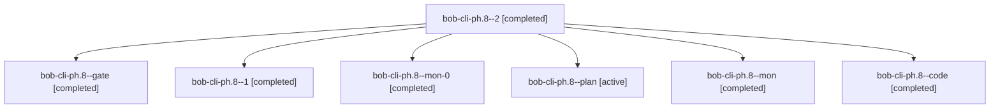

# Session: bob-cli-ph.8

[Agent Hoods](../README.md) / [bbugyi200](../users/bbugyi200/README.md) / [apollo](../users/bbugyi200/machines/apollo/README.md) / [bob-cli-ph](../users/bbugyi200/machines/apollo/hoods/bob-cli-ph/README.md) / bob-cli-ph.8

Owner: `bbugyi200.apollo` · Hood: `bob-cli-ph` · Members: 7 · Bead: [bob-cli-ph.8](https://github.com/bobs-org/bob-cli--beads/blob/main/pages/bob-cli-ph/bob-cli-ph.8.md)

## Lineage

The diagram is an optional enhancement; the ordered table below contains the same lineage in accessible text.

| Role | Agent | State | Model / provider | Timing | Commits | Prompt | Chat |
|---|---|---|---|---|---:|---|---|
| 2 | bob-cli-ph.8--2 | completed | muse-spark-1.3-contributor / muse | 2026-11-26T00:24:32.067129+00:00 → 2026-11-26T00:54:29.328919+00:00 | [1](../agents/bbugyi200.apollo.bob-cli-ph.8--2/README.md#commits) | [Prompt](../agents/bbugyi200.apollo.bob-cli-ph.8--2/prompt.md) | [Chat](../agents/bbugyi200.apollo.bob-cli-ph.8--2/chat.md) |
| gate | bob-cli-ph.8--gate | completed | opus / claude | 2026-11-26T01:55:11.615426+00:00 → 2026-11-26T01:55:37.756429+00:00 | 0 | — | [Chat](../agents/bbugyi200.apollo.bob-cli-ph.8--gate/chat.md) |
| 1 | bob-cli-ph.8--1 | completed | gpt-6-luna / codex | 2026-11-26T00:03:03.643788+00:00 → 2026-11-26T00:19:24.544227+00:00 | 0 | [Prompt](../agents/bbugyi200.apollo.bob-cli-ph.8--1/prompt.md) | [Chat](../agents/bbugyi200.apollo.bob-cli-ph.8--1/chat.md) |
| mon-0 | bob-cli-ph.8--mon-0 | completed | gpt-6-luna / codex | 2026-11-26T00:16:21.568916+00:00 → 2026-11-26T00:24:32.472728+00:00 | 0 | — | [Chat](../agents/bbugyi200.apollo.bob-cli-ph.8--mon-0/chat.md) |
| plan | bob-cli-ph.8--plan | active | opus / claude | 2026-11-26T01:43:23.576347+00:00 → 2026-11-26T01:55:49.425390+00:00 | 0 | [Prompt](../agents/bbugyi200.apollo.bob-cli-ph.8--plan/prompt.md) | [Chat](../agents/bbugyi200.apollo.bob-cli-ph.8--plan/chat.md) |
| mon | bob-cli-ph.8--mon | completed | opus / claude | 2026-11-26T01:55:35.711671+00:00 → 2026-11-26T02:02:56.910908+00:00 | 0 | — | [Chat](../agents/bbugyi200.apollo.bob-cli-ph.8--mon/chat.md) |
| code | bob-cli-ph.8--code | completed | gpt-6-luna / codex | 2026-11-25T23:40:58.738663+00:00 → 2026-11-25T23:57:11.717412+00:00 | 0 | — | [Chat](../agents/bbugyi200.apollo.bob-cli-ph.8--code/chat.md) |

## Commits

| Role | Repo | Commit | Subject | Committed |
|---|---|---|---|---|
| 2 | bob-cli | [`f4da72f`](https://github.com/bobs-org/bob-cli/commit/f4da72ff5dd08b9827eb8b13a9f2bce04c47d9f6) | docs(task-drawers): describe Mac thin-client drawer contract | 2026-11-25 19:51:53 EST |

## Neighbors

| Agent | Relation | State |
|---|---|---|
| [bob-cli-ph.8.1.1](bbugyi200.apollo.bob-cli-ph.8.1.1.md) (session · 9) | descendant | completed 7, failed 2 |
| [bob-cli-ph.8.1.2](bbugyi200.apollo.bob-cli-ph.8.1.2.md) (session · 7) | descendant | completed 5, failed 2 |
| [bob-cli-ph.8.1.3](bbugyi200.apollo.bob-cli-ph.8.1.3.md) (session · 3) | descendant | completed 2, failed 1 |
| [bob-cli-ph.8.1.4](bbugyi200.apollo.bob-cli-ph.8.1.4.md) (session · 3) | descendant | completed 2, failed 1 |
| [bob-cli-ph.8.1.5](bbugyi200.apollo.bob-cli-ph.8.1.5.md) (session · 2) | descendant | active 1, completed 1 |
| [bob-cli-ph.8.1.6](../agents/bbugyi200.apollo.bob-cli-ph.8.1.6/README.md) | descendant | waiting |
| [bob-cli-ph.8.1.land](../agents/bbugyi200.apollo.bob-cli-ph.8.1.land/README.md) | descendant | waiting |
| [bob-cli-ph.1](bbugyi200.apollo.bob-cli-ph.1.md) (session · 31) | bob-cli-ph hood | completed 20, failed 11 |
| [bob-cli-ph.10](bbugyi200.apollo.bob-cli-ph.10.md) (session · 16) | bob-cli-ph hood | completed 8, failed 8 |
| [bob-cli-ph.11](../agents/bbugyi200.apollo.bob-cli-ph.11/README.md) | bob-cli-ph hood | waiting |
| [bob-cli-ph.2](bbugyi200.apollo.bob-cli-ph.2.md) (session · 7) | bob-cli-ph hood | active 1, completed 5, failed 1 |
| [bob-cli-ph.3](bbugyi200.apollo.bob-cli-ph.3.md) (session · 2) | bob-cli-ph hood | active 1, completed 1 |
| [bob-cli-ph.3](../agents/bbugyi200.apollo.bob-cli-ph.3/README.md) | bob-cli-ph hood | completed |
| [bob-cli-ph.4](../agents/bbugyi200.apollo.bob-cli-ph.4/README.md) | bob-cli-ph hood | completed |
| [bob-cli-ph.5](bbugyi200.apollo.bob-cli-ph.5.md) (session · 3) | bob-cli-ph hood | completed 3 |
| [bob-cli-ph.6](bbugyi200.apollo.bob-cli-ph.6.md) (session · 3) | bob-cli-ph hood | active 1, completed 2 |
| [bob-cli-ph.6.1.1](../agents/bbugyi200.apollo.bob-cli-ph.6.1.1/README.md) | bob-cli-ph hood | completed |
| [bob-cli-ph.6.1.2](../agents/bbugyi200.apollo.bob-cli-ph.6.1.2/README.md) | bob-cli-ph hood | completed |
| [bob-cli-ph.6.1.3](../agents/bbugyi200.apollo.bob-cli-ph.6.1.3/README.md) | bob-cli-ph hood | completed |
| [bob-cli-ph.6.1.4](../agents/bbugyi200.apollo.bob-cli-ph.6.1.4/README.md) | bob-cli-ph hood | completed |
| [bob-cli-ph.6.1.5](bbugyi200.apollo.bob-cli-ph.6.1.5.md) (session · 3) | bob-cli-ph hood | completed 2, failed 1 |
| [bob-cli-ph.6.1.land](../agents/bbugyi200.apollo.bob-cli-ph.6.1.land/README.md) | bob-cli-ph hood | completed |
| [bob-cli-ph.7](bbugyi200.apollo.bob-cli-ph.7.md) (session · 3) | bob-cli-ph hood | active 1, completed 2 |
| [bob-cli-ph.7.1.1](../agents/bbugyi200.apollo.bob-cli-ph.7.1.1/README.md) | bob-cli-ph hood | completed |
| [bob-cli-ph.7.1.2](bbugyi200.apollo.bob-cli-ph.7.1.2.md) (session · 9) | bob-cli-ph hood | completed 6, failed 3 |
| [bob-cli-ph.7.1.3](../agents/bbugyi200.apollo.bob-cli-ph.7.1.3/README.md) | bob-cli-ph hood | completed |
| [bob-cli-ph.7.1.4](../agents/bbugyi200.apollo.bob-cli-ph.7.1.4/README.md) | bob-cli-ph hood | completed |
| [bob-cli-ph.7.1.land](bbugyi200.apollo.bob-cli-ph.7.1.land.md) (session · 17) | bob-cli-ph hood | completed 14, failed 3 |
| [bob-cli-ph.9](bbugyi200.apollo.bob-cli-ph.9.md) (session · 3) | bob-cli-ph hood | completed 3 |
| [bob-cli-ph.land](../agents/bbugyi200.apollo.bob-cli-ph.land/README.md) | bob-cli-ph hood | waiting |
