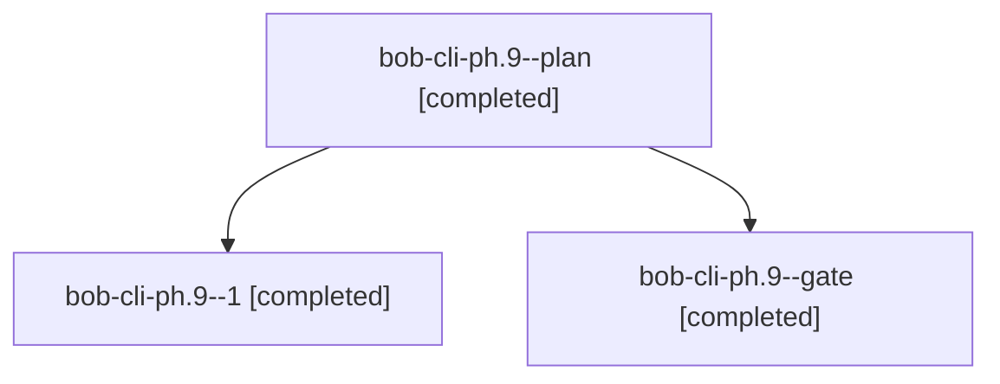

# Session: bob-cli-ph.9

[Agent Hoods](../README.md) / [bbugyi200](../users/bbugyi200/README.md) / [apollo](../users/bbugyi200/machines/apollo/README.md) / [bob-cli-ph](../users/bbugyi200/machines/apollo/hoods/bob-cli-ph/README.md) / bob-cli-ph.9

Owner: `bbugyi200.apollo` · Hood: `bob-cli-ph` · Members: 3 · Bead: [bob-cli-ph.9](https://github.com/bobs-org/bob-cli--beads/blob/main/pages/bob-cli-ph/bob-cli-ph.9.md)

## Lineage



The diagram is an optional enhancement; the ordered table below contains the same lineage in accessible text.

| Role | Agent | State | Model / provider | Timing | Commits | Prompt | Chat |
|---|---|---|---|---|---:|---|---|
| <a id="member-plan"></a>plan | bob-cli-ph.9--plan | completed | muse-spark-1.3-contributor / muse | 2026-11-25T23:57:45.524182+00:00 → 2026-11-26T00:12:45.248007+00:00 | 0 | [Prompt](../agents/bbugyi200.apollo.bob-cli-ph.9--plan/prompt.md) | [Chat](../agents/bbugyi200.apollo.bob-cli-ph.9--plan/chat.md) |
| <a id="member-1"></a>1 | bob-cli-ph.9--1 | completed | muse-spark-1.3-contributor / muse | 2026-11-26T01:46:55.008985+00:00 → 2026-11-26T01:52:25.544758+00:00 | 0 | [Prompt](../agents/bbugyi200.apollo.bob-cli-ph.9--1/prompt.md) | [Chat](../agents/bbugyi200.apollo.bob-cli-ph.9--1/chat.md) |
| <a id="member-gate"></a>gate | bob-cli-ph.9--gate | completed | muse-spark-1.3-contributor / muse | 2026-11-26T01:40:16.596987+00:00 → 2026-11-26T01:43:14.228715+00:00 | 0 | — | [Chat](../agents/bbugyi200.apollo.bob-cli-ph.9--gate/chat.md) |

## Variables

| Role | Variable | Value |
|---|---|---|
| 1 | `artifacts` | \[{bead: bob-cli-ph.9, kind: markdown, label: bob-cli-ph.9 drawer migration record for ph.10 cutover, path: /home/bryan/.sase/artifacts/agents/gh\_bobs-org\_\_bob-cli/20261125204312/bob-cli-ph9-migration… |

#### artifacts

**Role:** `1`

```yaml
- bead: bob-cli-ph.9
  kind: markdown
  label: bob-cli-ph.9 drawer migration record for ph.10 cutover
  path: /home/bryan/.sase/artifacts/agents/gh_bobs-org__bob-cli/20261125204312/bob-cli-ph9-migration-record-a8df44151858.md
  ref: file:explicit:1d4db13a0a6ed86a7c2d0374
  source_path: /tmp/bob-cli-ph9-migration-record.md
```

Values are truncated for display; see each member's agent meta.json for the full values.

## Neighbors

| Agent | Relation | State |
|---|---|---|
| [bob-cli-ph.1](bbugyi200.apollo.bob-cli-ph.1.md) (session · 31) | bob-cli-ph hood | completed 20, failed 11 |
| [bob-cli-ph.10](bbugyi200.apollo.bob-cli-ph.10.md) (session · 8) | bob-cli-ph hood | active 1, completed 4, failed 3 |
| [bob-cli-ph.11](../agents/bbugyi200.apollo.bob-cli-ph.11/README.md) | bob-cli-ph hood | waiting |
| [bob-cli-ph.2](bbugyi200.apollo.bob-cli-ph.2.md) (session · 7) | bob-cli-ph hood | active 1, completed 5, failed 1 |
| [bob-cli-ph.3](bbugyi200.apollo.bob-cli-ph.3.md) (session · 2) | bob-cli-ph hood | active 1, completed 1 |
| [bob-cli-ph.3](../agents/bbugyi200.apollo.bob-cli-ph.3/README.md) | bob-cli-ph hood | completed |
| [bob-cli-ph.4](../agents/bbugyi200.apollo.bob-cli-ph.4/README.md) | bob-cli-ph hood | completed |
| [bob-cli-ph.5](bbugyi200.apollo.bob-cli-ph.5.md) (session · 3) | bob-cli-ph hood | completed 3 |
| [bob-cli-ph.6](bbugyi200.apollo.bob-cli-ph.6.md) (session · 3) | bob-cli-ph hood | active 1, completed 2 |
| [bob-cli-ph.6.1.1](../agents/bbugyi200.apollo.bob-cli-ph.6.1.1/README.md) | bob-cli-ph hood | completed |
| [bob-cli-ph.6.1.2](../agents/bbugyi200.apollo.bob-cli-ph.6.1.2/README.md) | bob-cli-ph hood | completed |
| [bob-cli-ph.6.1.3](../agents/bbugyi200.apollo.bob-cli-ph.6.1.3/README.md) | bob-cli-ph hood | completed |
| [bob-cli-ph.6.1.4](../agents/bbugyi200.apollo.bob-cli-ph.6.1.4/README.md) | bob-cli-ph hood | completed |
| [bob-cli-ph.6.1.5](bbugyi200.apollo.bob-cli-ph.6.1.5.md) (session · 3) | bob-cli-ph hood | completed 2, failed 1 |
| [bob-cli-ph.6.1.land](../agents/bbugyi200.apollo.bob-cli-ph.6.1.land/README.md) | bob-cli-ph hood | completed |
| [bob-cli-ph.7](bbugyi200.apollo.bob-cli-ph.7.md) (session · 3) | bob-cli-ph hood | active 1, completed 2 |
| [bob-cli-ph.7.1.1](../agents/bbugyi200.apollo.bob-cli-ph.7.1.1/README.md) | bob-cli-ph hood | completed |
| [bob-cli-ph.7.1.2](bbugyi200.apollo.bob-cli-ph.7.1.2.md) (session · 9) | bob-cli-ph hood | completed 6, failed 3 |
| [bob-cli-ph.7.1.3](../agents/bbugyi200.apollo.bob-cli-ph.7.1.3/README.md) | bob-cli-ph hood | completed |
| [bob-cli-ph.7.1.4](../agents/bbugyi200.apollo.bob-cli-ph.7.1.4/README.md) | bob-cli-ph hood | completed |
| [bob-cli-ph.7.1.land](bbugyi200.apollo.bob-cli-ph.7.1.land.md) (session · 17) | bob-cli-ph hood | completed 14, failed 3 |
| [bob-cli-ph.8](bbugyi200.apollo.bob-cli-ph.8.md) (session · 7) | bob-cli-ph hood | active 1, completed 6 |
| [bob-cli-ph.8.1.1](bbugyi200.apollo.bob-cli-ph.8.1.1.md) (session · 9) | bob-cli-ph hood | completed 7, failed 2 |
| [bob-cli-ph.8.1.2](../agents/bbugyi200.apollo.bob-cli-ph.8.1.2/README.md) | bob-cli-ph hood | waiting |
| [bob-cli-ph.8.1.3](../agents/bbugyi200.apollo.bob-cli-ph.8.1.3/README.md) | bob-cli-ph hood | waiting |
| [bob-cli-ph.8.1.4](../agents/bbugyi200.apollo.bob-cli-ph.8.1.4/README.md) | bob-cli-ph hood | waiting |
| [bob-cli-ph.8.1.5](../agents/bbugyi200.apollo.bob-cli-ph.8.1.5/README.md) | bob-cli-ph hood | waiting |
| [bob-cli-ph.8.1.6](../agents/bbugyi200.apollo.bob-cli-ph.8.1.6/README.md) | bob-cli-ph hood | waiting |
| [bob-cli-ph.8.1.land](../agents/bbugyi200.apollo.bob-cli-ph.8.1.land/README.md) | bob-cli-ph hood | waiting |
| [bob-cli-ph.land](../agents/bbugyi200.apollo.bob-cli-ph.land/README.md) | bob-cli-ph hood | waiting |
