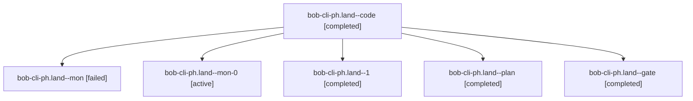

# Session: bob-cli-ph.land

[Agent Hoods](../README.md) / [bbugyi200](../users/bbugyi200/README.md) / [apollo](../users/bbugyi200/machines/apollo/README.md) / [bob-cli-ph](../users/bbugyi200/machines/apollo/hoods/bob-cli-ph/README.md) / bob-cli-ph.land

Owner: `bbugyi200.apollo` · Hood: `bob-cli-ph` · Members: 6 · Bead: [bob-cli-ph](https://github.com/bobs-org/bob-cli--beads/blob/main/pages/bob-cli-ph/README.md)

## Lineage



The diagram is an optional enhancement; the ordered table below contains the same lineage in accessible text.

| Role | Agent | State | Model / provider | Timing | Commits | Prompt | Chat |
|---|---|---|---|---|---:|---|---|
| <a id="member-code"></a>code | bob-cli-ph.land--code | completed | muse-spark-1.3-contributor / muse | 2026-11-26T12:49:13.191625+00:00 → 2026-11-26T13:18:48.194034+00:00 | [1](../agents/bbugyi200.apollo.bob-cli-ph.land--code/README.md#commits) | — | [Chat](../agents/bbugyi200.apollo.bob-cli-ph.land--code/chat.md) |
| <a id="member-mon"></a>mon | bob-cli-ph.land--mon | failed | muse-spark-1.3-contributor / muse | 2026-11-26T13:06:52.208427+00:00 → 2026-11-26T13:41:31.783997+00:00 | 0 | — | [Chat](../agents/bbugyi200.apollo.bob-cli-ph.land--mon/chat.md) |
| <a id="member-mon-0"></a>mon-0 | bob-cli-ph.land--mon-0 | active | muse-spark-1.3-contributor / muse | 2026-11-26T13:50:43.798248+00:00 | 0 | — | — |
| <a id="member-1"></a>1 | bob-cli-ph.land--1 | completed | muse-spark-1.3-contributor / muse | 2026-11-26T13:41:31.644826+00:00 → 2026-11-26T13:54:57.855148+00:00 | 0 | [Prompt](../agents/bbugyi200.apollo.bob-cli-ph.land--1/prompt.md) | [Chat](../agents/bbugyi200.apollo.bob-cli-ph.land--1/chat.md) |
| <a id="member-plan"></a>plan | bob-cli-ph.land--plan | completed | opus / claude | 2026-11-26T11:52:52.516403+00:00 → 2026-11-26T13:18:48.194034+00:00 | [1](../agents/bbugyi200.apollo.bob-cli-ph.land--plan/README.md#commits) | [Prompt](../agents/bbugyi200.apollo.bob-cli-ph.land--plan/prompt.md) | [Chat](../agents/bbugyi200.apollo.bob-cli-ph.land--plan/chat.md) |
| <a id="member-gate"></a>gate | bob-cli-ph.land--gate | completed | opus / claude | 2026-11-26T12:48:08.195201+00:00 → 2026-11-26T12:48:18.078040+00:00 | 0 | — | [Chat](../agents/bbugyi200.apollo.bob-cli-ph.land--gate/chat.md) |

## Commits

| Role | Repo | Commit | Subject | Committed |
|---|---|---|---|---|
| plan | bob-cli | [`db5a70c`](https://github.com/bobs-org/bob-cli/commit/db5a70cc185e1a607b6fe019422e3c7f7aa0d0b1) | fix(memory): repair drawer supersession frontmatter and regenerate drawer docs | 2026-11-26 07:46:29 EST |
| code | bob-cli | [`4dd787b`](https://github.com/bobs-org/bob-cli/commit/4dd787bceaa2c0f16e25336ec6b3ff65d6a731f5) | test(drawers): begin post-cutover true-case migration for bob-cli-ph | 2026-11-26 08:09:54 EST |

## Variables

| Role | Variable | Value |
|---|---|---|
| plan | `artifacts` | \[{bead: bob-cli-ph, kind: file, label: bob-cli-ph land: bob-host-currency bold-only drawer readers on athena/apollo/mac (2026-11-26), path: /home/bryan/.sase/artifacts/agents/gh\_bobs-org\_\_bob-cli/202… |

#### artifacts

**Role:** `plan`

```yaml
- bead: bob-cli-ph
  kind: file
  label: bob-cli-ph land: bob-host-currency bold-only drawer readers on athena/apollo/mac (2026-11-26)
  path: /home/bryan/.sase/artifacts/agents/gh_bobs-org__bob-cli/20261125060507/host_currency_bold_only_ph_land-a3555a4359d8.txt
  ref: file:explicit:dc76e318e355523f6fc8a927
  source_path: /tmp/phland/host_currency_bold_only_ph_land.txt
```

Values are truncated for display; see each member's agent meta.json for the full values.

## Neighbors

| Agent | Relation | State |
|---|---|---|
| [bob-cli-ph.1](bbugyi200.apollo.bob-cli-ph.1.md) (session · 31) | bob-cli-ph hood | completed 20, failed 11 |
| [bob-cli-ph.10](bbugyi200.apollo.bob-cli-ph.10.md) (session · 16) | bob-cli-ph hood | completed 8, failed 8 |
| [bob-cli-ph.10](../agents/bbugyi200.apollo.bob-cli-ph.10/README.md) | bob-cli-ph hood | completed |
| [bob-cli-ph.11](../agents/bbugyi200.apollo.bob-cli-ph.11/README.md) | bob-cli-ph hood | completed |
| [bob-cli-ph.2](bbugyi200.apollo.bob-cli-ph.2.md) (session · 7) | bob-cli-ph hood | active 1, completed 5, failed 1 |
| [bob-cli-ph.3](bbugyi200.apollo.bob-cli-ph.3.md) (session · 2) | bob-cli-ph hood | active 1, completed 1 |
| [bob-cli-ph.3](../agents/bbugyi200.apollo.bob-cli-ph.3/README.md) | bob-cli-ph hood | completed |
| [bob-cli-ph.4](../agents/bbugyi200.apollo.bob-cli-ph.4/README.md) | bob-cli-ph hood | completed |
| [bob-cli-ph.5](bbugyi200.apollo.bob-cli-ph.5.md) (session · 3) | bob-cli-ph hood | completed 3 |
| [bob-cli-ph.6](bbugyi200.apollo.bob-cli-ph.6.md) (session · 3) | bob-cli-ph hood | active 1, completed 2 |
| [bob-cli-ph.6.1.1](../agents/bbugyi200.apollo.bob-cli-ph.6.1.1/README.md) | bob-cli-ph hood | completed |
| [bob-cli-ph.6.1.2](../agents/bbugyi200.apollo.bob-cli-ph.6.1.2/README.md) | bob-cli-ph hood | completed |
| [bob-cli-ph.6.1.3](../agents/bbugyi200.apollo.bob-cli-ph.6.1.3/README.md) | bob-cli-ph hood | completed |
| [bob-cli-ph.6.1.4](../agents/bbugyi200.apollo.bob-cli-ph.6.1.4/README.md) | bob-cli-ph hood | completed |
| [bob-cli-ph.6.1.5](bbugyi200.apollo.bob-cli-ph.6.1.5.md) (session · 3) | bob-cli-ph hood | completed 2, failed 1 |
| [bob-cli-ph.6.1.land](../agents/bbugyi200.apollo.bob-cli-ph.6.1.land/README.md) | bob-cli-ph hood | completed |
| [bob-cli-ph.7](bbugyi200.apollo.bob-cli-ph.7.md) (session · 3) | bob-cli-ph hood | active 1, completed 2 |
| [bob-cli-ph.7.1.1](../agents/bbugyi200.apollo.bob-cli-ph.7.1.1/README.md) | bob-cli-ph hood | completed |
| [bob-cli-ph.7.1.2](bbugyi200.apollo.bob-cli-ph.7.1.2.md) (session · 9) | bob-cli-ph hood | completed 6, failed 3 |
| [bob-cli-ph.7.1.3](../agents/bbugyi200.apollo.bob-cli-ph.7.1.3/README.md) | bob-cli-ph hood | completed |
| [bob-cli-ph.7.1.4](../agents/bbugyi200.apollo.bob-cli-ph.7.1.4/README.md) | bob-cli-ph hood | completed |
| [bob-cli-ph.7.1.land](bbugyi200.apollo.bob-cli-ph.7.1.land.md) (session · 17) | bob-cli-ph hood | completed 14, failed 3 |
| [bob-cli-ph.8](bbugyi200.apollo.bob-cli-ph.8.md) (session · 7) | bob-cli-ph hood | active 1, completed 6 |
| [bob-cli-ph.8.1.1](bbugyi200.apollo.bob-cli-ph.8.1.1.md) (session · 9) | bob-cli-ph hood | completed 7, failed 2 |
| [bob-cli-ph.8.1.2](bbugyi200.apollo.bob-cli-ph.8.1.2.md) (session · 7) | bob-cli-ph hood | completed 5, failed 2 |
| [bob-cli-ph.8.1.3](bbugyi200.apollo.bob-cli-ph.8.1.3.md) (session · 3) | bob-cli-ph hood | completed 2, failed 1 |
| [bob-cli-ph.8.1.4](bbugyi200.apollo.bob-cli-ph.8.1.4.md) (session · 3) | bob-cli-ph hood | completed 2, failed 1 |
| [bob-cli-ph.8.1.5](bbugyi200.apollo.bob-cli-ph.8.1.5.md) (session · 7) | bob-cli-ph hood | completed 5, failed 2 |
| [bob-cli-ph.8.1.6](bbugyi200.apollo.bob-cli-ph.8.1.6.md) (session · 3) | bob-cli-ph hood | completed 2, failed 1 |
| [bob-cli-ph.8.1.land](bbugyi200.apollo.bob-cli-ph.8.1.land.md) (session · 13) | bob-cli-ph hood | completed 10, failed 3 |
| [bob-cli-ph.9](bbugyi200.apollo.bob-cli-ph.9.md) (session · 3) | bob-cli-ph hood | completed 3 |
