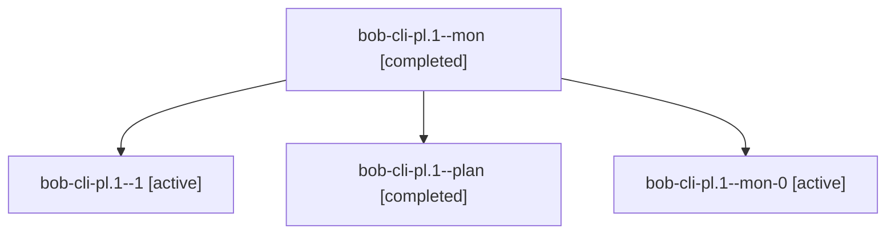

# Session: bob-cli-pl.1

[Agent Hoods](../README.md) / [bbugyi200](../users/bbugyi200/README.md) / [apollo](../users/bbugyi200/machines/apollo/README.md) / [bob-cli-pl](../users/bbugyi200/machines/apollo/hoods/bob-cli-pl/README.md) / bob-cli-pl.1

Owner: `bbugyi200.apollo` · Hood: `bob-cli-pl` · Members: 4 · Bead: [bob-cli-pl.1](https://github.com/bobs-org/bob-cli--beads/blob/main/pages/bob-cli-pl/bob-cli-pl.1.md)

## Lineage

The diagram is an optional enhancement; the ordered table below contains the same lineage in accessible text.

| Role | Agent | State | Model / provider | Timing | Commits | Prompt | Chat |
|---|---|---|---|---|---:|---|---|
| mon | bob-cli-pl.1--mon | completed | gpt-6-astra / codex | 2026-11-23T02:11:24.359689+00:00 → 2026-11-24T14:43:49.190481+00:00 | 0 | — | [Chat](../agents/bbugyi200.apollo.bob-cli-pl.1--mon/chat.md) |
| 1 | bob-cli-pl.1--1 | active | gpt-6-astra / codex | 2026-11-24T14:43:48.984065+00:00 | 0 | [Prompt](../agents/bbugyi200.apollo.bob-cli-pl.1--1/prompt.md) | — |
| plan | bob-cli-pl.1--plan | completed | gpt-6-astra / codex | 2026-11-23T02:07:50.463579+00:00 → 2026-11-23T02:12:00.773286+00:00 | 0 | [Prompt](../agents/bbugyi200.apollo.bob-cli-pl.1--plan/prompt.md) | [Chat](../agents/bbugyi200.apollo.bob-cli-pl.1--plan/chat.md) |
| mon-0 | bob-cli-pl.1--mon-0 | active | gpt-6-astra / codex | 2026-11-24T14:56:15.553091+00:00 | 0 | — | — |

## Neighbors

| Agent | Relation | State |
|---|---|---|
| [bob-cli-pl.2](bbugyi200.apollo.bob-cli-pl.2.md) (session · 3) | bob-cli-pl hood | active 1, completed 2 |
| [bob-cli-pl.3](../agents/bbugyi200.apollo.bob-cli-pl.3/README.md) | bob-cli-pl hood | waiting |
| [bob-cli-pl.4](bbugyi200.apollo.bob-cli-pl.4.md) (session · 5) | bob-cli-pl hood | completed 5 |
| [bob-cli-pl.4.1.1](../agents/bbugyi200.apollo.bob-cli-pl.4.1.1/README.md) | bob-cli-pl hood | active |
| [bob-cli-pl.4.1.2](../agents/bbugyi200.apollo.bob-cli-pl.4.1.2/README.md) | bob-cli-pl hood | waiting |
| [bob-cli-pl.4.1.3](../agents/bbugyi200.apollo.bob-cli-pl.4.1.3/README.md) | bob-cli-pl hood | waiting |
| [bob-cli-pl.4.1.land](../agents/bbugyi200.apollo.bob-cli-pl.4.1.land/README.md) | bob-cli-pl hood | waiting |
| [bob-cli-pl.5](../agents/bbugyi200.apollo.bob-cli-pl.5/README.md) | bob-cli-pl hood | waiting |
| [bob-cli-pl.6](../agents/bbugyi200.apollo.bob-cli-pl.6/README.md) | bob-cli-pl hood | waiting |
| [bob-cli-pl.7](../agents/bbugyi200.apollo.bob-cli-pl.7/README.md) | bob-cli-pl hood | waiting |
| [bob-cli-pl.8](../agents/bbugyi200.apollo.bob-cli-pl.8/README.md) | bob-cli-pl hood | waiting |
| [bob-cli-pl.9](../agents/bbugyi200.apollo.bob-cli-pl.9/README.md) | bob-cli-pl hood | waiting |
| [bob-cli-pl.land](../agents/bbugyi200.apollo.bob-cli-pl.land/README.md) | bob-cli-pl hood | waiting |
