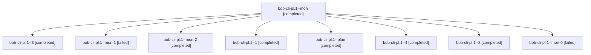

# Session: bob-cli-pl.1

[Agent Hoods](../README.md) / [bbugyi200](../users/bbugyi200/README.md) / [apollo](../users/bbugyi200/machines/apollo/README.md) / [bob-cli-pl](../users/bbugyi200/machines/apollo/hoods/bob-cli-pl/README.md) / bob-cli-pl.1

Owner: `bbugyi200.apollo` · Hood: `bob-cli-pl` · Members: 9 · Bead: [bob-cli-pl.1](https://github.com/bobs-org/bob-cli--beads/blob/main/pages/bob-cli-pl/bob-cli-pl.1.md)

## Lineage



The diagram is an optional enhancement; the ordered table below contains the same lineage in accessible text.

| Role | Agent | State | Model / provider | Timing | Commits | Prompt | Chat |
|---|---|---|---|---|---:|---|---|
| <a id="member-mon"></a>mon | bob-cli-pl.1--mon | completed | gpt-6-astra / codex | 2026-11-23T02:11:24.359689+00:00 → 2026-11-24T14:43:49.190481+00:00 | 0 | — | [Chat](../agents/bbugyi200.apollo.bob-cli-pl.1--mon/chat.md) |
| <a id="member-3"></a>3 | bob-cli-pl.1--3 | completed | gpt-6-astra / codex | 2026-11-24T16:13:27.813558+00:00 → 2026-11-24T16:24:20.764083+00:00 | 0 | [Prompt](../agents/bbugyi200.apollo.bob-cli-pl.1--3/prompt.md) | [Chat](../agents/bbugyi200.apollo.bob-cli-pl.1--3/chat.md) |
| <a id="member-mon-1"></a>mon-1 | bob-cli-pl.1--mon-1 | failed | gpt-6-astra / codex | 2026-11-24T15:37:10.157645+00:00 → 2026-11-24T16:03:00.989921+00:00 | 0 | — | [Chat](../agents/bbugyi200.apollo.bob-cli-pl.1--mon-1/chat.md) |
| <a id="member-mon-2"></a>mon-2 | bob-cli-pl.1--mon-2 | completed | gpt-6-astra / codex | 2026-11-24T16:23:12.594085+00:00 → 2026-11-24T16:48:31.047213+00:00 | 0 | — | [Chat](../agents/bbugyi200.apollo.bob-cli-pl.1--mon-2/chat.md) |
| <a id="member-1"></a>1 | bob-cli-pl.1--1 | completed | gpt-6-astra / codex | 2026-11-24T14:43:48.984065+00:00 → 2026-11-24T14:57:36.905432+00:00 | 0 | [Prompt](../agents/bbugyi200.apollo.bob-cli-pl.1--1/prompt.md) | [Chat](../agents/bbugyi200.apollo.bob-cli-pl.1--1/chat.md) |
| <a id="member-plan"></a>plan | bob-cli-pl.1--plan | completed | gpt-6-astra / codex | 2026-11-23T02:07:50.463579+00:00 → 2026-11-23T02:12:00.773286+00:00 | 0 | [Prompt](../agents/bbugyi200.apollo.bob-cli-pl.1--plan/prompt.md) | [Chat](../agents/bbugyi200.apollo.bob-cli-pl.1--plan/chat.md) |
| <a id="member-4"></a>4 | bob-cli-pl.1--4 | completed | gpt-6-astra / codex | 2026-11-24T16:51:26.352822+00:00 → 2026-11-24T17:33:38.810381+00:00 | [1](../agents/bbugyi200.apollo.bob-cli-pl.1--4/README.md#commits) | [Prompt](../agents/bbugyi200.apollo.bob-cli-pl.1--4/prompt.md) | [Chat](../agents/bbugyi200.apollo.bob-cli-pl.1--4/chat.md) |
| <a id="member-2"></a>2 | bob-cli-pl.1--2 | completed | gpt-6-astra / codex | 2026-11-24T15:15:09.188538+00:00 → 2026-11-24T15:38:21.409370+00:00 | 0 | [Prompt](../agents/bbugyi200.apollo.bob-cli-pl.1--2/prompt.md) | [Chat](../agents/bbugyi200.apollo.bob-cli-pl.1--2/chat.md) |
| <a id="member-mon-0"></a>mon-0 | bob-cli-pl.1--mon-0 | failed | gpt-6-astra / codex | 2026-11-24T14:56:15.553091+00:00 → 2026-11-24T15:15:09.334345+00:00 | 0 | — | [Chat](../agents/bbugyi200.apollo.bob-cli-pl.1--mon-0/chat.md) |

## Commits

| Role | Repo | Commit | Subject | Committed |
|---|---|---|---|---|
| 4 | bob-cli | [`31131fe`](https://github.com/bobs-org/bob-cli/commit/31131fe2f6151fafb941f92a78894d19784f04f6) | fix(props): allow removal of retired project count fields | 2026-11-24 12:07:50 EST |

## Variables

| Role | Variable | Value |
|---|---|---|
| 2 | `artifacts` | \[{bead: bob-cli-pl.1, kind: image, label: Project Base Active after count retirement, path: /home/bryan/.sase/artifacts/agents/gh\_bobs-org\_\_bob-cli/20261124101410/active-c3c91644958d.png, ref: file:e… |
| 3 | `artifacts` | \[{bead: bob-cli-pl.1, kind: file, label: Project count cleanup: stale Mac restoration evidence, path: /home/bryan/.sase/artifacts/agents/gh\_bobs-org\_\_bob-cli/20261124110200/live-recovery-evidence-431… |
| 4 | `artifacts` | \[{bead: bob-cli-pl.1, kind: file, label: bob-cli-pl.1 final live cleanup acceptance receipt, path: /home/bryan/.sase/artifacts/agents/gh\_bobs-org\_\_bob-cli/20261124114730/final-cleanup-receipt-d9f24c2… |

#### artifacts

**Role:** `2`

```yaml
- bead: bob-cli-pl.1
  kind: image
  label: Project Base Active after count retirement
  path: /home/bryan/.sase/artifacts/agents/gh_bobs-org__bob-cli/20261124101410/active-c3c91644958d.png
  ref: file:explicit:18af8a410edfdba7f8a5506b
  source_path: /home/bryan/.local/state/sase/workspaces/bobs-org/bob-cli/bob-cli_16/.git/pl1-acceptance/active.png
```

#### artifacts

**Role:** `3`

```yaml
- bead: bob-cli-pl.1
  kind: file
  label: Project count cleanup: stale Mac restoration evidence
  path: /home/bryan/.sase/artifacts/agents/gh_bobs-org__bob-cli/20261124110200/live-recovery-evidence-431cda04faa1.json
  ref: file:explicit:5c8a64dd5b630b4d7f26d2e5
  source_path: /home/bryan/.local/state/sase/workspaces/bobs-org/bob-cli/bob-cli_16/.git/pl1-acceptance/live-recovery-evidence.json
```

#### artifacts

**Role:** `4`

```yaml
- bead: bob-cli-pl.1
  kind: file
  label: bob-cli-pl.1 final live cleanup acceptance receipt
  path: /home/bryan/.sase/artifacts/agents/gh_bobs-org__bob-cli/20261124114730/final-cleanup-receipt-d9f24c21ebb0.json
  ref: file:explicit:7e981553181fd23c81d6b221
  source_path: /home/bryan/.local/state/sase/workspaces/bobs-org/bob-cli/bob-cli_16/.git/pl1-acceptance/final-cleanup-receipt.json
```

Values are truncated for display; see each member's agent meta.json for the full values.

## Neighbors

| Agent | Relation | State |
|---|---|---|
| [bob-cli-pl.2](bbugyi200.apollo.bob-cli-pl.2.md) (session · 5) | bob-cli-pl hood | completed 4, failed 1 |
| [bob-cli-pl.3](../agents/bbugyi200.apollo.bob-cli-pl.3/README.md) | bob-cli-pl hood | completed |
| [bob-cli-pl.4](bbugyi200.apollo.bob-cli-pl.4.md) (session · 5) | bob-cli-pl hood | completed 5 |
| [bob-cli-pl.4.1.1](../agents/bbugyi200.apollo.bob-cli-pl.4.1.1/README.md) | bob-cli-pl hood | completed |
| [bob-cli-pl.4.1.2](../agents/bbugyi200.apollo.bob-cli-pl.4.1.2/README.md) | bob-cli-pl hood | completed |
| [bob-cli-pl.4.1.3](bbugyi200.apollo.bob-cli-pl.4.1.3.md) (session · 12) | bob-cli-pl hood | completed 7, failed 5 |
| [bob-cli-pl.4.1.land](bbugyi200.apollo.bob-cli-pl.4.1.land.md) (session · 3) | bob-cli-pl hood | completed 3 |
| [bob-cli-pl.5](../agents/bbugyi200.apollo.bob-cli-pl.5/README.md) | bob-cli-pl hood | completed |
| [bob-cli-pl.6](bbugyi200.apollo.bob-cli-pl.6.md) (session · 3) | bob-cli-pl hood | active 1, completed 2 |
| [bob-cli-pl.6.1.1](bbugyi200.apollo.bob-cli-pl.6.1.1.md) (session · 3) | bob-cli-pl hood | completed 3 |
| [bob-cli-pl.6.1.2](bbugyi200.apollo.bob-cli-pl.6.1.2.md) (session · 8) | bob-cli-pl hood | active 1, completed 4, failed 3 |
| [bob-cli-pl.6.1.2](../agents/bbugyi200.apollo.bob-cli-pl.6.1.2/README.md) | bob-cli-pl hood | completed |
| [bob-cli-pl.6.1.3](../agents/bbugyi200.apollo.bob-cli-pl.6.1.3/README.md) | bob-cli-pl hood | completed |
| [bob-cli-pl.6.1.4](../agents/bbugyi200.apollo.bob-cli-pl.6.1.4/README.md) | bob-cli-pl hood | completed |
| [bob-cli-pl.6.1.5](bbugyi200.apollo.bob-cli-pl.6.1.5.md) (session · 18) | bob-cli-pl hood | active 1, completed 9, failed 8 |
| [bob-cli-pl.6.1.land](../agents/bbugyi200.apollo.bob-cli-pl.6.1.land/README.md) | bob-cli-pl hood | waiting |
| [bob-cli-pl.7](../agents/bbugyi200.apollo.bob-cli-pl.7/README.md) | bob-cli-pl hood | waiting |
| [bob-cli-pl.8](../agents/bbugyi200.apollo.bob-cli-pl.8/README.md) | bob-cli-pl hood | waiting |
| [bob-cli-pl.9](../agents/bbugyi200.apollo.bob-cli-pl.9/README.md) | bob-cli-pl hood | waiting |
| [bob-cli-pl.land](../agents/bbugyi200.apollo.bob-cli-pl.land/README.md) | bob-cli-pl hood | waiting |
