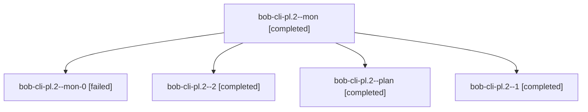

# Session: bob-cli-pl.2

[Agent Hoods](../README.md) / [bbugyi200](../users/bbugyi200/README.md) / [apollo](../users/bbugyi200/machines/apollo/README.md) / [bob-cli-pl](../users/bbugyi200/machines/apollo/hoods/bob-cli-pl/README.md) / bob-cli-pl.2

Owner: `bbugyi200.apollo` · Hood: `bob-cli-pl` · Members: 5 · Bead: [bob-cli-pl.2](https://github.com/bobs-org/bob-cli--beads/blob/main/pages/bob-cli-pl/bob-cli-pl.2.md)

## Lineage

The diagram is an optional enhancement; the ordered table below contains the same lineage in accessible text.

| Role | Agent | State | Model / provider | Timing | Commits | Prompt | Chat |
|---|---|---|---|---|---:|---|---|
| mon | bob-cli-pl.2--mon | completed | gpt-6-astra / codex | 2026-11-23T02:34:00.159861+00:00 → 2026-11-24T14:42:52.774676+00:00 | 0 | — | [Chat](../agents/bbugyi200.apollo.bob-cli-pl.2--mon/chat.md) |
| mon-0 | bob-cli-pl.2--mon-0 | failed | gpt-6-astra / codex | 2026-11-24T15:26:33.398518+00:00 → 2026-11-24T15:33:35.971150+00:00 | 0 | — | [Chat](../agents/bbugyi200.apollo.bob-cli-pl.2--mon-0/chat.md) |
| 2 | bob-cli-pl.2--2 | completed | gpt-6-astra / codex | 2026-11-24T15:33:39.740526+00:00 → 2026-11-24T16:01:19.248284+00:00 | [1](../agents/bbugyi200.apollo.bob-cli-pl.2--2/README.md#commits) | [Prompt](../agents/bbugyi200.apollo.bob-cli-pl.2--2/prompt.md) | [Chat](../agents/bbugyi200.apollo.bob-cli-pl.2--2/chat.md) |
| plan | bob-cli-pl.2--plan | completed | gpt-6-astra / codex | 2026-11-23T02:29:31.555283+00:00 → 2026-11-23T02:34:39.401684+00:00 | 0 | [Prompt](../agents/bbugyi200.apollo.bob-cli-pl.2--plan/prompt.md) | [Chat](../agents/bbugyi200.apollo.bob-cli-pl.2--plan/chat.md) |
| 1 | bob-cli-pl.2--1 | completed | gpt-6-astra / codex | 2026-11-24T14:42:52.423089+00:00 → 2026-11-24T15:27:24.970743+00:00 | 0 | [Prompt](../agents/bbugyi200.apollo.bob-cli-pl.2--1/prompt.md) | [Chat](../agents/bbugyi200.apollo.bob-cli-pl.2--1/chat.md) |

## Commits

| Role | Repo | Commit | Subject | Committed |
|---|---|---|---|---|
| 2 | bob-cli | [`d39680d`](https://github.com/bobs-org/bob-cli/commit/d39680dda4120b90602467ec812ec819d7a984d2) | feat(props): validate area and project setting writes | 2026-11-24 10:59:57 EST |

## Neighbors

| Agent | Relation | State |
|---|---|---|
| [bob-cli-pl.1](bbugyi200.apollo.bob-cli-pl.1.md) (session · 9) | bob-cli-pl hood | completed 7, failed 2 |
| [bob-cli-pl.3](../agents/bbugyi200.apollo.bob-cli-pl.3/README.md) | bob-cli-pl hood | completed |
| [bob-cli-pl.4](bbugyi200.apollo.bob-cli-pl.4.md) (session · 5) | bob-cli-pl hood | completed 5 |
| [bob-cli-pl.4.1.1](../agents/bbugyi200.apollo.bob-cli-pl.4.1.1/README.md) | bob-cli-pl hood | completed |
| [bob-cli-pl.4.1.2](../agents/bbugyi200.apollo.bob-cli-pl.4.1.2/README.md) | bob-cli-pl hood | completed |
| [bob-cli-pl.4.1.3](bbugyi200.apollo.bob-cli-pl.4.1.3.md) (session · 12) | bob-cli-pl hood | completed 7, failed 5 |
| [bob-cli-pl.4.1.land](bbugyi200.apollo.bob-cli-pl.4.1.land.md) (session · 3) | bob-cli-pl hood | completed 3 |
| [bob-cli-pl.5](../agents/bbugyi200.apollo.bob-cli-pl.5/README.md) | bob-cli-pl hood | completed |
| [bob-cli-pl.6](bbugyi200.apollo.bob-cli-pl.6.md) (session · 3) | bob-cli-pl hood | active 1, completed 2 |
| [bob-cli-pl.6.1.1](bbugyi200.apollo.bob-cli-pl.6.1.1.md) (session · 3) | bob-cli-pl hood | completed 3 |
| [bob-cli-pl.6.1.2](bbugyi200.apollo.bob-cli-pl.6.1.2.md) (session · 8) | bob-cli-pl hood | active 1, completed 4, failed 3 |
| [bob-cli-pl.6.1.2](../agents/bbugyi200.apollo.bob-cli-pl.6.1.2/README.md) | bob-cli-pl hood | completed |
| [bob-cli-pl.6.1.3](../agents/bbugyi200.apollo.bob-cli-pl.6.1.3/README.md) | bob-cli-pl hood | completed |
| [bob-cli-pl.6.1.4](../agents/bbugyi200.apollo.bob-cli-pl.6.1.4/README.md) | bob-cli-pl hood | waiting |
| [bob-cli-pl.6.1.5](../agents/bbugyi200.apollo.bob-cli-pl.6.1.5/README.md) | bob-cli-pl hood | waiting |
| [bob-cli-pl.6.1.land](../agents/bbugyi200.apollo.bob-cli-pl.6.1.land/README.md) | bob-cli-pl hood | waiting |
| [bob-cli-pl.7](../agents/bbugyi200.apollo.bob-cli-pl.7/README.md) | bob-cli-pl hood | waiting |
| [bob-cli-pl.8](../agents/bbugyi200.apollo.bob-cli-pl.8/README.md) | bob-cli-pl hood | waiting |
| [bob-cli-pl.9](../agents/bbugyi200.apollo.bob-cli-pl.9/README.md) | bob-cli-pl hood | waiting |
| [bob-cli-pl.land](../agents/bbugyi200.apollo.bob-cli-pl.land/README.md) | bob-cli-pl hood | waiting |
