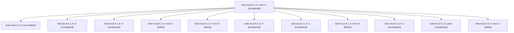

# Session: bob-cli-pl.4.1.3

[Agent Hoods](../README.md) / [bbugyi200](../users/bbugyi200/README.md) / [apollo](../users/bbugyi200/machines/apollo/README.md) / [bob-cli-pl](../users/bbugyi200/machines/apollo/hoods/bob-cli-pl/README.md) / bob-cli-pl.4.1.3

Owner: `bbugyi200.apollo` · Hood: `bob-cli-pl` · Members: 12 · Bead: [bob-cli-pl.4.1.3](https://github.com/bobs-org/bob-cli--beads/blob/main/pages/bob-cli-pl/bob-cli-pl.4.1.3.md)

## Lineage

The diagram is an optional enhancement; the ordered table below contains the same lineage in accessible text.

| Role | Agent | State | Model / provider | Timing | Commits | Prompt | Chat |
|---|---|---|---|---|---:|---|---|
| mon-4 | bob-cli-pl.4.1.3--mon-4 | completed | gpt-6-luna / codex | 2026-11-24T18:51:53.859733+00:00 → 2026-11-24T19:02:16.983632+00:00 | 0 | — | [Chat](../agents/bbugyi200.apollo.bob-cli-pl.4.1.3--mon-4/chat.md) |
| mon | bob-cli-pl.4.1.3--mon | failed | gpt-6-luna / codex | 2026-11-24T16:34:46.957795+00:00 → 2026-11-24T17:04:17.858872+00:00 | 0 | — | [Chat](../agents/bbugyi200.apollo.bob-cli-pl.4.1.3--mon/chat.md) |
| 5 | bob-cli-pl.4.1.3--5 | completed | gpt-6-luna / codex | 2026-11-24T19:02:16.678149+00:00 → 2026-11-24T19:05:41.395119+00:00 | 0 | [Prompt](../agents/bbugyi200.apollo.bob-cli-pl.4.1.3--5/prompt.md) | [Chat](../agents/bbugyi200.apollo.bob-cli-pl.4.1.3--5/chat.md) |
| 4 | bob-cli-pl.4.1.3--4 | completed | gpt-6-luna / codex | 2026-11-24T18:47:38.322805+00:00 → 2026-11-24T18:53:11.081738+00:00 | 0 | [Prompt](../agents/bbugyi200.apollo.bob-cli-pl.4.1.3--4/prompt.md) | [Chat](../agents/bbugyi200.apollo.bob-cli-pl.4.1.3--4/chat.md) |
| mon-2 | bob-cli-pl.4.1.3--mon-2 | failed | gpt-6-luna / codex | 2026-11-24T18:40:19.609422+00:00 → 2026-11-24T18:40:20.989252+00:00 | 0 | — | — |
| mon-0 | bob-cli-pl.4.1.3--mon-0 | failed | gpt-6-luna / codex | 2026-11-24T17:11:02.442366+00:00 → 2026-11-24T17:14:48.287821+00:00 | 0 | — | [Chat](../agents/bbugyi200.apollo.bob-cli-pl.4.1.3--mon-0/chat.md) |
| 3 | bob-cli-pl.4.1.3--3 | completed | gpt-6-luna / codex | 2026-11-24T18:31:07.319873+00:00 → 2026-11-24T18:43:45.758430+00:00 | 0 | [Prompt](../agents/bbugyi200.apollo.bob-cli-pl.4.1.3--3/prompt.md) | [Chat](../agents/bbugyi200.apollo.bob-cli-pl.4.1.3--3/chat.md) |
| 1 | bob-cli-pl.4.1.3--1 | completed | gpt-6-luna / codex | 2026-11-24T17:06:09.957980+00:00 → 2026-11-24T17:12:20.226982+00:00 | 0 | [Prompt](../agents/bbugyi200.apollo.bob-cli-pl.4.1.3--1/prompt.md) | [Chat](../agents/bbugyi200.apollo.bob-cli-pl.4.1.3--1/chat.md) |
| mon-3 | bob-cli-pl.4.1.3--mon-3 | failed | gpt-6-luna / codex | 2026-11-24T18:40:59.778977+00:00 → 2026-11-24T18:47:38.366019+00:00 | 0 | — | [Chat](../agents/bbugyi200.apollo.bob-cli-pl.4.1.3--mon-3/chat.md) |
| 2 | bob-cli-pl.4.1.3--2 | completed | gpt-6-luna / codex | 2026-11-24T17:14:48.264943+00:00 → 2026-11-24T17:44:50.057000+00:00 | 0 | [Prompt](../agents/bbugyi200.apollo.bob-cli-pl.4.1.3--2/prompt.md) | [Chat](../agents/bbugyi200.apollo.bob-cli-pl.4.1.3--2/chat.md) |
| plan | bob-cli-pl.4.1.3--plan | completed | gpt-6-luna / codex | 2026-11-24T16:01:19.652179+00:00 → 2026-11-24T16:37:45.342247+00:00 | 0 | [Prompt](../agents/bbugyi200.apollo.bob-cli-pl.4.1.3--plan/prompt.md) | [Chat](../agents/bbugyi200.apollo.bob-cli-pl.4.1.3--plan/chat.md) |
| mon-1 | bob-cli-pl.4.1.3--mon-1 | failed | gpt-6-luna / codex | 2026-11-24T17:43:43.547524+00:00 → 2026-11-24T18:31:07.469704+00:00 | 0 | — | [Chat](../agents/bbugyi200.apollo.bob-cli-pl.4.1.3--mon-1/chat.md) |

## Neighbors

| Agent | Relation | State |
|---|---|---|
| [bob-cli-pl.4](bbugyi200.apollo.bob-cli-pl.4.md) (session · 5) | ancestor | completed 5 |
| [bob-cli-pl.4.1.1](../agents/bbugyi200.apollo.bob-cli-pl.4.1.1/README.md) | bob-cli-pl.4.1 hood | completed |
| [bob-cli-pl.4.1.2](../agents/bbugyi200.apollo.bob-cli-pl.4.1.2/README.md) | bob-cli-pl.4.1 hood | completed |
| [bob-cli-pl.4.1.land](bbugyi200.apollo.bob-cli-pl.4.1.land.md) (session · 3) | bob-cli-pl.4.1 hood | completed 3 |
| [bob-cli-pl.1](bbugyi200.apollo.bob-cli-pl.1.md) (session · 9) | bob-cli-pl hood | completed 7, failed 2 |
| [bob-cli-pl.2](bbugyi200.apollo.bob-cli-pl.2.md) (session · 5) | bob-cli-pl hood | completed 4, failed 1 |
| [bob-cli-pl.3](../agents/bbugyi200.apollo.bob-cli-pl.3/README.md) | bob-cli-pl hood | completed |
| [bob-cli-pl.5](../agents/bbugyi200.apollo.bob-cli-pl.5/README.md) | bob-cli-pl hood | completed |
| [bob-cli-pl.6](bbugyi200.apollo.bob-cli-pl.6.md) (session · 3) | bob-cli-pl hood | completed 2, dismissed 1 |
| [bob-cli-pl.6.1.1](bbugyi200.apollo.bob-cli-pl.6.1.1.md) (session · 3) | bob-cli-pl hood | completed 3 |
| [bob-cli-pl.6.1.2](bbugyi200.apollo.bob-cli-pl.6.1.2.md) (session · 8) | bob-cli-pl hood | active 1, completed 4, failed 3 |
| [bob-cli-pl.6.1.2](../agents/bbugyi200.apollo.bob-cli-pl.6.1.2/README.md) | bob-cli-pl hood | completed |
| [bob-cli-pl.6.1.3](../agents/bbugyi200.apollo.bob-cli-pl.6.1.3/README.md) | bob-cli-pl hood | completed |
| [bob-cli-pl.6.1.4](../agents/bbugyi200.apollo.bob-cli-pl.6.1.4/README.md) | bob-cli-pl hood | completed |
| [bob-cli-pl.6.1.5](bbugyi200.apollo.bob-cli-pl.6.1.5.md) (session · 21) | bob-cli-pl hood | active 3, completed 10, failed 8 |
| [bob-cli-pl.6.1.land](../agents/bbugyi200.apollo.bob-cli-pl.6.1.land/README.md) | bob-cli-pl hood | completed |
| [bob-cli-pl.7](../agents/bbugyi200.apollo.bob-cli-pl.7/README.md) | bob-cli-pl hood | completed |
| [bob-cli-pl.8](../agents/bbugyi200.apollo.bob-cli-pl.8/README.md) | bob-cli-pl hood | completed |
| [bob-cli-pl.9](bbugyi200.apollo.bob-cli-pl.9.md) (session · 3) | bob-cli-pl hood | active 1, completed 2 |
| [bob-cli-pl.9.1.1](../agents/bbugyi200.apollo.bob-cli-pl.9.1.1/README.md) | bob-cli-pl hood | completed |
| [bob-cli-pl.9.1.2](bbugyi200.apollo.bob-cli-pl.9.1.2.md) (session · 31) | bob-cli-pl hood | active 1, completed 20, dismissed 1, failed 9 |
| [bob-cli-pl.9.1.2.1.1](bbugyi200.apollo.bob-cli-pl.9.1.2.1.1.md) (session · 11) | bob-cli-pl hood | completed 7, failed 4 |
| [bob-cli-pl.9.1.2.1.2](../agents/bbugyi200.apollo.bob-cli-pl.9.1.2.1.2/README.md) | bob-cli-pl hood | completed |
| [bob-cli-pl.9.1.2.1.3](bbugyi200.apollo.bob-cli-pl.9.1.2.1.3.md) (session · 7) | bob-cli-pl hood | completed 4, dismissed 2, failed 1 |
| [bob-cli-pl.9.1.2.1.4](../agents/bbugyi200.apollo.bob-cli-pl.9.1.2.1.4/README.md) | bob-cli-pl hood | dismissed |
| [bob-cli-pl.9.1.2.1.land](../agents/bbugyi200.apollo.bob-cli-pl.9.1.2.1.land/README.md) | bob-cli-pl hood | dismissed |
| [bob-cli-pl.9.1.3](../agents/bbugyi200.apollo.bob-cli-pl.9.1.3/README.md) | bob-cli-pl hood | dismissed |
| [bob-cli-pl.9.1.4](../agents/bbugyi200.apollo.bob-cli-pl.9.1.4/README.md) | bob-cli-pl hood | dismissed |
| [bob-cli-pl.9.1.land](../agents/bbugyi200.apollo.bob-cli-pl.9.1.land/README.md) | bob-cli-pl hood | dismissed |
| [bob-cli-pl.land](../agents/bbugyi200.apollo.bob-cli-pl.land/README.md) | bob-cli-pl hood | dismissed |
