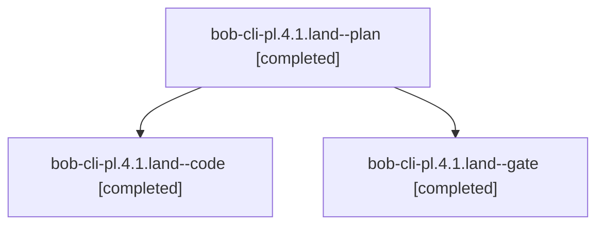

# Session: bob-cli-pl.4.1.land

[Agent Hoods](../README.md) / [bbugyi200](../users/bbugyi200/README.md) / [apollo](../users/bbugyi200/machines/apollo/README.md) / [bob-cli-pl](../users/bbugyi200/machines/apollo/hoods/bob-cli-pl/README.md) / bob-cli-pl.4.1.land

Owner: `bbugyi200.apollo` · Hood: `bob-cli-pl` · Members: 3 · Bead: [bob-cli-pl.4.1](https://github.com/bobs-org/bob-cli--beads/blob/main/pages/bob-cli-pl/bob-cli-pl.4.1.md)

## Lineage



The diagram is an optional enhancement; the ordered table below contains the same lineage in accessible text.

| Role | Agent | State | Model / provider | Timing | Commits | Prompt | Chat |
|---|---|---|---|---|---:|---|---|
| <a id="member-plan"></a>plan | bob-cli-pl.4.1.land--plan | completed | gpt-6-astra / codex | 2026-11-24T19:06:01.774970+00:00 → 2026-11-24T20:44:16.719286+00:00 | 0 | [Prompt](../agents/bbugyi200.apollo.bob-cli-pl.4.1.land--plan/prompt.md) | [Chat](../agents/bbugyi200.apollo.bob-cli-pl.4.1.land--plan/chat.md) |
| <a id="member-code"></a>code | bob-cli-pl.4.1.land--code | completed | grok-4.6 / grok | 2026-11-24T19:17:54.154124+00:00 → 2026-11-24T20:44:16.719286+00:00 | 0 | — | [Chat](../agents/bbugyi200.apollo.bob-cli-pl.4.1.land--code/chat.md) |
| <a id="member-gate"></a>gate | bob-cli-pl.4.1.land--gate | completed | gpt-6-astra / codex | 2026-11-24T19:16:59.055561+00:00 → 2026-11-24T19:17:09.451922+00:00 | 0 | — | [Chat](../agents/bbugyi200.apollo.bob-cli-pl.4.1.land--gate/chat.md) |

## Variables

| Role | Variable | Value |
|---|---|---|
| code | `artifacts` | \[{bead: bob-cli-pl.4.1, kind: file, label: Home-card real-Obsidian e2e report, path: /home/bryan/.sase/artifacts/agents/gh\_bobs-org\_\_bob-cli/20261124141719/home-cards-e2e-475a114dc642.json, ref: file… |

#### artifacts

**Role:** `code`

```yaml
- bead: bob-cli-pl.4.1
  kind: file
  label: Home-card real-Obsidian e2e report
  path: /home/bryan/.sase/artifacts/agents/gh_bobs-org__bob-cli/20261124141719/home-cards-e2e-475a114dc642.json
  ref: file:explicit:cb88c4643f511cce58e35444
  source_path: /tmp/home-cards-e2e-local/home-cards-e2e.json
- bead: bob-cli-pl.4.1
  kind: image
  label: Home-card e2e dev-live-dark-narrow
  path: /home/bryan/.sase/artifacts/agents/gh_bobs-org__bob-cli/20261124141719/dev-live-dark-narrow-3d0b3e0851ce.png
  ref: file:explicit:450a479cc73a6f86a9c661cc
  source_path: /tmp/home-cards-e2e-local/shots/dev-live-dark-narrow.png
- bead: bob-cli-pl.4.1
  kind: file
  label: Home-card real-Obsidian e2e 28 inspected screenshots
  path: /home/bryan/.sase/artifacts/agents/gh_bobs-org__bob-cli/20261124141719/home-cards-e2e-shots.tar-e8357ee59f3d.gz
  ref: file:explicit:d802ce1e232a7fed3b693268
  source_path: /tmp/home-cards-e2e-local/home-cards-e2e-shots.tar.gz
```

Values are truncated for display; see each member's agent meta.json for the full values.

## Neighbors

| Agent | Relation | State |
|---|---|---|
| [bob-cli-pl.4](bbugyi200.apollo.bob-cli-pl.4.md) (session · 5) | ancestor | completed 5 |
| [bob-cli-pl.4.1.1](../agents/bbugyi200.apollo.bob-cli-pl.4.1.1/README.md) | bob-cli-pl.4.1 hood | completed |
| [bob-cli-pl.4.1.2](../agents/bbugyi200.apollo.bob-cli-pl.4.1.2/README.md) | bob-cli-pl.4.1 hood | completed |
| [bob-cli-pl.4.1.3](bbugyi200.apollo.bob-cli-pl.4.1.3.md) (session · 12) | bob-cli-pl.4.1 hood | completed 7, failed 5 |
| [bob-cli-pl.1](bbugyi200.apollo.bob-cli-pl.1.md) (session · 9) | bob-cli-pl hood | completed 7, failed 2 |
| [bob-cli-pl.2](bbugyi200.apollo.bob-cli-pl.2.md) (session · 5) | bob-cli-pl hood | completed 4, failed 1 |
| [bob-cli-pl.3](../agents/bbugyi200.apollo.bob-cli-pl.3/README.md) | bob-cli-pl hood | completed |
| [bob-cli-pl.5](../agents/bbugyi200.apollo.bob-cli-pl.5/README.md) | bob-cli-pl hood | completed |
| [bob-cli-pl.6](bbugyi200.apollo.bob-cli-pl.6.md) (session · 3) | bob-cli-pl hood | active 1, completed 2 |
| [bob-cli-pl.6.1.1](bbugyi200.apollo.bob-cli-pl.6.1.1.md) (session · 3) | bob-cli-pl hood | completed 3 |
| [bob-cli-pl.6.1.2](bbugyi200.apollo.bob-cli-pl.6.1.2.md) (session · 8) | bob-cli-pl hood | active 1, completed 4, failed 3 |
| [bob-cli-pl.6.1.2](../agents/bbugyi200.apollo.bob-cli-pl.6.1.2/README.md) | bob-cli-pl hood | completed |
| [bob-cli-pl.6.1.3](../agents/bbugyi200.apollo.bob-cli-pl.6.1.3/README.md) | bob-cli-pl hood | completed |
| [bob-cli-pl.6.1.4](../agents/bbugyi200.apollo.bob-cli-pl.6.1.4/README.md) | bob-cli-pl hood | completed |
| [bob-cli-pl.6.1.5](bbugyi200.apollo.bob-cli-pl.6.1.5.md) (session · 21) | bob-cli-pl hood | active 3, completed 10, failed 8 |
| [bob-cli-pl.6.1.land](../agents/bbugyi200.apollo.bob-cli-pl.6.1.land/README.md) | bob-cli-pl hood | completed |
| [bob-cli-pl.7](../agents/bbugyi200.apollo.bob-cli-pl.7/README.md) | bob-cli-pl hood | completed |
| [bob-cli-pl.8](../agents/bbugyi200.apollo.bob-cli-pl.8/README.md) | bob-cli-pl hood | completed |
| [bob-cli-pl.9](bbugyi200.apollo.bob-cli-pl.9.md) (session · 3) | bob-cli-pl hood | active 1, completed 2 |
| [bob-cli-pl.9.1.1](../agents/bbugyi200.apollo.bob-cli-pl.9.1.1/README.md) | bob-cli-pl hood | completed |
| [bob-cli-pl.9.1.2](bbugyi200.apollo.bob-cli-pl.9.1.2.md) (session · 31) | bob-cli-pl hood | active 2, completed 20, failed 9 |
| [bob-cli-pl.9.1.2.1.1](bbugyi200.apollo.bob-cli-pl.9.1.2.1.1.md) (session · 11) | bob-cli-pl hood | completed 7, failed 4 |
| [bob-cli-pl.9.1.2.1.2](../agents/bbugyi200.apollo.bob-cli-pl.9.1.2.1.2/README.md) | bob-cli-pl hood | completed |
| [bob-cli-pl.9.1.2.1.3](../agents/bbugyi200.apollo.bob-cli-pl.9.1.2.1.3/README.md) | bob-cli-pl hood | waiting |
| [bob-cli-pl.9.1.2.1.4](../agents/bbugyi200.apollo.bob-cli-pl.9.1.2.1.4/README.md) | bob-cli-pl hood | waiting |
| [bob-cli-pl.9.1.2.1.land](../agents/bbugyi200.apollo.bob-cli-pl.9.1.2.1.land/README.md) | bob-cli-pl hood | waiting |
| [bob-cli-pl.9.1.3](../agents/bbugyi200.apollo.bob-cli-pl.9.1.3/README.md) | bob-cli-pl hood | waiting |
| [bob-cli-pl.9.1.4](../agents/bbugyi200.apollo.bob-cli-pl.9.1.4/README.md) | bob-cli-pl hood | waiting |
| [bob-cli-pl.9.1.land](../agents/bbugyi200.apollo.bob-cli-pl.9.1.land/README.md) | bob-cli-pl hood | waiting |
| [bob-cli-pl.land](../agents/bbugyi200.apollo.bob-cli-pl.land/README.md) | bob-cli-pl hood | waiting |
