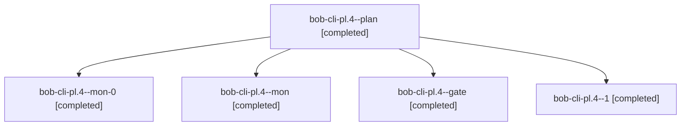

# Session: bob-cli-pl.4

[Agent Hoods](../README.md) / [bbugyi200](../users/bbugyi200/README.md) / [apollo](../users/bbugyi200/machines/apollo/README.md) / [bob-cli-pl](../users/bbugyi200/machines/apollo/hoods/bob-cli-pl/README.md) / bob-cli-pl.4

Owner: `bbugyi200.apollo` · Hood: `bob-cli-pl` · Members: 5 · Bead: [bob-cli-pl.4](https://github.com/bobs-org/bob-cli--beads/blob/main/pages/bob-cli-pl/bob-cli-pl.4.md)

## Lineage

The diagram is an optional enhancement; the ordered table below contains the same lineage in accessible text.

| Role | Agent | State | Model / provider | Timing | Commits | Prompt | Chat |
|---|---|---|---|---|---:|---|---|
| plan | bob-cli-pl.4--plan | completed | gpt-6-astra / codex | 2026-11-23T01:59:46.730815+00:00 → 2026-11-23T02:04:16.006455+00:00 | 0 | [Prompt](../agents/bbugyi200.apollo.bob-cli-pl.4--plan/prompt.md) | [Chat](../agents/bbugyi200.apollo.bob-cli-pl.4--plan/chat.md) |
| mon-0 | bob-cli-pl.4--mon-0 | completed | gpt-6-astra / codex | 2026-11-24T14:50:58.926667+00:00 → 2026-11-24T14:52:51.298359+00:00 | 0 | — | [Chat](../agents/bbugyi200.apollo.bob-cli-pl.4--mon-0/chat.md) |
| mon | bob-cli-pl.4--mon | completed | gpt-6-astra / codex | 2026-11-23T02:03:42.801042+00:00 → 2026-11-24T14:41:53.183265+00:00 | 0 | — | [Chat](../agents/bbugyi200.apollo.bob-cli-pl.4--mon/chat.md) |
| gate | bob-cli-pl.4--gate | completed | gpt-6-astra / codex | 2026-11-24T14:50:09.356897+00:00 → 2026-11-24T14:51:00.611249+00:00 | 0 | — | [Chat](../agents/bbugyi200.apollo.bob-cli-pl.4--gate/chat.md) |
| 1 | bob-cli-pl.4--1 | completed | gpt-6-astra / codex | 2026-11-24T14:41:59.336020+00:00 → 2026-11-24T14:51:10.760848+00:00 | 0 | [Prompt](../agents/bbugyi200.apollo.bob-cli-pl.4--1/prompt.md) | [Chat](../agents/bbugyi200.apollo.bob-cli-pl.4--1/chat.md) |

## Neighbors

| Agent | Relation | State |
|---|---|---|
| [bob-cli-pl.4.1.1](../agents/bbugyi200.apollo.bob-cli-pl.4.1.1/README.md) | descendant | completed |
| [bob-cli-pl.4.1.2](../agents/bbugyi200.apollo.bob-cli-pl.4.1.2/README.md) | descendant | completed |
| [bob-cli-pl.4.1.3](bbugyi200.apollo.bob-cli-pl.4.1.3.md) (session · 12) | descendant | completed 7, failed 5 |
| [bob-cli-pl.4.1.land](bbugyi200.apollo.bob-cli-pl.4.1.land.md) (session · 3) | descendant | completed 3 |
| [bob-cli-pl.1](bbugyi200.apollo.bob-cli-pl.1.md) (session · 9) | bob-cli-pl hood | completed 7, failed 2 |
| [bob-cli-pl.2](bbugyi200.apollo.bob-cli-pl.2.md) (session · 5) | bob-cli-pl hood | completed 4, failed 1 |
| [bob-cli-pl.3](../agents/bbugyi200.apollo.bob-cli-pl.3/README.md) | bob-cli-pl hood | completed |
| [bob-cli-pl.5](../agents/bbugyi200.apollo.bob-cli-pl.5/README.md) | bob-cli-pl hood | completed |
| [bob-cli-pl.6](bbugyi200.apollo.bob-cli-pl.6.md) (session · 3) | bob-cli-pl hood | active 1, completed 2 |
| [bob-cli-pl.6.1.1](bbugyi200.apollo.bob-cli-pl.6.1.1.md) (session · 3) | bob-cli-pl hood | completed 3 |
| [bob-cli-pl.6.1.2](bbugyi200.apollo.bob-cli-pl.6.1.2.md) (session · 4) | bob-cli-pl hood | active 1, completed 2, failed 1 |
| [bob-cli-pl.6.1.3](../agents/bbugyi200.apollo.bob-cli-pl.6.1.3/README.md) | bob-cli-pl hood | waiting |
| [bob-cli-pl.6.1.4](../agents/bbugyi200.apollo.bob-cli-pl.6.1.4/README.md) | bob-cli-pl hood | waiting |
| [bob-cli-pl.6.1.5](../agents/bbugyi200.apollo.bob-cli-pl.6.1.5/README.md) | bob-cli-pl hood | waiting |
| [bob-cli-pl.6.1.land](../agents/bbugyi200.apollo.bob-cli-pl.6.1.land/README.md) | bob-cli-pl hood | waiting |
| [bob-cli-pl.7](../agents/bbugyi200.apollo.bob-cli-pl.7/README.md) | bob-cli-pl hood | waiting |
| [bob-cli-pl.8](../agents/bbugyi200.apollo.bob-cli-pl.8/README.md) | bob-cli-pl hood | waiting |
| [bob-cli-pl.9](../agents/bbugyi200.apollo.bob-cli-pl.9/README.md) | bob-cli-pl hood | waiting |
| [bob-cli-pl.land](../agents/bbugyi200.apollo.bob-cli-pl.land/README.md) | bob-cli-pl hood | waiting |
