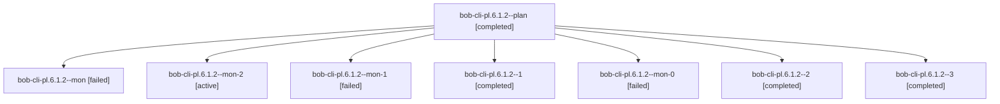

# Session: bob-cli-pl.6.1.2

[Agent Hoods](../README.md) / [bbugyi200](../users/bbugyi200/README.md) / [apollo](../users/bbugyi200/machines/apollo/README.md) / [bob-cli-pl](../users/bbugyi200/machines/apollo/hoods/bob-cli-pl/README.md) / bob-cli-pl.6.1.2

Owner: `bbugyi200.apollo` · Hood: `bob-cli-pl` · Members: 8 · Bead: [bob-cli-pl.6.1.2](https://github.com/bobs-org/bob-cli--beads/blob/main/pages/bob-cli-pl/bob-cli-pl.6.1.2.md)

## Lineage

The diagram is an optional enhancement; the ordered table below contains the same lineage in accessible text.

| Role | Agent | State | Model / provider | Timing | Commits | Prompt | Chat |
|---|---|---|---|---|---:|---|---|
| plan | bob-cli-pl.6.1.2--plan | completed | gpt-6-luna / codex | 2026-11-24T21:47:45.255432+00:00 → 2026-11-24T22:30:17.046935+00:00 | 0 | [Prompt](../agents/bbugyi200.apollo.bob-cli-pl.6.1.2--plan/prompt.md) | [Chat](../agents/bbugyi200.apollo.bob-cli-pl.6.1.2--plan/chat.md) |
| mon | bob-cli-pl.6.1.2--mon | failed | gpt-6-luna / codex | 2026-11-24T22:27:39.855076+00:00 → 2026-11-24T22:32:33.749014+00:00 | 0 | — | [Chat](../agents/bbugyi200.apollo.bob-cli-pl.6.1.2--mon/chat.md) |
| mon-2 | bob-cli-pl.6.1.2--mon-2 | active | gpt-6-luna / codex | 2026-11-24T23:04:36.285715+00:00 | 0 | — | — |
| mon-1 | bob-cli-pl.6.1.2--mon-1 | failed | gpt-6-luna / codex | 2026-11-24T22:48:56.050675+00:00 → 2026-11-24T22:56:23.433264+00:00 | 0 | — | [Chat](../agents/bbugyi200.apollo.bob-cli-pl.6.1.2--mon-1/chat.md) |
| 1 | bob-cli-pl.6.1.2--1 | completed | gpt-6-luna / codex | 2026-11-24T22:32:33.734973+00:00 → 2026-11-24T22:41:34.719321+00:00 | 0 | [Prompt](../agents/bbugyi200.apollo.bob-cli-pl.6.1.2--1/prompt.md) | [Chat](../agents/bbugyi200.apollo.bob-cli-pl.6.1.2--1/chat.md) |
| mon-0 | bob-cli-pl.6.1.2--mon-0 | failed | gpt-6-luna / codex | 2026-11-24T22:39:13.614847+00:00 → 2026-11-24T22:44:51.842521+00:00 | 0 | — | [Chat](../agents/bbugyi200.apollo.bob-cli-pl.6.1.2--mon-0/chat.md) |
| 2 | bob-cli-pl.6.1.2--2 | completed | gpt-6-luna / codex | 2026-11-24T22:44:51.684526+00:00 → 2026-11-24T22:49:48.874457+00:00 | 0 | [Prompt](../agents/bbugyi200.apollo.bob-cli-pl.6.1.2--2/prompt.md) | [Chat](../agents/bbugyi200.apollo.bob-cli-pl.6.1.2--2/chat.md) |
| 3 | bob-cli-pl.6.1.2--3 | completed | gpt-6-luna / codex | 2026-11-24T22:56:22.998480+00:00 → 2026-11-24T23:06:51.104302+00:00 | 0 | [Prompt](../agents/bbugyi200.apollo.bob-cli-pl.6.1.2--3/prompt.md) | [Chat](../agents/bbugyi200.apollo.bob-cli-pl.6.1.2--3/chat.md) |

## Neighbors

| Agent | Relation | State |
|---|---|---|
| [bob-cli-pl.6](bbugyi200.apollo.bob-cli-pl.6.md) (session · 3) | ancestor | active 1, completed 2 |
| [bob-cli-pl.6.1.1](bbugyi200.apollo.bob-cli-pl.6.1.1.md) (session · 3) | bob-cli-pl.6.1 hood | completed 3 |
| [bob-cli-pl.6.1.3](../agents/bbugyi200.apollo.bob-cli-pl.6.1.3/README.md) | bob-cli-pl.6.1 hood | completed |
| [bob-cli-pl.6.1.4](../agents/bbugyi200.apollo.bob-cli-pl.6.1.4/README.md) | bob-cli-pl.6.1 hood | completed |
| [bob-cli-pl.6.1.5](bbugyi200.apollo.bob-cli-pl.6.1.5.md) (session · 21) | bob-cli-pl.6.1 hood | active 3, completed 10, failed 8 |
| [bob-cli-pl.6.1.land](../agents/bbugyi200.apollo.bob-cli-pl.6.1.land/README.md) | bob-cli-pl.6.1 hood | completed |
| [bob-cli-pl.1](bbugyi200.apollo.bob-cli-pl.1.md) (session · 9) | bob-cli-pl hood | completed 7, failed 2 |
| [bob-cli-pl.2](bbugyi200.apollo.bob-cli-pl.2.md) (session · 5) | bob-cli-pl hood | completed 4, failed 1 |
| [bob-cli-pl.3](../agents/bbugyi200.apollo.bob-cli-pl.3/README.md) | bob-cli-pl hood | completed |
| [bob-cli-pl.4](bbugyi200.apollo.bob-cli-pl.4.md) (session · 5) | bob-cli-pl hood | completed 5 |
| [bob-cli-pl.4.1.1](../agents/bbugyi200.apollo.bob-cli-pl.4.1.1/README.md) | bob-cli-pl hood | completed |
| [bob-cli-pl.4.1.2](../agents/bbugyi200.apollo.bob-cli-pl.4.1.2/README.md) | bob-cli-pl hood | completed |
| [bob-cli-pl.4.1.3](bbugyi200.apollo.bob-cli-pl.4.1.3.md) (session · 12) | bob-cli-pl hood | completed 7, failed 5 |
| [bob-cli-pl.4.1.land](bbugyi200.apollo.bob-cli-pl.4.1.land.md) (session · 3) | bob-cli-pl hood | completed 3 |
| [bob-cli-pl.5](../agents/bbugyi200.apollo.bob-cli-pl.5/README.md) | bob-cli-pl hood | completed |
| [bob-cli-pl.7](../agents/bbugyi200.apollo.bob-cli-pl.7/README.md) | bob-cli-pl hood | completed |
| [bob-cli-pl.8](../agents/bbugyi200.apollo.bob-cli-pl.8/README.md) | bob-cli-pl hood | completed |
| [bob-cli-pl.9](bbugyi200.apollo.bob-cli-pl.9.md) (session · 3) | bob-cli-pl hood | active 1, completed 2 |
| [bob-cli-pl.9.1.1](../agents/bbugyi200.apollo.bob-cli-pl.9.1.1/README.md) | bob-cli-pl hood | completed |
| [bob-cli-pl.9.1.2](../agents/bbugyi200.apollo.bob-cli-pl.9.1.2/README.md) | bob-cli-pl hood | waiting |
| [bob-cli-pl.9.1.3](../agents/bbugyi200.apollo.bob-cli-pl.9.1.3/README.md) | bob-cli-pl hood | waiting |
| [bob-cli-pl.9.1.4](../agents/bbugyi200.apollo.bob-cli-pl.9.1.4/README.md) | bob-cli-pl hood | waiting |
| [bob-cli-pl.9.1.land](../agents/bbugyi200.apollo.bob-cli-pl.9.1.land/README.md) | bob-cli-pl hood | waiting |
| [bob-cli-pl.land](../agents/bbugyi200.apollo.bob-cli-pl.land/README.md) | bob-cli-pl hood | waiting |
