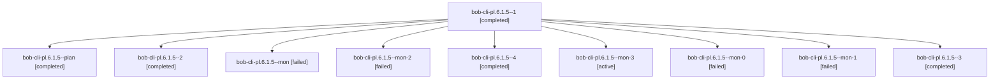

# Session: bob-cli-pl.6.1.5

[Agent Hoods](../README.md) / [bbugyi200](../users/bbugyi200/README.md) / [apollo](../users/bbugyi200/machines/apollo/README.md) / [bob-cli-pl](../users/bbugyi200/machines/apollo/hoods/bob-cli-pl/README.md) / bob-cli-pl.6.1.5

Owner: `bbugyi200.apollo` · Hood: `bob-cli-pl` · Members: 10 · Bead: [bob-cli-pl.6.1.5](https://github.com/bobs-org/bob-cli--beads/blob/main/pages/bob-cli-pl/bob-cli-pl.6.1.5.md)

## Lineage



The diagram is an optional enhancement; the ordered table below contains the same lineage in accessible text.

| Role | Agent | State | Model / provider | Timing | Commits | Prompt | Chat |
|---|---|---|---|---|---:|---|---|
| <a id="member-1"></a>1 | bob-cli-pl.6.1.5--1 | completed | gpt-6-luna / codex | 2026-11-25T12:21:56.844749+00:00 → 2026-11-25T12:31:43.848872+00:00 | 0 | [Prompt](../agents/bbugyi200.apollo.bob-cli-pl.6.1.5--1/prompt.md) | [Chat](../agents/bbugyi200.apollo.bob-cli-pl.6.1.5--1/chat.md) |
| <a id="member-plan"></a>plan | bob-cli-pl.6.1.5--plan | completed | gpt-6-luna / codex | 2026-11-25T11:42:38.642792+00:00 → 2026-11-25T12:16:45.786846+00:00 | 0 | [Prompt](../agents/bbugyi200.apollo.bob-cli-pl.6.1.5--plan/prompt.md) | [Chat](../agents/bbugyi200.apollo.bob-cli-pl.6.1.5--plan/chat.md) |
| <a id="member-2"></a>2 | bob-cli-pl.6.1.5--2 | completed | gpt-6-luna / codex | 2026-11-25T12:36:44.706448+00:00 → 2026-11-25T12:39:33.901935+00:00 | 0 | [Prompt](../agents/bbugyi200.apollo.bob-cli-pl.6.1.5--2/prompt.md) | [Chat](../agents/bbugyi200.apollo.bob-cli-pl.6.1.5--2/chat.md) |
| <a id="member-mon"></a>mon | bob-cli-pl.6.1.5--mon | failed | gpt-6-luna / codex | 2026-11-25T12:14:15.028792+00:00 → 2026-11-25T12:21:56.709400+00:00 | 0 | — | [Chat](../agents/bbugyi200.apollo.bob-cli-pl.6.1.5--mon/chat.md) |
| <a id="member-mon-2"></a>mon-2 | bob-cli-pl.6.1.5--mon-2 | failed | gpt-6-luna / codex | 2026-11-25T12:56:34.339008+00:00 → 2026-11-25T13:04:06.881820+00:00 | 0 | — | [Chat](../agents/bbugyi200.apollo.bob-cli-pl.6.1.5--mon-2/chat.md) |
| <a id="member-4"></a>4 | bob-cli-pl.6.1.5--4 | completed | gpt-6-luna / codex | 2026-11-25T13:04:17.728870+00:00 → 2026-11-25T13:16:36.066252+00:00 | 0 | [Prompt](../agents/bbugyi200.apollo.bob-cli-pl.6.1.5--4/prompt.md) | [Chat](../agents/bbugyi200.apollo.bob-cli-pl.6.1.5--4/chat.md) |
| <a id="member-mon-3"></a>mon-3 | bob-cli-pl.6.1.5--mon-3 | active | gpt-6-luna / codex | 2026-11-25T13:14:14.960249+00:00 | 0 | — | — |
| <a id="member-mon-0"></a>mon-0 | bob-cli-pl.6.1.5--mon-0 | failed | gpt-6-luna / codex | 2026-11-25T12:30:32.782479+00:00 → 2026-11-25T12:36:28.692350+00:00 | 0 | — | [Chat](../agents/bbugyi200.apollo.bob-cli-pl.6.1.5--mon-0/chat.md) |
| <a id="member-mon-1"></a>mon-1 | bob-cli-pl.6.1.5--mon-1 | failed | gpt-6-luna / codex | 2026-11-25T12:38:39.555892+00:00 → 2026-11-25T12:43:43.383290+00:00 | 0 | — | [Chat](../agents/bbugyi200.apollo.bob-cli-pl.6.1.5--mon-1/chat.md) |
| <a id="member-3"></a>3 | bob-cli-pl.6.1.5--3 | completed | gpt-6-luna / codex | 2026-11-25T12:43:43.073207+00:00 → 2026-11-25T12:59:53.265462+00:00 | 0 | [Prompt](../agents/bbugyi200.apollo.bob-cli-pl.6.1.5--3/prompt.md) | [Chat](../agents/bbugyi200.apollo.bob-cli-pl.6.1.5--3/chat.md) |

## Variables

| Role | Variable | Value |
|---|---|---|
| 3 | `artifacts` | \[{bead: bob-cli-pl.6.1.5, kind: file, label: Settings acceptance failure report (managed rows collapsed), path: /home/bryan/.sase/artifacts/agents/gh\_bobs-org\_\_bob-cli/20261125074255/property-editor-… |
| 4 | `artifacts` | \[{bead: bob-cli-pl.6.1.5, kind: file, label: Obsidian settings acceptance report (failed, 2026-11-25 13:02 UTC), path: /home/bryan/.sase/artifacts/agents/gh\_bobs-org\_\_bob-cli/20261125080306/property-… |

#### artifacts

**Role:** `3`

```yaml
- bead: bob-cli-pl.6.1.5
  kind: file
  label: Settings acceptance failure report (managed rows collapsed)
  path: /home/bryan/.sase/artifacts/agents/gh_bobs-org__bob-cli/20261125074255/property-editor-settings-e2e-3acd577a0af6.json
  ref: file:explicit:380437933d2ad00ffe9bf9e5
  source_path: /tmp/property-editor-settings-e2e.json
```

#### artifacts

**Role:** `4`

```yaml
- bead: bob-cli-pl.6.1.5
  kind: file
  label: Obsidian settings acceptance report (failed, 2026-11-25 13:02 UTC)
  path: /home/bryan/.sase/artifacts/agents/gh_bobs-org__bob-cli/20261125080306/property-editor-settings-e2e-e1a73303ecc9.json
  ref: file:explicit:45956d095b4a9c87c12538d7
  source_path: /tmp/property-editor-settings-e2e.json
- bead: bob-cli-pl.6.1.5
  kind: image
  label: Obsidian settings acceptance failure screenshot (2026-11-25)
  path: /home/bryan/.sase/artifacts/agents/gh_bobs-org__bob-cli/20261125080306/property-editor-failure-8659904001df.png
  ref: file:explicit:df648c0cb0cc5a2fd010f811
  source_path: /tmp/bob-plugins-settings-e2e-shots/property-editor-failure.png
```

Values are truncated for display; see each member's agent meta.json for the full values.

## Neighbors

| Agent | Relation | State |
|---|---|---|
| [bob-cli-pl.6](bbugyi200.apollo.bob-cli-pl.6.md) (session · 3) | ancestor | active 1, completed 2 |
| [bob-cli-pl.6.1.1](bbugyi200.apollo.bob-cli-pl.6.1.1.md) (session · 3) | bob-cli-pl.6.1 hood | completed 3 |
| [bob-cli-pl.6.1.2](bbugyi200.apollo.bob-cli-pl.6.1.2.md) (session · 8) | bob-cli-pl.6.1 hood | active 1, completed 4, failed 3 |
| [bob-cli-pl.6.1.2](../agents/bbugyi200.apollo.bob-cli-pl.6.1.2/README.md) | bob-cli-pl.6.1 hood | completed |
| [bob-cli-pl.6.1.3](../agents/bbugyi200.apollo.bob-cli-pl.6.1.3/README.md) | bob-cli-pl.6.1 hood | completed |
| [bob-cli-pl.6.1.4](../agents/bbugyi200.apollo.bob-cli-pl.6.1.4/README.md) | bob-cli-pl.6.1 hood | completed |
| [bob-cli-pl.6.1.land](../agents/bbugyi200.apollo.bob-cli-pl.6.1.land/README.md) | bob-cli-pl.6.1 hood | waiting |
| [bob-cli-pl.1](bbugyi200.apollo.bob-cli-pl.1.md) (session · 9) | bob-cli-pl hood | completed 7, failed 2 |
| [bob-cli-pl.2](bbugyi200.apollo.bob-cli-pl.2.md) (session · 5) | bob-cli-pl hood | completed 4, failed 1 |
| [bob-cli-pl.3](../agents/bbugyi200.apollo.bob-cli-pl.3/README.md) | bob-cli-pl hood | completed |
| [bob-cli-pl.4](bbugyi200.apollo.bob-cli-pl.4.md) (session · 5) | bob-cli-pl hood | completed 5 |
| [bob-cli-pl.4.1.1](../agents/bbugyi200.apollo.bob-cli-pl.4.1.1/README.md) | bob-cli-pl hood | completed |
| [bob-cli-pl.4.1.2](../agents/bbugyi200.apollo.bob-cli-pl.4.1.2/README.md) | bob-cli-pl hood | completed |
| [bob-cli-pl.4.1.3](bbugyi200.apollo.bob-cli-pl.4.1.3.md) (session · 12) | bob-cli-pl hood | completed 7, failed 5 |
| [bob-cli-pl.4.1.land](bbugyi200.apollo.bob-cli-pl.4.1.land.md) (session · 3) | bob-cli-pl hood | completed 3 |
| [bob-cli-pl.5](../agents/bbugyi200.apollo.bob-cli-pl.5/README.md) | bob-cli-pl hood | completed |
| [bob-cli-pl.7](../agents/bbugyi200.apollo.bob-cli-pl.7/README.md) | bob-cli-pl hood | waiting |
| [bob-cli-pl.8](../agents/bbugyi200.apollo.bob-cli-pl.8/README.md) | bob-cli-pl hood | waiting |
| [bob-cli-pl.9](../agents/bbugyi200.apollo.bob-cli-pl.9/README.md) | bob-cli-pl hood | waiting |
| [bob-cli-pl.land](../agents/bbugyi200.apollo.bob-cli-pl.land/README.md) | bob-cli-pl hood | waiting |
