# Session: bob-cli-pl.6.1.5

[Agent Hoods](../README.md) / [bbugyi200](../users/bbugyi200/README.md) / [apollo](../users/bbugyi200/machines/apollo/README.md) / [bob-cli-pl](../users/bbugyi200/machines/apollo/hoods/bob-cli-pl/README.md) / bob-cli-pl.6.1.5

Owner: `bbugyi200.apollo` · Hood: `bob-cli-pl` · Members: 18 · Bead: [bob-cli-pl.6.1.5](https://github.com/bobs-org/bob-cli--beads/blob/main/pages/bob-cli-pl/bob-cli-pl.6.1.5.md)

## Lineage

```mermaid
flowchart TD
  n0["bob-cli-pl.6.1.5--1 [completed]"]
  n1["bob-cli-pl.6.1.5--mon-6 [failed]"]
  n0 --> n1
  n2["bob-cli-pl.6.1.5--plan [completed]"]
  n0 --> n2
  n3["bob-cli-pl.6.1.5--2 [completed]"]
  n0 --> n3
  n4["bob-cli-pl.6.1.5--mon-7 [active]"]
  n0 --> n4
  n5["bob-cli-pl.6.1.5--mon [failed]"]
  n0 --> n5
  n6["bob-cli-pl.6.1.5--mon-2 [failed]"]
  n0 --> n6
  n7["bob-cli-pl.6.1.5--4 [completed]"]
  n0 --> n7
  n8["bob-cli-pl.6.1.5--6 [completed]"]
  n0 --> n8
  n9["bob-cli-pl.6.1.5--7 [completed]"]
  n0 --> n9
  n10["bob-cli-pl.6.1.5--mon-3 [failed]"]
  n0 --> n10
  n11["bob-cli-pl.6.1.5--5 [completed]"]
  n0 --> n11
  n12["bob-cli-pl.6.1.5--mon-5 [failed]"]
  n0 --> n12
  n13["bob-cli-pl.6.1.5--mon-4 [failed]"]
  n0 --> n13
  n14["bob-cli-pl.6.1.5--mon-0 [failed]"]
  n0 --> n14
  n15["bob-cli-pl.6.1.5--8 [completed]"]
  n0 --> n15
  n16["bob-cli-pl.6.1.5--mon-1 [failed]"]
  n0 --> n16
  n17["bob-cli-pl.6.1.5--3 [completed]"]
  n0 --> n17
```



The diagram is an optional enhancement; the ordered table below contains the same lineage in accessible text.

| Role | Agent | State | Model / provider | Timing | Commits | Prompt | Chat |
|---|---|---|---|---|---:|---|---|
| <a id="member-1"></a>1 | bob-cli-pl.6.1.5--1 | completed | gpt-6-luna / codex | 2026-11-25T12:21:56.844749+00:00 → 2026-11-25T12:31:43.848872+00:00 | 0 | [Prompt](../agents/bbugyi200.apollo.bob-cli-pl.6.1.5--1/prompt.md) | [Chat](../agents/bbugyi200.apollo.bob-cli-pl.6.1.5--1/chat.md) |
| <a id="member-mon-6"></a>mon-6 | bob-cli-pl.6.1.5--mon-6 | failed | gpt-6-luna / codex | 2026-11-25T15:17:49.870896+00:00 → 2026-11-25T15:25:51.491931+00:00 | 0 | — | [Chat](../agents/bbugyi200.apollo.bob-cli-pl.6.1.5--mon-6/chat.md) |
| <a id="member-plan"></a>plan | bob-cli-pl.6.1.5--plan | completed | gpt-6-luna / codex | 2026-11-25T11:42:38.642792+00:00 → 2026-11-25T12:16:45.786846+00:00 | 0 | [Prompt](../agents/bbugyi200.apollo.bob-cli-pl.6.1.5--plan/prompt.md) | [Chat](../agents/bbugyi200.apollo.bob-cli-pl.6.1.5--plan/chat.md) |
| <a id="member-2"></a>2 | bob-cli-pl.6.1.5--2 | completed | gpt-6-luna / codex | 2026-11-25T12:36:44.706448+00:00 → 2026-11-25T12:39:33.901935+00:00 | 0 | [Prompt](../agents/bbugyi200.apollo.bob-cli-pl.6.1.5--2/prompt.md) | [Chat](../agents/bbugyi200.apollo.bob-cli-pl.6.1.5--2/chat.md) |
| <a id="member-mon-7"></a>mon-7 | bob-cli-pl.6.1.5--mon-7 | active | gpt-6-luna / codex | 2026-11-25T16:27:03.094068+00:00 | 0 | — | — |
| <a id="member-mon"></a>mon | bob-cli-pl.6.1.5--mon | failed | gpt-6-luna / codex | 2026-11-25T12:14:15.028792+00:00 → 2026-11-25T12:21:56.709400+00:00 | 0 | — | [Chat](../agents/bbugyi200.apollo.bob-cli-pl.6.1.5--mon/chat.md) |
| <a id="member-mon-2"></a>mon-2 | bob-cli-pl.6.1.5--mon-2 | failed | gpt-6-luna / codex | 2026-11-25T12:56:34.339008+00:00 → 2026-11-25T13:04:06.881820+00:00 | 0 | — | [Chat](../agents/bbugyi200.apollo.bob-cli-pl.6.1.5--mon-2/chat.md) |
| <a id="member-4"></a>4 | bob-cli-pl.6.1.5--4 | completed | gpt-6-luna / codex | 2026-11-25T13:04:17.728870+00:00 → 2026-11-25T13:16:36.066252+00:00 | 0 | [Prompt](../agents/bbugyi200.apollo.bob-cli-pl.6.1.5--4/prompt.md) | [Chat](../agents/bbugyi200.apollo.bob-cli-pl.6.1.5--4/chat.md) |
| <a id="member-6"></a>6 | bob-cli-pl.6.1.5--6 | completed | gpt-6-luna / codex | 2026-11-25T14:17:30.204128+00:00 → 2026-11-25T14:26:18.662056+00:00 | 0 | [Prompt](../agents/bbugyi200.apollo.bob-cli-pl.6.1.5--6/prompt.md) | [Chat](../agents/bbugyi200.apollo.bob-cli-pl.6.1.5--6/chat.md) |
| <a id="member-7"></a>7 | bob-cli-pl.6.1.5--7 | completed | gpt-6-luna / codex | 2026-11-25T14:28:36.645513+00:00 → 2026-11-25T15:20:16.362793+00:00 | 0 | [Prompt](../agents/bbugyi200.apollo.bob-cli-pl.6.1.5--7/prompt.md) | [Chat](../agents/bbugyi200.apollo.bob-cli-pl.6.1.5--7/chat.md) |
| <a id="member-mon-3"></a>mon-3 | bob-cli-pl.6.1.5--mon-3 | failed | gpt-6-luna / codex | 2026-11-25T13:14:14.960249+00:00 → 2026-11-25T13:21:20.966717+00:00 | 0 | — | [Chat](../agents/bbugyi200.apollo.bob-cli-pl.6.1.5--mon-3/chat.md) |
| <a id="member-5"></a>5 | bob-cli-pl.6.1.5--5 | completed | gpt-6-luna / codex | 2026-11-25T13:21:23.013505+00:00 → 2026-11-25T14:12:58.618423+00:00 | 0 | [Prompt](../agents/bbugyi200.apollo.bob-cli-pl.6.1.5--5/prompt.md) | [Chat](../agents/bbugyi200.apollo.bob-cli-pl.6.1.5--5/chat.md) |
| <a id="member-mon-5"></a>mon-5 | bob-cli-pl.6.1.5--mon-5 | failed | gpt-6-luna / codex | 2026-11-25T14:25:26.342423+00:00 → 2026-11-25T14:28:36.654894+00:00 | 0 | — | [Chat](../agents/bbugyi200.apollo.bob-cli-pl.6.1.5--mon-5/chat.md) |
| <a id="member-mon-4"></a>mon-4 | bob-cli-pl.6.1.5--mon-4 | failed | gpt-6-luna / codex | 2026-11-25T14:10:00.420200+00:00 → 2026-11-25T14:17:30.238789+00:00 | 0 | — | [Chat](../agents/bbugyi200.apollo.bob-cli-pl.6.1.5--mon-4/chat.md) |
| <a id="member-mon-0"></a>mon-0 | bob-cli-pl.6.1.5--mon-0 | failed | gpt-6-luna / codex | 2026-11-25T12:30:32.782479+00:00 → 2026-11-25T12:36:28.692350+00:00 | 0 | — | [Chat](../agents/bbugyi200.apollo.bob-cli-pl.6.1.5--mon-0/chat.md) |
| <a id="member-8"></a>8 | bob-cli-pl.6.1.5--8 | completed | gpt-6-luna / codex | 2026-11-25T15:25:51.117625+00:00 → 2026-11-25T16:31:42.932684+00:00 | 0 | [Prompt](../agents/bbugyi200.apollo.bob-cli-pl.6.1.5--8/prompt.md) | [Chat](../agents/bbugyi200.apollo.bob-cli-pl.6.1.5--8/chat.md) |
| <a id="member-mon-1"></a>mon-1 | bob-cli-pl.6.1.5--mon-1 | failed | gpt-6-luna / codex | 2026-11-25T12:38:39.555892+00:00 → 2026-11-25T12:43:43.383290+00:00 | 0 | — | [Chat](../agents/bbugyi200.apollo.bob-cli-pl.6.1.5--mon-1/chat.md) |
| <a id="member-3"></a>3 | bob-cli-pl.6.1.5--3 | completed | gpt-6-luna / codex | 2026-11-25T12:43:43.073207+00:00 → 2026-11-25T12:59:53.265462+00:00 | 0 | [Prompt](../agents/bbugyi200.apollo.bob-cli-pl.6.1.5--3/prompt.md) | [Chat](../agents/bbugyi200.apollo.bob-cli-pl.6.1.5--3/chat.md) |

## Variables

| Role | Variable | Value |
|---|---|---|
| 3 | `artifacts` | \[{bead: bob-cli-pl.6.1.5, kind: file, label: Settings acceptance failure report (managed rows collapsed), path: /home/bryan/.sase/artifacts/agents/gh\_bobs-org\_\_bob-cli/20261125074255/property-editor-… |
| 4 | `artifacts` | \[{bead: bob-cli-pl.6.1.5, kind: file, label: Obsidian settings acceptance report (failed, 2026-11-25 13:02 UTC), path: /home/bryan/.sase/artifacts/agents/gh\_bobs-org\_\_bob-cli/20261125080306/property-… |
| 5 | `artifacts` | \[{bead: bob-cli-pl.6.1.5, kind: file, label: Failed Obsidian settings acceptance screenshot: property-editor-failure, path: /home/bryan/.sase/artifacts/agents/gh\_bobs-org\_\_bob-cli/20261125082020/prop… |
| 7 | `artifacts` | \[{bead: bob-cli-pl.6.1.5, kind: file, label: Failed settings acceptance report jreet53khzsz, path: /home/bryan/.sase/artifacts/agents/gh\_bobs-org\_\_bob-cli/20261125092735/property-editor-settings-e2e-… |
| 8 | `artifacts` | \[{bead: bob-cli-pl.6.1.5, kind: file, label: Failed settings acceptance report ewgwedrv584s, path: /home/bryan/.sase/artifacts/agents/gh\_bobs-org\_\_bob-cli/20261125102459/property-editor-settings-e2e-… |

#### artifacts

**Role:** `3`

```yaml
- bead: bob-cli-pl.6.1.5
  kind: file
  label: Settings acceptance failure report (managed rows collapsed)
  path: /home/bryan/.sase/artifacts/agents/gh_bobs-org__bob-cli/20261125074255/property-editor-settings-e2e-3acd577a0af6.json
  ref: file:explicit:380437933d2ad00ffe9bf9e5
  source_path: /tmp/property-editor-settings-e2e.json
```

#### artifacts

**Role:** `4`

```yaml
- bead: bob-cli-pl.6.1.5
  kind: file
  label: Obsidian settings acceptance report (failed, 2026-11-25 13:02 UTC)
  path: /home/bryan/.sase/artifacts/agents/gh_bobs-org__bob-cli/20261125080306/property-editor-settings-e2e-e1a73303ecc9.json
  ref: file:explicit:45956d095b4a9c87c12538d7
  source_path: /tmp/property-editor-settings-e2e.json
- bead: bob-cli-pl.6.1.5
  kind: image
  label: Obsidian settings acceptance failure screenshot (2026-11-25)
  path: /home/bryan/.sase/artifacts/agents/gh_bobs-org__bob-cli/20261125080306/property-editor-failure-8659904001df.png
  ref: file:explicit:df648c0cb0cc5a2fd010f811
  source_path: /tmp/bob-plugins-settings-e2e-shots/property-editor-failure.png
```

#### artifacts

**Role:** `5`

```yaml
- bead: bob-cli-pl.6.1.5
  kind: file
  label: Failed Obsidian settings acceptance screenshot: property-editor-failure
  path: /home/bryan/.sase/artifacts/agents/gh_bobs-org__bob-cli/20261125082020/property-editor-failure-86a3f06124b5.png
  ref: file:explicit:273b2c658d5b61c382a38a37
- bead: bob-cli-pl.6.1.5
  kind: file
  label: Failed Obsidian settings acceptance screenshot: property-editor-parity-filter-1400-dark
  path: /home/bryan/.sase/artifacts/agents/gh_bobs-org__bob-cli/20261125082020/property-editor-parity-filter-1400-dark-f49a8d47c26c.png
  ref: file:explicit:45dc7735989a011cdf728260
- bead: bob-cli-pl.6.1.5
  kind: file
  label: Failed Obsidian settings acceptance screenshot: property-editor-parity-filter-1400-light
  path: /home/bryan/.sase/artifacts/agents/gh_bobs-org__bob-cli/20261125082020/property-editor-parity-filter-1400-light-51fced3e01f6.png
  ref: file:explicit:15e6ee9644ddca04b3e15b68
- bead: bob-cli-pl.6.1.5
  kind: file
  label: Failed Obsidian settings acceptance screenshot: property-editor-parity-filter-390-dark
  path: /home/bryan/.sase/artifacts/agents/gh_bobs-org__bob-cli/20261125082020/property-editor-parity-filter-390-dark-cf095f3e3376.png
  ref: file:explicit:1f140b8a9cfe8c2603d455bc
- bead: bob-cli-pl.6.1.5
  kind: file
  label: Failed Obsidian settings acceptance screenshot: property-editor-parity-filter-390-light
  path: /home/bryan/.sase/artifacts/agents/gh_bobs-org__bob-cli/20261125082020/property-editor-parity-filter-390-light-66c0593ef8b4.png
  ref: file:explicit:f772ca3b26930c7f3fc9d2b7
- bead: bob-cli-pl.6.1.5
  kind: file
  label: Failed Obsidian settings acceptance screenshot: property-editor-parity-marked-1400-dark
  path: /home/bryan/.sase/artifacts/agents/gh_bobs-org__bob-cli/20261125082020/property-editor-parity-marked-1400-dark-5e062d251053.png
  ref: file:explicit:47b5de8060e4fa99bc07a717
- bead: bob-cli-pl.6.1.5
  kind: file
  label: Failed Obsidian settings acceptance screenshot: property-editor-parity-marked-1400-light
  path: /home/bryan/.sase/artifacts/agents/gh_bobs-org__bob-cli/20261125082020/property-editor-parity-marked-1400-light-21ac1d59a5bb.png
  ref: file:explicit:d2709269d2d7eb52365f5f55
- bead: bob-cli-pl.6.1.5
  kind: file
  label: Failed Obsidian settings acceptance screenshot: property-editor-parity-marked-390-dark
  path: /home/bryan/.sase/artifacts/agents/gh_bobs-org__bob-cli/20261125082020/property-editor-parity-marked-390-dark-2a6aea467a29.png
  ref: file:explicit:6b3cd7189b58978001673256
- bead: bob-cli-pl.6.1.5
  kind: file
  label: Failed Obsidian settings acceptance screenshot: property-editor-parity-marked-390-light
  path: /home/bryan/.sase/artifacts/agents/gh_bobs-org__bob-cli/20261125082020/property-editor-parity-marked-390-light-b1838cdef32c.png
  ref: file:explicit:768c90e756f020c43204ce1d
- bead: bob-cli-pl.6.1.5
  kind: file
  label: Failed Obsidian settings acceptance screenshot: property-editor-parity-rename-1400-dark
  path: /home/bryan/.sase/artifacts/agents/gh_bobs-org__bob-cli/20261125082020/property-editor-parity-rename-1400-dark-63a34e9d7391.png
  ref: file:explicit:69c4fda47ff362a7bffa75f8
- bead: bob-cli-pl.6.1.5
  kind: file
  label: Failed Obsidian settings acceptance screenshot: property-editor-parity-rename-1400-light
  path: /home/bryan/.sase/artifacts/agents/gh_bobs-org__bob-cli/20261125082020/property-editor-parity-rename-1400-light-94488ec0f880.png
  ref: file:explicit:ae7eed0a50602d4baca2d591
- bead: bob-cli-pl.6.1.5
  kind: file
  label: Failed Obsidian settings acceptance screenshot: property-editor-parity-rename-390-dark
  path: /home/bryan/.sase/artifacts/agents/gh_bobs-org__bob-cli/20261125082020/property-editor-parity-rename-390-dark-b5708690855c.png
  ref: file:explicit:8e08cc4bfd0c453564c2812f
- bead: bob-cli-pl.6.1.5
  kind: file
  label: Failed Obsidian settings acceptance screenshot: property-editor-parity-rename-390-light
  path: /home/bryan/.sase/artifacts/agents/gh_bobs-org__bob-cli/20261125082020/property-editor-parity-rename-390-light-c872065c05c6.png
  ref: file:explicit:1517ae57c0a2221475089d20
- bead: bob-cli-pl.6.1.5
  kind: file
  label: Failed Obsidian settings acceptance report: 7k01aw
  path: /home/bryan/.sase/artifacts/agents/gh_bobs-org__bob-cli/20261125082020/report-b7f360f64876.json
  ref: file:explicit:ceac5914a62d6c380e0ccc51
```

#### artifacts

**Role:** `7`

```yaml
- bead: bob-cli-pl.6.1.5
  kind: file
  label: Failed settings acceptance report jreet53khzsz
  path: /home/bryan/.sase/artifacts/agents/gh_bobs-org__bob-cli/20261125092735/property-editor-settings-e2e-e9a6b69484c7.json
  ref: file:explicit:7c7732897efd57852e58549d
  source_path: /tmp/property-editor-settings-e2e.json
- bead: bob-cli-pl.6.1.5
  kind: image
  label: Failed settings acceptance screenshot jreet53khzsz property-editor-failure.png
  path: /home/bryan/.sase/artifacts/agents/gh_bobs-org__bob-cli/20261125092735/property-editor-failure-b36e399cb225.png
  ref: file:explicit:8f8cccda01e4ecab5e121689
  source_path: /tmp/bob-plugins-settings-e2e-shots/property-editor-failure.png
- bead: bob-cli-pl.6.1.5
  kind: image
  label: Failed settings acceptance screenshot jreet53khzsz property-editor-parity-filter-1400-dark.png
  path: /home/bryan/.sase/artifacts/agents/gh_bobs-org__bob-cli/20261125092735/property-editor-parity-filter-1400-dark-f49a8d47c26c.png
  ref: file:explicit:25c2cf52c795b8bb980ef342
  source_path: /tmp/bob-plugins-settings-e2e-shots/property-editor-parity-filter-1400-dark.png
- bead: bob-cli-pl.6.1.5
  kind: image
  label: Failed settings acceptance screenshot jreet53khzsz property-editor-parity-filter-1400-light.png
  path: /home/bryan/.sase/artifacts/agents/gh_bobs-org__bob-cli/20261125092735/property-editor-parity-filter-1400-light-51fced3e01f6.png
  ref: file:explicit:c8e6f29f29359949ecbc2b5b
  source_path: /tmp/bob-plugins-settings-e2e-shots/property-editor-parity-filter-1400-light.png
- bead: bob-cli-pl.6.1.5
  kind: image
  label: Failed settings acceptance screenshot jreet53khzsz property-editor-parity-filter-390-dark.png
  path: /home/bryan/.sase/artifacts/agents/gh_bobs-org__bob-cli/20261125092735/property-editor-parity-filter-390-dark-cf095f3e3376.png
  ref: file:explicit:7de1b3a5b07bde5695deaef7
  source_path: /tmp/bob-plugins-settings-e2e-shots/property-editor-parity-filter-390-dark.png
- bead: bob-cli-pl.6.1.5
  kind: image
  label: Failed settings acceptance screenshot jreet53khzsz property-editor-parity-filter-390-light.png
  path: /home/bryan/.sase/artifacts/agents/gh_bobs-org__bob-cli/20261125092735/property-editor-parity-filter-390-light-66c0593ef8b4.png
  ref: file:explicit:a4c35a9f39b9398dbcf72f92
  source_path: /tmp/bob-plugins-settings-e2e-shots/property-editor-parity-filter-390-light.png
- bead: bob-cli-pl.6.1.5
  kind: image
  label: Failed settings acceptance screenshot jreet53khzsz property-editor-parity-marked-1400-dark.png
  path: /home/bryan/.sase/artifacts/agents/gh_bobs-org__bob-cli/20261125092735/property-editor-parity-marked-1400-dark-5e062d251053.png
  ref: file:explicit:7930a61423fb45f7864096c3
  source_path: /tmp/bob-plugins-settings-e2e-shots/property-editor-parity-marked-1400-dark.png
- bead: bob-cli-pl.6.1.5
  kind: image
  label: Failed settings acceptance screenshot jreet53khzsz property-editor-parity-marked-1400-light.png
  path: /home/bryan/.sase/artifacts/agents/gh_bobs-org__bob-cli/20261125092735/property-editor-parity-marked-1400-light-21ac1d59a5bb.png
  ref: file:explicit:c7d159491a8bb9e1baa7a352
  source_path: /tmp/bob-plugins-settings-e2e-shots/property-editor-parity-marked-1400-light.png
- bead: bob-cli-pl.6.1.5
  kind: image
  label: Failed settings acceptance screenshot jreet53khzsz property-editor-parity-marked-390-dark.png
  path: /home/bryan/.sase/artifacts/agents/gh_bobs-org__bob-cli/20261125092735/property-editor-parity-marked-390-dark-2a6aea467a29.png
  ref: file:explicit:ed2035cf2c05f92752f0d83e
  source_path: /tmp/bob-plugins-settings-e2e-shots/property-editor-parity-marked-390-dark.png
- bead: bob-cli-pl.6.1.5
  kind: image
  label: Failed settings acceptance screenshot jreet53khzsz property-editor-parity-marked-390-light.png
  path: /home/bryan/.sase/artifacts/agents/gh_bobs-org__bob-cli/20261125092735/property-editor-parity-marked-390-light-b1838cdef32c.png
  ref: file:explicit:a7aad6122b88c9990f221c94
  source_path: /tmp/bob-plugins-settings-e2e-shots/property-editor-parity-marked-390-light.png
- bead: bob-cli-pl.6.1.5
  kind: image
  label: Failed settings acceptance screenshot jreet53khzsz property-editor-parity-rename-1400-dark.png
  path: /home/bryan/.sase/artifacts/agents/gh_bobs-org__bob-cli/20261125092735/property-editor-parity-rename-1400-dark-63a34e9d7391.png
  ref: file:explicit:00ecd6d831fb1b470bfb515e
  source_path: /tmp/bob-plugins-settings-e2e-shots/property-editor-parity-rename-1400-dark.png
- bead: bob-cli-pl.6.1.5
  kind: image
  label: Failed settings acceptance screenshot jreet53khzsz property-editor-parity-rename-1400-light.png
  path: /home/bryan/.sase/artifacts/agents/gh_bobs-org__bob-cli/20261125092735/property-editor-parity-rename-1400-light-94488ec0f880.png
  ref: file:explicit:ce1130b9190729572809a7b8
  source_path: /tmp/bob-plugins-settings-e2e-shots/property-editor-parity-rename-1400-light.png
- bead: bob-cli-pl.6.1.5
  kind: image
  label: Failed settings acceptance screenshot jreet53khzsz property-editor-parity-rename-390-dark.png
  path: /home/bryan/.sase/artifacts/agents/gh_bobs-org__bob-cli/20261125092735/property-editor-parity-rename-390-dark-b5708690855c.png
  ref: file:explicit:41087d9690fc6e75ad958db1
  source_path: /tmp/bob-plugins-settings-e2e-shots/property-editor-parity-rename-390-dark.png
- bead: bob-cli-pl.6.1.5
  kind: image
  label: Failed settings acceptance screenshot jreet53khzsz property-editor-parity-rename-390-light.png
  path: /home/bryan/.sase/artifacts/agents/gh_bobs-org__bob-cli/20261125092735/property-editor-parity-rename-390-light-c872065c05c6.png
  ref: file:explicit:4f7cfabb0cebd0eabd869db5
  source_path: /tmp/bob-plugins-settings-e2e-shots/property-editor-parity-rename-390-light.png
```

#### artifacts

**Role:** `8`

```yaml
- bead: bob-cli-pl.6.1.5
  kind: file
  label: Failed settings acceptance report ewgwedrv584s
  path: /home/bryan/.sase/artifacts/agents/gh_bobs-org__bob-cli/20261125102459/property-editor-settings-e2e-1feab01c38a2.json
  ref: file:explicit:0b7f5dcd3ad54a06615f0aa3
  source_path: /tmp/property-editor-settings-e2e.json
- bead: bob-cli-pl.6.1.5
  kind: image
  label: Failed settings acceptance screenshot ewgwedrv584s property-editor-failure.png
  path: /home/bryan/.sase/artifacts/agents/gh_bobs-org__bob-cli/20261125102459/property-editor-failure-a2aa8c9aaf0d.png
  ref: file:explicit:102101973af2ca32e6bb022d
  source_path: /tmp/bob-plugins-settings-e2e-shots/property-editor-failure.png
- bead: bob-cli-pl.6.1.5
  kind: image
  label: Failed settings acceptance screenshot ewgwedrv584s property-editor-parity-filter-1400-dark.png
  path: /home/bryan/.sase/artifacts/agents/gh_bobs-org__bob-cli/20261125102459/property-editor-parity-filter-1400-dark-e84f1b923531.png
  ref: file:explicit:84880df9b16f7a86054bcf04
  source_path: /tmp/bob-plugins-settings-e2e-shots/property-editor-parity-filter-1400-dark.png
- bead: bob-cli-pl.6.1.5
  kind: image
  label: Failed settings acceptance screenshot ewgwedrv584s property-editor-parity-filter-1400-light.png
  path: /home/bryan/.sase/artifacts/agents/gh_bobs-org__bob-cli/20261125102459/property-editor-parity-filter-1400-light-51fced3e01f6.png
  ref: file:explicit:61aa57d5ad5f26328e620ffd
  source_path: /tmp/bob-plugins-settings-e2e-shots/property-editor-parity-filter-1400-light.png
- kind: image
  label: Failed settings acceptance screenshot ewgwedrv584s property-editor-parity-filter-390-dark.png
  path: /home/bryan/.sase/artifacts/agents/gh_bobs-org__bob-cli/20261125102459/property-editor-parity-filter-390-dark-cf095f3e3376.png
  ref: file:explicit:ffc0445d5aad578111533de3
  source_path: /tmp/bob-plugins-settings-e2e-shots/property-editor-parity-filter-390-dark.png
- bead: bob-cli-pl.6.1.5
  kind: image
  label: Failed settings acceptance screenshot ewgwedrv584s property-editor-parity-filter-390-light.png
  path: /home/bryan/.sase/artifacts/agents/gh_bobs-org__bob-cli/20261125102459/property-editor-parity-filter-390-light-66c0593ef8b4.png
  ref: file:explicit:fd4c679b570b513dca1338c5
  source_path: /tmp/bob-plugins-settings-e2e-shots/property-editor-parity-filter-390-light.png
- bead: bob-cli-pl.6.1.5
  kind: image
  label: Failed settings acceptance screenshot ewgwedrv584s property-editor-parity-marked-1400-dark.png
  path: /home/bryan/.sase/artifacts/agents/gh_bobs-org__bob-cli/20261125102459/property-editor-parity-marked-1400-dark-5e062d251053.png
  ref: file:explicit:06dc13b5afc95d4c0c5a784f
  source_path: /tmp/bob-plugins-settings-e2e-shots/property-editor-parity-marked-1400-dark.png
- bead: bob-cli-pl.6.1.5
  kind: image
  label: Failed settings acceptance screenshot ewgwedrv584s property-editor-parity-marked-1400-light.png
  path: /home/bryan/.sase/artifacts/agents/gh_bobs-org__bob-cli/20261125102459/property-editor-parity-marked-1400-light-21ac1d59a5bb.png
  ref: file:explicit:35090815a79efcf615498fa8
  source_path: /tmp/bob-plugins-settings-e2e-shots/property-editor-parity-marked-1400-light.png
- bead: bob-cli-pl.6.1.5
  kind: image
  label: Failed settings acceptance screenshot ewgwedrv584s property-editor-parity-marked-390-dark.png
  path: /home/bryan/.sase/artifacts/agents/gh_bobs-org__bob-cli/20261125102459/property-editor-parity-marked-390-dark-2a6aea467a29.png
  ref: file:explicit:63a4fe6ed44162080cb82577
  source_path: /tmp/bob-plugins-settings-e2e-shots/property-editor-parity-marked-390-dark.png
- bead: bob-cli-pl.6.1.5
  kind: image
  label: Failed settings acceptance screenshot ewgwedrv584s property-editor-parity-marked-390-light.png
  path: /home/bryan/.sase/artifacts/agents/gh_bobs-org__bob-cli/20261125102459/property-editor-parity-marked-390-light-b1838cdef32c.png
  ref: file:explicit:2589494040f185f61a254804
  source_path: /tmp/bob-plugins-settings-e2e-shots/property-editor-parity-marked-390-light.png
- bead: bob-cli-pl.6.1.5
  kind: image
  label: Failed settings acceptance screenshot ewgwedrv584s property-editor-parity-rename-1400-dark.png
  path: /home/bryan/.sase/artifacts/agents/gh_bobs-org__bob-cli/20261125102459/property-editor-parity-rename-1400-dark-63a34e9d7391.png
  ref: file:explicit:ce1569949e700d6cabaca6be
  source_path: /tmp/bob-plugins-settings-e2e-shots/property-editor-parity-rename-1400-dark.png
- bead: bob-cli-pl.6.1.5
  kind: image
  label: Failed settings acceptance screenshot ewgwedrv584s property-editor-parity-rename-1400-light.png
  path: /home/bryan/.sase/artifacts/agents/gh_bobs-org__bob-cli/20261125102459/property-editor-parity-rename-1400-light-94488ec0f880.png
  ref: file:explicit:d80781d73db77817e7e20033
  source_path: /tmp/bob-plugins-settings-e2e-shots/property-editor-parity-rename-1400-light.png
- bead: bob-cli-pl.6.1.5
  kind: image
  label: Failed settings acceptance screenshot ewgwedrv584s property-editor-parity-rename-390-dark.png
  path: /home/bryan/.sase/artifacts/agents/gh_bobs-org__bob-cli/20261125102459/property-editor-parity-rename-390-dark-b5708690855c.png
  ref: file:explicit:b4a8eb54c2ec5fa6c470a21e
  source_path: /tmp/bob-plugins-settings-e2e-shots/property-editor-parity-rename-390-dark.png
- bead: bob-cli-pl.6.1.5
  kind: image
  label: Failed settings acceptance screenshot ewgwedrv584s property-editor-parity-rename-390-light.png
  path: /home/bryan/.sase/artifacts/agents/gh_bobs-org__bob-cli/20261125102459/property-editor-parity-rename-390-light-c872065c05c6.png
  ref: file:explicit:69fff6f5a28d0761588ca8af
  source_path: /tmp/bob-plugins-settings-e2e-shots/property-editor-parity-rename-390-light.png
```

Values are truncated for display; see each member's agent meta.json for the full values.

## Neighbors

| Agent | Relation | State |
|---|---|---|
| [bob-cli-pl.6](bbugyi200.apollo.bob-cli-pl.6.md) (session · 3) | ancestor | active 1, completed 2 |
| [bob-cli-pl.6.1.1](bbugyi200.apollo.bob-cli-pl.6.1.1.md) (session · 3) | bob-cli-pl.6.1 hood | completed 3 |
| [bob-cli-pl.6.1.2](bbugyi200.apollo.bob-cli-pl.6.1.2.md) (session · 8) | bob-cli-pl.6.1 hood | active 1, completed 4, failed 3 |
| [bob-cli-pl.6.1.2](../agents/bbugyi200.apollo.bob-cli-pl.6.1.2/README.md) | bob-cli-pl.6.1 hood | completed |
| [bob-cli-pl.6.1.3](../agents/bbugyi200.apollo.bob-cli-pl.6.1.3/README.md) | bob-cli-pl.6.1 hood | completed |
| [bob-cli-pl.6.1.4](../agents/bbugyi200.apollo.bob-cli-pl.6.1.4/README.md) | bob-cli-pl.6.1 hood | completed |
| [bob-cli-pl.6.1.land](../agents/bbugyi200.apollo.bob-cli-pl.6.1.land/README.md) | bob-cli-pl.6.1 hood | waiting |
| [bob-cli-pl.1](bbugyi200.apollo.bob-cli-pl.1.md) (session · 9) | bob-cli-pl hood | completed 7, failed 2 |
| [bob-cli-pl.2](bbugyi200.apollo.bob-cli-pl.2.md) (session · 5) | bob-cli-pl hood | completed 4, failed 1 |
| [bob-cli-pl.3](../agents/bbugyi200.apollo.bob-cli-pl.3/README.md) | bob-cli-pl hood | completed |
| [bob-cli-pl.4](bbugyi200.apollo.bob-cli-pl.4.md) (session · 5) | bob-cli-pl hood | completed 5 |
| [bob-cli-pl.4.1.1](../agents/bbugyi200.apollo.bob-cli-pl.4.1.1/README.md) | bob-cli-pl hood | completed |
| [bob-cli-pl.4.1.2](../agents/bbugyi200.apollo.bob-cli-pl.4.1.2/README.md) | bob-cli-pl hood | completed |
| [bob-cli-pl.4.1.3](bbugyi200.apollo.bob-cli-pl.4.1.3.md) (session · 12) | bob-cli-pl hood | completed 7, failed 5 |
| [bob-cli-pl.4.1.land](bbugyi200.apollo.bob-cli-pl.4.1.land.md) (session · 3) | bob-cli-pl hood | completed 3 |
| [bob-cli-pl.5](../agents/bbugyi200.apollo.bob-cli-pl.5/README.md) | bob-cli-pl hood | completed |
| [bob-cli-pl.7](../agents/bbugyi200.apollo.bob-cli-pl.7/README.md) | bob-cli-pl hood | waiting |
| [bob-cli-pl.8](../agents/bbugyi200.apollo.bob-cli-pl.8/README.md) | bob-cli-pl hood | waiting |
| [bob-cli-pl.9](../agents/bbugyi200.apollo.bob-cli-pl.9/README.md) | bob-cli-pl hood | waiting |
| [bob-cli-pl.land](../agents/bbugyi200.apollo.bob-cli-pl.land/README.md) | bob-cli-pl hood | waiting |
