# Session: bob-cli-pl.6.1.5

[Agent Hoods](../README.md) / [bbugyi200](../users/bbugyi200/README.md) / [apollo](../users/bbugyi200/machines/apollo/README.md) / [bob-cli-pl](../users/bbugyi200/machines/apollo/hoods/bob-cli-pl/README.md) / bob-cli-pl.6.1.5

Owner: `bbugyi200.apollo` · Hood: `bob-cli-pl` · Members: 21 · Bead: [bob-cli-pl.6.1.5](https://github.com/bobs-org/bob-cli--beads/blob/main/pages/bob-cli-pl/bob-cli-pl.6.1.5.md)

## Lineage

```mermaid
flowchart TD
  n0["bob-cli-pl.6.1.5--gate [completed]"]
  n1["bob-cli-pl.6.1.5--3 [active]"]
  n0 --> n1
  n2["bob-cli-pl.6.1.5--mon-0 [failed]"]
  n0 --> n2
  n3["bob-cli-pl.6.1.5--mon-1 [failed]"]
  n0 --> n3
  n4["bob-cli-pl.6.1.5--1 [completed]"]
  n0 --> n4
  n5["bob-cli-pl.6.1.5--mon [failed]"]
  n0 --> n5
  n6["bob-cli-pl.6.1.5--mon-6 [failed]"]
  n0 --> n6
  n7["bob-cli-pl.6.1.5--mon-7 [failed]"]
  n0 --> n7
  n8["bob-cli-pl.6.1.5--4 [completed]"]
  n0 --> n8
  n9["bob-cli-pl.6.1.5--6 [completed]"]
  n0 --> n9
  n10["bob-cli-pl.6.1.5--7 [completed]"]
  n0 --> n10
  n11["bob-cli-pl.6.1.5--plan [completed]"]
  n0 --> n11
  n12["bob-cli-pl.6.1.5--mon-8 [active]"]
  n0 --> n12
  n13["bob-cli-pl.6.1.5--9 [completed]"]
  n0 --> n13
  n14["bob-cli-pl.6.1.5--2 [completed]"]
  n0 --> n14
  n15["bob-cli-pl.6.1.5--mon-2 [active]"]
  n0 --> n15
  n16["bob-cli-pl.6.1.5--mon-3 [failed]"]
  n0 --> n16
  n17["bob-cli-pl.6.1.5--5 [completed]"]
  n0 --> n17
  n18["bob-cli-pl.6.1.5--mon-5 [failed]"]
  n0 --> n18
  n19["bob-cli-pl.6.1.5--mon-4 [failed]"]
  n0 --> n19
  n20["bob-cli-pl.6.1.5--8 [completed]"]
  n0 --> n20
```



The diagram is an optional enhancement; the ordered table below contains the same lineage in accessible text.

| Role | Agent | State | Model / provider | Timing | Commits | Prompt | Chat |
|---|---|---|---|---|---:|---|---|
| <a id="member-gate"></a>gate | bob-cli-pl.6.1.5--gate | completed | opus / claude | 2026-11-25T22:18:42.315636+00:00 → 2026-11-25T22:19:08.617305+00:00 | 0 | — | [Chat](../agents/bbugyi200.apollo.bob-cli-pl.6.1.5--gate/chat.md) |
| <a id="member-3"></a>3 | bob-cli-pl.6.1.5--3 | active | gpt-6-astra / codex | 2026-11-25T19:33:12.669367+00:00 | 0 | [Prompt](../agents/bbugyi200.apollo.bob-cli-pl.6.1.5--3/prompt.md) | — |
| <a id="member-mon-0"></a>mon-0 | bob-cli-pl.6.1.5--mon-0 | failed | gpt-6-astra / codex | 2026-11-25T18:43:06.557888+00:00 → 2026-11-25T18:58:08.376604+00:00 | 0 | — | [Chat](../agents/bbugyi200.apollo.bob-cli-pl.6.1.5--mon-0/chat.md) |
| <a id="member-mon-1"></a>mon-1 | bob-cli-pl.6.1.5--mon-1 | failed | gpt-6-astra / codex | 2026-11-25T19:16:33.762661+00:00 → 2026-11-25T19:33:12.782159+00:00 | 0 | — | [Chat](../agents/bbugyi200.apollo.bob-cli-pl.6.1.5--mon-1/chat.md) |
| <a id="member-1"></a>1 | bob-cli-pl.6.1.5--1 | completed | opus / claude | 2026-11-25T22:20:40.423012+00:00 → 2026-11-25T22:42:26.622855+00:00 | 0 | [Prompt](../agents/bbugyi200.apollo.bob-cli-pl.6.1.5--1/prompt.md) | [Chat](../agents/bbugyi200.apollo.bob-cli-pl.6.1.5--1/chat.md) |
| <a id="member-mon"></a>mon | bob-cli-pl.6.1.5--mon | failed | gpt-6-astra / codex | 2026-11-25T18:09:29.632153+00:00 → 2026-11-25T18:25:33.757919+00:00 | 0 | — | [Chat](../agents/bbugyi200.apollo.bob-cli-pl.6.1.5--mon/chat.md) |
| <a id="member-mon-6"></a>mon-6 | bob-cli-pl.6.1.5--mon-6 | failed | gpt-6-luna / codex | 2026-11-25T15:17:49.870896+00:00 → 2026-11-25T15:25:51.491931+00:00 | 0 | — | [Chat](../agents/bbugyi200.apollo.bob-cli-pl.6.1.5--mon-6/chat.md) |
| <a id="member-mon-7"></a>mon-7 | bob-cli-pl.6.1.5--mon-7 | failed | gpt-6-luna / codex | 2026-11-25T16:27:03.094068+00:00 → 2026-11-25T16:37:09.292675+00:00 | 0 | — | [Chat](../agents/bbugyi200.apollo.bob-cli-pl.6.1.5--mon-7/chat.md) |
| <a id="member-4"></a>4 | bob-cli-pl.6.1.5--4 | completed | gpt-6-luna / codex | 2026-11-25T13:04:17.728870+00:00 → 2026-11-25T13:16:36.066252+00:00 | 0 | [Prompt](../agents/bbugyi200.apollo.bob-cli-pl.6.1.5--4/prompt.md) | [Chat](../agents/bbugyi200.apollo.bob-cli-pl.6.1.5--4/chat.md) |
| <a id="member-6"></a>6 | bob-cli-pl.6.1.5--6 | completed | gpt-6-luna / codex | 2026-11-25T14:17:30.204128+00:00 → 2026-11-25T14:26:18.662056+00:00 | 0 | [Prompt](../agents/bbugyi200.apollo.bob-cli-pl.6.1.5--6/prompt.md) | [Chat](../agents/bbugyi200.apollo.bob-cli-pl.6.1.5--6/chat.md) |
| <a id="member-7"></a>7 | bob-cli-pl.6.1.5--7 | completed | gpt-6-luna / codex | 2026-11-25T14:28:36.645513+00:00 → 2026-11-25T15:20:16.362793+00:00 | 0 | [Prompt](../agents/bbugyi200.apollo.bob-cli-pl.6.1.5--7/prompt.md) | [Chat](../agents/bbugyi200.apollo.bob-cli-pl.6.1.5--7/chat.md) |
| <a id="member-plan"></a>plan | bob-cli-pl.6.1.5--plan | completed | opus / claude | 2026-11-25T20:02:02.378353+00:00 → 2026-11-25T22:10:49.362252+00:00 | 0 | [Prompt](../agents/bbugyi200.apollo.bob-cli-pl.6.1.5--plan/prompt.md) | [Chat](../agents/bbugyi200.apollo.bob-cli-pl.6.1.5--plan/chat.md) |
| <a id="member-mon-8"></a>mon-8 | bob-cli-pl.6.1.5--mon-8 | active | gpt-6-luna / codex | 2026-11-25T17:13:29.854472+00:00 | 0 | — | — |
| <a id="member-9"></a>9 | bob-cli-pl.6.1.5--9 | completed | gpt-6-luna / codex | 2026-11-25T16:37:08.848355+00:00 → 2026-11-25T17:16:12.603846+00:00 | 0 | [Prompt](../agents/bbugyi200.apollo.bob-cli-pl.6.1.5--9/prompt.md) | [Chat](../agents/bbugyi200.apollo.bob-cli-pl.6.1.5--9/chat.md) |
| <a id="member-2"></a>2 | bob-cli-pl.6.1.5--2 | completed | gpt-6-astra / codex | 2026-11-25T18:58:08.148285+00:00 → 2026-11-25T19:19:02.370610+00:00 | 0 | [Prompt](../agents/bbugyi200.apollo.bob-cli-pl.6.1.5--2/prompt.md) | [Chat](../agents/bbugyi200.apollo.bob-cli-pl.6.1.5--2/chat.md) |
| <a id="member-mon-2"></a>mon-2 | bob-cli-pl.6.1.5--mon-2 | active | gpt-6-astra / codex | 2026-11-25T19:50:52.327506+00:00 | 0 | — | — |
| <a id="member-mon-3"></a>mon-3 | bob-cli-pl.6.1.5--mon-3 | failed | gpt-6-luna / codex | 2026-11-25T13:14:14.960249+00:00 → 2026-11-25T13:21:20.966717+00:00 | 0 | — | [Chat](../agents/bbugyi200.apollo.bob-cli-pl.6.1.5--mon-3/chat.md) |
| <a id="member-5"></a>5 | bob-cli-pl.6.1.5--5 | completed | gpt-6-luna / codex | 2026-11-25T13:21:23.013505+00:00 → 2026-11-25T14:12:58.618423+00:00 | 0 | [Prompt](../agents/bbugyi200.apollo.bob-cli-pl.6.1.5--5/prompt.md) | [Chat](../agents/bbugyi200.apollo.bob-cli-pl.6.1.5--5/chat.md) |
| <a id="member-mon-5"></a>mon-5 | bob-cli-pl.6.1.5--mon-5 | failed | gpt-6-luna / codex | 2026-11-25T14:25:26.342423+00:00 → 2026-11-25T14:28:36.654894+00:00 | 0 | — | [Chat](../agents/bbugyi200.apollo.bob-cli-pl.6.1.5--mon-5/chat.md) |
| <a id="member-mon-4"></a>mon-4 | bob-cli-pl.6.1.5--mon-4 | failed | gpt-6-luna / codex | 2026-11-25T14:10:00.420200+00:00 → 2026-11-25T14:17:30.238789+00:00 | 0 | — | [Chat](../agents/bbugyi200.apollo.bob-cli-pl.6.1.5--mon-4/chat.md) |
| <a id="member-8"></a>8 | bob-cli-pl.6.1.5--8 | completed | gpt-6-luna / codex | 2026-11-25T15:25:51.117625+00:00 → 2026-11-25T16:31:42.932684+00:00 | 0 | [Prompt](../agents/bbugyi200.apollo.bob-cli-pl.6.1.5--8/prompt.md) | [Chat](../agents/bbugyi200.apollo.bob-cli-pl.6.1.5--8/chat.md) |

## Variables

| Role | Variable | Value |
|---|---|---|
| 1 | `artifacts` | \[{bead: bob-cli-pl.6.1.5, kind: file, label: bob-cli-pl.6.1.5 deploy + startup smoke evidence, path: /home/bryan/.sase/artifacts/agents/gh\_bobs-org\_\_bob-cli/20261125171907/pl615-deploy-smoke.tar-6116… |
| 2 | `artifacts` | \[{bead: bob-cli-pl.6.1.5, kind: file, label: Settings acceptance 48yzxp report: 249 passes, root toggle timeout, path: /home/bryan/.sase/artifacts/agents/gh\_bobs-org\_\_bob-cli/20261125135717/report-fd… |
| 3 | `artifacts` | \[{bead: bob-cli-pl.6.1.5, kind: file, label: Settings acceptance a4knqw report (277 passes, alias preview race), path: /home/bryan/.sase/artifacts/agents/gh\_bobs-org\_\_bob-cli/20261125143216/report-d2… |
| 4 | `artifacts` | \[{bead: bob-cli-pl.6.1.5, kind: file, label: Obsidian settings acceptance report (failed, 2026-11-25 13:02 UTC), path: /home/bryan/.sase/artifacts/agents/gh\_bobs-org\_\_bob-cli/20261125080306/property-… |
| 5 | `artifacts` | \[{bead: bob-cli-pl.6.1.5, kind: file, label: Failed Obsidian settings acceptance screenshot: property-editor-failure, path: /home/bryan/.sase/artifacts/agents/gh\_bobs-org\_\_bob-cli/20261125082020/prop… |
| 7 | `artifacts` | \[{bead: bob-cli-pl.6.1.5, kind: file, label: Failed settings acceptance report jreet53khzsz, path: /home/bryan/.sase/artifacts/agents/gh\_bobs-org\_\_bob-cli/20261125092735/property-editor-settings-e2e-… |
| 8 | `artifacts` | \[{bead: bob-cli-pl.6.1.5, kind: file, label: Failed settings acceptance report ewgwedrv584s, path: /home/bryan/.sase/artifacts/agents/gh\_bobs-org\_\_bob-cli/20261125102459/property-editor-settings-e2e-… |
| 9 | `artifacts` | \[{bead: bob-cli-pl.6.1.5, kind: file, label: settings acceptance failed report 7497esk1cx0t, path: /home/bryan/.sase/artifacts/agents/gh\_bobs-org\_\_bob-cli/20261125113620/property-editor-settings-e2e-… |
| plan | `artifacts` | \[{bead: bob-cli-pl.6.1.5, kind: file, label: Settings acceptance final review: 52 image verdicts, provenance, independent checks, path: /home/bryan/.sase/artifacts/agents/gh\_bobs-org\_\_bob-cli/2026112… |

#### artifacts

**Role:** `1`

```yaml
- bead: bob-cli-pl.6.1.5
  kind: file
  label: bob-cli-pl.6.1.5 deploy + startup smoke evidence
  path: /home/bryan/.sase/artifacts/agents/gh_bobs-org__bob-cli/20261125171907/pl615-deploy-smoke.tar-61164b684c6f.gz
  ref: file:explicit:ce342b705d2b71241d7f2c49
  source_path: /home/bryan/.local/state/sase/workspaces/bobs-org/bob-cli/bob-cli_15/.build/pl615-deploy-smoke.tar.gz
```

#### artifacts

**Role:** `2`

```yaml
- bead: bob-cli-pl.6.1.5
  kind: file
  label: Settings acceptance 48yzxp report: 249 passes, root toggle timeout
  path: /home/bryan/.sase/artifacts/agents/gh_bobs-org__bob-cli/20261125135717/report-fd9153f28441.json
  ref: file:explicit:fbeaa8707ac2b992338cf96c
  source_path: /home/bryan/.local/state/sase/workspaces/bobs-org/bob-cli/bob-cli_15/.build/settings-acceptance/run-8ZaYUkyr/evidence/report.json
- bead: bob-cli-pl.6.1.5
  kind: file
  label: Settings 48yzxp: all 25 image verdicts and independent clean-base checks
  path: /home/bryan/.sase/artifacts/agents/gh_bobs-org__bob-cli/20261125135717/review-fa129646b0ba.json
  ref: file:explicit:fd26715443aff32561845c16
  source_path: /home/bryan/.local/state/sase/workspaces/bobs-org/bob-cli/bob-cli_15/.build/settings-acceptance/run-8ZaYUkyr/evidence/review.json
- bead: bob-cli-pl.6.1.5
  kind: file
  label: Settings 48yzxp complete logs, clean-base comparison and 25 reviewed PNGs
  path: /home/bryan/.sase/artifacts/agents/gh_bobs-org__bob-cli/20261125135717/settings-48yzxp-evidence.tar-a77b6d5cd8fe.gz
  ref: file:explicit:f79e1e995ac2532e7e1cbd73
  source_path: /home/bryan/.local/state/sase/workspaces/bobs-org/bob-cli/bob-cli_15/.build/settings-acceptance/settings-48yzxp-evidence.tar.gz
```

#### artifacts

**Role:** `3`

```yaml
- bead: bob-cli-pl.6.1.5
  kind: file
  label: Settings acceptance a4knqw report (277 passes, alias preview race)
  path: /home/bryan/.sase/artifacts/agents/gh_bobs-org__bob-cli/20261125143216/report-d2a449e01363.json
  ref: file:explicit:d980a3b08f0597fba13d1f2e
  source_path: /home/bryan/.local/state/sase/workspaces/bobs-org/bob-cli/bob-cli_15/.build/settings-acceptance/run-1grsJ5qZ/evidence/report.json
- bead: bob-cli-pl.6.1.5
  kind: file
  label: All49 settings acceptance screenshots and independent check review a4knqw
  path: /home/bryan/.sase/artifacts/agents/gh_bobs-org__bob-cli/20261125143216/review-fbd4c526c284.json
  ref: file:explicit:7ec227016b8bda0afa771023
  source_path: /home/bryan/.local/state/sase/workspaces/bobs-org/bob-cli/bob-cli_15/.build/settings-acceptance/run-1grsJ5qZ/evidence/review.json
- bead: bob-cli-pl.6.1.5
  kind: file
  label: Complete a4knqw report logs and49 PNG evidence
  path: /home/bryan/.sase/artifacts/agents/gh_bobs-org__bob-cli/20261125143216/settings-a4knqw-evidence.tar-8850b2c1e39c.gz
  ref: file:explicit:0e8eba0ddfe46989f75cb0c7
  source_path: /home/bryan/.local/state/sase/workspaces/bobs-org/bob-cli/bob-cli_15/.build/settings-acceptance/settings-a4knqw-evidence.tar.gz
```

#### artifacts

**Role:** `4`

```yaml
- bead: bob-cli-pl.6.1.5
  kind: file
  label: Obsidian settings acceptance report (failed, 2026-11-25 13:02 UTC)
  path: /home/bryan/.sase/artifacts/agents/gh_bobs-org__bob-cli/20261125080306/property-editor-settings-e2e-e1a73303ecc9.json
  ref: file:explicit:45956d095b4a9c87c12538d7
  source_path: /tmp/property-editor-settings-e2e.json
- bead: bob-cli-pl.6.1.5
  kind: image
  label: Obsidian settings acceptance failure screenshot (2026-11-25)
  path: /home/bryan/.sase/artifacts/agents/gh_bobs-org__bob-cli/20261125080306/property-editor-failure-8659904001df.png
  ref: file:explicit:df648c0cb0cc5a2fd010f811
  source_path: /tmp/bob-plugins-settings-e2e-shots/property-editor-failure.png
```

#### artifacts

**Role:** `5`

```yaml
- bead: bob-cli-pl.6.1.5
  kind: file
  label: Failed Obsidian settings acceptance screenshot: property-editor-failure
  path: /home/bryan/.sase/artifacts/agents/gh_bobs-org__bob-cli/20261125082020/property-editor-failure-86a3f06124b5.png
  ref: file:explicit:273b2c658d5b61c382a38a37
- bead: bob-cli-pl.6.1.5
  kind: file
  label: Failed Obsidian settings acceptance screenshot: property-editor-parity-filter-1400-dark
  path: /home/bryan/.sase/artifacts/agents/gh_bobs-org__bob-cli/20261125082020/property-editor-parity-filter-1400-dark-f49a8d47c26c.png
  ref: file:explicit:45dc7735989a011cdf728260
- bead: bob-cli-pl.6.1.5
  kind: file
  label: Failed Obsidian settings acceptance screenshot: property-editor-parity-filter-1400-light
  path: /home/bryan/.sase/artifacts/agents/gh_bobs-org__bob-cli/20261125082020/property-editor-parity-filter-1400-light-51fced3e01f6.png
  ref: file:explicit:15e6ee9644ddca04b3e15b68
- bead: bob-cli-pl.6.1.5
  kind: file
  label: Failed Obsidian settings acceptance screenshot: property-editor-parity-filter-390-dark
  path: /home/bryan/.sase/artifacts/agents/gh_bobs-org__bob-cli/20261125082020/property-editor-parity-filter-390-dark-cf095f3e3376.png
  ref: file:explicit:1f140b8a9cfe8c2603d455bc
- bead: bob-cli-pl.6.1.5
  kind: file
  label: Failed Obsidian settings acceptance screenshot: property-editor-parity-filter-390-light
  path: /home/bryan/.sase/artifacts/agents/gh_bobs-org__bob-cli/20261125082020/property-editor-parity-filter-390-light-66c0593ef8b4.png
  ref: file:explicit:f772ca3b26930c7f3fc9d2b7
- bead: bob-cli-pl.6.1.5
  kind: file
  label: Failed Obsidian settings acceptance screenshot: property-editor-parity-marked-1400-dark
  path: /home/bryan/.sase/artifacts/agents/gh_bobs-org__bob-cli/20261125082020/property-editor-parity-marked-1400-dark-5e062d251053.png
  ref: file:explicit:47b5de8060e4fa99bc07a717
- bead: bob-cli-pl.6.1.5
  kind: file
  label: Failed Obsidian settings acceptance screenshot: property-editor-parity-marked-1400-light
  path: /home/bryan/.sase/artifacts/agents/gh_bobs-org__bob-cli/20261125082020/property-editor-parity-marked-1400-light-21ac1d59a5bb.png
  ref: file:explicit:d2709269d2d7eb52365f5f55
- bead: bob-cli-pl.6.1.5
  kind: file
  label: Failed Obsidian settings acceptance screenshot: property-editor-parity-marked-390-dark
  path: /home/bryan/.sase/artifacts/agents/gh_bobs-org__bob-cli/20261125082020/property-editor-parity-marked-390-dark-2a6aea467a29.png
  ref: file:explicit:6b3cd7189b58978001673256
- bead: bob-cli-pl.6.1.5
  kind: file
  label: Failed Obsidian settings acceptance screenshot: property-editor-parity-marked-390-light
  path: /home/bryan/.sase/artifacts/agents/gh_bobs-org__bob-cli/20261125082020/property-editor-parity-marked-390-light-b1838cdef32c.png
  ref: file:explicit:768c90e756f020c43204ce1d
- bead: bob-cli-pl.6.1.5
  kind: file
  label: Failed Obsidian settings acceptance screenshot: property-editor-parity-rename-1400-dark
  path: /home/bryan/.sase/artifacts/agents/gh_bobs-org__bob-cli/20261125082020/property-editor-parity-rename-1400-dark-63a34e9d7391.png
  ref: file:explicit:69c4fda47ff362a7bffa75f8
- bead: bob-cli-pl.6.1.5
  kind: file
  label: Failed Obsidian settings acceptance screenshot: property-editor-parity-rename-1400-light
  path: /home/bryan/.sase/artifacts/agents/gh_bobs-org__bob-cli/20261125082020/property-editor-parity-rename-1400-light-94488ec0f880.png
  ref: file:explicit:ae7eed0a50602d4baca2d591
- bead: bob-cli-pl.6.1.5
  kind: file
  label: Failed Obsidian settings acceptance screenshot: property-editor-parity-rename-390-dark
  path: /home/bryan/.sase/artifacts/agents/gh_bobs-org__bob-cli/20261125082020/property-editor-parity-rename-390-dark-b5708690855c.png
  ref: file:explicit:8e08cc4bfd0c453564c2812f
- bead: bob-cli-pl.6.1.5
  kind: file
  label: Failed Obsidian settings acceptance screenshot: property-editor-parity-rename-390-light
  path: /home/bryan/.sase/artifacts/agents/gh_bobs-org__bob-cli/20261125082020/property-editor-parity-rename-390-light-c872065c05c6.png
  ref: file:explicit:1517ae57c0a2221475089d20
- bead: bob-cli-pl.6.1.5
  kind: file
  label: Failed Obsidian settings acceptance report: 7k01aw
  path: /home/bryan/.sase/artifacts/agents/gh_bobs-org__bob-cli/20261125082020/report-b7f360f64876.json
  ref: file:explicit:ceac5914a62d6c380e0ccc51
```

#### artifacts

**Role:** `7`

```yaml
- bead: bob-cli-pl.6.1.5
  kind: file
  label: Failed settings acceptance report jreet53khzsz
  path: /home/bryan/.sase/artifacts/agents/gh_bobs-org__bob-cli/20261125092735/property-editor-settings-e2e-e9a6b69484c7.json
  ref: file:explicit:7c7732897efd57852e58549d
  source_path: /tmp/property-editor-settings-e2e.json
- bead: bob-cli-pl.6.1.5
  kind: image
  label: Failed settings acceptance screenshot jreet53khzsz property-editor-failure.png
  path: /home/bryan/.sase/artifacts/agents/gh_bobs-org__bob-cli/20261125092735/property-editor-failure-b36e399cb225.png
  ref: file:explicit:8f8cccda01e4ecab5e121689
  source_path: /tmp/bob-plugins-settings-e2e-shots/property-editor-failure.png
- bead: bob-cli-pl.6.1.5
  kind: image
  label: Failed settings acceptance screenshot jreet53khzsz property-editor-parity-filter-1400-dark.png
  path: /home/bryan/.sase/artifacts/agents/gh_bobs-org__bob-cli/20261125092735/property-editor-parity-filter-1400-dark-f49a8d47c26c.png
  ref: file:explicit:25c2cf52c795b8bb980ef342
  source_path: /tmp/bob-plugins-settings-e2e-shots/property-editor-parity-filter-1400-dark.png
- bead: bob-cli-pl.6.1.5
  kind: image
  label: Failed settings acceptance screenshot jreet53khzsz property-editor-parity-filter-1400-light.png
  path: /home/bryan/.sase/artifacts/agents/gh_bobs-org__bob-cli/20261125092735/property-editor-parity-filter-1400-light-51fced3e01f6.png
  ref: file:explicit:c8e6f29f29359949ecbc2b5b
  source_path: /tmp/bob-plugins-settings-e2e-shots/property-editor-parity-filter-1400-light.png
- bead: bob-cli-pl.6.1.5
  kind: image
  label: Failed settings acceptance screenshot jreet53khzsz property-editor-parity-filter-390-dark.png
  path: /home/bryan/.sase/artifacts/agents/gh_bobs-org__bob-cli/20261125092735/property-editor-parity-filter-390-dark-cf095f3e3376.png
  ref: file:explicit:7de1b3a5b07bde5695deaef7
  source_path: /tmp/bob-plugins-settings-e2e-shots/property-editor-parity-filter-390-dark.png
- bead: bob-cli-pl.6.1.5
  kind: image
  label: Failed settings acceptance screenshot jreet53khzsz property-editor-parity-filter-390-light.png
  path: /home/bryan/.sase/artifacts/agents/gh_bobs-org__bob-cli/20261125092735/property-editor-parity-filter-390-light-66c0593ef8b4.png
  ref: file:explicit:a4c35a9f39b9398dbcf72f92
  source_path: /tmp/bob-plugins-settings-e2e-shots/property-editor-parity-filter-390-light.png
- bead: bob-cli-pl.6.1.5
  kind: image
  label: Failed settings acceptance screenshot jreet53khzsz property-editor-parity-marked-1400-dark.png
  path: /home/bryan/.sase/artifacts/agents/gh_bobs-org__bob-cli/20261125092735/property-editor-parity-marked-1400-dark-5e062d251053.png
  ref: file:explicit:7930a61423fb45f7864096c3
  source_path: /tmp/bob-plugins-settings-e2e-shots/property-editor-parity-marked-1400-dark.png
- bead: bob-cli-pl.6.1.5
  kind: image
  label: Failed settings acceptance screenshot jreet53khzsz property-editor-parity-marked-1400-light.png
  path: /home/bryan/.sase/artifacts/agents/gh_bobs-org__bob-cli/20261125092735/property-editor-parity-marked-1400-light-21ac1d59a5bb.png
  ref: file:explicit:c7d159491a8bb9e1baa7a352
  source_path: /tmp/bob-plugins-settings-e2e-shots/property-editor-parity-marked-1400-light.png
- bead: bob-cli-pl.6.1.5
  kind: image
  label: Failed settings acceptance screenshot jreet53khzsz property-editor-parity-marked-390-dark.png
  path: /home/bryan/.sase/artifacts/agents/gh_bobs-org__bob-cli/20261125092735/property-editor-parity-marked-390-dark-2a6aea467a29.png
  ref: file:explicit:ed2035cf2c05f92752f0d83e
  source_path: /tmp/bob-plugins-settings-e2e-shots/property-editor-parity-marked-390-dark.png
- bead: bob-cli-pl.6.1.5
  kind: image
  label: Failed settings acceptance screenshot jreet53khzsz property-editor-parity-marked-390-light.png
  path: /home/bryan/.sase/artifacts/agents/gh_bobs-org__bob-cli/20261125092735/property-editor-parity-marked-390-light-b1838cdef32c.png
  ref: file:explicit:a7aad6122b88c9990f221c94
  source_path: /tmp/bob-plugins-settings-e2e-shots/property-editor-parity-marked-390-light.png
- bead: bob-cli-pl.6.1.5
  kind: image
  label: Failed settings acceptance screenshot jreet53khzsz property-editor-parity-rename-1400-dark.png
  path: /home/bryan/.sase/artifacts/agents/gh_bobs-org__bob-cli/20261125092735/property-editor-parity-rename-1400-dark-63a34e9d7391.png
  ref: file:explicit:00ecd6d831fb1b470bfb515e
  source_path: /tmp/bob-plugins-settings-e2e-shots/property-editor-parity-rename-1400-dark.png
- bead: bob-cli-pl.6.1.5
  kind: image
  label: Failed settings acceptance screenshot jreet53khzsz property-editor-parity-rename-1400-light.png
  path: /home/bryan/.sase/artifacts/agents/gh_bobs-org__bob-cli/20261125092735/property-editor-parity-rename-1400-light-94488ec0f880.png
  ref: file:explicit:ce1130b9190729572809a7b8
  source_path: /tmp/bob-plugins-settings-e2e-shots/property-editor-parity-rename-1400-light.png
- bead: bob-cli-pl.6.1.5
  kind: image
  label: Failed settings acceptance screenshot jreet53khzsz property-editor-parity-rename-390-dark.png
  path: /home/bryan/.sase/artifacts/agents/gh_bobs-org__bob-cli/20261125092735/property-editor-parity-rename-390-dark-b5708690855c.png
  ref: file:explicit:41087d9690fc6e75ad958db1
  source_path: /tmp/bob-plugins-settings-e2e-shots/property-editor-parity-rename-390-dark.png
- bead: bob-cli-pl.6.1.5
  kind: image
  label: Failed settings acceptance screenshot jreet53khzsz property-editor-parity-rename-390-light.png
  path: /home/bryan/.sase/artifacts/agents/gh_bobs-org__bob-cli/20261125092735/property-editor-parity-rename-390-light-c872065c05c6.png
  ref: file:explicit:4f7cfabb0cebd0eabd869db5
  source_path: /tmp/bob-plugins-settings-e2e-shots/property-editor-parity-rename-390-light.png
```

#### artifacts

**Role:** `8`

```yaml
- bead: bob-cli-pl.6.1.5
  kind: file
  label: Failed settings acceptance report ewgwedrv584s
  path: /home/bryan/.sase/artifacts/agents/gh_bobs-org__bob-cli/20261125102459/property-editor-settings-e2e-1feab01c38a2.json
  ref: file:explicit:0b7f5dcd3ad54a06615f0aa3
  source_path: /tmp/property-editor-settings-e2e.json
- bead: bob-cli-pl.6.1.5
  kind: image
  label: Failed settings acceptance screenshot ewgwedrv584s property-editor-failure.png
  path: /home/bryan/.sase/artifacts/agents/gh_bobs-org__bob-cli/20261125102459/property-editor-failure-a2aa8c9aaf0d.png
  ref: file:explicit:102101973af2ca32e6bb022d
  source_path: /tmp/bob-plugins-settings-e2e-shots/property-editor-failure.png
- bead: bob-cli-pl.6.1.5
  kind: image
  label: Failed settings acceptance screenshot ewgwedrv584s property-editor-parity-filter-1400-dark.png
  path: /home/bryan/.sase/artifacts/agents/gh_bobs-org__bob-cli/20261125102459/property-editor-parity-filter-1400-dark-e84f1b923531.png
  ref: file:explicit:84880df9b16f7a86054bcf04
  source_path: /tmp/bob-plugins-settings-e2e-shots/property-editor-parity-filter-1400-dark.png
- bead: bob-cli-pl.6.1.5
  kind: image
  label: Failed settings acceptance screenshot ewgwedrv584s property-editor-parity-filter-1400-light.png
  path: /home/bryan/.sase/artifacts/agents/gh_bobs-org__bob-cli/20261125102459/property-editor-parity-filter-1400-light-51fced3e01f6.png
  ref: file:explicit:61aa57d5ad5f26328e620ffd
  source_path: /tmp/bob-plugins-settings-e2e-shots/property-editor-parity-filter-1400-light.png
- kind: image
  label: Failed settings acceptance screenshot ewgwedrv584s property-editor-parity-filter-390-dark.png
  path: /home/bryan/.sase/artifacts/agents/gh_bobs-org__bob-cli/20261125102459/property-editor-parity-filter-390-dark-cf095f3e3376.png
  ref: file:explicit:ffc0445d5aad578111533de3
  source_path: /tmp/bob-plugins-settings-e2e-shots/property-editor-parity-filter-390-dark.png
- bead: bob-cli-pl.6.1.5
  kind: image
  label: Failed settings acceptance screenshot ewgwedrv584s property-editor-parity-filter-390-light.png
  path: /home/bryan/.sase/artifacts/agents/gh_bobs-org__bob-cli/20261125102459/property-editor-parity-filter-390-light-66c0593ef8b4.png
  ref: file:explicit:fd4c679b570b513dca1338c5
  source_path: /tmp/bob-plugins-settings-e2e-shots/property-editor-parity-filter-390-light.png
- bead: bob-cli-pl.6.1.5
  kind: image
  label: Failed settings acceptance screenshot ewgwedrv584s property-editor-parity-marked-1400-dark.png
  path: /home/bryan/.sase/artifacts/agents/gh_bobs-org__bob-cli/20261125102459/property-editor-parity-marked-1400-dark-5e062d251053.png
  ref: file:explicit:06dc13b5afc95d4c0c5a784f
  source_path: /tmp/bob-plugins-settings-e2e-shots/property-editor-parity-marked-1400-dark.png
- bead: bob-cli-pl.6.1.5
  kind: image
  label: Failed settings acceptance screenshot ewgwedrv584s property-editor-parity-marked-1400-light.png
  path: /home/bryan/.sase/artifacts/agents/gh_bobs-org__bob-cli/20261125102459/property-editor-parity-marked-1400-light-21ac1d59a5bb.png
  ref: file:explicit:35090815a79efcf615498fa8
  source_path: /tmp/bob-plugins-settings-e2e-shots/property-editor-parity-marked-1400-light.png
- bead: bob-cli-pl.6.1.5
  kind: image
  label: Failed settings acceptance screenshot ewgwedrv584s property-editor-parity-marked-390-dark.png
  path: /home/bryan/.sase/artifacts/agents/gh_bobs-org__bob-cli/20261125102459/property-editor-parity-marked-390-dark-2a6aea467a29.png
  ref: file:explicit:63a4fe6ed44162080cb82577
  source_path: /tmp/bob-plugins-settings-e2e-shots/property-editor-parity-marked-390-dark.png
- bead: bob-cli-pl.6.1.5
  kind: image
  label: Failed settings acceptance screenshot ewgwedrv584s property-editor-parity-marked-390-light.png
  path: /home/bryan/.sase/artifacts/agents/gh_bobs-org__bob-cli/20261125102459/property-editor-parity-marked-390-light-b1838cdef32c.png
  ref: file:explicit:2589494040f185f61a254804
  source_path: /tmp/bob-plugins-settings-e2e-shots/property-editor-parity-marked-390-light.png
- bead: bob-cli-pl.6.1.5
  kind: image
  label: Failed settings acceptance screenshot ewgwedrv584s property-editor-parity-rename-1400-dark.png
  path: /home/bryan/.sase/artifacts/agents/gh_bobs-org__bob-cli/20261125102459/property-editor-parity-rename-1400-dark-63a34e9d7391.png
  ref: file:explicit:ce1569949e700d6cabaca6be
  source_path: /tmp/bob-plugins-settings-e2e-shots/property-editor-parity-rename-1400-dark.png
- bead: bob-cli-pl.6.1.5
  kind: image
  label: Failed settings acceptance screenshot ewgwedrv584s property-editor-parity-rename-1400-light.png
  path: /home/bryan/.sase/artifacts/agents/gh_bobs-org__bob-cli/20261125102459/property-editor-parity-rename-1400-light-94488ec0f880.png
  ref: file:explicit:d80781d73db77817e7e20033
  source_path: /tmp/bob-plugins-settings-e2e-shots/property-editor-parity-rename-1400-light.png
- bead: bob-cli-pl.6.1.5
  kind: image
  label: Failed settings acceptance screenshot ewgwedrv584s property-editor-parity-rename-390-dark.png
  path: /home/bryan/.sase/artifacts/agents/gh_bobs-org__bob-cli/20261125102459/property-editor-parity-rename-390-dark-b5708690855c.png
  ref: file:explicit:b4a8eb54c2ec5fa6c470a21e
  source_path: /tmp/bob-plugins-settings-e2e-shots/property-editor-parity-rename-390-dark.png
- bead: bob-cli-pl.6.1.5
  kind: image
  label: Failed settings acceptance screenshot ewgwedrv584s property-editor-parity-rename-390-light.png
  path: /home/bryan/.sase/artifacts/agents/gh_bobs-org__bob-cli/20261125102459/property-editor-parity-rename-390-light-c872065c05c6.png
  ref: file:explicit:69fff6f5a28d0761588ca8af
  source_path: /tmp/bob-plugins-settings-e2e-shots/property-editor-parity-rename-390-light.png
```

#### artifacts

**Role:** `9`

```yaml
- bead: bob-cli-pl.6.1.5
  kind: file
  label: settings acceptance failed report 7497esk1cx0t
  path: /home/bryan/.sase/artifacts/agents/gh_bobs-org__bob-cli/20261125113620/property-editor-settings-e2e-43582ef6cc02.json
  ref: file:explicit:ea8c736d9f76838ba96de072
  source_path: /tmp/property-editor-settings-e2e.json
- bead: bob-cli-pl.6.1.5
  kind: image
  label: failed acceptance 7497esk1cx0t property-editor-parity-rename-1400-dark.png
  path: /home/bryan/.sase/artifacts/agents/gh_bobs-org__bob-cli/20261125113620/property-editor-parity-rename-1400-dark-63a34e9d7391.png
  ref: file:explicit:249d3656138a372e3b05e577
  source_path: /tmp/bob-plugins-settings-e2e-shots/property-editor-parity-rename-1400-dark.png
- bead: bob-cli-pl.6.1.5
  kind: image
  label: failed acceptance 7497esk1cx0t property-editor-parity-rename-1400-light.png
  path: /home/bryan/.sase/artifacts/agents/gh_bobs-org__bob-cli/20261125113620/property-editor-parity-rename-1400-light-94488ec0f880.png
  ref: file:explicit:3d14923815f5249ae65fa5fe
  source_path: /tmp/bob-plugins-settings-e2e-shots/property-editor-parity-rename-1400-light.png
- bead: bob-cli-pl.6.1.5
  kind: image
  label: failed acceptance 7497esk1cx0t property-editor-parity-rename-390-light.png
  path: /home/bryan/.sase/artifacts/agents/gh_bobs-org__bob-cli/20261125113620/property-editor-parity-rename-390-light-c872065c05c6.png
  ref: file:explicit:d362ce83883a3716373b0967
  source_path: /tmp/bob-plugins-settings-e2e-shots/property-editor-parity-rename-390-light.png
- bead: bob-cli-pl.6.1.5
  kind: image
  label: failed acceptance 7497esk1cx0t property-editor-parity-marked-390-light.png
  path: /home/bryan/.sase/artifacts/agents/gh_bobs-org__bob-cli/20261125113620/property-editor-parity-marked-390-light-b1838cdef32c.png
  ref: file:explicit:da365481569fc38589ab564d
  source_path: /tmp/bob-plugins-settings-e2e-shots/property-editor-parity-marked-390-light.png
- bead: bob-cli-pl.6.1.5
  kind: image
  label: failed acceptance 7497esk1cx0t property-editor-parity-marked-1400-light.png
  path: /home/bryan/.sase/artifacts/agents/gh_bobs-org__bob-cli/20261125113620/property-editor-parity-marked-1400-light-21ac1d59a5bb.png
  ref: file:explicit:c53bc4b9de0bcfacff1d378c
  source_path: /tmp/bob-plugins-settings-e2e-shots/property-editor-parity-marked-1400-light.png
- bead: bob-cli-pl.6.1.5
  kind: image
  label: failed acceptance 7497esk1cx0t property-editor-parity-rename-390-dark.png
  path: /home/bryan/.sase/artifacts/agents/gh_bobs-org__bob-cli/20261125113620/property-editor-parity-rename-390-dark-b5708690855c.png
  ref: file:explicit:0f239313ecbd344e0161d93f
  source_path: /tmp/bob-plugins-settings-e2e-shots/property-editor-parity-rename-390-dark.png
- bead: bob-cli-pl.6.1.5
  kind: image
  label: failed acceptance 7497esk1cx0t property-editor-parity-marked-1400-dark.png
  path: /home/bryan/.sase/artifacts/agents/gh_bobs-org__bob-cli/20261125113620/property-editor-parity-marked-1400-dark-5e062d251053.png
  ref: file:explicit:9a122bd6dbc3cbe6b8dc0bf6
  source_path: /tmp/bob-plugins-settings-e2e-shots/property-editor-parity-marked-1400-dark.png
- bead: bob-cli-pl.6.1.5
  kind: image
  label: failed acceptance 7497esk1cx0t property-editor-parity-filter-1400-light.png
  path: /home/bryan/.sase/artifacts/agents/gh_bobs-org__bob-cli/20261125113620/property-editor-parity-filter-1400-light-51fced3e01f6.png
  ref: file:explicit:d6c26d53c5c3b9afb60e14b8
  source_path: /tmp/bob-plugins-settings-e2e-shots/property-editor-parity-filter-1400-light.png
- bead: bob-cli-pl.6.1.5
  kind: image
  label: failed acceptance 7497esk1cx0t property-editor-parity-marked-390-dark.png
  path: /home/bryan/.sase/artifacts/agents/gh_bobs-org__bob-cli/20261125113620/property-editor-parity-marked-390-dark-2a6aea467a29.png
  ref: file:explicit:e20f85482a15b71b01780106
  source_path: /tmp/bob-plugins-settings-e2e-shots/property-editor-parity-marked-390-dark.png
- bead: bob-cli-pl.6.1.5
  kind: image
  label: failed acceptance 7497esk1cx0t property-editor-parity-filter-1400-dark.png
  path: /home/bryan/.sase/artifacts/agents/gh_bobs-org__bob-cli/20261125113620/property-editor-parity-filter-1400-dark-e84f1b923531.png
  ref: file:explicit:e064404b0f73f6206b1c5ec9
  source_path: /tmp/bob-plugins-settings-e2e-shots/property-editor-parity-filter-1400-dark.png
- bead: bob-cli-pl.6.1.5
  kind: image
  label: failed acceptance 7497esk1cx0t property-editor-parity-filter-390-light.png
  path: /home/bryan/.sase/artifacts/agents/gh_bobs-org__bob-cli/20261125113620/property-editor-parity-filter-390-light-66c0593ef8b4.png
  ref: file:explicit:b487c294be4d48f18d63425b
  source_path: /tmp/bob-plugins-settings-e2e-shots/property-editor-parity-filter-390-light.png
- bead: bob-cli-pl.6.1.5
  kind: image
  label: failed acceptance 7497esk1cx0t property-editor-failure.png
  path: /home/bryan/.sase/artifacts/agents/gh_bobs-org__bob-cli/20261125113620/property-editor-failure-2a508695ad26.png
  ref: file:explicit:fa48ffe510216d1ec70bea82
  source_path: /tmp/bob-plugins-settings-e2e-shots/property-editor-failure.png
- bead: bob-cli-pl.6.1.5
  kind: image
  label: failed acceptance 7497esk1cx0t property-editor-parity-filter-390-dark.png
  path: /home/bryan/.sase/artifacts/agents/gh_bobs-org__bob-cli/20261125113620/property-editor-parity-filter-390-dark-cf095f3e3376.png
  ref: file:explicit:70fdaff98b9a79c329c9afb9
  source_path: /tmp/bob-plugins-settings-e2e-shots/property-editor-parity-filter-390-dark.png
```

#### artifacts

**Role:** `plan`

```yaml
- bead: bob-cli-pl.6.1.5
  kind: file
  label: Settings acceptance final review: 52 image verdicts, provenance, independent checks
  path: /home/bryan/.sase/artifacts/agents/gh_bobs-org__bob-cli/20261125150106/settings-acceptance-review-final-346b500ad17c.json
  ref: file:explicit:935580a3605b66b0a8062706
  source_path: /tmp/claude-preflight-pl615/settings-acceptance-review-final.json
- bead: bob-cli-pl.6.1.5
  kind: file
  label: Settings acceptance r8 report (PASS 363, rebased on 1c2534cc)
  path: /home/bryan/.sase/artifacts/agents/gh_bobs-org__bob-cli/20261125150106/settings-acceptance-report-r8-a6773bdf5d89.json
  ref: file:explicit:373dee2e6fe46fd2287f55e6
  source_path: /tmp/claude-preflight-pl615/settings-acceptance-report-r8.json
- bead: bob-cli-pl.6.1.5
  kind: file
  label: Settings acceptance r7+r8 evidence archive (reports, logs, 104 PNGs)
  path: /home/bryan/.sase/artifacts/agents/gh_bobs-org__bob-cli/20261125150106/settings-acceptance-final-evidence.tar-1d5d3d280be1.gz
  ref: file:explicit:e311204aef86ae42a951d44e
  source_path: /tmp/claude-preflight-pl615/settings-acceptance-final-evidence.tar.gz
```

Values are truncated for display; see each member's agent meta.json for the full values.

## Neighbors

| Agent | Relation | State |
|---|---|---|
| [bob-cli-pl.6](bbugyi200.apollo.bob-cli-pl.6.md) (session · 3) | ancestor | active 1, completed 2 |
| [bob-cli-pl.6.1.1](bbugyi200.apollo.bob-cli-pl.6.1.1.md) (session · 3) | bob-cli-pl.6.1 hood | completed 3 |
| [bob-cli-pl.6.1.2](bbugyi200.apollo.bob-cli-pl.6.1.2.md) (session · 8) | bob-cli-pl.6.1 hood | active 1, completed 4, failed 3 |
| [bob-cli-pl.6.1.2](../agents/bbugyi200.apollo.bob-cli-pl.6.1.2/README.md) | bob-cli-pl.6.1 hood | completed |
| [bob-cli-pl.6.1.3](../agents/bbugyi200.apollo.bob-cli-pl.6.1.3/README.md) | bob-cli-pl.6.1 hood | completed |
| [bob-cli-pl.6.1.4](../agents/bbugyi200.apollo.bob-cli-pl.6.1.4/README.md) | bob-cli-pl.6.1 hood | completed |
| [bob-cli-pl.6.1.land](../agents/bbugyi200.apollo.bob-cli-pl.6.1.land/README.md) | bob-cli-pl.6.1 hood | completed |
| [bob-cli-pl.1](bbugyi200.apollo.bob-cli-pl.1.md) (session · 9) | bob-cli-pl hood | completed 7, failed 2 |
| [bob-cli-pl.2](bbugyi200.apollo.bob-cli-pl.2.md) (session · 5) | bob-cli-pl hood | completed 4, failed 1 |
| [bob-cli-pl.3](../agents/bbugyi200.apollo.bob-cli-pl.3/README.md) | bob-cli-pl hood | completed |
| [bob-cli-pl.4](bbugyi200.apollo.bob-cli-pl.4.md) (session · 5) | bob-cli-pl hood | completed 5 |
| [bob-cli-pl.4.1.1](../agents/bbugyi200.apollo.bob-cli-pl.4.1.1/README.md) | bob-cli-pl hood | completed |
| [bob-cli-pl.4.1.2](../agents/bbugyi200.apollo.bob-cli-pl.4.1.2/README.md) | bob-cli-pl hood | completed |
| [bob-cli-pl.4.1.3](bbugyi200.apollo.bob-cli-pl.4.1.3.md) (session · 12) | bob-cli-pl hood | completed 7, failed 5 |
| [bob-cli-pl.4.1.land](bbugyi200.apollo.bob-cli-pl.4.1.land.md) (session · 3) | bob-cli-pl hood | completed 3 |
| [bob-cli-pl.5](../agents/bbugyi200.apollo.bob-cli-pl.5/README.md) | bob-cli-pl hood | completed |
| [bob-cli-pl.7](../agents/bbugyi200.apollo.bob-cli-pl.7/README.md) | bob-cli-pl hood | completed |
| [bob-cli-pl.8](../agents/bbugyi200.apollo.bob-cli-pl.8/README.md) | bob-cli-pl hood | completed |
| [bob-cli-pl.9](bbugyi200.apollo.bob-cli-pl.9.md) (session · 3) | bob-cli-pl hood | active 1, completed 2 |
| [bob-cli-pl.9.1.1](../agents/bbugyi200.apollo.bob-cli-pl.9.1.1/README.md) | bob-cli-pl hood | active |
| [bob-cli-pl.9.1.2](../agents/bbugyi200.apollo.bob-cli-pl.9.1.2/README.md) | bob-cli-pl hood | waiting |
| [bob-cli-pl.9.1.3](../agents/bbugyi200.apollo.bob-cli-pl.9.1.3/README.md) | bob-cli-pl hood | waiting |
| [bob-cli-pl.9.1.4](../agents/bbugyi200.apollo.bob-cli-pl.9.1.4/README.md) | bob-cli-pl hood | waiting |
| [bob-cli-pl.9.1.land](../agents/bbugyi200.apollo.bob-cli-pl.9.1.land/README.md) | bob-cli-pl hood | waiting |
| [bob-cli-pl.land](../agents/bbugyi200.apollo.bob-cli-pl.land/README.md) | bob-cli-pl hood | waiting |
