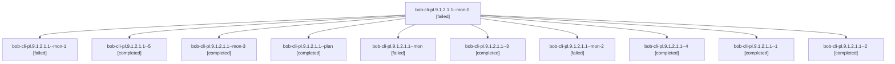

# Session: bob-cli-pl.9.1.2.1.1

[Agent Hoods](../README.md) / [bbugyi200](../users/bbugyi200/README.md) / [apollo](../users/bbugyi200/machines/apollo/README.md) / [bob-cli-pl](../users/bbugyi200/machines/apollo/hoods/bob-cli-pl/README.md) / bob-cli-pl.9.1.2.1.1

Owner: `bbugyi200.apollo` · Hood: `bob-cli-pl` · Members: 11 · Bead: [bob-cli-pl.9.1.2.1.1](https://github.com/bobs-org/bob-cli--beads/blob/main/pages/bob-cli-pl/bob-cli-pl.9.1.2.1.1.md)

## Lineage



The diagram is an optional enhancement; the ordered table below contains the same lineage in accessible text.

| Role | Agent | State | Model / provider | Timing | Commits | Prompt | Chat |
|---|---|---|---|---|---:|---|---|
| <a id="member-mon-0"></a>mon-0 | bob-cli-pl.9.1.2.1.1--mon-0 | failed | gpt-6-luna / codex | 2026-11-26T09:21:09.948466+00:00 → 2026-11-26T09:23:36.769236+00:00 | 0 | — | [Chat](../agents/bbugyi200.apollo.bob-cli-pl.9.1.2.1.1--mon-0/chat.md) |
| <a id="member-mon-1"></a>mon-1 | bob-cli-pl.9.1.2.1.1--mon-1 | failed | gpt-6-luna / codex | 2026-11-26T09:32:51.945725+00:00 → 2026-11-26T09:39:41.585171+00:00 | 0 | — | [Chat](../agents/bbugyi200.apollo.bob-cli-pl.9.1.2.1.1--mon-1/chat.md) |
| <a id="member-5"></a>5 | bob-cli-pl.9.1.2.1.1--5 | completed | gpt-6-luna / codex | 2026-11-26T10:25:47.372526+00:00 → 2026-11-26T10:45:00.372652+00:00 | 0 | [Prompt](../agents/bbugyi200.apollo.bob-cli-pl.9.1.2.1.1--5/prompt.md) | [Chat](../agents/bbugyi200.apollo.bob-cli-pl.9.1.2.1.1--5/chat.md) |
| <a id="member-mon-3"></a>mon-3 | bob-cli-pl.9.1.2.1.1--mon-3 | completed | gpt-6-luna / codex | 2026-11-26T10:14:01.337365+00:00 → 2026-11-26T10:25:47.837611+00:00 | 0 | — | [Chat](../agents/bbugyi200.apollo.bob-cli-pl.9.1.2.1.1--mon-3/chat.md) |
| <a id="member-plan"></a>plan | bob-cli-pl.9.1.2.1.1--plan | completed | gpt-6-luna / codex | 2026-11-26T08:30:38.389885+00:00 → 2026-11-26T09:12:23.597855+00:00 | 0 | [Prompt](../agents/bbugyi200.apollo.bob-cli-pl.9.1.2.1.1--plan/prompt.md) | [Chat](../agents/bbugyi200.apollo.bob-cli-pl.9.1.2.1.1--plan/chat.md) |
| <a id="member-mon"></a>mon | bob-cli-pl.9.1.2.1.1--mon | failed | gpt-6-luna / codex | 2026-11-26T09:07:22.065468+00:00 → 2026-11-26T09:17:11.622920+00:00 | 0 | — | [Chat](../agents/bbugyi200.apollo.bob-cli-pl.9.1.2.1.1--mon/chat.md) |
| <a id="member-3"></a>3 | bob-cli-pl.9.1.2.1.1--3 | completed | gpt-6-luna / codex | 2026-11-26T09:52:53.131686+00:00 → 2026-11-26T09:59:46.894009+00:00 | 0 | [Prompt](../agents/bbugyi200.apollo.bob-cli-pl.9.1.2.1.1--3/prompt.md) | [Chat](../agents/bbugyi200.apollo.bob-cli-pl.9.1.2.1.1--3/chat.md) |
| <a id="member-mon-2"></a>mon-2 | bob-cli-pl.9.1.2.1.1--mon-2 | failed | gpt-6-luna / codex | 2026-11-26T09:58:50.324272+00:00 → 2026-11-26T10:07:55.119893+00:00 | 0 | — | [Chat](../agents/bbugyi200.apollo.bob-cli-pl.9.1.2.1.1--mon-2/chat.md) |
| <a id="member-4"></a>4 | bob-cli-pl.9.1.2.1.1--4 | completed | gpt-6-luna / codex | 2026-11-26T10:07:54.942344+00:00 → 2026-11-26T10:14:59.260128+00:00 | 0 | [Prompt](../agents/bbugyi200.apollo.bob-cli-pl.9.1.2.1.1--4/prompt.md) | [Chat](../agents/bbugyi200.apollo.bob-cli-pl.9.1.2.1.1--4/chat.md) |
| <a id="member-1"></a>1 | bob-cli-pl.9.1.2.1.1--1 | completed | gpt-6-luna / codex | 2026-11-26T09:17:11.296397+00:00 → 2026-11-26T09:22:04.437428+00:00 | 0 | [Prompt](../agents/bbugyi200.apollo.bob-cli-pl.9.1.2.1.1--1/prompt.md) | [Chat](../agents/bbugyi200.apollo.bob-cli-pl.9.1.2.1.1--1/chat.md) |
| <a id="member-2"></a>2 | bob-cli-pl.9.1.2.1.1--2 | completed | gpt-6-luna / codex | 2026-11-26T09:23:36.438023+00:00 → 2026-11-26T09:33:53.077018+00:00 | 0 | [Prompt](../agents/bbugyi200.apollo.bob-cli-pl.9.1.2.1.1--2/prompt.md) | [Chat](../agents/bbugyi200.apollo.bob-cli-pl.9.1.2.1.1--2/chat.md) |

## Variables

| Role | Variable | Value |
|---|---|---|
| 5 | `artifacts` | \[{bead: bob-cli-pl.9.1.2.1.1, kind: file, label: Athena Bank profile raw report 20261126T101848Z, path: /home/bryan/.sase/artifacts/agents/gh\_bobs-org\_\_bob-cli/20261126052500/report-1b5b805b87ca.json… |

#### artifacts

**Role:** `5`

```yaml
- bead: bob-cli-pl.9.1.2.1.1
  kind: file
  label: Athena Bank profile raw report 20261126T101848Z
  path: /home/bryan/.sase/artifacts/agents/gh_bobs-org__bob-cli/20261126052500/report-1b5b805b87ca.json
  ref: file:explicit:6fed67657bdc3c6424a2728b
  source_path: /tmp/bob-bank-profile-20261126T101848Z-2764294.FQVjMG/evidence/report.json
- bead: bob-cli-pl.9.1.2.1.1
  kind: file
  label: Athena Bank profile complete evidence archive 20261126T101848Z
  path: /home/bryan/.sase/artifacts/agents/gh_bobs-org__bob-cli/20261126052500/bob-bank-profile-20261126T101848Z-2764294-evidence.tar-03f26e60c91e.zst
  ref: file:explicit:fe0b22b0a0295a7a7901d2c1
  source_path: /tmp/bob-bank-profile-20261126T101848Z-2764294-evidence.tar.zst
```

Values are truncated for display; see each member's agent meta.json for the full values.

## Neighbors

| Agent | Relation | State |
|---|---|---|
| [bob-cli-pl.9.1.2](bbugyi200.apollo.bob-cli-pl.9.1.2.md) (session · 31) | ancestor | active 2, completed 20, failed 9 |
| [bob-cli-pl.9](bbugyi200.apollo.bob-cli-pl.9.md) (session · 3) | ancestor | active 1, completed 2 |
| [bob-cli-pl.9.1.2.1.2](../agents/bbugyi200.apollo.bob-cli-pl.9.1.2.1.2/README.md) | bob-cli-pl.9.1.2.1 hood | completed |
| [bob-cli-pl.9.1.2.1.3](../agents/bbugyi200.apollo.bob-cli-pl.9.1.2.1.3/README.md) | bob-cli-pl.9.1.2.1 hood | waiting |
| [bob-cli-pl.9.1.2.1.4](../agents/bbugyi200.apollo.bob-cli-pl.9.1.2.1.4/README.md) | bob-cli-pl.9.1.2.1 hood | waiting |
| [bob-cli-pl.9.1.2.1.land](../agents/bbugyi200.apollo.bob-cli-pl.9.1.2.1.land/README.md) | bob-cli-pl.9.1.2.1 hood | waiting |
| [bob-cli-pl.9.1.1](../agents/bbugyi200.apollo.bob-cli-pl.9.1.1/README.md) | bob-cli-pl.9.1 hood | completed |
| [bob-cli-pl.9.1.3](../agents/bbugyi200.apollo.bob-cli-pl.9.1.3/README.md) | bob-cli-pl.9.1 hood | waiting |
| [bob-cli-pl.9.1.4](../agents/bbugyi200.apollo.bob-cli-pl.9.1.4/README.md) | bob-cli-pl.9.1 hood | waiting |
| [bob-cli-pl.9.1.land](../agents/bbugyi200.apollo.bob-cli-pl.9.1.land/README.md) | bob-cli-pl.9.1 hood | waiting |
| [bob-cli-pl.1](bbugyi200.apollo.bob-cli-pl.1.md) (session · 9) | bob-cli-pl hood | completed 7, failed 2 |
| [bob-cli-pl.2](bbugyi200.apollo.bob-cli-pl.2.md) (session · 5) | bob-cli-pl hood | completed 4, failed 1 |
| [bob-cli-pl.3](../agents/bbugyi200.apollo.bob-cli-pl.3/README.md) | bob-cli-pl hood | completed |
| [bob-cli-pl.4](bbugyi200.apollo.bob-cli-pl.4.md) (session · 5) | bob-cli-pl hood | completed 5 |
| [bob-cli-pl.4.1.1](../agents/bbugyi200.apollo.bob-cli-pl.4.1.1/README.md) | bob-cli-pl hood | completed |
| [bob-cli-pl.4.1.2](../agents/bbugyi200.apollo.bob-cli-pl.4.1.2/README.md) | bob-cli-pl hood | completed |
| [bob-cli-pl.4.1.3](bbugyi200.apollo.bob-cli-pl.4.1.3.md) (session · 12) | bob-cli-pl hood | completed 7, failed 5 |
| [bob-cli-pl.4.1.land](bbugyi200.apollo.bob-cli-pl.4.1.land.md) (session · 3) | bob-cli-pl hood | completed 3 |
| [bob-cli-pl.5](../agents/bbugyi200.apollo.bob-cli-pl.5/README.md) | bob-cli-pl hood | completed |
| [bob-cli-pl.6](bbugyi200.apollo.bob-cli-pl.6.md) (session · 3) | bob-cli-pl hood | active 1, completed 2 |
| [bob-cli-pl.6.1.1](bbugyi200.apollo.bob-cli-pl.6.1.1.md) (session · 3) | bob-cli-pl hood | completed 3 |
| [bob-cli-pl.6.1.2](bbugyi200.apollo.bob-cli-pl.6.1.2.md) (session · 8) | bob-cli-pl hood | active 1, completed 4, failed 3 |
| [bob-cli-pl.6.1.2](../agents/bbugyi200.apollo.bob-cli-pl.6.1.2/README.md) | bob-cli-pl hood | completed |
| [bob-cli-pl.6.1.3](../agents/bbugyi200.apollo.bob-cli-pl.6.1.3/README.md) | bob-cli-pl hood | completed |
| [bob-cli-pl.6.1.4](../agents/bbugyi200.apollo.bob-cli-pl.6.1.4/README.md) | bob-cli-pl hood | completed |
| [bob-cli-pl.6.1.5](bbugyi200.apollo.bob-cli-pl.6.1.5.md) (session · 21) | bob-cli-pl hood | active 3, completed 10, failed 8 |
| [bob-cli-pl.6.1.land](../agents/bbugyi200.apollo.bob-cli-pl.6.1.land/README.md) | bob-cli-pl hood | completed |
| [bob-cli-pl.7](../agents/bbugyi200.apollo.bob-cli-pl.7/README.md) | bob-cli-pl hood | completed |
| [bob-cli-pl.8](../agents/bbugyi200.apollo.bob-cli-pl.8/README.md) | bob-cli-pl hood | completed |
| [bob-cli-pl.land](../agents/bbugyi200.apollo.bob-cli-pl.land/README.md) | bob-cli-pl hood | waiting |
