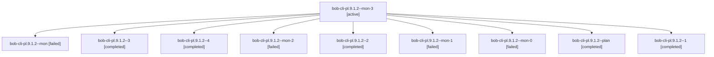

# Session: bob-cli-pl.9.1.2

[Agent Hoods](../README.md) / [bbugyi200](../users/bbugyi200/README.md) / [apollo](../users/bbugyi200/machines/apollo/README.md) / [bob-cli-pl](../users/bbugyi200/machines/apollo/hoods/bob-cli-pl/README.md) / bob-cli-pl.9.1.2

Owner: `bbugyi200.apollo` · Hood: `bob-cli-pl` · Members: 10 · Bead: [bob-cli-pl.9.1.2](https://github.com/bobs-org/bob-cli--beads/blob/main/pages/bob-cli-pl/bob-cli-pl.9.1.2.md)

## Lineage

The diagram is an optional enhancement; the ordered table below contains the same lineage in accessible text.

| Role | Agent | State | Model / provider | Timing | Commits | Prompt | Chat |
|---|---|---|---|---|---:|---|---|
| mon-3 | bob-cli-pl.9.1.2--mon-3 | active | gpt-6-luna / codex | 2026-11-26T04:25:19.721309+00:00 | 0 | — | — |
| mon | bob-cli-pl.9.1.2--mon | failed | gpt-6-luna / codex | 2026-11-26T01:49:51.398964+00:00 → 2026-11-26T01:54:33.620993+00:00 | 0 | — | [Chat](../agents/bbugyi200.apollo.bob-cli-pl.9.1.2--mon/chat.md) |
| 3 | bob-cli-pl.9.1.2--3 | completed | gpt-6-luna / codex | 2026-11-26T03:31:47.551195+00:00 → 2026-11-26T03:45:36.571409+00:00 | 0 | [Prompt](../agents/bbugyi200.apollo.bob-cli-pl.9.1.2--3/prompt.md) | [Chat](../agents/bbugyi200.apollo.bob-cli-pl.9.1.2--3/chat.md) |
| 4 | bob-cli-pl.9.1.2--4 | completed | gpt-6-luna / codex | 2026-11-26T03:55:08.434218+00:00 → 2026-11-26T04:28:37.728881+00:00 | 0 | [Prompt](../agents/bbugyi200.apollo.bob-cli-pl.9.1.2--4/prompt.md) | [Chat](../agents/bbugyi200.apollo.bob-cli-pl.9.1.2--4/chat.md) |
| mon-2 | bob-cli-pl.9.1.2--mon-2 | failed | gpt-6-luna / codex | 2026-11-26T03:44:38.439810+00:00 → 2026-11-26T03:55:08.659885+00:00 | 0 | — | [Chat](../agents/bbugyi200.apollo.bob-cli-pl.9.1.2--mon-2/chat.md) |
| 2 | bob-cli-pl.9.1.2--2 | completed | gpt-6-luna / codex | 2026-11-26T02:59:44.151722+00:00 → 2026-11-26T03:26:35.678637+00:00 | 0 | [Prompt](../agents/bbugyi200.apollo.bob-cli-pl.9.1.2--2/prompt.md) | [Chat](../agents/bbugyi200.apollo.bob-cli-pl.9.1.2--2/chat.md) |
| mon-1 | bob-cli-pl.9.1.2--mon-1 | failed | gpt-6-luna / codex | 2026-11-26T03:10:15.136722+00:00 → 2026-11-26T03:31:47.608340+00:00 | 0 | — | [Chat](../agents/bbugyi200.apollo.bob-cli-pl.9.1.2--mon-1/chat.md) |
| mon-0 | bob-cli-pl.9.1.2--mon-0 | failed | gpt-6-luna / codex | 2026-11-26T02:45:27.265782+00:00 → 2026-11-26T02:59:44.213802+00:00 | 0 | — | [Chat](../agents/bbugyi200.apollo.bob-cli-pl.9.1.2--mon-0/chat.md) |
| plan | bob-cli-pl.9.1.2--plan | completed | gpt-6-luna / codex | 2026-11-26T01:21:13.210532+00:00 → 2026-11-26T01:51:16.773705+00:00 | 0 | [Prompt](../agents/bbugyi200.apollo.bob-cli-pl.9.1.2--plan/prompt.md) | [Chat](../agents/bbugyi200.apollo.bob-cli-pl.9.1.2--plan/chat.md) |
| 1 | bob-cli-pl.9.1.2--1 | completed | gpt-6-luna / codex | 2026-11-26T01:54:49.044467+00:00 → 2026-11-26T02:47:13.441620+00:00 | 0 | [Prompt](../agents/bbugyi200.apollo.bob-cli-pl.9.1.2--1/prompt.md) | [Chat](../agents/bbugyi200.apollo.bob-cli-pl.9.1.2--1/chat.md) |

## Neighbors

| Agent | Relation | State |
|---|---|---|
| [bob-cli-pl.9](bbugyi200.apollo.bob-cli-pl.9.md) (session · 3) | ancestor | active 1, completed 2 |
| [bob-cli-pl.9.1.1](../agents/bbugyi200.apollo.bob-cli-pl.9.1.1/README.md) | bob-cli-pl.9.1 hood | completed |
| [bob-cli-pl.9.1.3](../agents/bbugyi200.apollo.bob-cli-pl.9.1.3/README.md) | bob-cli-pl.9.1 hood | waiting |
| [bob-cli-pl.9.1.4](../agents/bbugyi200.apollo.bob-cli-pl.9.1.4/README.md) | bob-cli-pl.9.1 hood | waiting |
| [bob-cli-pl.9.1.land](../agents/bbugyi200.apollo.bob-cli-pl.9.1.land/README.md) | bob-cli-pl.9.1 hood | waiting |
| [bob-cli-pl.1](bbugyi200.apollo.bob-cli-pl.1.md) (session · 9) | bob-cli-pl hood | completed 7, failed 2 |
| [bob-cli-pl.2](bbugyi200.apollo.bob-cli-pl.2.md) (session · 5) | bob-cli-pl hood | completed 4, failed 1 |
| [bob-cli-pl.3](../agents/bbugyi200.apollo.bob-cli-pl.3/README.md) | bob-cli-pl hood | completed |
| [bob-cli-pl.4](bbugyi200.apollo.bob-cli-pl.4.md) (session · 5) | bob-cli-pl hood | completed 5 |
| [bob-cli-pl.4.1.1](../agents/bbugyi200.apollo.bob-cli-pl.4.1.1/README.md) | bob-cli-pl hood | completed |
| [bob-cli-pl.4.1.2](../agents/bbugyi200.apollo.bob-cli-pl.4.1.2/README.md) | bob-cli-pl hood | completed |
| [bob-cli-pl.4.1.3](bbugyi200.apollo.bob-cli-pl.4.1.3.md) (session · 12) | bob-cli-pl hood | completed 7, failed 5 |
| [bob-cli-pl.4.1.land](bbugyi200.apollo.bob-cli-pl.4.1.land.md) (session · 3) | bob-cli-pl hood | completed 3 |
| [bob-cli-pl.5](../agents/bbugyi200.apollo.bob-cli-pl.5/README.md) | bob-cli-pl hood | completed |
| [bob-cli-pl.6](bbugyi200.apollo.bob-cli-pl.6.md) (session · 3) | bob-cli-pl hood | active 1, completed 2 |
| [bob-cli-pl.6.1.1](bbugyi200.apollo.bob-cli-pl.6.1.1.md) (session · 3) | bob-cli-pl hood | completed 3 |
| [bob-cli-pl.6.1.2](bbugyi200.apollo.bob-cli-pl.6.1.2.md) (session · 8) | bob-cli-pl hood | active 1, completed 4, failed 3 |
| [bob-cli-pl.6.1.2](../agents/bbugyi200.apollo.bob-cli-pl.6.1.2/README.md) | bob-cli-pl hood | completed |
| [bob-cli-pl.6.1.3](../agents/bbugyi200.apollo.bob-cli-pl.6.1.3/README.md) | bob-cli-pl hood | completed |
| [bob-cli-pl.6.1.4](../agents/bbugyi200.apollo.bob-cli-pl.6.1.4/README.md) | bob-cli-pl hood | completed |
| [bob-cli-pl.6.1.5](bbugyi200.apollo.bob-cli-pl.6.1.5.md) (session · 21) | bob-cli-pl hood | active 3, completed 10, failed 8 |
| [bob-cli-pl.6.1.land](../agents/bbugyi200.apollo.bob-cli-pl.6.1.land/README.md) | bob-cli-pl hood | completed |
| [bob-cli-pl.7](../agents/bbugyi200.apollo.bob-cli-pl.7/README.md) | bob-cli-pl hood | completed |
| [bob-cli-pl.8](../agents/bbugyi200.apollo.bob-cli-pl.8/README.md) | bob-cli-pl hood | completed |
| [bob-cli-pl.land](../agents/bbugyi200.apollo.bob-cli-pl.land/README.md) | bob-cli-pl hood | waiting |
