# Session: bob-cli-pl.9.1.2

[Agent Hoods](../README.md) / [bbugyi200](../users/bbugyi200/README.md) / [apollo](../users/bbugyi200/machines/apollo/README.md) / [bob-cli-pl](../users/bbugyi200/machines/apollo/hoods/bob-cli-pl/README.md) / bob-cli-pl.9.1.2

Owner: `bbugyi200.apollo` · Hood: `bob-cli-pl` · Members: 31 · Bead: [bob-cli-pl.9.1.2](https://github.com/bobs-org/bob-cli--beads/blob/main/pages/bob-cli-pl/bob-cli-pl.9.1.2.md)

## Lineage

```mermaid
flowchart TD
  n0["bob-cli-pl.9.1.2--6 [completed]"]
  n1["bob-cli-pl.9.1.2--mon-b [failed]"]
  n0 --> n1
  n2["bob-cli-pl.9.1.2--d [completed]"]
  n0 --> n2
  n3["bob-cli-pl.9.1.2--mon-3 [failed]"]
  n0 --> n3
  n4["bob-cli-pl.9.1.2--7 [completed]"]
  n0 --> n4
  n5["bob-cli-pl.9.1.2--9 [completed]"]
  n0 --> n5
  n6["bob-cli-pl.9.1.2--e [completed]"]
  n0 --> n6
  n7["bob-cli-pl.9.1.2--mon-d [active]"]
  n0 --> n7
  n8["bob-cli-pl.9.1.2--3 [completed]"]
  n0 --> n8
  n9["bob-cli-pl.9.1.2--4 [completed]"]
  n0 --> n9
  n10["bob-cli-pl.9.1.2--mon-2 [failed]"]
  n0 --> n10
  n11["bob-cli-pl.9.1.2--mon-5 [failed]"]
  n0 --> n11
  n12["bob-cli-pl.9.1.2--mon-a [completed]"]
  n0 --> n12
  n13["bob-cli-pl.9.1.2--gate [completed]"]
  n0 --> n13
  n14["bob-cli-pl.9.1.2--mon-4 [failed]"]
  n0 --> n14
  n15["bob-cli-pl.9.1.2--plan [active]"]
  n0 --> n15
  n16["bob-cli-pl.9.1.2--mon [completed]"]
  n0 --> n16
  n17["bob-cli-pl.9.1.2--2 [completed]"]
  n0 --> n17
  n18["bob-cli-pl.9.1.2--mon-1 [failed]"]
  n0 --> n18
  n19["bob-cli-pl.9.1.2--5 [completed]"]
  n0 --> n19
  n20["bob-cli-pl.9.1.2--mon-0 [failed]"]
  n0 --> n20
  n21["bob-cli-pl.9.1.2--mon-8 [failed]"]
  n0 --> n21
  n22["bob-cli-pl.9.1.2--mon-7 [completed]"]
  n0 --> n22
  n23["bob-cli-pl.9.1.2--mon-c [completed]"]
  n0 --> n23
  n24["bob-cli-pl.9.1.2--8 [completed]"]
  n0 --> n24
  n25["bob-cli-pl.9.1.2--c [completed]"]
  n0 --> n25
  n26["bob-cli-pl.9.1.2--b [completed]"]
  n0 --> n26
  n27["bob-cli-pl.9.1.2--mon-9 [completed]"]
  n0 --> n27
  n28["bob-cli-pl.9.1.2--1 [completed]"]
  n0 --> n28
  n29["bob-cli-pl.9.1.2--mon-6 [failed]"]
  n0 --> n29
  n30["bob-cli-pl.9.1.2--a [completed]"]
  n0 --> n30
```



The diagram is an optional enhancement; the ordered table below contains the same lineage in accessible text.

| Role | Agent | State | Model / provider | Timing | Commits | Prompt | Chat |
|---|---|---|---|---|---:|---|---|
| <a id="member-6"></a>6 | bob-cli-pl.9.1.2--6 | completed | gpt-6-luna / codex | 2026-11-26T04:47:57.232368+00:00 → 2026-11-26T04:54:44.806320+00:00 | 0 | [Prompt](../agents/bbugyi200.apollo.bob-cli-pl.9.1.2--6/prompt.md) | [Chat](../agents/bbugyi200.apollo.bob-cli-pl.9.1.2--6/chat.md) |
| <a id="member-mon-b"></a>mon-b | bob-cli-pl.9.1.2--mon-b | failed | gpt-6-luna / codex | 2026-11-26T06:52:55.657959+00:00 → 2026-11-26T07:00:51.753987+00:00 | 0 | — | [Chat](../agents/bbugyi200.apollo.bob-cli-pl.9.1.2--mon-b/chat.md) |
| <a id="member-d"></a>d | bob-cli-pl.9.1.2--d | completed | gpt-6-luna / codex | 2026-11-26T07:00:51.269693+00:00 → 2026-11-26T07:16:06.197194+00:00 | 0 | [Prompt](../agents/bbugyi200.apollo.bob-cli-pl.9.1.2--d/prompt.md) | [Chat](../agents/bbugyi200.apollo.bob-cli-pl.9.1.2--d/chat.md) |
| <a id="member-mon-3"></a>mon-3 | bob-cli-pl.9.1.2--mon-3 | failed | gpt-6-luna / codex | 2026-11-26T04:25:19.721309+00:00 → 2026-11-26T04:34:35.386428+00:00 | 0 | — | [Chat](../agents/bbugyi200.apollo.bob-cli-pl.9.1.2--mon-3/chat.md) |
| <a id="member-7"></a>7 | bob-cli-pl.9.1.2--7 | completed | gpt-6-luna / codex | 2026-11-26T05:00:09.866439+00:00 → 2026-11-26T05:13:43.220472+00:00 | 0 | [Prompt](../agents/bbugyi200.apollo.bob-cli-pl.9.1.2--7/prompt.md) | [Chat](../agents/bbugyi200.apollo.bob-cli-pl.9.1.2--7/chat.md) |
| <a id="member-9"></a>9 | bob-cli-pl.9.1.2--9 | completed | gpt-6-luna / codex | 2026-11-26T05:45:35.545939+00:00 → 2026-11-26T06:03:44.036627+00:00 | 0 | [Prompt](../agents/bbugyi200.apollo.bob-cli-pl.9.1.2--9/prompt.md) | [Chat](../agents/bbugyi200.apollo.bob-cli-pl.9.1.2--9/chat.md) |
| <a id="member-e"></a>e | bob-cli-pl.9.1.2--e | completed | gpt-6-luna / codex | 2026-11-26T07:25:16.047971+00:00 → 2026-11-26T07:55:03.751287+00:00 | 0 | [Prompt](../agents/bbugyi200.apollo.bob-cli-pl.9.1.2--e/prompt.md) | [Chat](../agents/bbugyi200.apollo.bob-cli-pl.9.1.2--e/chat.md) |
| <a id="member-mon-d"></a>mon-d | bob-cli-pl.9.1.2--mon-d | active | gpt-6-luna / codex | 2026-11-26T07:52:35.083238+00:00 | 0 | — | — |
| <a id="member-3"></a>3 | bob-cli-pl.9.1.2--3 | completed | gpt-6-luna / codex | 2026-11-26T03:31:47.551195+00:00 → 2026-11-26T03:45:36.571409+00:00 | 0 | [Prompt](../agents/bbugyi200.apollo.bob-cli-pl.9.1.2--3/prompt.md) | [Chat](../agents/bbugyi200.apollo.bob-cli-pl.9.1.2--3/chat.md) |
| <a id="member-4"></a>4 | bob-cli-pl.9.1.2--4 | completed | gpt-6-luna / codex | 2026-11-26T03:55:08.434218+00:00 → 2026-11-26T04:28:37.728881+00:00 | 0 | [Prompt](../agents/bbugyi200.apollo.bob-cli-pl.9.1.2--4/prompt.md) | [Chat](../agents/bbugyi200.apollo.bob-cli-pl.9.1.2--4/chat.md) |
| <a id="member-mon-2"></a>mon-2 | bob-cli-pl.9.1.2--mon-2 | failed | gpt-6-luna / codex | 2026-11-26T03:44:38.439810+00:00 → 2026-11-26T03:55:08.659885+00:00 | 0 | — | [Chat](../agents/bbugyi200.apollo.bob-cli-pl.9.1.2--mon-2/chat.md) |
| <a id="member-mon-5"></a>mon-5 | bob-cli-pl.9.1.2--mon-5 | failed | gpt-6-luna / codex | 2026-11-26T04:53:56.538341+00:00 → 2026-11-26T05:00:10.187932+00:00 | 0 | — | [Chat](../agents/bbugyi200.apollo.bob-cli-pl.9.1.2--mon-5/chat.md) |
| <a id="member-mon-a"></a>mon-a | bob-cli-pl.9.1.2--mon-a | completed | gpt-6-luna / codex | 2026-11-26T06:25:09.105929+00:00 → 2026-11-26T06:36:13.208849+00:00 | 0 | — | [Chat](../agents/bbugyi200.apollo.bob-cli-pl.9.1.2--mon-a/chat.md) |
| <a id="member-gate"></a>gate | bob-cli-pl.9.1.2--gate | completed | gpt-6-astra / codex | 2026-11-26T08:27:57.068647+00:00 → 2026-11-26T08:28:27.689710+00:00 | 0 | — | [Chat](../agents/bbugyi200.apollo.bob-cli-pl.9.1.2--gate/chat.md) |
| <a id="member-mon-4"></a>mon-4 | bob-cli-pl.9.1.2--mon-4 | failed | gpt-6-luna / codex | 2026-11-26T04:41:55.142237+00:00 → 2026-11-26T04:47:57.714599+00:00 | 0 | — | [Chat](../agents/bbugyi200.apollo.bob-cli-pl.9.1.2--mon-4/chat.md) |
| <a id="member-plan"></a>plan | bob-cli-pl.9.1.2--plan | active | gpt-6-astra / codex | 2026-11-26T08:16:57.163534+00:00 → 2026-11-26T08:28:38.293278+00:00 | 0 | [Prompt](../agents/bbugyi200.apollo.bob-cli-pl.9.1.2--plan/prompt.md) | [Chat](../agents/bbugyi200.apollo.bob-cli-pl.9.1.2--plan/chat.md) |
| <a id="member-mon"></a>mon | bob-cli-pl.9.1.2--mon | completed | gpt-6-astra / codex | 2026-11-26T08:28:25.834245+00:00 → 2026-11-26T08:30:24.166151+00:00 | 0 | — | [Chat](../agents/bbugyi200.apollo.bob-cli-pl.9.1.2--mon/chat.md) |
| <a id="member-2"></a>2 | bob-cli-pl.9.1.2--2 | completed | gpt-6-luna / codex | 2026-11-26T02:59:44.151722+00:00 → 2026-11-26T03:26:35.678637+00:00 | 0 | [Prompt](../agents/bbugyi200.apollo.bob-cli-pl.9.1.2--2/prompt.md) | [Chat](../agents/bbugyi200.apollo.bob-cli-pl.9.1.2--2/chat.md) |
| <a id="member-mon-1"></a>mon-1 | bob-cli-pl.9.1.2--mon-1 | failed | gpt-6-luna / codex | 2026-11-26T03:10:15.136722+00:00 → 2026-11-26T03:31:47.608340+00:00 | 0 | — | [Chat](../agents/bbugyi200.apollo.bob-cli-pl.9.1.2--mon-1/chat.md) |
| <a id="member-5"></a>5 | bob-cli-pl.9.1.2--5 | completed | gpt-6-luna / codex | 2026-11-26T04:34:34.882828+00:00 → 2026-11-26T04:42:46.065848+00:00 | 0 | [Prompt](../agents/bbugyi200.apollo.bob-cli-pl.9.1.2--5/prompt.md) | [Chat](../agents/bbugyi200.apollo.bob-cli-pl.9.1.2--5/chat.md) |
| <a id="member-mon-0"></a>mon-0 | bob-cli-pl.9.1.2--mon-0 | failed | gpt-6-luna / codex | 2026-11-26T02:45:27.265782+00:00 → 2026-11-26T02:59:44.213802+00:00 | 0 | — | [Chat](../agents/bbugyi200.apollo.bob-cli-pl.9.1.2--mon-0/chat.md) |
| <a id="member-mon-8"></a>mon-8 | bob-cli-pl.9.1.2--mon-8 | failed | gpt-6-luna / codex | 2026-11-26T06:00:53.520732+00:00 → 2026-11-26T06:09:00.976550+00:00 | 0 | — | [Chat](../agents/bbugyi200.apollo.bob-cli-pl.9.1.2--mon-8/chat.md) |
| <a id="member-mon-7"></a>mon-7 | bob-cli-pl.9.1.2--mon-7 | completed | gpt-6-luna / codex | 2026-11-26T05:31:12.496721+00:00 → 2026-11-26T05:44:59.389541+00:00 | 0 | — | [Chat](../agents/bbugyi200.apollo.bob-cli-pl.9.1.2--mon-7/chat.md) |
| <a id="member-mon-c"></a>mon-c | bob-cli-pl.9.1.2--mon-c | completed | gpt-6-luna / codex | 2026-11-26T07:15:21.682646+00:00 → 2026-11-26T07:25:16.237467+00:00 | 0 | — | [Chat](../agents/bbugyi200.apollo.bob-cli-pl.9.1.2--mon-c/chat.md) |
| <a id="member-8"></a>8 | bob-cli-pl.9.1.2--8 | completed | gpt-6-luna / codex | 2026-11-26T05:19:03.851268+00:00 → 2026-11-26T05:33:02.934216+00:00 | 0 | [Prompt](../agents/bbugyi200.apollo.bob-cli-pl.9.1.2--8/prompt.md) | [Chat](../agents/bbugyi200.apollo.bob-cli-pl.9.1.2--8/chat.md) |
| <a id="member-c"></a>c | bob-cli-pl.9.1.2--c | completed | gpt-6-luna / codex | 2026-11-26T06:36:13.156782+00:00 → 2026-11-26T06:55:32.729039+00:00 | 0 | [Prompt](../agents/bbugyi200.apollo.bob-cli-pl.9.1.2--c/prompt.md) | [Chat](../agents/bbugyi200.apollo.bob-cli-pl.9.1.2--c/chat.md) |
| <a id="member-b"></a>b | bob-cli-pl.9.1.2--b | completed | gpt-6-luna / codex | 2026-11-26T06:19:41.636719+00:00 → 2026-11-26T06:25:49.635509+00:00 | 0 | [Prompt](../agents/bbugyi200.apollo.bob-cli-pl.9.1.2--b/prompt.md) | [Chat](../agents/bbugyi200.apollo.bob-cli-pl.9.1.2--b/chat.md) |
| <a id="member-mon-9"></a>mon-9 | bob-cli-pl.9.1.2--mon-9 | completed | gpt-6-luna / codex | 2026-11-26T06:16:40.496768+00:00 → 2026-11-26T06:19:41.764478+00:00 | 0 | — | [Chat](../agents/bbugyi200.apollo.bob-cli-pl.9.1.2--mon-9/chat.md) |
| <a id="member-1"></a>1 | bob-cli-pl.9.1.2--1 | completed | gpt-6-luna / codex | 2026-11-26T01:54:49.044467+00:00 → 2026-11-26T02:47:13.441620+00:00 | 0 | [Prompt](../agents/bbugyi200.apollo.bob-cli-pl.9.1.2--1/prompt.md) | [Chat](../agents/bbugyi200.apollo.bob-cli-pl.9.1.2--1/chat.md) |
| <a id="member-mon-6"></a>mon-6 | bob-cli-pl.9.1.2--mon-6 | failed | gpt-6-luna / codex | 2026-11-26T05:12:16.254503+00:00 → 2026-11-26T05:19:04.144688+00:00 | 0 | — | [Chat](../agents/bbugyi200.apollo.bob-cli-pl.9.1.2--mon-6/chat.md) |
| <a id="member-a"></a>a | bob-cli-pl.9.1.2--a | completed | gpt-6-luna / codex | 2026-11-26T06:09:00.638577+00:00 → 2026-11-26T06:17:47.497978+00:00 | 0 | [Prompt](../agents/bbugyi200.apollo.bob-cli-pl.9.1.2--a/prompt.md) | [Chat](../agents/bbugyi200.apollo.bob-cli-pl.9.1.2--a/chat.md) |

## Variables

| Role | Variable | Value |
|---|---|---|
| plan | `artifacts` | \[{bead: bob-cli-pl.9.1.2, kind: file, label: Bank arbitration failed acceptance and recovery evidence, path: /home/bryan/.sase/artifacts/agents/gh\_bobs-org\_\_bob-cli/20261126031608/bank-arbitration-re… |

#### artifacts

**Role:** `plan`

```yaml
- bead: bob-cli-pl.9.1.2
  kind: file
  label: Bank arbitration failed acceptance and recovery evidence
  path: /home/bryan/.sase/artifacts/agents/gh_bobs-org__bob-cli/20261126031608/bank-arbitration-recovery-evidence.tar-2dfd0fc1c069.gz
  ref: file:explicit:e85d653a52d90836c21d7b53
  source_path: /home/bryan/.local/state/sase/workspaces/bobs-org/bob-cli/bob-cli_10/.build/bank-arbitration-recovery/bank-arbitration-recovery-evidence.tar.gz
```

Values are truncated for display; see each member's agent meta.json for the full values.

## Neighbors

| Agent | Relation | State |
|---|---|---|
| [bob-cli-pl.9](bbugyi200.apollo.bob-cli-pl.9.md) (session · 3) | ancestor | active 1, completed 2 |
| [bob-cli-pl.9.1.2.1.1](bbugyi200.apollo.bob-cli-pl.9.1.2.1.1.md) (session · 11) | descendant | completed 7, failed 4 |
| [bob-cli-pl.9.1.2.1.2](../agents/bbugyi200.apollo.bob-cli-pl.9.1.2.1.2/README.md) | descendant | completed |
| [bob-cli-pl.9.1.2.1.3](../agents/bbugyi200.apollo.bob-cli-pl.9.1.2.1.3/README.md) | descendant | waiting |
| [bob-cli-pl.9.1.2.1.4](../agents/bbugyi200.apollo.bob-cli-pl.9.1.2.1.4/README.md) | descendant | waiting |
| [bob-cli-pl.9.1.2.1.land](../agents/bbugyi200.apollo.bob-cli-pl.9.1.2.1.land/README.md) | descendant | waiting |
| [bob-cli-pl.9.1.1](../agents/bbugyi200.apollo.bob-cli-pl.9.1.1/README.md) | bob-cli-pl.9.1 hood | completed |
| [bob-cli-pl.9.1.3](../agents/bbugyi200.apollo.bob-cli-pl.9.1.3/README.md) | bob-cli-pl.9.1 hood | waiting |
| [bob-cli-pl.9.1.4](../agents/bbugyi200.apollo.bob-cli-pl.9.1.4/README.md) | bob-cli-pl.9.1 hood | waiting |
| [bob-cli-pl.9.1.land](../agents/bbugyi200.apollo.bob-cli-pl.9.1.land/README.md) | bob-cli-pl.9.1 hood | waiting |
| [bob-cli-pl.1](bbugyi200.apollo.bob-cli-pl.1.md) (session · 9) | bob-cli-pl hood | completed 7, failed 2 |
| [bob-cli-pl.2](bbugyi200.apollo.bob-cli-pl.2.md) (session · 5) | bob-cli-pl hood | completed 4, failed 1 |
| [bob-cli-pl.3](../agents/bbugyi200.apollo.bob-cli-pl.3/README.md) | bob-cli-pl hood | completed |
| [bob-cli-pl.4](bbugyi200.apollo.bob-cli-pl.4.md) (session · 5) | bob-cli-pl hood | completed 5 |
| [bob-cli-pl.4.1.1](../agents/bbugyi200.apollo.bob-cli-pl.4.1.1/README.md) | bob-cli-pl hood | completed |
| [bob-cli-pl.4.1.2](../agents/bbugyi200.apollo.bob-cli-pl.4.1.2/README.md) | bob-cli-pl hood | completed |
| [bob-cli-pl.4.1.3](bbugyi200.apollo.bob-cli-pl.4.1.3.md) (session · 12) | bob-cli-pl hood | completed 7, failed 5 |
| [bob-cli-pl.4.1.land](bbugyi200.apollo.bob-cli-pl.4.1.land.md) (session · 3) | bob-cli-pl hood | completed 3 |
| [bob-cli-pl.5](../agents/bbugyi200.apollo.bob-cli-pl.5/README.md) | bob-cli-pl hood | completed |
| [bob-cli-pl.6](bbugyi200.apollo.bob-cli-pl.6.md) (session · 3) | bob-cli-pl hood | active 1, completed 2 |
| [bob-cli-pl.6.1.1](bbugyi200.apollo.bob-cli-pl.6.1.1.md) (session · 3) | bob-cli-pl hood | completed 3 |
| [bob-cli-pl.6.1.2](bbugyi200.apollo.bob-cli-pl.6.1.2.md) (session · 8) | bob-cli-pl hood | active 1, completed 4, failed 3 |
| [bob-cli-pl.6.1.2](../agents/bbugyi200.apollo.bob-cli-pl.6.1.2/README.md) | bob-cli-pl hood | completed |
| [bob-cli-pl.6.1.3](../agents/bbugyi200.apollo.bob-cli-pl.6.1.3/README.md) | bob-cli-pl hood | completed |
| [bob-cli-pl.6.1.4](../agents/bbugyi200.apollo.bob-cli-pl.6.1.4/README.md) | bob-cli-pl hood | completed |
| [bob-cli-pl.6.1.5](bbugyi200.apollo.bob-cli-pl.6.1.5.md) (session · 21) | bob-cli-pl hood | active 3, completed 10, failed 8 |
| [bob-cli-pl.6.1.land](../agents/bbugyi200.apollo.bob-cli-pl.6.1.land/README.md) | bob-cli-pl hood | completed |
| [bob-cli-pl.7](../agents/bbugyi200.apollo.bob-cli-pl.7/README.md) | bob-cli-pl hood | completed |
| [bob-cli-pl.8](../agents/bbugyi200.apollo.bob-cli-pl.8/README.md) | bob-cli-pl hood | completed |
| [bob-cli-pl.land](../agents/bbugyi200.apollo.bob-cli-pl.land/README.md) | bob-cli-pl hood | waiting |
