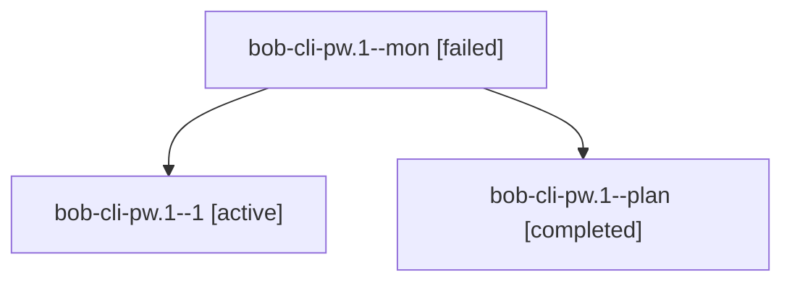

# Session: bob-cli-pw.1

[Agent Hoods](../README.md) / [bbugyi200](../users/bbugyi200/README.md) / [apollo](../users/bbugyi200/machines/apollo/README.md) / [bob-cli-pw](../users/bbugyi200/machines/apollo/hoods/bob-cli-pw/README.md) / bob-cli-pw.1

Owner: `bbugyi200.apollo` · Hood: `bob-cli-pw` · Members: 3 · Bead: [bob-cli-pw.1](https://github.com/bobs-org/bob-cli--beads/blob/main/pages/bob-cli-pw/bob-cli-pw.1.md)

## Lineage

The diagram is an optional enhancement; the ordered table below contains the same lineage in accessible text.

| Role | Agent | State | Model / provider | Timing | Commits | Prompt | Chat |
|---|---|---|---|---|---:|---|---|
| mon | bob-cli-pw.1--mon | failed | gpt-6-luna / codex | 2026-11-24T16:10:04.828404+00:00 → 2026-11-24T16:14:15.764868+00:00 | 0 | — | [Chat](../agents/bbugyi200.apollo.bob-cli-pw.1--mon/chat.md) |
| 1 | bob-cli-pw.1--1 | active | gpt-6-luna / codex | 2026-11-24T16:14:15.369272+00:00 | 0 | [Prompt](../agents/bbugyi200.apollo.bob-cli-pw.1--1/prompt.md) | — |
| plan | bob-cli-pw.1--plan | completed | gpt-6-luna / codex | 2026-11-24T15:47:27.406886+00:00 → 2026-11-24T16:12:31.198233+00:00 | [1](../agents/bbugyi200.apollo.bob-cli-pw.1--plan/README.md#commits) | [Prompt](../agents/bbugyi200.apollo.bob-cli-pw.1--plan/prompt.md) | [Chat](../agents/bbugyi200.apollo.bob-cli-pw.1--plan/chat.md) |

## Commits

| Role | Repo | Commit | Subject | Committed |
|---|---|---|---|---|
| plan | bob-cli | [`dbf405e`](https://github.com/bobs-org/bob-cli/commit/dbf405e397b7081c5c5531590608637346e49dfc) | feat(meetings): add notes normalization and rendering | 2026-11-24 11:11:34 EST |

## Neighbors

| Agent | Relation | State |
|---|---|---|
| [bob-cli-pw.2](../agents/bbugyi200.apollo.bob-cli-pw.2/README.md) | bob-cli-pw hood | active |
| [bob-cli-pw.3](../agents/bbugyi200.apollo.bob-cli-pw.3/README.md) | bob-cli-pw hood | waiting |
| [bob-cli-pw.4](../agents/bbugyi200.apollo.bob-cli-pw.4/README.md) | bob-cli-pw hood | waiting |
| [bob-cli-pw.5](../agents/bbugyi200.apollo.bob-cli-pw.5/README.md) | bob-cli-pw hood | waiting |
| [bob-cli-pw.6](../agents/bbugyi200.apollo.bob-cli-pw.6/README.md) | bob-cli-pw hood | waiting |
| [bob-cli-pw.7](../agents/bbugyi200.apollo.bob-cli-pw.7/README.md) | bob-cli-pw hood | waiting |
| [bob-cli-pw.8](../agents/bbugyi200.apollo.bob-cli-pw.8/README.md) | bob-cli-pw hood | waiting |
| [bob-cli-pw.land](../agents/bbugyi200.apollo.bob-cli-pw.land/README.md) | bob-cli-pw hood | waiting |
