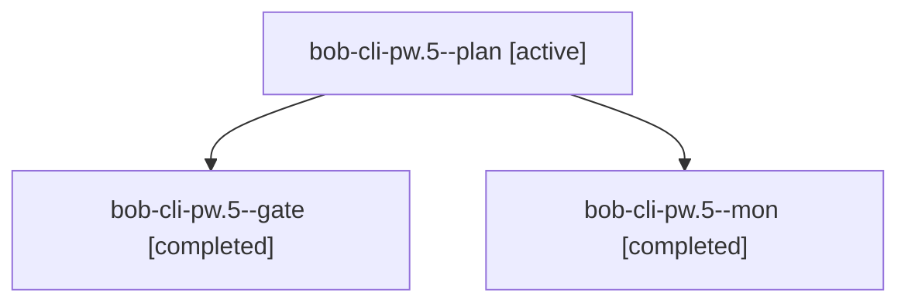

# Session: bob-cli-pw.5

[Agent Hoods](../README.md) / [bbugyi200](../users/bbugyi200/README.md) / [apollo](../users/bbugyi200/machines/apollo/README.md) / [bob-cli-pw](../users/bbugyi200/machines/apollo/hoods/bob-cli-pw/README.md) / bob-cli-pw.5

Owner: `bbugyi200.apollo` · Hood: `bob-cli-pw` · Members: 3 · Bead: [bob-cli-pw.5](https://github.com/bobs-org/bob-cli--beads/blob/main/pages/bob-cli-pw/bob-cli-pw.5.md)

## Lineage

The diagram is an optional enhancement; the ordered table below contains the same lineage in accessible text.

| Role | Agent | State | Model / provider | Timing | Commits | Prompt | Chat |
|---|---|---|---|---|---:|---|---|
| plan | bob-cli-pw.5--plan | active | gpt-6-astra / codex | 2026-11-24T20:05:08.640597+00:00 → 2026-11-24T20:14:22.881512+00:00 | 0 | [Prompt](../agents/bbugyi200.apollo.bob-cli-pw.5--plan/prompt.md) | [Chat](../agents/bbugyi200.apollo.bob-cli-pw.5--plan/chat.md) |
| gate | bob-cli-pw.5--gate | completed | gpt-6-astra / codex | 2026-11-24T20:13:55.573898+00:00 → 2026-11-24T20:14:14.008989+00:00 | 0 | — | [Chat](../agents/bbugyi200.apollo.bob-cli-pw.5--gate/chat.md) |
| mon | bob-cli-pw.5--mon | completed | gpt-6-astra / codex | 2026-11-24T20:14:12.395625+00:00 → 2026-11-24T20:17:15.719211+00:00 | 0 | — | [Chat](../agents/bbugyi200.apollo.bob-cli-pw.5--mon/chat.md) |

## Neighbors

| Agent | Relation | State |
|---|---|---|
| [bob-cli-pw.5.1.1](bbugyi200.apollo.bob-cli-pw.5.1.1.md) (session · 5) | descendant | completed 4, failed 1 |
| [bob-cli-pw.5.1.2](../agents/bbugyi200.apollo.bob-cli-pw.5.1.2/README.md) | descendant | completed |
| [bob-cli-pw.5.1.3](../agents/bbugyi200.apollo.bob-cli-pw.5.1.3/README.md) | descendant | completed |
| [bob-cli-pw.5.1.4](../agents/bbugyi200.apollo.bob-cli-pw.5.1.4/README.md) | descendant | completed |
| [bob-cli-pw.5.1.land](bbugyi200.apollo.bob-cli-pw.5.1.land.md) (session · 3) | descendant | completed 3 |
| [bob-cli-pw.1](bbugyi200.apollo.bob-cli-pw.1.md) (session · 7) | bob-cli-pw hood | completed 5, failed 2 |
| [bob-cli-pw.2](../agents/bbugyi200.apollo.bob-cli-pw.2/README.md) | bob-cli-pw hood | completed |
| [bob-cli-pw.3](../agents/bbugyi200.apollo.bob-cli-pw.3/README.md) | bob-cli-pw hood | completed |
| [bob-cli-pw.4](../agents/bbugyi200.apollo.bob-cli-pw.4/README.md) | bob-cli-pw hood | completed |
| [bob-cli-pw.6](bbugyi200.apollo.bob-cli-pw.6.md) (session · 5) | bob-cli-pw hood | completed 5 |
| [bob-cli-pw.6](../agents/bbugyi200.apollo.bob-cli-pw.6/README.md) | bob-cli-pw hood | completed |
| [bob-cli-pw.7](../agents/bbugyi200.apollo.bob-cli-pw.7/README.md) | bob-cli-pw hood | completed |
| [bob-cli-pw.8](bbugyi200.apollo.bob-cli-pw.8.md) (session · 3) | bob-cli-pw hood | active 1, completed 2 |
| [bob-cli-pw.8.1.1](bbugyi200.apollo.bob-cli-pw.8.1.1.md) (session · 9) | bob-cli-pw hood | completed 5, failed 4 |
| [bob-cli-pw.8.1.2](bbugyi200.apollo.bob-cli-pw.8.1.2.md) (session · 7) | bob-cli-pw hood | completed 5, failed 2 |
| [bob-cli-pw.8.1.3](bbugyi200.apollo.bob-cli-pw.8.1.3.md) (session · 3) | bob-cli-pw hood | completed 2, failed 1 |
| [bob-cli-pw.8.1.land](bbugyi200.apollo.bob-cli-pw.8.1.land.md) (session · 9) | bob-cli-pw hood | completed 7, failed 2 |
| [bob-cli-pw.land](bbugyi200.apollo.bob-cli-pw.land.md) (session · 5) | bob-cli-pw hood | completed 5 |
