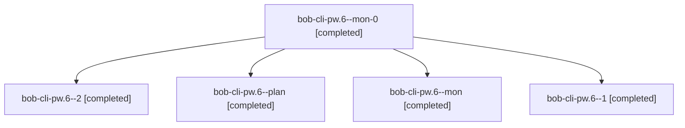

# Session: bob-cli-pw.6

[Agent Hoods](../README.md) / [bbugyi200](../users/bbugyi200/README.md) / [apollo](../users/bbugyi200/machines/apollo/README.md) / [bob-cli-pw](../users/bbugyi200/machines/apollo/hoods/bob-cli-pw/README.md) / bob-cli-pw.6

Owner: `bbugyi200.apollo` · Hood: `bob-cli-pw` · Members: 5 · Bead: [bob-cli-pw.6](https://github.com/bobs-org/bob-cli--beads/blob/main/pages/bob-cli-pw/bob-cli-pw.6.md)

## Lineage

The diagram is an optional enhancement; the ordered table below contains the same lineage in accessible text.

| Role | Agent | State | Model / provider | Timing | Commits | Prompt | Chat |
|---|---|---|---|---|---:|---|---|
| mon-0 | bob-cli-pw.6--mon-0 | completed | gpt-6-luna / codex | 2026-11-25T04:58:56.670636+00:00 → 2026-11-25T05:10:51.271024+00:00 | 0 | — | [Chat](../agents/bbugyi200.apollo.bob-cli-pw.6--mon-0/chat.md) |
| 2 | bob-cli-pw.6--2 | completed | gpt-6-luna / codex | 2026-11-25T05:10:51.031813+00:00 → 2026-11-25T05:21:19.534571+00:00 | 0 | [Prompt](../agents/bbugyi200.apollo.bob-cli-pw.6--2/prompt.md) | [Chat](../agents/bbugyi200.apollo.bob-cli-pw.6--2/chat.md) |
| plan | bob-cli-pw.6--plan | completed | gpt-6-luna / codex | 2026-11-25T04:45:23.130907+00:00 → 2026-11-25T04:47:48.504521+00:00 | 0 | [Prompt](../agents/bbugyi200.apollo.bob-cli-pw.6--plan/prompt.md) | [Chat](../agents/bbugyi200.apollo.bob-cli-pw.6--plan/chat.md) |
| mon | bob-cli-pw.6--mon | completed | gpt-6-luna / codex | 2026-11-25T04:47:09.627476+00:00 → 2026-11-25T04:56:19.818299+00:00 | 0 | — | [Chat](../agents/bbugyi200.apollo.bob-cli-pw.6--mon/chat.md) |
| 1 | bob-cli-pw.6--1 | completed | gpt-6-luna / codex | 2026-11-25T04:56:19.753588+00:00 → 2026-11-25T04:59:34.724706+00:00 | 0 | [Prompt](../agents/bbugyi200.apollo.bob-cli-pw.6--1/prompt.md) | [Chat](../agents/bbugyi200.apollo.bob-cli-pw.6--1/chat.md) |

## Neighbors

| Agent | Relation | State |
|---|---|---|
| [bob-cli-pw.1](bbugyi200.apollo.bob-cli-pw.1.md) (session · 7) | bob-cli-pw hood | completed 5, failed 2 |
| [bob-cli-pw.2](../agents/bbugyi200.apollo.bob-cli-pw.2/README.md) | bob-cli-pw hood | completed |
| [bob-cli-pw.3](../agents/bbugyi200.apollo.bob-cli-pw.3/README.md) | bob-cli-pw hood | completed |
| [bob-cli-pw.4](../agents/bbugyi200.apollo.bob-cli-pw.4/README.md) | bob-cli-pw hood | completed |
| [bob-cli-pw.5](bbugyi200.apollo.bob-cli-pw.5.md) (session · 3) | bob-cli-pw hood | active 1, completed 2 |
| [bob-cli-pw.5.1.1](bbugyi200.apollo.bob-cli-pw.5.1.1.md) (session · 5) | bob-cli-pw hood | completed 4, failed 1 |
| [bob-cli-pw.5.1.2](../agents/bbugyi200.apollo.bob-cli-pw.5.1.2/README.md) | bob-cli-pw hood | completed |
| [bob-cli-pw.5.1.3](../agents/bbugyi200.apollo.bob-cli-pw.5.1.3/README.md) | bob-cli-pw hood | completed |
| [bob-cli-pw.5.1.4](../agents/bbugyi200.apollo.bob-cli-pw.5.1.4/README.md) | bob-cli-pw hood | completed |
| [bob-cli-pw.5.1.land](bbugyi200.apollo.bob-cli-pw.5.1.land.md) (session · 3) | bob-cli-pw hood | completed 3 |
| [bob-cli-pw.7](../agents/bbugyi200.apollo.bob-cli-pw.7/README.md) | bob-cli-pw hood | completed |
| [bob-cli-pw.8](bbugyi200.apollo.bob-cli-pw.8.md) (session · 3) | bob-cli-pw hood | active 1, completed 2 |
| [bob-cli-pw.8.1.1](bbugyi200.apollo.bob-cli-pw.8.1.1.md) (session · 9) | bob-cli-pw hood | completed 5, failed 4 |
| [bob-cli-pw.8.1.2](bbugyi200.apollo.bob-cli-pw.8.1.2.md) (session · 7) | bob-cli-pw hood | completed 5, failed 2 |
| [bob-cli-pw.8.1.3](bbugyi200.apollo.bob-cli-pw.8.1.3.md) (session · 3) | bob-cli-pw hood | completed 2, failed 1 |
| [bob-cli-pw.8.1.land](bbugyi200.apollo.bob-cli-pw.8.1.land.md) (session · 9) | bob-cli-pw hood | completed 7, failed 2 |
| [bob-cli-pw.land](bbugyi200.apollo.bob-cli-pw.land.md) (session · 3) | bob-cli-pw hood | active 2, completed 1 |
