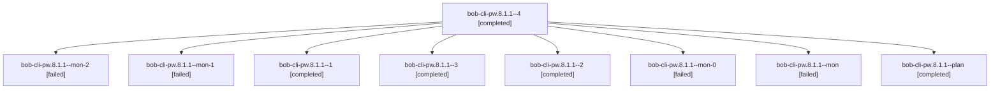

# Session: bob-cli-pw.8.1.1

[Agent Hoods](../README.md) / [bbugyi200](../users/bbugyi200/README.md) / [apollo](../users/bbugyi200/machines/apollo/README.md) / [bob-cli-pw](../users/bbugyi200/machines/apollo/hoods/bob-cli-pw/README.md) / bob-cli-pw.8.1.1

Owner: `bbugyi200.apollo` · Hood: `bob-cli-pw` · Members: 9 · Bead: [bob-cli-pw.8.1.1](https://github.com/bobs-org/bob-cli--beads/blob/main/pages/bob-cli-pw/bob-cli-pw.8.1.1.md)

## Lineage

The diagram is an optional enhancement; the ordered table below contains the same lineage in accessible text.

| Role | Agent | State | Model / provider | Timing | Commits | Prompt | Chat |
|---|---|---|---|---|---:|---|---|
| 4 | bob-cli-pw.8.1.1--4 | completed | gpt-6-luna / codex | 2026-11-25T07:19:10.757704+00:00 → 2026-11-25T07:24:26.492617+00:00 | 0 | [Prompt](../agents/bbugyi200.apollo.bob-cli-pw.8.1.1--4/prompt.md) | [Chat](../agents/bbugyi200.apollo.bob-cli-pw.8.1.1--4/chat.md) |
| mon-2 | bob-cli-pw.8.1.1--mon-2 | failed | gpt-6-luna / codex | 2026-11-25T06:47:14.045263+00:00 → 2026-11-25T07:19:10.824763+00:00 | 0 | — | [Chat](../agents/bbugyi200.apollo.bob-cli-pw.8.1.1--mon-2/chat.md) |
| mon-1 | bob-cli-pw.8.1.1--mon-1 | failed | gpt-6-luna / codex | 2026-11-25T06:16:21.633447+00:00 → 2026-11-25T06:42:51.700090+00:00 | 0 | — | [Chat](../agents/bbugyi200.apollo.bob-cli-pw.8.1.1--mon-1/chat.md) |
| 1 | bob-cli-pw.8.1.1--1 | completed | gpt-6-luna / codex | 2026-11-25T05:34:08.503580+00:00 → 2026-11-25T05:43:35.899006+00:00 | 0 | [Prompt](../agents/bbugyi200.apollo.bob-cli-pw.8.1.1--1/prompt.md) | [Chat](../agents/bbugyi200.apollo.bob-cli-pw.8.1.1--1/chat.md) |
| 3 | bob-cli-pw.8.1.1--3 | completed | gpt-6-luna / codex | 2026-11-25T06:42:51.534764+00:00 → 2026-11-25T06:49:09.496409+00:00 | 0 | [Prompt](../agents/bbugyi200.apollo.bob-cli-pw.8.1.1--3/prompt.md) | [Chat](../agents/bbugyi200.apollo.bob-cli-pw.8.1.1--3/chat.md) |
| 2 | bob-cli-pw.8.1.1--2 | completed | gpt-6-luna / codex | 2026-11-25T06:10:27.551281+00:00 → 2026-11-25T06:18:13.374364+00:00 | 0 | [Prompt](../agents/bbugyi200.apollo.bob-cli-pw.8.1.1--2/prompt.md) | [Chat](../agents/bbugyi200.apollo.bob-cli-pw.8.1.1--2/chat.md) |
| mon-0 | bob-cli-pw.8.1.1--mon-0 | failed | gpt-6-luna / codex | 2026-11-25T05:41:34.819249+00:00 → 2026-11-25T06:10:28.040994+00:00 | 0 | — | [Chat](../agents/bbugyi200.apollo.bob-cli-pw.8.1.1--mon-0/chat.md) |
| mon | bob-cli-pw.8.1.1--mon | failed | gpt-6-luna / codex | 2026-11-25T05:27:21.190415+00:00 → 2026-11-25T05:34:08.558661+00:00 | 0 | — | [Chat](../agents/bbugyi200.apollo.bob-cli-pw.8.1.1--mon/chat.md) |
| plan | bob-cli-pw.8.1.1--plan | completed | gpt-6-luna / codex | 2026-11-25T04:57:35.173559+00:00 → 2026-11-25T05:29:49.390425+00:00 | 0 | [Prompt](../agents/bbugyi200.apollo.bob-cli-pw.8.1.1--plan/prompt.md) | [Chat](../agents/bbugyi200.apollo.bob-cli-pw.8.1.1--plan/chat.md) |

## Neighbors

| Agent | Relation | State |
|---|---|---|
| [bob-cli-pw.8](bbugyi200.apollo.bob-cli-pw.8.md) (session · 3) | ancestor | completed 2, dismissed 1 |
| [bob-cli-pw.8.1.2](bbugyi200.apollo.bob-cli-pw.8.1.2.md) (session · 7) | bob-cli-pw.8.1 hood | completed 5, failed 2 |
| [bob-cli-pw.8.1.3](bbugyi200.apollo.bob-cli-pw.8.1.3.md) (session · 3) | bob-cli-pw.8.1 hood | completed 2, failed 1 |
| [bob-cli-pw.8.1.land](bbugyi200.apollo.bob-cli-pw.8.1.land.md) (session · 9) | bob-cli-pw.8.1 hood | completed 7, failed 2 |
| [bob-cli-pw.1](bbugyi200.apollo.bob-cli-pw.1.md) (session · 7) | bob-cli-pw hood | completed 5, failed 2 |
| [bob-cli-pw.2](../agents/bbugyi200.apollo.bob-cli-pw.2/README.md) | bob-cli-pw hood | completed |
| [bob-cli-pw.3](../agents/bbugyi200.apollo.bob-cli-pw.3/README.md) | bob-cli-pw hood | completed |
| [bob-cli-pw.4](../agents/bbugyi200.apollo.bob-cli-pw.4/README.md) | bob-cli-pw hood | completed |
| [bob-cli-pw.5](bbugyi200.apollo.bob-cli-pw.5.md) (session · 3) | bob-cli-pw hood | completed 2, dismissed 1 |
| [bob-cli-pw.5.1.1](bbugyi200.apollo.bob-cli-pw.5.1.1.md) (session · 5) | bob-cli-pw hood | completed 4, failed 1 |
| [bob-cli-pw.5.1.2](../agents/bbugyi200.apollo.bob-cli-pw.5.1.2/README.md) | bob-cli-pw hood | completed |
| [bob-cli-pw.5.1.3](../agents/bbugyi200.apollo.bob-cli-pw.5.1.3/README.md) | bob-cli-pw hood | completed |
| [bob-cli-pw.5.1.4](../agents/bbugyi200.apollo.bob-cli-pw.5.1.4/README.md) | bob-cli-pw hood | completed |
| [bob-cli-pw.5.1.land](bbugyi200.apollo.bob-cli-pw.5.1.land.md) (session · 3) | bob-cli-pw hood | completed 3 |
| [bob-cli-pw.6](bbugyi200.apollo.bob-cli-pw.6.md) (session · 5) | bob-cli-pw hood | completed 5 |
| [bob-cli-pw.6](../agents/bbugyi200.apollo.bob-cli-pw.6/README.md) | bob-cli-pw hood | completed |
| [bob-cli-pw.7](../agents/bbugyi200.apollo.bob-cli-pw.7/README.md) | bob-cli-pw hood | completed |
| [bob-cli-pw.land](bbugyi200.apollo.bob-cli-pw.land.md) (session · 5) | bob-cli-pw hood | completed 5 |
