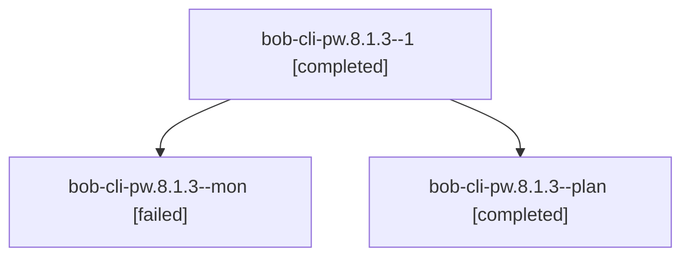

# Session: bob-cli-pw.8.1.3

[Agent Hoods](../README.md) / [bbugyi200](../users/bbugyi200/README.md) / [apollo](../users/bbugyi200/machines/apollo/README.md) / [bob-cli-pw](../users/bbugyi200/machines/apollo/hoods/bob-cli-pw/README.md) / bob-cli-pw.8.1.3

Owner: `bbugyi200.apollo` · Hood: `bob-cli-pw` · Members: 3 · Bead: [bob-cli-pw.8.1.3](https://github.com/bobs-org/bob-cli--beads/blob/main/pages/bob-cli-pw/bob-cli-pw.8.1.3.md)

## Lineage

The diagram is an optional enhancement; the ordered table below contains the same lineage in accessible text.

| Role | Agent | State | Model / provider | Timing | Commits | Prompt | Chat |
|---|---|---|---|---|---:|---|---|
| 1 | bob-cli-pw.8.1.3--1 | completed | muse-spark-1.3-contributor / muse | 2026-11-25T07:56:10.198165+00:00 → 2026-11-25T09:22:57.504764+00:00 | 0 | [Prompt](../agents/bbugyi200.apollo.bob-cli-pw.8.1.3--1/prompt.md) | [Chat](../agents/bbugyi200.apollo.bob-cli-pw.8.1.3--1/chat.md) |
| mon | bob-cli-pw.8.1.3--mon | failed | muse-spark-1.3-contributor / muse | 2026-11-25T07:42:48.045958+00:00 → 2026-11-25T07:56:10.518922+00:00 | 0 | — | [Chat](../agents/bbugyi200.apollo.bob-cli-pw.8.1.3--mon/chat.md) |
| plan | bob-cli-pw.8.1.3--plan | completed | muse-spark-1.3-contributor / muse | 2026-11-25T07:24:46.516546+00:00 → 2026-11-25T07:47:31.760540+00:00 | [1](../agents/bbugyi200.apollo.bob-cli-pw.8.1.3--plan/README.md#commits) | [Prompt](../agents/bbugyi200.apollo.bob-cli-pw.8.1.3--plan/prompt.md) | [Chat](../agents/bbugyi200.apollo.bob-cli-pw.8.1.3--plan/chat.md) |

## Commits

| Role | Repo | Commit | Subject | Committed |
|---|---|---|---|---|
| plan | bob-cli | [`bcf0566`](https://github.com/bobs-org/bob-cli/commit/bcf0566ba90212b9198d38c69da96a00cba9ce78) | docs(guides): link Mac Capture meeting notes flow from filing guide | 2026-11-25 02:45:27 EST |

## Neighbors

| Agent | Relation | State |
|---|---|---|
| [bob-cli-pw.8](bbugyi200.apollo.bob-cli-pw.8.md) (session · 3) | ancestor | active 1, completed 2 |
| [bob-cli-pw.8.1.1](bbugyi200.apollo.bob-cli-pw.8.1.1.md) (session · 9) | bob-cli-pw.8.1 hood | completed 5, failed 4 |
| [bob-cli-pw.8.1.2](bbugyi200.apollo.bob-cli-pw.8.1.2.md) (session · 7) | bob-cli-pw.8.1 hood | completed 5, failed 2 |
| [bob-cli-pw.8.1.land](bbugyi200.apollo.bob-cli-pw.8.1.land.md) (session · 9) | bob-cli-pw.8.1 hood | completed 7, failed 2 |
| [bob-cli-pw.1](bbugyi200.apollo.bob-cli-pw.1.md) (session · 7) | bob-cli-pw hood | completed 5, failed 2 |
| [bob-cli-pw.2](../agents/bbugyi200.apollo.bob-cli-pw.2/README.md) | bob-cli-pw hood | completed |
| [bob-cli-pw.3](../agents/bbugyi200.apollo.bob-cli-pw.3/README.md) | bob-cli-pw hood | completed |
| [bob-cli-pw.4](../agents/bbugyi200.apollo.bob-cli-pw.4/README.md) | bob-cli-pw hood | completed |
| [bob-cli-pw.5](bbugyi200.apollo.bob-cli-pw.5.md) (session · 3) | bob-cli-pw hood | active 1, completed 2 |
| [bob-cli-pw.5.1.1](bbugyi200.apollo.bob-cli-pw.5.1.1.md) (session · 5) | bob-cli-pw hood | completed 4, failed 1 |
| [bob-cli-pw.5.1.2](../agents/bbugyi200.apollo.bob-cli-pw.5.1.2/README.md) | bob-cli-pw hood | completed |
| [bob-cli-pw.5.1.3](../agents/bbugyi200.apollo.bob-cli-pw.5.1.3/README.md) | bob-cli-pw hood | completed |
| [bob-cli-pw.5.1.4](../agents/bbugyi200.apollo.bob-cli-pw.5.1.4/README.md) | bob-cli-pw hood | completed |
| [bob-cli-pw.5.1.land](bbugyi200.apollo.bob-cli-pw.5.1.land.md) (session · 3) | bob-cli-pw hood | completed 3 |
| [bob-cli-pw.6](bbugyi200.apollo.bob-cli-pw.6.md) (session · 5) | bob-cli-pw hood | completed 5 |
| [bob-cli-pw.6](../agents/bbugyi200.apollo.bob-cli-pw.6/README.md) | bob-cli-pw hood | completed |
| [bob-cli-pw.7](../agents/bbugyi200.apollo.bob-cli-pw.7/README.md) | bob-cli-pw hood | completed |
| [bob-cli-pw.land](../agents/bbugyi200.apollo.bob-cli-pw.land/README.md) | bob-cli-pw hood | waiting |
