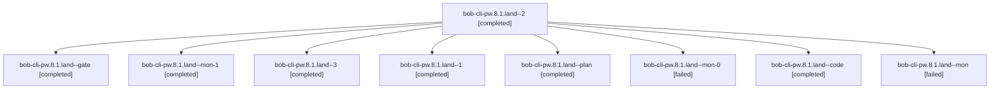

# Session: bob-cli-pw.8.1.land

[Agent Hoods](../README.md) / [bbugyi200](../users/bbugyi200/README.md) / [apollo](../users/bbugyi200/machines/apollo/README.md) / [bob-cli-pw](../users/bbugyi200/machines/apollo/hoods/bob-cli-pw/README.md) / bob-cli-pw.8.1.land

Owner: `bbugyi200.apollo` · Hood: `bob-cli-pw` · Members: 9 · Bead: [bob-cli-pw.8.1](https://github.com/bobs-org/bob-cli--beads/blob/main/pages/bob-cli-pw/bob-cli-pw.8.1.md)

## Lineage

The diagram is an optional enhancement; the ordered table below contains the same lineage in accessible text.

| Role | Agent | State | Model / provider | Timing | Commits | Prompt | Chat |
|---|---|---|---|---|---:|---|---|
| 2 | bob-cli-pw.8.1.land--2 | completed | grok-4.6 / grok | 2026-11-25T11:40:49.019725+00:00 → 2026-11-25T11:49:37.270946+00:00 | 0 | [Prompt](../agents/bbugyi200.apollo.bob-cli-pw.8.1.land--2/prompt.md) | [Chat](../agents/bbugyi200.apollo.bob-cli-pw.8.1.land--2/chat.md) |
| gate | bob-cli-pw.8.1.land--gate | completed | gpt-6-astra / codex | 2026-11-25T09:34:25.129089+00:00 → 2026-11-25T09:34:34.008212+00:00 | 0 | — | [Chat](../agents/bbugyi200.apollo.bob-cli-pw.8.1.land--gate/chat.md) |
| mon-1 | bob-cli-pw.8.1.land--mon-1 | completed | grok-4.6 / grok | 2026-11-25T11:47:52.274353+00:00 → 2026-11-25T12:17:49.930254+00:00 | 0 | — | [Chat](../agents/bbugyi200.apollo.bob-cli-pw.8.1.land--mon-1/chat.md) |
| 3 | bob-cli-pw.8.1.land--3 | completed | grok-4.6 / grok | 2026-11-25T12:18:55.577810+00:00 → 2026-11-25T12:33:07.954818+00:00 | 0 | [Prompt](../agents/bbugyi200.apollo.bob-cli-pw.8.1.land--3/prompt.md) | [Chat](../agents/bbugyi200.apollo.bob-cli-pw.8.1.land--3/chat.md) |
| 1 | bob-cli-pw.8.1.land--1 | completed | grok-4.6 / grok | 2026-11-25T11:07:53.156165+00:00 → 2026-11-25T11:19:06.040756+00:00 | 0 | [Prompt](../agents/bbugyi200.apollo.bob-cli-pw.8.1.land--1/prompt.md) | [Chat](../agents/bbugyi200.apollo.bob-cli-pw.8.1.land--1/chat.md) |
| plan | bob-cli-pw.8.1.land--plan | completed | gpt-6-astra / codex | 2026-11-25T09:23:15.183560+00:00 → 2026-11-25T10:41:32.291012+00:00 | 0 | [Prompt](../agents/bbugyi200.apollo.bob-cli-pw.8.1.land--plan/prompt.md) | [Chat](../agents/bbugyi200.apollo.bob-cli-pw.8.1.land--plan/chat.md) |
| mon-0 | bob-cli-pw.8.1.land--mon-0 | failed | grok-4.6 / grok | 2026-11-25T11:17:09.447841+00:00 → 2026-11-25T11:40:49.058382+00:00 | 0 | — | [Chat](../agents/bbugyi200.apollo.bob-cli-pw.8.1.land--mon-0/chat.md) |
| code | bob-cli-pw.8.1.land--code | completed | grok-4.6 / grok | 2026-11-25T09:35:15.761195+00:00 → 2026-11-25T10:41:32.291012+00:00 | 0 | — | [Chat](../agents/bbugyi200.apollo.bob-cli-pw.8.1.land--code/chat.md) |
| mon | bob-cli-pw.8.1.land--mon | failed | grok-4.6 / grok | 2026-11-25T10:39:02.706282+00:00 → 2026-11-25T11:06:00.771296+00:00 | 0 | — | [Chat](../agents/bbugyi200.apollo.bob-cli-pw.8.1.land--mon/chat.md) |

## Neighbors

| Agent | Relation | State |
|---|---|---|
| [bob-cli-pw.8](bbugyi200.apollo.bob-cli-pw.8.md) (session · 3) | ancestor | active 1, completed 2 |
| [bob-cli-pw.8.1.1](bbugyi200.apollo.bob-cli-pw.8.1.1.md) (session · 9) | bob-cli-pw.8.1 hood | completed 5, failed 4 |
| [bob-cli-pw.8.1.2](bbugyi200.apollo.bob-cli-pw.8.1.2.md) (session · 7) | bob-cli-pw.8.1 hood | completed 5, failed 2 |
| [bob-cli-pw.8.1.3](bbugyi200.apollo.bob-cli-pw.8.1.3.md) (session · 3) | bob-cli-pw.8.1 hood | completed 2, failed 1 |
| [bob-cli-pw.1](bbugyi200.apollo.bob-cli-pw.1.md) (session · 7) | bob-cli-pw hood | completed 5, failed 2 |
| [bob-cli-pw.2](../agents/bbugyi200.apollo.bob-cli-pw.2/README.md) | bob-cli-pw hood | completed |
| [bob-cli-pw.3](../agents/bbugyi200.apollo.bob-cli-pw.3/README.md) | bob-cli-pw hood | completed |
| [bob-cli-pw.4](../agents/bbugyi200.apollo.bob-cli-pw.4/README.md) | bob-cli-pw hood | completed |
| [bob-cli-pw.5](bbugyi200.apollo.bob-cli-pw.5.md) (session · 3) | bob-cli-pw hood | active 1, completed 2 |
| [bob-cli-pw.5.1.1](bbugyi200.apollo.bob-cli-pw.5.1.1.md) (session · 5) | bob-cli-pw hood | completed 4, failed 1 |
| [bob-cli-pw.5.1.2](../agents/bbugyi200.apollo.bob-cli-pw.5.1.2/README.md) | bob-cli-pw hood | completed |
| [bob-cli-pw.5.1.3](../agents/bbugyi200.apollo.bob-cli-pw.5.1.3/README.md) | bob-cli-pw hood | completed |
| [bob-cli-pw.5.1.4](../agents/bbugyi200.apollo.bob-cli-pw.5.1.4/README.md) | bob-cli-pw hood | completed |
| [bob-cli-pw.5.1.land](bbugyi200.apollo.bob-cli-pw.5.1.land.md) (session · 3) | bob-cli-pw hood | completed 3 |
| [bob-cli-pw.6](bbugyi200.apollo.bob-cli-pw.6.md) (session · 5) | bob-cli-pw hood | completed 5 |
| [bob-cli-pw.6](../agents/bbugyi200.apollo.bob-cli-pw.6/README.md) | bob-cli-pw hood | completed |
| [bob-cli-pw.7](../agents/bbugyi200.apollo.bob-cli-pw.7/README.md) | bob-cli-pw hood | completed |
| [bob-cli-pw.land](bbugyi200.apollo.bob-cli-pw.land.md) (session · 4) | bob-cli-pw hood | active 1, completed 3 |
