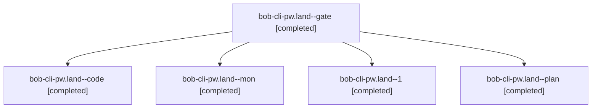

# Session: bob-cli-pw.land

[Agent Hoods](../README.md) / [bbugyi200](../users/bbugyi200/README.md) / [apollo](../users/bbugyi200/machines/apollo/README.md) / [bob-cli-pw](../users/bbugyi200/machines/apollo/hoods/bob-cli-pw/README.md) / bob-cli-pw.land

Owner: `bbugyi200.apollo` · Hood: `bob-cli-pw` · Members: 5 · Bead: [bob-cli-pw](https://github.com/bobs-org/bob-cli--beads/blob/main/pages/bob-cli-pw/README.md)

## Lineage

The diagram is an optional enhancement; the ordered table below contains the same lineage in accessible text.

| Role | Agent | State | Model / provider | Timing | Commits | Prompt | Chat |
|---|---|---|---|---|---:|---|---|
| gate | bob-cli-pw.land--gate | completed | opus / claude | 2026-11-25T13:24:59.869938+00:00 → 2026-11-25T13:25:10.452633+00:00 | 0 | — | [Chat](../agents/bbugyi200.apollo.bob-cli-pw.land--gate/chat.md) |
| code | bob-cli-pw.land--code | completed | muse-spark-1.3-contributor / muse | 2026-11-25T13:28:37.415671+00:00 → 2026-11-25T14:17:19.372542+00:00 | [1](../agents/bbugyi200.apollo.bob-cli-pw.land--code/README.md#commits) | — | [Chat](../agents/bbugyi200.apollo.bob-cli-pw.land--code/chat.md) |
| mon | bob-cli-pw.land--mon | completed | muse-spark-1.3-contributor / muse | 2026-11-25T14:12:54.725546+00:00 → 2026-11-25T14:37:19.034240+00:00 | 0 | — | [Chat](../agents/bbugyi200.apollo.bob-cli-pw.land--mon/chat.md) |
| 1 | bob-cli-pw.land--1 | completed | muse-spark-1.3-contributor / muse | 2026-11-25T14:39:37.681231+00:00 → 2026-11-25T14:43:56.903984+00:00 | 0 | [Prompt](../agents/bbugyi200.apollo.bob-cli-pw.land--1/prompt.md) | [Chat](../agents/bbugyi200.apollo.bob-cli-pw.land--1/chat.md) |
| plan | bob-cli-pw.land--plan | completed | opus / claude | 2026-11-25T12:28:23.440051+00:00 → 2026-11-25T14:17:19.372542+00:00 | 0 | [Prompt](../agents/bbugyi200.apollo.bob-cli-pw.land--plan/prompt.md) | [Chat](../agents/bbugyi200.apollo.bob-cli-pw.land--plan/chat.md) |

## Commits

| Role | Repo | Commit | Subject | Committed |
|---|---|---|---|---|
| code | bob-cli | [`f47055d`](https://github.com/bobs-org/bob-cli/commit/f47055dad542113dc21e6251828c2a3e4cfc7597) | fix(meetings): land meeting-notes repairs | 2026-11-25 09:14:17 EST |

## Neighbors

| Agent | Relation | State |
|---|---|---|
| [bob-cli-pw.1](bbugyi200.apollo.bob-cli-pw.1.md) (session · 7) | bob-cli-pw hood | completed 5, failed 2 |
| [bob-cli-pw.2](../agents/bbugyi200.apollo.bob-cli-pw.2/README.md) | bob-cli-pw hood | completed |
| [bob-cli-pw.3](../agents/bbugyi200.apollo.bob-cli-pw.3/README.md) | bob-cli-pw hood | completed |
| [bob-cli-pw.4](../agents/bbugyi200.apollo.bob-cli-pw.4/README.md) | bob-cli-pw hood | completed |
| [bob-cli-pw.5](bbugyi200.apollo.bob-cli-pw.5.md) (session · 3) | bob-cli-pw hood | active 1, completed 2 |
| [bob-cli-pw.5.1.1](bbugyi200.apollo.bob-cli-pw.5.1.1.md) (session · 5) | bob-cli-pw hood | completed 4, failed 1 |
| [bob-cli-pw.5.1.2](../agents/bbugyi200.apollo.bob-cli-pw.5.1.2/README.md) | bob-cli-pw hood | completed |
| [bob-cli-pw.5.1.3](../agents/bbugyi200.apollo.bob-cli-pw.5.1.3/README.md) | bob-cli-pw hood | completed |
| [bob-cli-pw.5.1.4](../agents/bbugyi200.apollo.bob-cli-pw.5.1.4/README.md) | bob-cli-pw hood | completed |
| [bob-cli-pw.5.1.land](bbugyi200.apollo.bob-cli-pw.5.1.land.md) (session · 3) | bob-cli-pw hood | completed 3 |
| [bob-cli-pw.6](bbugyi200.apollo.bob-cli-pw.6.md) (session · 5) | bob-cli-pw hood | completed 5 |
| [bob-cli-pw.6](../agents/bbugyi200.apollo.bob-cli-pw.6/README.md) | bob-cli-pw hood | completed |
| [bob-cli-pw.7](../agents/bbugyi200.apollo.bob-cli-pw.7/README.md) | bob-cli-pw hood | completed |
| [bob-cli-pw.8](bbugyi200.apollo.bob-cli-pw.8.md) (session · 3) | bob-cli-pw hood | active 1, completed 2 |
| [bob-cli-pw.8.1.1](bbugyi200.apollo.bob-cli-pw.8.1.1.md) (session · 9) | bob-cli-pw hood | completed 5, failed 4 |
| [bob-cli-pw.8.1.2](bbugyi200.apollo.bob-cli-pw.8.1.2.md) (session · 7) | bob-cli-pw hood | completed 5, failed 2 |
| [bob-cli-pw.8.1.3](bbugyi200.apollo.bob-cli-pw.8.1.3.md) (session · 3) | bob-cli-pw hood | completed 2, failed 1 |
| [bob-cli-pw.8.1.land](bbugyi200.apollo.bob-cli-pw.8.1.land.md) (session · 9) | bob-cli-pw hood | completed 7, failed 2 |
