# Session: bob-cli-q8.10.3

[Agent Hoods](../README.md) / [bbugyi200](../users/bbugyi200/README.md) / [apollo](../users/bbugyi200/machines/apollo/README.md) / [bob-cli-q8](../users/bbugyi200/machines/apollo/hoods/bob-cli-q8/README.md) / bob-cli-q8.10.3

Owner: `bbugyi200.apollo` · Hood: `bob-cli-q8` · Members: 15 · Bead: [bob-cli-q8.10.3](https://github.com/bobs-org/bob-cli--beads/blob/main/pages/bob-cli-q8/bob-cli-q8.10.3.md)

## Lineage

```mermaid
flowchart TD
  n0["bob-cli-q8.10.3--mon-3 [completed]"]
  n1["bob-cli-q8.10.3--1 [completed]"]
  n0 --> n1
  n2["bob-cli-q8.10.3--4 [completed]"]
  n0 --> n2
  n3["bob-cli-q8.10.3--mon-0 [failed]"]
  n0 --> n3
  n4["bob-cli-q8.10.3--7 [completed]"]
  n0 --> n4
  n5["bob-cli-q8.10.3--3 [completed]"]
  n0 --> n5
  n6["bob-cli-q8.10.3--6 [completed]"]
  n0 --> n6
  n7["bob-cli-q8.10.3--mon [failed]"]
  n0 --> n7
  n8["bob-cli-q8.10.3--mon-4 [completed]"]
  n0 --> n8
  n9["bob-cli-q8.10.3--5 [completed]"]
  n0 --> n9
  n10["bob-cli-q8.10.3--2 [completed]"]
  n0 --> n10
  n11["bob-cli-q8.10.3--mon-2 [failed]"]
  n0 --> n11
  n12["bob-cli-q8.10.3--plan [completed]"]
  n0 --> n12
  n13["bob-cli-q8.10.3--mon-1 [failed]"]
  n0 --> n13
  n14["bob-cli-q8.10.3--gate [completed]"]
  n0 --> n14
```

The diagram is an optional enhancement; the ordered table below contains the same lineage in accessible text.

| Role | Agent | State | Model / provider | Timing | Commits | Prompt | Chat |
|---|---|---|---|---|---:|---|---|
| mon-3 | bob-cli-q8.10.3--mon-3 | completed | gpt-6-luna / codex | 2026-11-26T10:06:23.217144+00:00 → 2026-11-26T10:12:06.633575+00:00 | 0 | — | [Chat](../agents/bbugyi200.apollo.bob-cli-q8.10.3--mon-3/chat.md) |
| 1 | bob-cli-q8.10.3--1 | completed | gpt-6-luna / codex | 2026-11-26T08:35:58.193859+00:00 → 2026-11-26T08:49:20.520117+00:00 | 0 | [Prompt](../agents/bbugyi200.apollo.bob-cli-q8.10.3--1/prompt.md) | [Chat](../agents/bbugyi200.apollo.bob-cli-q8.10.3--1/chat.md) |
| 4 | bob-cli-q8.10.3--4 | completed | gpt-6-luna / codex | 2026-11-26T10:04:27.656450+00:00 → 2026-11-26T10:07:19.323513+00:00 | 0 | [Prompt](../agents/bbugyi200.apollo.bob-cli-q8.10.3--4/prompt.md) | [Chat](../agents/bbugyi200.apollo.bob-cli-q8.10.3--4/chat.md) |
| mon-0 | bob-cli-q8.10.3--mon-0 | failed | gpt-6-luna / codex | 2026-11-26T08:47:15.358740+00:00 → 2026-11-26T08:54:58.170324+00:00 | 0 | — | [Chat](../agents/bbugyi200.apollo.bob-cli-q8.10.3--mon-0/chat.md) |
| 7 | bob-cli-q8.10.3--7 | completed | gpt-6-luna / codex | 2026-11-26T10:41:06.645761+00:00 → 2026-11-26T10:43:12.945412+00:00 | 0 | [Prompt](../agents/bbugyi200.apollo.bob-cli-q8.10.3--7/prompt.md) | [Chat](../agents/bbugyi200.apollo.bob-cli-q8.10.3--7/chat.md) |
| 3 | bob-cli-q8.10.3--3 | completed | gpt-6-luna / codex | 2026-11-26T09:12:41.533503+00:00 → 2026-11-26T09:58:55.191711+00:00 | 0 | [Prompt](../agents/bbugyi200.apollo.bob-cli-q8.10.3--3/prompt.md) | [Chat](../agents/bbugyi200.apollo.bob-cli-q8.10.3--3/chat.md) |
| 6 | bob-cli-q8.10.3--6 | completed | gpt-6-luna / codex | 2026-11-26T10:29:31.838611+00:00 → 2026-11-26T10:38:35.006314+00:00 | 0 | [Prompt](../agents/bbugyi200.apollo.bob-cli-q8.10.3--6/prompt.md) | [Chat](../agents/bbugyi200.apollo.bob-cli-q8.10.3--6/chat.md) |
| mon | bob-cli-q8.10.3--mon | failed | gpt-6-luna / codex | 2026-11-26T08:26:12.086555+00:00 → 2026-11-26T08:35:55.711543+00:00 | 0 | — | [Chat](../agents/bbugyi200.apollo.bob-cli-q8.10.3--mon/chat.md) |
| mon-4 | bob-cli-q8.10.3--mon-4 | completed | gpt-6-luna / codex | 2026-11-26T10:20:53.372282+00:00 → 2026-11-26T10:29:31.985395+00:00 | 0 | — | [Chat](../agents/bbugyi200.apollo.bob-cli-q8.10.3--mon-4/chat.md) |
| 5 | bob-cli-q8.10.3--5 | completed | gpt-6-luna / codex | 2026-11-26T10:12:06.440875+00:00 → 2026-11-26T10:21:50.000673+00:00 | 0 | [Prompt](../agents/bbugyi200.apollo.bob-cli-q8.10.3--5/prompt.md) | [Chat](../agents/bbugyi200.apollo.bob-cli-q8.10.3--5/chat.md) |
| 2 | bob-cli-q8.10.3--2 | completed | gpt-6-luna / codex | 2026-11-26T08:55:05.799577+00:00 → 2026-11-26T09:07:16.717315+00:00 | 0 | [Prompt](../agents/bbugyi200.apollo.bob-cli-q8.10.3--2/prompt.md) | [Chat](../agents/bbugyi200.apollo.bob-cli-q8.10.3--2/chat.md) |
| mon-2 | bob-cli-q8.10.3--mon-2 | failed | gpt-6-luna / codex | 2026-11-26T09:25:06.526408+00:00 → 2026-11-26T10:04:28.035698+00:00 | 0 | — | [Chat](../agents/bbugyi200.apollo.bob-cli-q8.10.3--mon-2/chat.md) |
| plan | bob-cli-q8.10.3--plan | completed | gpt-6-luna / codex | 2026-11-26T07:43:30.462246+00:00 → 2026-11-26T08:29:33.936446+00:00 | [1](../agents/bbugyi200.apollo.bob-cli-q8.10.3--plan/README.md#commits) | [Prompt](../agents/bbugyi200.apollo.bob-cli-q8.10.3--plan/prompt.md) | [Chat](../agents/bbugyi200.apollo.bob-cli-q8.10.3--plan/chat.md) |
| mon-1 | bob-cli-q8.10.3--mon-1 | failed | gpt-6-luna / codex | 2026-11-26T08:58:24.628809+00:00 → 2026-11-26T09:12:41.792144+00:00 | 0 | — | [Chat](../agents/bbugyi200.apollo.bob-cli-q8.10.3--mon-1/chat.md) |
| gate | bob-cli-q8.10.3--gate | completed | gpt-6-luna / codex | 2026-11-26T10:39:36.619758+00:00 → 2026-11-26T10:40:19.467995+00:00 | 0 | — | [Chat](../agents/bbugyi200.apollo.bob-cli-q8.10.3--gate/chat.md) |

## Commits

| Role | Repo | Commit | Subject | Committed |
|---|---|---|---|---|
| plan | bob-cli | [`8cb474b`](https://github.com/bobs-org/bob-cli/commit/8cb474ba818f1e214e38634dce63f8ffb120b11d) | docs(tasks): document navigation tie consequence copy | 2026-11-26 03:27:19 EST |

## Neighbors

| Agent | Relation | State |
|---|---|---|
| [bob-cli-q8.10.1](../agents/bbugyi200.apollo.bob-cli-q8.10.1/README.md) | bob-cli-q8.10 hood | completed |
| [bob-cli-q8.10.2](../agents/bbugyi200.apollo.bob-cli-q8.10.2/README.md) | bob-cli-q8.10 hood | completed |
| [bob-cli-q8.10.land](bbugyi200.apollo.bob-cli-q8.10.land.md) (session · 3) | bob-cli-q8.10 hood | active 2, completed 1 |
| [bob-cli-q8.1](../agents/bbugyi200.apollo.bob-cli-q8.1/README.md) | bob-cli-q8 hood | completed |
| [bob-cli-q8.2](../agents/bbugyi200.apollo.bob-cli-q8.2/README.md) | bob-cli-q8 hood | completed |
| [bob-cli-q8.3](../agents/bbugyi200.apollo.bob-cli-q8.3/README.md) | bob-cli-q8 hood | completed |
| [bob-cli-q8.4](../agents/bbugyi200.apollo.bob-cli-q8.4/README.md) | bob-cli-q8 hood | completed |
| [bob-cli-q8.5](../agents/bbugyi200.apollo.bob-cli-q8.5/README.md) | bob-cli-q8 hood | completed |
| [bob-cli-q8.6](bbugyi200.apollo.bob-cli-q8.6.md) (session · 3) | bob-cli-q8 hood | completed 3 |
| [bob-cli-q8.7](../agents/bbugyi200.apollo.bob-cli-q8.7/README.md) | bob-cli-q8 hood | completed |
| [bob-cli-q8.8](../agents/bbugyi200.apollo.bob-cli-q8.8/README.md) | bob-cli-q8 hood | completed |
| [bob-cli-q8.9](../agents/bbugyi200.apollo.bob-cli-q8.9/README.md) | bob-cli-q8 hood | completed |
| [bob-cli-q8.land](bbugyi200.apollo.bob-cli-q8.land.md) (session · 3) | bob-cli-q8 hood | active 1, completed 2 |
| [bob-cli-q8.land](../agents/bbugyi200.apollo.bob-cli-q8.land/README.md) | bob-cli-q8 hood | completed |
