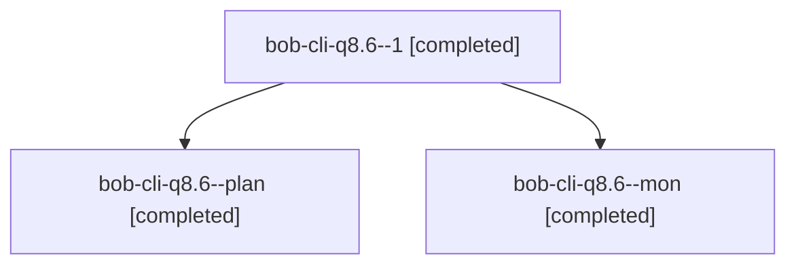

# Session: bob-cli-q8.6

[Agent Hoods](../README.md) / [bbugyi200](../users/bbugyi200/README.md) / [apollo](../users/bbugyi200/machines/apollo/README.md) / [bob-cli-q8](../users/bbugyi200/machines/apollo/hoods/bob-cli-q8/README.md) / bob-cli-q8.6

Owner: `bbugyi200.apollo` · Hood: `bob-cli-q8` · Members: 3 · Bead: [bob-cli-q8.6](https://github.com/bobs-org/bob-cli--beads/blob/main/pages/bob-cli-q8/bob-cli-q8.6.md)

## Lineage

The diagram is an optional enhancement; the ordered table below contains the same lineage in accessible text.

| Role | Agent | State | Model / provider | Timing | Commits | Prompt | Chat |
|---|---|---|---|---|---:|---|---|
| 1 | bob-cli-q8.6--1 | completed | gpt-6-luna / codex | 2026-11-26T03:35:55.569807+00:00 → 2026-11-26T03:37:46.595404+00:00 | 0 | [Prompt](../agents/bbugyi200.apollo.bob-cli-q8.6--1/prompt.md) | [Chat](../agents/bbugyi200.apollo.bob-cli-q8.6--1/chat.md) |
| plan | bob-cli-q8.6--plan | completed | gpt-6-luna / codex | 2026-11-26T02:23:38.042224+00:00 → 2026-11-26T03:34:56.762229+00:00 | [1](../agents/bbugyi200.apollo.bob-cli-q8.6--plan/README.md#commits) | [Prompt](../agents/bbugyi200.apollo.bob-cli-q8.6--plan/prompt.md) | [Chat](../agents/bbugyi200.apollo.bob-cli-q8.6--plan/chat.md) |
| mon | bob-cli-q8.6--mon | completed | gpt-6-luna / codex | 2026-11-26T03:30:10.725956+00:00 → 2026-11-26T03:35:56.100611+00:00 | 0 | — | [Chat](../agents/bbugyi200.apollo.bob-cli-q8.6--mon/chat.md) |

## Commits

| Role | Repo | Commit | Subject | Committed |
|---|---|---|---|---|
| plan | bob-cli | [`944a375`](https://github.com/bobs-org/bob-cli/commit/944a375f1c0daef2781697c180b13753e9181028) | docs(nav): document task tie visibility | 2026-11-25 22:33:16 EST |

## Neighbors

| Agent | Relation | State |
|---|---|---|
| [bob-cli-q8.1](../agents/bbugyi200.apollo.bob-cli-q8.1/README.md) | bob-cli-q8 hood | completed |
| [bob-cli-q8.10.1](../agents/bbugyi200.apollo.bob-cli-q8.10.1/README.md) | bob-cli-q8 hood | completed |
| [bob-cli-q8.10.2](../agents/bbugyi200.apollo.bob-cli-q8.10.2/README.md) | bob-cli-q8 hood | completed |
| [bob-cli-q8.10.3](bbugyi200.apollo.bob-cli-q8.10.3.md) (session · 8) | bob-cli-q8 hood | active 2, completed 3, failed 3 |
| [bob-cli-q8.10.land](../agents/bbugyi200.apollo.bob-cli-q8.10.land/README.md) | bob-cli-q8 hood | waiting |
| [bob-cli-q8.2](../agents/bbugyi200.apollo.bob-cli-q8.2/README.md) | bob-cli-q8 hood | completed |
| [bob-cli-q8.3](../agents/bbugyi200.apollo.bob-cli-q8.3/README.md) | bob-cli-q8 hood | completed |
| [bob-cli-q8.4](../agents/bbugyi200.apollo.bob-cli-q8.4/README.md) | bob-cli-q8 hood | completed |
| [bob-cli-q8.5](../agents/bbugyi200.apollo.bob-cli-q8.5/README.md) | bob-cli-q8 hood | completed |
| [bob-cli-q8.7](../agents/bbugyi200.apollo.bob-cli-q8.7/README.md) | bob-cli-q8 hood | completed |
| [bob-cli-q8.8](../agents/bbugyi200.apollo.bob-cli-q8.8/README.md) | bob-cli-q8 hood | completed |
| [bob-cli-q8.9](../agents/bbugyi200.apollo.bob-cli-q8.9/README.md) | bob-cli-q8 hood | completed |
| [bob-cli-q8.land](bbugyi200.apollo.bob-cli-q8.land.md) (session · 3) | bob-cli-q8 hood | active 1, completed 2 |
| [bob-cli-q8.land](../agents/bbugyi200.apollo.bob-cli-q8.land/README.md) | bob-cli-q8 hood | completed |
