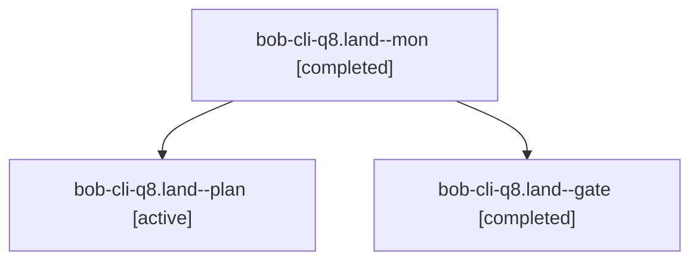

# Session: bob-cli-q8.land

[Agent Hoods](../README.md) / [bbugyi200](../users/bbugyi200/README.md) / [apollo](../users/bbugyi200/machines/apollo/README.md) / [bob-cli-q8](../users/bbugyi200/machines/apollo/hoods/bob-cli-q8/README.md) / bob-cli-q8.land

Owner: `bbugyi200.apollo` · Hood: `bob-cli-q8` · Members: 3 · Bead: [bob-cli-q8](https://github.com/bobs-org/bob-cli--beads/blob/main/pages/bob-cli-q8/README.md)

## Lineage

The diagram is an optional enhancement; the ordered table below contains the same lineage in accessible text.

| Role | Agent | State | Model / provider | Timing | Commits | Prompt | Chat |
|---|---|---|---|---|---:|---|---|
| mon | bob-cli-q8.land--mon | completed | opus / claude | 2026-11-26T07:09:10.098978+00:00 → 2026-11-26T07:12:55.645187+00:00 | 0 | — | [Chat](../agents/bbugyi200.apollo.bob-cli-q8.land--mon/chat.md) |
| plan | bob-cli-q8.land--plan | active | opus / claude | 2026-11-26T05:50:44.334225+00:00 → 2026-11-26T07:09:21.493237+00:00 | [1](../agents/bbugyi200.apollo.bob-cli-q8.land--plan/README.md#commits) | [Prompt](../agents/bbugyi200.apollo.bob-cli-q8.land--plan/prompt.md) | [Chat](../agents/bbugyi200.apollo.bob-cli-q8.land--plan/chat.md) |
| gate | bob-cli-q8.land--gate | completed | opus / claude | 2026-11-26T07:08:49.135835+00:00 → 2026-11-26T07:09:11.761750+00:00 | 0 | — | [Chat](../agents/bbugyi200.apollo.bob-cli-q8.land--gate/chat.md) |

## Commits

| Role | Repo | Commit | Subject | Committed |
|---|---|---|---|---|
| plan | bob-cli | [`71f7b67`](https://github.com/bobs-org/bob-cli/commit/71f7b670f66116b5c7742358c4838624aab086e0) | fix(relations): clear tie lint gates, dedupe the plain-link glossary rule, and correct tie docs | 2026-11-26 02:07:03 EST |

## Neighbors

| Agent | Relation | State |
|---|---|---|
| [bob-cli-q8.1](../agents/bbugyi200.apollo.bob-cli-q8.1/README.md) | bob-cli-q8 hood | completed |
| [bob-cli-q8.10.1](../agents/bbugyi200.apollo.bob-cli-q8.10.1/README.md) | bob-cli-q8 hood | completed |
| [bob-cli-q8.10.2](../agents/bbugyi200.apollo.bob-cli-q8.10.2/README.md) | bob-cli-q8 hood | completed |
| [bob-cli-q8.10.3](bbugyi200.apollo.bob-cli-q8.10.3.md) (session · 6) | bob-cli-q8 hood | active 1, completed 3, failed 2 |
| [bob-cli-q8.10.land](../agents/bbugyi200.apollo.bob-cli-q8.10.land/README.md) | bob-cli-q8 hood | waiting |
| [bob-cli-q8.2](../agents/bbugyi200.apollo.bob-cli-q8.2/README.md) | bob-cli-q8 hood | completed |
| [bob-cli-q8.3](../agents/bbugyi200.apollo.bob-cli-q8.3/README.md) | bob-cli-q8 hood | completed |
| [bob-cli-q8.4](../agents/bbugyi200.apollo.bob-cli-q8.4/README.md) | bob-cli-q8 hood | completed |
| [bob-cli-q8.5](../agents/bbugyi200.apollo.bob-cli-q8.5/README.md) | bob-cli-q8 hood | completed |
| [bob-cli-q8.6](bbugyi200.apollo.bob-cli-q8.6.md) (session · 3) | bob-cli-q8 hood | completed 3 |
| [bob-cli-q8.7](../agents/bbugyi200.apollo.bob-cli-q8.7/README.md) | bob-cli-q8 hood | completed |
| [bob-cli-q8.8](../agents/bbugyi200.apollo.bob-cli-q8.8/README.md) | bob-cli-q8 hood | completed |
| [bob-cli-q8.9](../agents/bbugyi200.apollo.bob-cli-q8.9/README.md) | bob-cli-q8 hood | completed |
