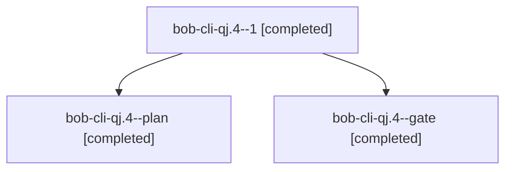

# Session: bob-cli-qj.4

[Agent Hoods](../README.md) / [bbugyi200](../users/bbugyi200/README.md) / [apollo](../users/bbugyi200/machines/apollo/README.md) / [bob-cli-qj](../users/bbugyi200/machines/apollo/hoods/bob-cli-qj/README.md) / bob-cli-qj.4

Owner: `bbugyi200.apollo` · Hood: `bob-cli-qj` · Members: 3 · Bead: [bob-cli-qj.4](https://github.com/bobs-org/bob-cli--beads/blob/main/pages/bob-cli-qj/bob-cli-qj.4.md)

## Lineage



The diagram is an optional enhancement; the ordered table below contains the same lineage in accessible text.

| Role | Agent | State | Model / provider | Timing | Commits | Prompt | Chat |
|---|---|---|---|---|---:|---|---|
| <a id="member-1"></a>1 | bob-cli-qj.4--1 | completed | opus / claude | 2026-11-27T11:38:34.305605+00:00 → 2026-11-27T11:45:08.848044+00:00 | 0 | [Prompt](../agents/bbugyi200.apollo.bob-cli-qj.4--1/prompt.md) | [Chat](../agents/bbugyi200.apollo.bob-cli-qj.4--1/chat.md) |
| <a id="member-plan"></a>plan | bob-cli-qj.4--plan | completed | opus / claude | 2026-11-27T10:42:19.786433+00:00 → 2026-11-27T11:36:27.878688+00:00 | [1](../agents/bbugyi200.apollo.bob-cli-qj.4--plan/README.md#commits) | [Prompt](../agents/bbugyi200.apollo.bob-cli-qj.4--plan/prompt.md) | [Chat](../agents/bbugyi200.apollo.bob-cli-qj.4--plan/chat.md) |
| <a id="member-gate"></a>gate | bob-cli-qj.4--gate | completed | opus / claude | 2026-11-27T11:36:49.549272+00:00 → 2026-11-27T11:37:48.118702+00:00 | 0 | — | [Chat](../agents/bbugyi200.apollo.bob-cli-qj.4--gate/chat.md) |

## Commits

| Role | Repo | Commit | Subject | Committed |
|---|---|---|---|---|
| plan | bob-cli | [`16a2497`](https://github.com/bobs-org/bob-cli/commit/16a2497d0a73f8497220a656116eaf311c08d246) | docs(decisions): cite the prose-cli commit in prose-notes-are-owned-prose | 2026-11-27 06:34:53 EST |

## Variables

| Role | Variable | Value |
|---|---|---|
| 1 | `artifacts` | \[{bead: bob-cli-qj.4, kind: markdown, label: bob-cli-qj.4 host-currency gate: all hosts current, path: /home/bryan/.sase/artifacts/agents/gh\_bobs-org\_\_bob-cli/20261127063747/qj4\_host\_currency\_pass-07… |

#### artifacts

**Role:** `1`

```yaml
- bead: bob-cli-qj.4
  kind: markdown
  label: bob-cli-qj.4 host-currency gate: all hosts current
  path: /home/bryan/.sase/artifacts/agents/gh_bobs-org__bob-cli/20261127063747/qj4_host_currency_pass-0789033c67d9.md
  ref: file:explicit:c7e796fd6902bbaed0bde124
  source_path: /tmp/qj4-artifact/qj4_host_currency_pass.md
```

Values are truncated for display; see each member's agent meta.json for the full values.

## Neighbors

| Agent | Relation | State |
|---|---|---|
| [bob-cli-qj.1](../agents/bbugyi200.apollo.bob-cli-qj.1/README.md) | bob-cli-qj hood | completed |
| [bob-cli-qj.2](../agents/bbugyi200.apollo.bob-cli-qj.2/README.md) | bob-cli-qj hood | completed |
| [bob-cli-qj.3](../agents/bbugyi200.apollo.bob-cli-qj.3/README.md) | bob-cli-qj hood | completed |
| [bob-cli-qj.5](bbugyi200.apollo.bob-cli-qj.5.md) (session · 3) | bob-cli-qj hood | active 1, completed 2 |
| [bob-cli-qj.5.1.1](../agents/bbugyi200.apollo.bob-cli-qj.5.1.1/README.md) | bob-cli-qj hood | completed |
| [bob-cli-qj.5.1.2](bbugyi200.apollo.bob-cli-qj.5.1.2.md) (session · 3) | bob-cli-qj hood | completed 3 |
| [bob-cli-qj.5.1.3](../agents/bbugyi200.apollo.bob-cli-qj.5.1.3/README.md) | bob-cli-qj hood | completed |
| [bob-cli-qj.5.1.4](../agents/bbugyi200.apollo.bob-cli-qj.5.1.4/README.md) | bob-cli-qj hood | completed |
| [bob-cli-qj.5.1.5](bbugyi200.apollo.bob-cli-qj.5.1.5.md) (session · 3) | bob-cli-qj hood | completed 2, failed 1 |
| [bob-cli-qj.5.1.6](../agents/bbugyi200.apollo.bob-cli-qj.5.1.6/README.md) | bob-cli-qj hood | waiting |
| [bob-cli-qj.5.1.7](../agents/bbugyi200.apollo.bob-cli-qj.5.1.7/README.md) | bob-cli-qj hood | waiting |
| [bob-cli-qj.5.1.8](../agents/bbugyi200.apollo.bob-cli-qj.5.1.8/README.md) | bob-cli-qj hood | waiting |
| [bob-cli-qj.5.1.land](../agents/bbugyi200.apollo.bob-cli-qj.5.1.land/README.md) | bob-cli-qj hood | waiting |
| [bob-cli-qj.land](bbugyi200.apollo.bob-cli-qj.land.md) (session · 2) | bob-cli-qj hood | active 1, completed 1 |
