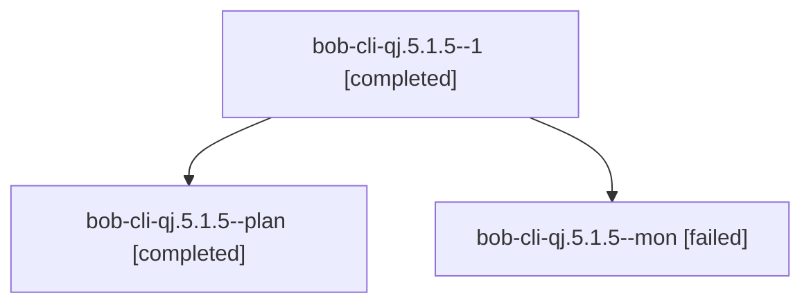

# Session: bob-cli-qj.5.1.5

[Agent Hoods](../README.md) / [bbugyi200](../users/bbugyi200/README.md) / [apollo](../users/bbugyi200/machines/apollo/README.md) / [bob-cli-qj](../users/bbugyi200/machines/apollo/hoods/bob-cli-qj/README.md) / bob-cli-qj.5.1.5

Owner: `bbugyi200.apollo` · Hood: `bob-cli-qj` · Members: 3 · Bead: [bob-cli-qj.5.1.5](https://github.com/bobs-org/bob-cli--beads/blob/main/pages/bob-cli-qj/bob-cli-qj.5.1.5.md)

## Lineage

The diagram is an optional enhancement; the ordered table below contains the same lineage in accessible text.

| Role | Agent | State | Model / provider | Timing | Commits | Prompt | Chat |
|---|---|---|---|---|---:|---|---|
| 1 | bob-cli-qj.5.1.5--1 | completed | gpt-6-luna / codex | 2026-11-27T17:20:05.370700+00:00 → 2026-11-27T17:58:47.355848+00:00 | [1](../agents/bbugyi200.apollo.bob-cli-qj.5.1.5--1/README.md#commits) | [Prompt](../agents/bbugyi200.apollo.bob-cli-qj.5.1.5--1/prompt.md) | [Chat](../agents/bbugyi200.apollo.bob-cli-qj.5.1.5--1/chat.md) |
| plan | bob-cli-qj.5.1.5--plan | completed | gpt-6-luna / codex | 2026-11-27T16:20:10.083401+00:00 → 2026-11-27T17:13:50.544817+00:00 | 0 | [Prompt](../agents/bbugyi200.apollo.bob-cli-qj.5.1.5--plan/prompt.md) | [Chat](../agents/bbugyi200.apollo.bob-cli-qj.5.1.5--plan/chat.md) |
| mon | bob-cli-qj.5.1.5--mon | failed | gpt-6-luna / codex | 2026-11-27T17:12:17.273285+00:00 → 2026-11-27T17:20:05.533527+00:00 | 0 | — | [Chat](../agents/bbugyi200.apollo.bob-cli-qj.5.1.5--mon/chat.md) |

## Commits

| Role | Repo | Commit | Subject | Committed |
|---|---|---|---|---|
| 1 | bob-cli | [`eff5d98`](https://github.com/bobs-org/bob-cli/commit/eff5d986678801e3466622aafa64e70c950f07a2) | feat(prose): inline prose notes and guarantee round trips | 2026-11-27 12:57:43 EST |

## Neighbors

| Agent | Relation | State |
|---|---|---|
| [bob-cli-qj.5](bbugyi200.apollo.bob-cli-qj.5.md) (session · 3) | ancestor | active 1, completed 2 |
| [bob-cli-qj.5.1.1](../agents/bbugyi200.apollo.bob-cli-qj.5.1.1/README.md) | bob-cli-qj.5.1 hood | completed |
| [bob-cli-qj.5.1.2](bbugyi200.apollo.bob-cli-qj.5.1.2.md) (session · 3) | bob-cli-qj.5.1 hood | completed 3 |
| [bob-cli-qj.5.1.3](../agents/bbugyi200.apollo.bob-cli-qj.5.1.3/README.md) | bob-cli-qj.5.1 hood | completed |
| [bob-cli-qj.5.1.4](../agents/bbugyi200.apollo.bob-cli-qj.5.1.4/README.md) | bob-cli-qj.5.1 hood | completed |
| [bob-cli-qj.5.1.6](../agents/bbugyi200.apollo.bob-cli-qj.5.1.6/README.md) | bob-cli-qj.5.1 hood | completed |
| [bob-cli-qj.5.1.7](bbugyi200.apollo.bob-cli-qj.5.1.7.md) (session · 5) | bob-cli-qj.5.1 hood | completed 3, failed 2 |
| [bob-cli-qj.5.1.8](../agents/bbugyi200.apollo.bob-cli-qj.5.1.8/README.md) | bob-cli-qj.5.1 hood | completed |
| [bob-cli-qj.5.1.land](bbugyi200.apollo.bob-cli-qj.5.1.land.md) (session · 3) | bob-cli-qj.5.1 hood | active 2, completed 1 |
| [bob-cli-qj.1](../agents/bbugyi200.apollo.bob-cli-qj.1/README.md) | bob-cli-qj hood | completed |
| [bob-cli-qj.2](../agents/bbugyi200.apollo.bob-cli-qj.2/README.md) | bob-cli-qj hood | completed |
| [bob-cli-qj.3](../agents/bbugyi200.apollo.bob-cli-qj.3/README.md) | bob-cli-qj hood | completed |
| [bob-cli-qj.4](bbugyi200.apollo.bob-cli-qj.4.md) (session · 3) | bob-cli-qj hood | completed 3 |
| [bob-cli-qj.4](../agents/bbugyi200.apollo.bob-cli-qj.4/README.md) | bob-cli-qj hood | completed |
| [bob-cli-qj.land](bbugyi200.apollo.bob-cli-qj.land.md) (session · 2) | bob-cli-qj hood | active 1, completed 1 |
