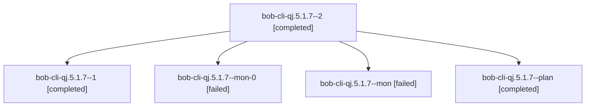

# Session: bob-cli-qj.5.1.7

[Agent Hoods](../README.md) / [bbugyi200](../users/bbugyi200/README.md) / [apollo](../users/bbugyi200/machines/apollo/README.md) / [bob-cli-qj](../users/bbugyi200/machines/apollo/hoods/bob-cli-qj/README.md) / bob-cli-qj.5.1.7

Owner: `bbugyi200.apollo` · Hood: `bob-cli-qj` · Members: 5 · Bead: [bob-cli-qj.5.1.7](https://github.com/bobs-org/bob-cli--beads/blob/main/pages/bob-cli-qj/bob-cli-qj.5.1.7.md)

## Lineage



The diagram is an optional enhancement; the ordered table below contains the same lineage in accessible text.

| Role | Agent | State | Model / provider | Timing | Commits | Prompt | Chat |
|---|---|---|---|---|---:|---|---|
| <a id="member-2"></a>2 | bob-cli-qj.5.1.7--2 | completed | gpt-6-luna / codex | 2026-11-27T19:39:19.996074+00:00 → 2026-11-27T19:48:04.906679+00:00 | 0 | [Prompt](../agents/bbugyi200.apollo.bob-cli-qj.5.1.7--2/prompt.md) | [Chat](../agents/bbugyi200.apollo.bob-cli-qj.5.1.7--2/chat.md) |
| <a id="member-1"></a>1 | bob-cli-qj.5.1.7--1 | completed | gpt-6-luna / codex | 2026-11-27T19:25:04.525238+00:00 → 2026-11-27T19:33:34.128613+00:00 | 0 | [Prompt](../agents/bbugyi200.apollo.bob-cli-qj.5.1.7--1/prompt.md) | [Chat](../agents/bbugyi200.apollo.bob-cli-qj.5.1.7--1/chat.md) |
| <a id="member-mon-0"></a>mon-0 | bob-cli-qj.5.1.7--mon-0 | failed | gpt-6-luna / codex | 2026-11-27T19:30:42.469340+00:00 → 2026-11-27T19:39:20.431379+00:00 | 0 | — | [Chat](../agents/bbugyi200.apollo.bob-cli-qj.5.1.7--mon-0/chat.md) |
| <a id="member-mon"></a>mon | bob-cli-qj.5.1.7--mon | failed | gpt-6-luna / codex | 2026-11-27T19:10:07.357779+00:00 → 2026-11-27T19:17:56.537494+00:00 | 0 | — | [Chat](../agents/bbugyi200.apollo.bob-cli-qj.5.1.7--mon/chat.md) |
| <a id="member-plan"></a>plan | bob-cli-qj.5.1.7--plan | completed | gpt-6-luna / codex | 2026-11-27T18:46:14.736169+00:00 → 2026-11-27T19:13:32.809152+00:00 | 0 | [Prompt](../agents/bbugyi200.apollo.bob-cli-qj.5.1.7--plan/prompt.md) | [Chat](../agents/bbugyi200.apollo.bob-cli-qj.5.1.7--plan/chat.md) |

## Variables

| Role | Variable | Value |
|---|---|---|
| 2 | `artifacts` | \[{kind: markdown, label: Bob prose extract preview host currency probe, path: /home/bryan/.sase/artifacts/agents/gh\_bobs-org\_\_bob-cli/20261127143827/prose-extract-preview-host-currency-bc4491f69ccc.m… |

#### artifacts

**Role:** `2`

```yaml
- kind: markdown
  label: Bob prose extract preview host currency probe
  path: /home/bryan/.sase/artifacts/agents/gh_bobs-org__bob-cli/20261127143827/prose-extract-preview-host-currency-bc4491f69ccc.md
  ref: file:explicit:89b09f66b65a5fb2c728053f
```

Values are truncated for display; see each member's agent meta.json for the full values.

## Neighbors

| Agent | Relation | State |
|---|---|---|
| [bob-cli-qj.5](bbugyi200.apollo.bob-cli-qj.5.md) (session · 3) | ancestor | active 1, completed 2 |
| [bob-cli-qj.5.1.1](../agents/bbugyi200.apollo.bob-cli-qj.5.1.1/README.md) | bob-cli-qj.5.1 hood | completed |
| [bob-cli-qj.5.1.2](bbugyi200.apollo.bob-cli-qj.5.1.2.md) (session · 3) | bob-cli-qj.5.1 hood | completed 3 |
| [bob-cli-qj.5.1.3](../agents/bbugyi200.apollo.bob-cli-qj.5.1.3/README.md) | bob-cli-qj.5.1 hood | completed |
| [bob-cli-qj.5.1.4](../agents/bbugyi200.apollo.bob-cli-qj.5.1.4/README.md) | bob-cli-qj.5.1 hood | completed |
| [bob-cli-qj.5.1.5](bbugyi200.apollo.bob-cli-qj.5.1.5.md) (session · 3) | bob-cli-qj.5.1 hood | completed 2, failed 1 |
| [bob-cli-qj.5.1.6](../agents/bbugyi200.apollo.bob-cli-qj.5.1.6/README.md) | bob-cli-qj.5.1 hood | completed |
| [bob-cli-qj.5.1.8](../agents/bbugyi200.apollo.bob-cli-qj.5.1.8/README.md) | bob-cli-qj.5.1 hood | completed |
| [bob-cli-qj.5.1.land](bbugyi200.apollo.bob-cli-qj.5.1.land.md) (session · 6) | bob-cli-qj.5.1 hood | active 1, completed 4, failed 1 |
| [bob-cli-qj.1](../agents/bbugyi200.apollo.bob-cli-qj.1/README.md) | bob-cli-qj hood | completed |
| [bob-cli-qj.2](../agents/bbugyi200.apollo.bob-cli-qj.2/README.md) | bob-cli-qj hood | completed |
| [bob-cli-qj.3](../agents/bbugyi200.apollo.bob-cli-qj.3/README.md) | bob-cli-qj hood | completed |
| [bob-cli-qj.4](bbugyi200.apollo.bob-cli-qj.4.md) (session · 3) | bob-cli-qj hood | completed 3 |
| [bob-cli-qj.4](../agents/bbugyi200.apollo.bob-cli-qj.4/README.md) | bob-cli-qj hood | completed |
| [bob-cli-qj.land](bbugyi200.apollo.bob-cli-qj.land.md) (session · 2) | bob-cli-qj hood | active 1, completed 1 |
