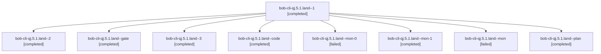

# Session: bob-cli-qj.5.1.land

[Agent Hoods](../README.md) / [bbugyi200](../users/bbugyi200/README.md) / [apollo](../users/bbugyi200/machines/apollo/README.md) / [bob-cli-qj](../users/bbugyi200/machines/apollo/hoods/bob-cli-qj/README.md) / bob-cli-qj.5.1.land

Owner: `bbugyi200.apollo` · Hood: `bob-cli-qj` · Members: 9 · Bead: [bob-cli-qj.5.1](https://github.com/bobs-org/bob-cli--beads/blob/main/pages/bob-cli-qj/bob-cli-qj.5.1.md)

## Lineage

The diagram is an optional enhancement; the ordered table below contains the same lineage in accessible text.

| Role | Agent | State | Model / provider | Timing | Commits | Prompt | Chat |
|---|---|---|---|---|---:|---|---|
| 1 | bob-cli-qj.5.1.land--1 | completed | gpt-6-luna / codex | 2026-11-27T21:38:07.908418+00:00 → 2026-11-27T21:46:48.205584+00:00 | [1](../agents/bbugyi200.apollo.bob-cli-qj.5.1.land--1/README.md#commits) | [Prompt](../agents/bbugyi200.apollo.bob-cli-qj.5.1.land--1/prompt.md) | [Chat](../agents/bbugyi200.apollo.bob-cli-qj.5.1.land--1/chat.md) |
| 2 | bob-cli-qj.5.1.land--2 | completed | gpt-6-luna / codex | 2026-11-27T22:05:48.702910+00:00 → 2026-11-27T22:50:44.859295+00:00 | [1](../agents/bbugyi200.apollo.bob-cli-qj.5.1.land--2/README.md#commits) | [Prompt](../agents/bbugyi200.apollo.bob-cli-qj.5.1.land--2/prompt.md) | [Chat](../agents/bbugyi200.apollo.bob-cli-qj.5.1.land--2/chat.md) |
| gate | bob-cli-qj.5.1.land--gate | completed | opus / claude | 2026-11-27T20:49:29.816348+00:00 → 2026-11-27T20:49:40.334915+00:00 | 0 | — | [Chat](../agents/bbugyi200.apollo.bob-cli-qj.5.1.land--gate/chat.md) |
| 3 | bob-cli-qj.5.1.land--3 | completed | gpt-6-luna / codex | 2026-11-27T23:08:12.385133+00:00 → 2026-11-27T23:30:23.451031+00:00 | 0 | [Prompt](../agents/bbugyi200.apollo.bob-cli-qj.5.1.land--3/prompt.md) | [Chat](../agents/bbugyi200.apollo.bob-cli-qj.5.1.land--3/chat.md) |
| code | bob-cli-qj.5.1.land--code | completed | gpt-6-luna / codex | 2026-11-27T20:50:39.930202+00:00 → 2026-11-27T21:30:40.442078+00:00 | [1](../agents/bbugyi200.apollo.bob-cli-qj.5.1.land--code/README.md#commits) | — | [Chat](../agents/bbugyi200.apollo.bob-cli-qj.5.1.land--code/chat.md) |
| mon-0 | bob-cli-qj.5.1.land--mon-0 | failed | gpt-6-luna / codex | 2026-11-27T21:44:39.537178+00:00 → 2026-11-27T22:05:48.886537+00:00 | 0 | — | [Chat](../agents/bbugyi200.apollo.bob-cli-qj.5.1.land--mon-0/chat.md) |
| mon-1 | bob-cli-qj.5.1.land--mon-1 | completed | gpt-6-luna / codex | 2026-11-27T22:27:52.039776+00:00 → 2026-11-27T23:07:52.768856+00:00 | 0 | — | [Chat](../agents/bbugyi200.apollo.bob-cli-qj.5.1.land--mon-1/chat.md) |
| mon | bob-cli-qj.5.1.land--mon | failed | gpt-6-luna / codex | 2026-11-27T21:27:57.295591+00:00 → 2026-11-27T21:38:08.048131+00:00 | 0 | — | [Chat](../agents/bbugyi200.apollo.bob-cli-qj.5.1.land--mon/chat.md) |
| plan | bob-cli-qj.5.1.land--plan | completed | opus / claude | 2026-11-27T19:48:36.428422+00:00 → 2026-11-27T21:30:40.442078+00:00 | [1](../agents/bbugyi200.apollo.bob-cli-qj.5.1.land--plan/README.md#commits) | [Prompt](../agents/bbugyi200.apollo.bob-cli-qj.5.1.land--plan/prompt.md) | [Chat](../agents/bbugyi200.apollo.bob-cli-qj.5.1.land--plan/chat.md) |

## Commits

| Role | Repo | Commit | Subject | Committed |
|---|---|---|---|---|
| plan | bob-cli | [`46885db`](https://github.com/bobs-org/bob-cli/commit/46885dbf65778dd67a4b4de84c1c7c8647e84374) | fix(prose): green the canonical gate for extract and inline | 2026-11-27 15:48:12 EST |
| code | bob-cli | [`3deb0bd`](https://github.com/bobs-org/bob-cli/commit/3deb0bd3adab6014338682e56675733325ba1c24) | fix(prose): keep link form and shortest fragments across extract and inline | 2026-11-27 16:29:14 EST |
| 1 | bob-cli | [`5b2c530`](https://github.com/bobs-org/bob-cli/commit/5b2c53068ad86a0d585593f9779044281242f387) | fix(prose): keep link form and shortest fragments across extract and inline | 2026-11-27 16:45:36 EST |
| 2 | bob-cli | [`7d48b7b`](https://github.com/bobs-org/bob-cli/commit/7d48b7b2490b1cfd4aeb2ba826c66c037c9db4f0) | fix(prose): keep link form and shortest fragments across extract and inline | 2026-11-27 17:48:38 EST |

## Neighbors

| Agent | Relation | State |
|---|---|---|
| [bob-cli-qj.5](bbugyi200.apollo.bob-cli-qj.5.md) (session · 3) | ancestor | active 1, completed 2 |
| [bob-cli-qj.5.1.1](../agents/bbugyi200.apollo.bob-cli-qj.5.1.1/README.md) | bob-cli-qj.5.1 hood | completed |
| [bob-cli-qj.5.1.2](bbugyi200.apollo.bob-cli-qj.5.1.2.md) (session · 3) | bob-cli-qj.5.1 hood | completed 3 |
| [bob-cli-qj.5.1.3](../agents/bbugyi200.apollo.bob-cli-qj.5.1.3/README.md) | bob-cli-qj.5.1 hood | completed |
| [bob-cli-qj.5.1.4](../agents/bbugyi200.apollo.bob-cli-qj.5.1.4/README.md) | bob-cli-qj.5.1 hood | completed |
| [bob-cli-qj.5.1.5](bbugyi200.apollo.bob-cli-qj.5.1.5.md) (session · 3) | bob-cli-qj.5.1 hood | completed 2, failed 1 |
| [bob-cli-qj.5.1.6](../agents/bbugyi200.apollo.bob-cli-qj.5.1.6/README.md) | bob-cli-qj.5.1 hood | completed |
| [bob-cli-qj.5.1.7](bbugyi200.apollo.bob-cli-qj.5.1.7.md) (session · 5) | bob-cli-qj.5.1 hood | completed 3, failed 2 |
| [bob-cli-qj.5.1.8](../agents/bbugyi200.apollo.bob-cli-qj.5.1.8/README.md) | bob-cli-qj.5.1 hood | completed |
| [bob-cli-qj.1](../agents/bbugyi200.apollo.bob-cli-qj.1/README.md) | bob-cli-qj hood | completed |
| [bob-cli-qj.2](../agents/bbugyi200.apollo.bob-cli-qj.2/README.md) | bob-cli-qj hood | completed |
| [bob-cli-qj.3](../agents/bbugyi200.apollo.bob-cli-qj.3/README.md) | bob-cli-qj hood | completed |
| [bob-cli-qj.4](bbugyi200.apollo.bob-cli-qj.4.md) (session · 3) | bob-cli-qj hood | completed 3 |
| [bob-cli-qj.4](../agents/bbugyi200.apollo.bob-cli-qj.4/README.md) | bob-cli-qj hood | completed |
| [bob-cli-qj.land](bbugyi200.apollo.bob-cli-qj.land.md) (session · 2) | bob-cli-qj hood | active 1, completed 1 |
