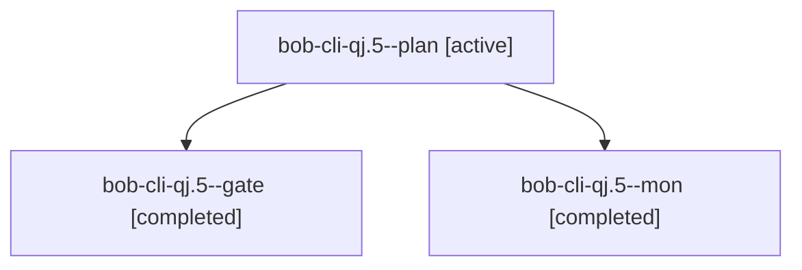

# Session: bob-cli-qj.5

[Agent Hoods](../README.md) / [bbugyi200](../users/bbugyi200/README.md) / [apollo](../users/bbugyi200/machines/apollo/README.md) / [bob-cli-qj](../users/bbugyi200/machines/apollo/hoods/bob-cli-qj/README.md) / bob-cli-qj.5

Owner: `bbugyi200.apollo` · Hood: `bob-cli-qj` · Members: 3 · Bead: [bob-cli-qj.5](https://github.com/bobs-org/bob-cli--beads/blob/main/pages/bob-cli-qj/bob-cli-qj.5.md)

## Lineage

The diagram is an optional enhancement; the ordered table below contains the same lineage in accessible text.

| Role | Agent | State | Model / provider | Timing | Commits | Prompt | Chat |
|---|---|---|---|---|---:|---|---|
| plan | bob-cli-qj.5--plan | active | opus / claude | 2026-11-27T11:45:25.760823+00:00 → 2026-11-27T12:18:29.303153+00:00 | 0 | [Prompt](../agents/bbugyi200.apollo.bob-cli-qj.5--plan/prompt.md) | [Chat](../agents/bbugyi200.apollo.bob-cli-qj.5--plan/chat.md) |
| gate | bob-cli-qj.5--gate | completed | opus / claude | 2026-11-27T12:17:58.793695+00:00 → 2026-11-27T12:18:17.976665+00:00 | 0 | — | [Chat](../agents/bbugyi200.apollo.bob-cli-qj.5--gate/chat.md) |
| mon | bob-cli-qj.5--mon | completed | opus / claude | 2026-11-27T12:18:16.355151+00:00 → 2026-11-27T12:23:55.250426+00:00 | 0 | — | [Chat](../agents/bbugyi200.apollo.bob-cli-qj.5--mon/chat.md) |

## Neighbors

| Agent | Relation | State |
|---|---|---|
| [bob-cli-qj.5.1.1](../agents/bbugyi200.apollo.bob-cli-qj.5.1.1/README.md) | descendant | active |
| [bob-cli-qj.5.1.2](bbugyi200.apollo.bob-cli-qj.5.1.2.md) (session · 2) | descendant | active 1, completed 1 |
| [bob-cli-qj.5.1.3](../agents/bbugyi200.apollo.bob-cli-qj.5.1.3/README.md) | descendant | waiting |
| [bob-cli-qj.5.1.4](../agents/bbugyi200.apollo.bob-cli-qj.5.1.4/README.md) | descendant | waiting |
| [bob-cli-qj.5.1.5](../agents/bbugyi200.apollo.bob-cli-qj.5.1.5/README.md) | descendant | waiting |
| [bob-cli-qj.5.1.6](../agents/bbugyi200.apollo.bob-cli-qj.5.1.6/README.md) | descendant | waiting |
| [bob-cli-qj.5.1.7](../agents/bbugyi200.apollo.bob-cli-qj.5.1.7/README.md) | descendant | waiting |
| [bob-cli-qj.5.1.8](../agents/bbugyi200.apollo.bob-cli-qj.5.1.8/README.md) | descendant | waiting |
| [bob-cli-qj.5.1.land](../agents/bbugyi200.apollo.bob-cli-qj.5.1.land/README.md) | descendant | waiting |
| [bob-cli-qj.1](../agents/bbugyi200.apollo.bob-cli-qj.1/README.md) | bob-cli-qj hood | completed |
| [bob-cli-qj.2](../agents/bbugyi200.apollo.bob-cli-qj.2/README.md) | bob-cli-qj hood | completed |
| [bob-cli-qj.3](../agents/bbugyi200.apollo.bob-cli-qj.3/README.md) | bob-cli-qj hood | completed |
| [bob-cli-qj.4](bbugyi200.apollo.bob-cli-qj.4.md) (session · 3) | bob-cli-qj hood | completed 3 |
| [bob-cli-qj.4](../agents/bbugyi200.apollo.bob-cli-qj.4/README.md) | bob-cli-qj hood | waiting |
| [bob-cli-qj.land](../agents/bbugyi200.apollo.bob-cli-qj.land/README.md) | bob-cli-qj hood | waiting |
