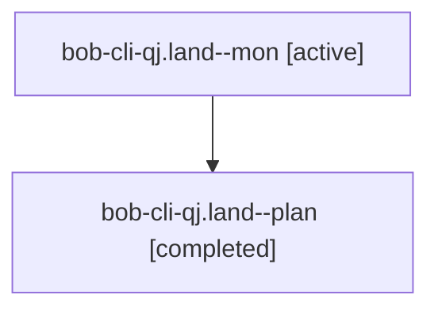

# Session: bob-cli-qj.land

[Agent Hoods](../README.md) / [bbugyi200](../users/bbugyi200/README.md) / [apollo](../users/bbugyi200/machines/apollo/README.md) / [bob-cli-qj](../users/bbugyi200/machines/apollo/hoods/bob-cli-qj/README.md) / bob-cli-qj.land

Owner: `bbugyi200.apollo` · Hood: `bob-cli-qj` · Members: 2 · Bead: [bob-cli-qj](https://github.com/bobs-org/bob-cli--beads/blob/main/pages/bob-cli-qj/README.md)

## Lineage

The diagram is an optional enhancement; the ordered table below contains the same lineage in accessible text.

| Role | Agent | State | Model / provider | Timing | Commits | Prompt | Chat |
|---|---|---|---|---|---:|---|---|
| mon | bob-cli-qj.land--mon | active | opus / claude | 2026-11-27T13:10:03.046020+00:00 | 0 | — | — |
| plan | bob-cli-qj.land--plan | completed | opus / claude | 2026-11-27T12:24:12.878752+00:00 → 2026-11-27T13:12:39.695905+00:00 | 0 | [Prompt](../agents/bbugyi200.apollo.bob-cli-qj.land--plan/prompt.md) | [Chat](../agents/bbugyi200.apollo.bob-cli-qj.land--plan/chat.md) |

## Neighbors

| Agent | Relation | State |
|---|---|---|
| [bob-cli-qj.1](../agents/bbugyi200.apollo.bob-cli-qj.1/README.md) | bob-cli-qj hood | completed |
| [bob-cli-qj.2](../agents/bbugyi200.apollo.bob-cli-qj.2/README.md) | bob-cli-qj hood | completed |
| [bob-cli-qj.3](../agents/bbugyi200.apollo.bob-cli-qj.3/README.md) | bob-cli-qj hood | completed |
| [bob-cli-qj.4](bbugyi200.apollo.bob-cli-qj.4.md) (session · 3) | bob-cli-qj hood | completed 3 |
| [bob-cli-qj.4](../agents/bbugyi200.apollo.bob-cli-qj.4/README.md) | bob-cli-qj hood | completed |
| [bob-cli-qj.5](bbugyi200.apollo.bob-cli-qj.5.md) (session · 3) | bob-cli-qj hood | active 1, completed 2 |
| [bob-cli-qj.5.1.1](../agents/bbugyi200.apollo.bob-cli-qj.5.1.1/README.md) | bob-cli-qj hood | completed |
| [bob-cli-qj.5.1.2](bbugyi200.apollo.bob-cli-qj.5.1.2.md) (session · 3) | bob-cli-qj hood | completed 3 |
| [bob-cli-qj.5.1.3](../agents/bbugyi200.apollo.bob-cli-qj.5.1.3/README.md) | bob-cli-qj hood | completed |
| [bob-cli-qj.5.1.4](../agents/bbugyi200.apollo.bob-cli-qj.5.1.4/README.md) | bob-cli-qj hood | completed |
| [bob-cli-qj.5.1.5](bbugyi200.apollo.bob-cli-qj.5.1.5.md) (session · 3) | bob-cli-qj hood | completed 2, failed 1 |
| [bob-cli-qj.5.1.6](../agents/bbugyi200.apollo.bob-cli-qj.5.1.6/README.md) | bob-cli-qj hood | completed |
| [bob-cli-qj.5.1.7](../agents/bbugyi200.apollo.bob-cli-qj.5.1.7/README.md) | bob-cli-qj hood | waiting |
| [bob-cli-qj.5.1.8](../agents/bbugyi200.apollo.bob-cli-qj.5.1.8/README.md) | bob-cli-qj hood | completed |
| [bob-cli-qj.5.1.land](../agents/bbugyi200.apollo.bob-cli-qj.5.1.land/README.md) | bob-cli-qj hood | waiting |
