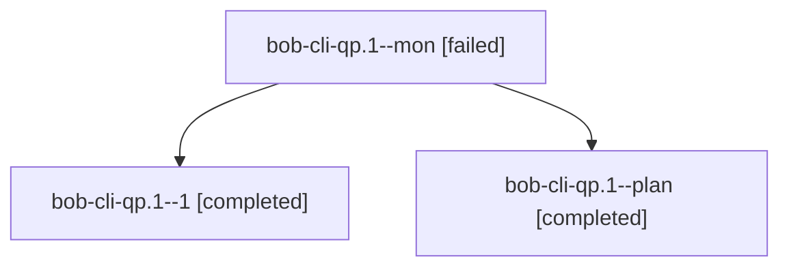

# Session: bob-cli-qp.1

[Agent Hoods](../README.md) / [bbugyi200](../users/bbugyi200/README.md) / [apollo](../users/bbugyi200/machines/apollo/README.md) / [bob-cli-qp](../users/bbugyi200/machines/apollo/hoods/bob-cli-qp/README.md) / bob-cli-qp.1

Owner: `bbugyi200.apollo` · Hood: `bob-cli-qp` · Members: 3 · Bead: [bob-cli-qp.1](https://github.com/bobs-org/bob-cli--beads/blob/main/pages/bob-cli-qp/bob-cli-qp.1.md)

## Lineage

The diagram is an optional enhancement; the ordered table below contains the same lineage in accessible text.

| Role | Agent | State | Model / provider | Timing | Commits | Prompt | Chat |
|---|---|---|---|---|---:|---|---|
| mon | bob-cli-qp.1--mon | failed | gpt-6-luna / codex | 2026-11-26T20:50:08.125246+00:00 → 2026-11-26T21:06:41.403849+00:00 | 0 | — | [Chat](../agents/bbugyi200.apollo.bob-cli-qp.1--mon/chat.md) |
| 1 | bob-cli-qp.1--1 | completed | gpt-6-luna / codex | 2026-11-26T21:06:40.916938+00:00 → 2026-11-26T21:12:34.544633+00:00 | [1](../agents/bbugyi200.apollo.bob-cli-qp.1--1/README.md#commits) | [Prompt](../agents/bbugyi200.apollo.bob-cli-qp.1--1/prompt.md) | [Chat](../agents/bbugyi200.apollo.bob-cli-qp.1--1/chat.md) |
| plan | bob-cli-qp.1--plan | completed | gpt-6-luna / codex | 2026-11-26T19:26:15.436428+00:00 → 2026-11-26T20:51:44.241828+00:00 | 0 | [Prompt](../agents/bbugyi200.apollo.bob-cli-qp.1--plan/prompt.md) | [Chat](../agents/bbugyi200.apollo.bob-cli-qp.1--plan/chat.md) |

## Commits

| Role | Repo | Commit | Subject | Committed |
|---|---|---|---|---|
| 1 | bob-cli | [`0846b03`](https://github.com/bobs-org/bob-cli/commit/0846b0381e05d8abbb5a42669cbe5ca73be12056) | feat(props): add Reference contract and roles | 2026-11-26 16:10:25 EST |

## Neighbors

| Agent | Relation | State |
|---|---|---|
| [bob-cli-qp.2](../agents/bbugyi200.apollo.bob-cli-qp.2/README.md) | bob-cli-qp hood | completed |
| [bob-cli-qp.3](../agents/bbugyi200.apollo.bob-cli-qp.3/README.md) | bob-cli-qp hood | completed |
| [bob-cli-qp.4](../agents/bbugyi200.apollo.bob-cli-qp.4/README.md) | bob-cli-qp hood | completed |
| [bob-cli-qp.5](../agents/bbugyi200.apollo.bob-cli-qp.5/README.md) | bob-cli-qp hood | completed |
| [bob-cli-qp.6](../agents/bbugyi200.apollo.bob-cli-qp.6/README.md) | bob-cli-qp hood | waiting |
| [bob-cli-qp.7](../agents/bbugyi200.apollo.bob-cli-qp.7/README.md) | bob-cli-qp hood | waiting |
| [bob-cli-qp.8](../agents/bbugyi200.apollo.bob-cli-qp.8/README.md) | bob-cli-qp hood | waiting |
| [bob-cli-qp.land](../agents/bbugyi200.apollo.bob-cli-qp.land/README.md) | bob-cli-qp hood | waiting |
