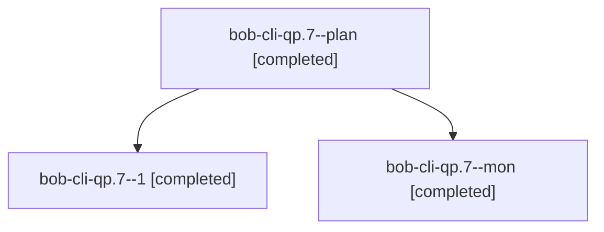

# Session: bob-cli-qp.7

[Agent Hoods](../README.md) / [bbugyi200](../users/bbugyi200/README.md) / [apollo](../users/bbugyi200/machines/apollo/README.md) / [bob-cli-qp](../users/bbugyi200/machines/apollo/hoods/bob-cli-qp/README.md) / bob-cli-qp.7

Owner: `bbugyi200.apollo` · Hood: `bob-cli-qp` · Members: 3 · Bead: [bob-cli-qp.7](https://github.com/bobs-org/bob-cli--beads/blob/main/pages/bob-cli-qp/bob-cli-qp.7.md)

## Lineage

The diagram is an optional enhancement; the ordered table below contains the same lineage in accessible text.

| Role | Agent | State | Model / provider | Timing | Commits | Prompt | Chat |
|---|---|---|---|---|---:|---|---|
| plan | bob-cli-qp.7--plan | completed | gpt-6-luna / codex | 2026-11-26T21:58:23.116342+00:00 → 2026-11-26T23:33:35.570363+00:00 | 0 | [Prompt](../agents/bbugyi200.apollo.bob-cli-qp.7--plan/prompt.md) | [Chat](../agents/bbugyi200.apollo.bob-cli-qp.7--plan/chat.md) |
| 1 | bob-cli-qp.7--1 | completed | gpt-6-luna / codex | 2026-11-26T23:44:25.944050+00:00 → 2026-11-27T00:39:23.085001+00:00 | 0 | [Prompt](../agents/bbugyi200.apollo.bob-cli-qp.7--1/prompt.md) | [Chat](../agents/bbugyi200.apollo.bob-cli-qp.7--1/chat.md) |
| mon | bob-cli-qp.7--mon | completed | gpt-6-luna / codex | 2026-11-26T22:43:51.866221+00:00 → 2026-11-26T23:44:26.096969+00:00 | 0 | — | [Chat](../agents/bbugyi200.apollo.bob-cli-qp.7--mon/chat.md) |

## Neighbors

| Agent | Relation | State |
|---|---|---|
| [bob-cli-qp.1](bbugyi200.apollo.bob-cli-qp.1.md) (session · 3) | bob-cli-qp hood | completed 2, failed 1 |
| [bob-cli-qp.2](../agents/bbugyi200.apollo.bob-cli-qp.2/README.md) | bob-cli-qp hood | completed |
| [bob-cli-qp.3](../agents/bbugyi200.apollo.bob-cli-qp.3/README.md) | bob-cli-qp hood | completed |
| [bob-cli-qp.4](../agents/bbugyi200.apollo.bob-cli-qp.4/README.md) | bob-cli-qp hood | completed |
| [bob-cli-qp.5](../agents/bbugyi200.apollo.bob-cli-qp.5/README.md) | bob-cli-qp hood | completed |
| [bob-cli-qp.6](../agents/bbugyi200.apollo.bob-cli-qp.6/README.md) | bob-cli-qp hood | completed |
| [bob-cli-qp.8](../agents/bbugyi200.apollo.bob-cli-qp.8/README.md) | bob-cli-qp hood | completed |
| [bob-cli-qp.land](../agents/bbugyi200.apollo.bob-cli-qp.land/README.md) | bob-cli-qp hood | waiting |
