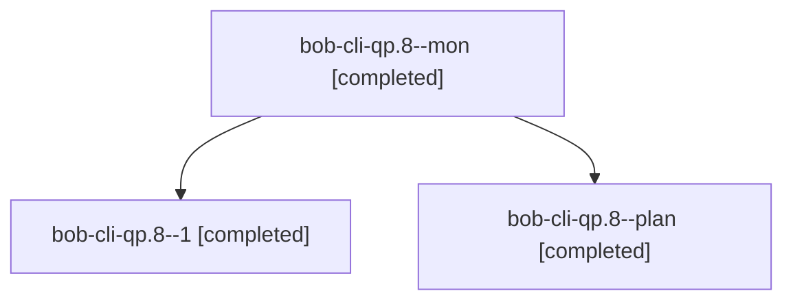

# Session: bob-cli-qp.8

[Agent Hoods](../README.md) / [bbugyi200](../users/bbugyi200/README.md) / [apollo](../users/bbugyi200/machines/apollo/README.md) / [bob-cli-qp](../users/bbugyi200/machines/apollo/hoods/bob-cli-qp/README.md) / bob-cli-qp.8

Owner: `bbugyi200.apollo` · Hood: `bob-cli-qp` · Members: 3 · Bead: [bob-cli-qp.8](https://github.com/bobs-org/bob-cli--beads/blob/main/pages/bob-cli-qp/bob-cli-qp.8.md)

## Lineage

The diagram is an optional enhancement; the ordered table below contains the same lineage in accessible text.

| Role | Agent | State | Model / provider | Timing | Commits | Prompt | Chat |
|---|---|---|---|---|---:|---|---|
| mon | bob-cli-qp.8--mon | completed | opus / claude | 2026-11-27T10:44:06.986353+00:00 → 2026-11-27T12:27:21.960276+00:00 | 0 | — | [Chat](../agents/bbugyi200.apollo.bob-cli-qp.8--mon/chat.md) |
| 1 | bob-cli-qp.8--1 | completed | opus / claude | 2026-11-27T12:27:21.667950+00:00 → 2026-11-27T13:05:15.868298+00:00 | [1](../agents/bbugyi200.apollo.bob-cli-qp.8--1/README.md#commits) | [Prompt](../agents/bbugyi200.apollo.bob-cli-qp.8--1/prompt.md) | [Chat](../agents/bbugyi200.apollo.bob-cli-qp.8--1/chat.md) |
| plan | bob-cli-qp.8--plan | completed | opus / claude | 2026-11-27T10:39:39.161984+00:00 → 2026-11-27T10:44:52.730696+00:00 | 0 | [Prompt](../agents/bbugyi200.apollo.bob-cli-qp.8--plan/prompt.md) | [Chat](../agents/bbugyi200.apollo.bob-cli-qp.8--plan/chat.md) |

## Commits

| Role | Repo | Commit | Subject | Committed |
|---|---|---|---|---|
| 1 | bob-cli | [`7666118`](https://github.com/bobs-org/bob-cli/commit/7666118c640875cdcbc380f0a9accb249e63abd8) | docs(ref): finish Ref Card go-live docs and property-card glossary | 2026-11-27 08:00:47 EST |

## Neighbors

| Agent | Relation | State |
|---|---|---|
| [bob-cli-qp.1](bbugyi200.apollo.bob-cli-qp.1.md) (session · 3) | bob-cli-qp hood | completed 2, failed 1 |
| [bob-cli-qp.2](../agents/bbugyi200.apollo.bob-cli-qp.2/README.md) | bob-cli-qp hood | completed |
| [bob-cli-qp.3](../agents/bbugyi200.apollo.bob-cli-qp.3/README.md) | bob-cli-qp hood | completed |
| [bob-cli-qp.4](../agents/bbugyi200.apollo.bob-cli-qp.4/README.md) | bob-cli-qp hood | completed |
| [bob-cli-qp.5](../agents/bbugyi200.apollo.bob-cli-qp.5/README.md) | bob-cli-qp hood | completed |
| [bob-cli-qp.6](../agents/bbugyi200.apollo.bob-cli-qp.6/README.md) | bob-cli-qp hood | completed |
| [bob-cli-qp.7](bbugyi200.apollo.bob-cli-qp.7.md) (session · 3) | bob-cli-qp hood | completed 3 |
| [bob-cli-qp.7](../agents/bbugyi200.apollo.bob-cli-qp.7/README.md) | bob-cli-qp hood | completed |
| [bob-cli-qp.land](../agents/bbugyi200.apollo.bob-cli-qp.land/README.md) | bob-cli-qp hood | completed |
