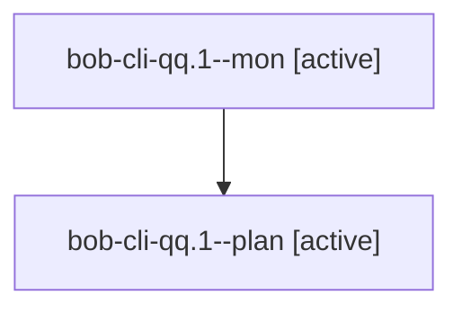

# Session: bob-cli-qq.1

[Agent Hoods](../README.md) / [bbugyi200](../users/bbugyi200/README.md) / [apollo](../users/bbugyi200/machines/apollo/README.md) / [bob-cli-qq](../users/bbugyi200/machines/apollo/hoods/bob-cli-qq/README.md) / bob-cli-qq.1

Owner: `bbugyi200.apollo` · Hood: `bob-cli-qq` · Members: 2 · Bead: [bob-cli-qq.1](https://github.com/bobs-org/bob-cli--beads/blob/main/pages/bob-cli-qq/bob-cli-qq.1.md)

## Lineage

The diagram is an optional enhancement; the ordered table below contains the same lineage in accessible text.

| Role | Agent | State | Model / provider | Timing | Commits | Prompt | Chat |
|---|---|---|---|---|---:|---|---|
| mon | bob-cli-qq.1--mon | active | gpt-6-luna / codex | 2026-11-26T21:39:52.713851+00:00 | 0 | — | — |
| plan | bob-cli-qq.1--plan | active | gpt-6-luna / codex | 2026-11-26T21:12:09.119576+00:00 | 0 | [Prompt](../agents/bbugyi200.apollo.bob-cli-qq.1--plan/prompt.md) | — |

## Neighbors

| Agent | Relation | State |
|---|---|---|
| [bob-cli-qq.2](bbugyi200.apollo.bob-cli-qq.2.md) (session · 3) | bob-cli-qq hood | completed 3 |
| [bob-cli-qq.3](../agents/bbugyi200.apollo.bob-cli-qq.3/README.md) | bob-cli-qq hood | completed |
| [bob-cli-qq.4](../agents/bbugyi200.apollo.bob-cli-qq.4/README.md) | bob-cli-qq hood | waiting |
| [bob-cli-qq.5](../agents/bbugyi200.apollo.bob-cli-qq.5/README.md) | bob-cli-qq hood | waiting |
| [bob-cli-qq.6](../agents/bbugyi200.apollo.bob-cli-qq.6/README.md) | bob-cli-qq hood | waiting |
| [bob-cli-qq.7](../agents/bbugyi200.apollo.bob-cli-qq.7/README.md) | bob-cli-qq hood | waiting |
| [bob-cli-qq.8](../agents/bbugyi200.apollo.bob-cli-qq.8/README.md) | bob-cli-qq hood | waiting |
| [bob-cli-qq.9](../agents/bbugyi200.apollo.bob-cli-qq.9/README.md) | bob-cli-qq hood | waiting |
| [bob-cli-qq.land](../agents/bbugyi200.apollo.bob-cli-qq.land/README.md) | bob-cli-qq hood | waiting |
